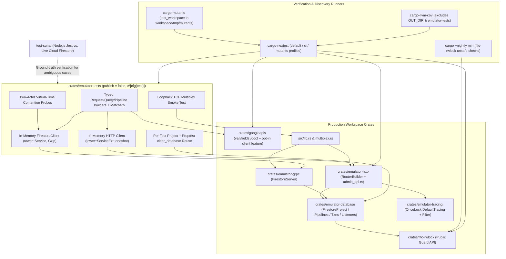

# Layered Black-Box Rust Testing Foundation

*   **Author:** Paco van der Linden
*   **Status:** Draft
*   **Date:** 2026-11-12

--------------------------------------------------------------------------------

## Overview

The Rust Firestore emulator in this repository acts as an in-memory local substitute for Google Cloud Firestore over gRPC ([`crates/emulator-grpc/`](../../crates/emulator-grpc)) and HTTP/REST ([`crates/emulator-http/`](../../crates/emulator-http)), backed by shared database state ([`crates/emulator-database/`](../../crates/emulator-database)), a custom first-in-first-out reader-writer lock ([`crates/fifo-rwlock/`](../../crates/fifo-rwlock)), dynamic log capture ([`crates/emulator-tracing/`](../../crates/emulator-tracing)), and compiled Firestore v1 Protocol Buffers ([`crates/googleapis/`](../../crates/googleapis)).

Before benchmarking the emulator and refactoring hot-path internals for throughput and memory efficiency, the project needs fast, deterministic behavioral tests in Rust. Today, most end-to-end validation runs through [`test-suite/`](../../test-suite), an external Node.js and Jest suite using `@google-cloud/firestore`, while several Rust subsystems lack direct Rust unit or integration coverage. This design introduces workspace-wide value and document macros in [`crates/googleapis/`](../../crates/googleapis), an in-memory black-box gRPC and HTTP test harness over the official Firestore wire contracts, cross-platform coverage (`cargo-llvm-cov`), property-based invariant checks (`proptest`), and file-scoped mutation testing (`cargo-mutants`), while preserving [`test-suite/`](../../test-suite) as the live Google Cloud Firestore oracle whenever expected cloud behavior is uncertain.

## The Problem

Relying on the current mix of external Node.js SDK tests and sparse internal Rust unit tests creates four obstacles ahead of performance work:

1.  **Functional Blind Spots Across Hot-Path Rust Modules:** Core subsystems lack exhaustive test cases in [`test-suite/`](../../test-suite) and Rust. In particular, [`crates/emulator-grpc/src/lib.rs`](../../crates/emulator-grpc/src/lib.rs) has zero Rust unit or integration tests (only one doctest), while the 10 implemented Enterprise Edition pipeline stages and expression evaluators under [`crates/emulator-database/src/database/pipeline/mod.rs`](../../crates/emulator-database/src/database/pipeline/mod.rs), transaction commit and concurrency validation in [`crates/emulator-database/src/database/transaction.rs`](../../crates/emulator-database/src/database/transaction.rs), and real-time `Listen` target streams in [`crates/emulator-database/src/listener.rs`](../../crates/emulator-database/src/listener.rs) have zero Rust tests today. Performance optimizations risk breaking edge-case semantics silently where neither suite exercises those code paths.
2.  **Slow, Coarse Feedback Loops in `test-suite/`:** Running [`just sdk-test`](../../justfile#L94-L96) compiles a binary, spawns a background server bound to `127.0.0.1:8080`, boots Node.js and Jest, and communicates over loopback TCP sockets without control over async task interleaving or virtual clocks. Expressing combinatorial filter matrices, unvalidated gRPC request structs, or sub-millisecond lock contention races through Jest increases test runtime and flakiness.
3.  **Refactoring Lock-In From White-Box Coupling and Internal-Type Exposure in Public Signatures:** Writing unit tests directly against internal Rust modules—or against `emulator-database`'s current `pub` Rust methods—would freeze the exact data structures that upcoming performance work needs to replace:
    *   [`FirestoreDatabase::get_doc`](../../crates/emulator-database/src/database.rs#L88-L92) and [`Query::once`](../../crates/emulator-database/src/database/query.rs#L432-L435) return `Arc<StoredDocumentVersion>` ([`crates/emulator-database/src/database/document.rs`](../../crates/emulator-database/src/database/document.rs#L360-L401)) with `pub fields: HashMap<String, Value>`, and reference types in [`crates/emulator-database/src/database/reference.rs`](../../crates/emulator-database/src/database/reference.rs#L228-L269) expose `pub` `string_cache::DefaultAtom` fields.
    *   Existing concurrency tests reach into private internals: [`crates/emulator-database/src/database/query/tests.rs`](../../crates/emulator-database/src/database/query/tests.rs#L93-L115) polls `DocumentMeta::write_owned()` (`is_locked`), and [`crates/fifo-rwlock/src/tests.rs`](../../crates/fifo-rwlock/src/tests.rs#L11-L13) asserts debug strings formatted from the private wait queue (`"[W1 (pending), R2, W3 (pending)]"`).
    *   Meanwhile, [`crates/googleapis/build.rs`](../../crates/googleapis/build.rs#L7-L9) disables gRPC client generation (`.build_client(false)`), and constructing raw Protobuf structs in Rust requires boilerplate with no `From<T> for Value` traits or declarative document macros.
4.  **Tooling Drift and Process-Global State Hazards:** Local workflows ([`justfile`](../../justfile#L34-L65) and [`flake.nix`](../../flake.nix#L62-L64)) run `cargo-nextest` (one OS process per test) and Linux-oriented `cargo-tarpaulin`, whereas GitHub Actions CI ([`.github/workflows/rust.yml`](../../.github/workflows/rust.yml#L26-L27)) runs `cargo test --workspace` (one shared OS process per test binary) and [`rust-toolchain.toml`](../../rust-toolchain.toml#L1-L4) omits `llvm-tools-preview`. Because runtime entrypoints require `&'static FirestoreProject` via `Box::leak` and [`DefaultTracing::start()`](../../crates/emulator-tracing/src/lib.rs#L38-L69) initializes a process-global tracing registry that panics on a second call, scaling up Rust tests and multi-iteration `proptest` suites without lifecycle management causes unbounded memory growth inside property loops and panics in shared-process test runs.

## Goals

*   **Provide Ergonomic Workspace-Wide Value and Document Construction:** Implement `From<T> for Value` conversions and exported declarative macros (`val!`, `fields!`, `doc!`) in [`crates/googleapis/`](../../crates/googleapis) so both tests and workspace crates can construct typed Firestore values and documents concisely without losing Firestore type distinctions (`Integer` vs. `Double`, `Timestamp`, `Bytes`, `GeoPoint`, `Reference`, `NaN`).
*   **Validate Hot-Path Behavior Through Refactor-Safe Black-Box Boundaries:** Drive functional tests for `emulator-grpc` and `emulator-database` through an in-memory Tonic `FirestoreClient` over `tower::Service` (zero TCP sockets, opt-in `googleapis/client` feature excluded from release binaries), paired with typed request builders, stream-draining helpers, timestamp-aware assertions, and direct access to the raw `FirestoreClient` for incomplete or unvalidated gRPC request structs.
*   **Test Standalone Primitives and Perimeter Crates:** Verify `fifo-rwlock` fairness, upgrades, downgrades, cancellation, and `unsafe` aliasing soundness (`miri`) through its public guard API; verify `googleapis` ordering, equality, timestamp monotonicity, and ProtoJSON roundtrips via unit and `proptest` suites; extend socket-free `oneshot` regression checks in `emulator-http` and unit checks in `emulator-tracing`; and verify `src/lib.rs` protocol multiplexing via a single loopback TCP smoke test.
*   **Execute Contention and Property Suites Deterministically Within Tight Resource Bounds:** Run lock-contention and timeout scenarios under `#[tokio::test(start_paused = true)]` using external two-actor probes in sub-millisecond virtual time; isolate each regular test in its own `FirestoreProject` while bounding memory in `proptest` loops via sequential `clear_database` cleanup and finite ID vocabularies; and keep warm workspace Rust test execution (`cargo nextest run --workspace` on pre-built binaries) within **<= 15 seconds**.
*   **Standardize Blind-Spot Discovery Tooling Across macOS, Nix, and CI:** Replace `cargo-tarpaulin` with `cargo-llvm-cov` (filtering out generated `OUT_DIR` and test-harness files) to surface unexercised lines and regions, align local and CI runners on `cargo-nextest` while preserving `cargo test` safety via idempotent `OnceLock`-guarded `DefaultTracing::start()`, and configure file-scoped `cargo-mutants` workflows writing scratch artifacts exclusively inside `<workspace>/tmp/`.
*   **Maintain Cloud Firestore Ground-Truth Fidelity:** Verify uncertain or undocumented Firestore behaviors against live Google Cloud Firestore via [`test-suite/`](../../test-suite), committing minimal cloud-verifiable reproductions in [`test-suite/tests/`](../../test-suite/tests) and cross-referencing them from the corresponding Rust tests.

## Non-Goals

*   **Enforcing a 100% Line-Coverage Gate:** Coverage reports act as a discovery tool to find untested functional paths, not a mandate to write tests for generated Protobuf structs (`OUT_DIR`), static UI asset bundles, CLI startup glue, or intentionally `unimplemented!` Firestore RPCs and operators.
*   **Writing White-Box Unit Tests Against `emulator-database` Storage Internals:** New tests will not assert on `StoredDocumentVersion`, `DocumentMeta`, `DefaultAtom` struct fields, or private `FifoRwLockQueue` debug formatting, and `pub(crate)` items will not be widened to `pub` for test access. Existing white-box tests in [`crates/emulator-database/src/database/query/tests.rs`](../../crates/emulator-database/src/database/query/tests.rs) and [`crates/fifo-rwlock/src/tests.rs`](../../crates/fifo-rwlock/src/tests.rs) remain untouched in this phase and are retired in the subsequent storage/lock refactor branch once black-box equivalents are green.
*   **Running Workspace-Wide `cargo-mutants` in Continuous Integration:** Per-mutant incremental rebuilds and workspace test runs make full-workspace mutation sweeps too slow for pull-request CI; mutation testing remains a developer-invoked workflow scoped to individual files or functions (`<= 100` mutants and `<= 10 minutes` per targeted run).
*   **Implementing Missing Firestore Features or Performance Optimizations:** Unimplemented pipeline sources (`collection_group`, `documents`), query operators (`NotIn`, `ArrayContainsAny`), transforms (`Maximum`, `Minimum`), multi-target `Listen`, `partition_query`, and internal performance optimizations belong to subsequent efforts after this testing foundation lands.

## Open Questions

*   None.

## Critical User Journeys (CUJs)

### CUJ 1: Authoring a Readable Black-Box Test That Survives Internal Storage Rewrites

*   **Given:** A contributor wants to verify a multi-stage Enterprise pipeline or composite query edge case, and a later performance branch replaces `emulator-database`'s internal `HashMap<String, Value>` document storage and `DefaultAtom` references with a compact indexed layout.
*   **When:** The contributor writes a Rust test using `doc! { "name": "Alice", "age": 42, "score": 42.0 }` and the in-memory gRPC test client (`client.put(...)`, `client.query(...)`, or `client.pipeline(...)`) and runs `just test`.
*   **Then:** The test executes in-memory over `emulator_grpc::service(project)` in milliseconds without binding TCP ports, produces clear field-level failure diffs using wire-exact `Value::storage_eq` by default (ignoring dynamic monotonic timestamps unless asserted), and continues to compile and pass unchanged after the internal `emulator-database` storage rewrite.

### CUJ 2: Verifying Transaction Locking and Contention Timeouts in Sub-Millisecond Virtual Time

*   **Given:** A pessimistic read-write transaction (Actor A) holding read or write locks on matched documents in a `#[tokio::test(start_paused = true)]` test, and a second independent in-memory client (Actor B).
*   **When:** Actor B attempts a conflicting write or commit on a locked document versus an unlocked document outside a query cursor, or waits past the configured contention timeout (`2s`–`16s`).
*   **Then:** The harness proves lock scoping and FIFO wakeup order through Actor B's external task readiness (`Pending` vs. `Ready`) across intermediate timer wakeups and verifies timeout `Aborted` errors in under 5 milliseconds of wall-clock time without sleeping or inspecting `DocumentMeta` or `FifoRwLockQueue` internals.

### CUJ 3: Discovering Blind Spots and Auditing Assertions Within Bounded Mutation Runs

*   **Given:** A hot-path module in `googleapis`, `emulator-database`, or `emulator-grpc` whose behavioral test coverage is incomplete.
*   **When:** The developer runs `just cov` (`cargo-llvm-cov`) to list unhit lines and regions, adds black-box or `proptest` tests (consulting [`test-suite/`](../../test-suite) against live Cloud Firestore if expected behavior is ambiguous), and runs a file-scoped `just mutants <crate> <file>` audit (`<= 100` mutants, `<= 10 minutes`) with scratch outputs under `<workspace>/tmp/mutants`.
*   **Then:** Generated `OUT_DIR` and test-harness files are excluded from coverage summaries, `proptest` cases run without unbounded `Box::leak` memory growth, deadlocking mutants are terminated within 5 seconds by the `mutants` nextest profile while still running cross-crate black-box tests, and surviving mutants pinpoint missing test assertions.

## Technical Plan (Architecture)

The testing architecture splits verification into **crate-local suites** (for standalone invariants in `fifo-rwlock`, `googleapis`, `emulator-database` public string parsers, `emulator-tracing`, and `emulator-http` REST/UI/SSE routes) and a **centralized single-target black-box workspace test crate** (`crates/emulator-tests`, `publish = false`) that drives `emulator-grpc`, `emulator-database`, and cross-protocol `emulator-http` flows in-memory over official wire contracts, plus one loopback TCP smoke test for the root `src/lib.rs` multiplexer.

### 1. Opt-In gRPC Client Codegen and Value/Document Macros (`crates/googleapis`)

[`crates/googleapis/`](../../crates/googleapis) is already a dependency of every Firestore domain and transport crate (`emulator-database`, `emulator-grpc`, `emulator-http`), making it the shared home for wire-type construction without introducing circular dependencies:

1.  **Feature-Gated Tonic Client (`googleapis/client`):**
    *   Add an opt-in `client = ["tonic/gzip"]` feature (off by default) in [`crates/googleapis/Cargo.toml`](../../crates/googleapis/Cargo.toml) and update [`crates/googleapis/build.rs`](../../crates/googleapis/build.rs#L7-L9) from `.build_client(false)` to `.build_client(cfg!(feature = "client"))`. Production release builds (`cargo build --release --no-default-features` and `nix build`) keep `client` disabled so zero gRPC client code is linked into the emulator binary.
2.  **`From<T> for Value` Conversions and `val!` / `fields!` / `doc!` Macros:**
    *   Extend [`crates/googleapis/src/value_ext.rs`](../../crates/googleapis/src/value_ext.rs) with `From` implementations for `bool`, `i32`, `i64`, `f64`, `&str`, `String`, `Bytes`, `Vec<u8>`, `&[u8]`, `&[u8; N]`, `[u8; N]`, `Timestamp`, `LatLng`, `Vec<Value>`, `HashMap<String, Value>`, and `Option<T>` (`None => Value::null()`, `Some(v) => v.into()`). Supporting both `i32` and `i64` allows unsuffixed Rust integer literals (`42`) to lower to `IntegerValue(42)`, while explicit domain constructors such as `Value::reference(...)` pass through `Into<Value>` without guessing types from string prefixes.
    *   Export declarative `val!`, `fields!`, and `doc!` macros from `crates/googleapis` (supporting nested array/map literals via TT-munching, both `doc! { "k": v, ... }` and `doc!("projects/.../documents/col/id", { "k": v, ... })`, and exercising every macro rule in `googleapis` unit tests so `unused_macro_rules = "warn"` stays clean under `-D warnings`). Because these macros construct wire-level `googleapis` types, internal `emulator-database` storage structures remain decoupled and free to change.

### 2. Centralized Black-Box Harness (`crates/emulator-tests`) and HTTP Route Reuse

A new workspace member `crates/emulator-tests` (`publish = false`, matched by `members = ["crates/*"]` in root [`Cargo.toml`](../../Cargo.toml#L18) and unbuilt by `defaultPackage` in [`flake.nix`](../../flake.nix#L81-L87)) compiles as a **single `#![cfg(test)]` unit-test target** (`src/lib.rs` with `[lib] doctest = false`, zero `[dependencies]`, and all harness and test dependencies in `[dev-dependencies]`). Consolidating harness and cross-crate black-box suites into a single `#![cfg(test)]` target satisfies `unused_crate_dependencies = "warn"` across `--all-targets` without lint overrides, compiles once instead of linking separate `rlib` and `tests/it` binaries, and keeps `googleapis/client` out of `emulator-database`'s build graph. Pure HTTP REST v1, admin `GET`/`PATCH`, embedded Web UI (`ui` feature, enabled by default in root `Cargo.toml` to serve static SPA assets), and SSE `/emulator/v1/events` tests reuse and extend the existing 560-line [`crates/emulator-http/tests/admin_api.rs`](../../crates/emulator-http/tests/admin_api.rs) suite so both `ui`-enabled and `ui`-disabled builds are verified natively inside `emulator-http`.

1.  **Zero-Socket In-Memory Transports and Per-Test Project Isolation (`TestDb`):**
    *   **gRPC Transport:** [`emulator_grpc::service(project)`](../../crates/emulator-grpc/src/lib.rs#L62-L67) returns a `FirestoreServer` implementing `tower::Service<http::Request<Body>>` with Gzip compression and a 50 MiB decoding limit. `TestDb` connects `FirestoreClient::with_origin` directly to `emulator_grpc::service(project)` with Gzip send/accept compression and a 50 MiB decode limit, executing gRPC serialization, compression, request validation, and database execution in-memory with zero TCP sockets.
    *   **HTTP/REST Admin & Parity Transport:** `TestDb` wraps [`emulator_http::RouterBuilder::new(project)`](../../crates/emulator-http/src/routes.rs#L35) via `tower::ServiceExt::oneshot`, providing an in-memory admin `PATCH` helper to switch database edition (`STANDARD` vs. `ENTERPRISE`) and concurrency mode (`PESSIMISTIC` default vs. `OPTIMISTIC`) as well as cross-protocol gRPC-write / HTTP-read assertions.
    *   **Project Lifecycle Isolation:** Each regular test leaks one fresh `FirestoreProject::new(config)` (~64 KiB; zero cross-test state in both `cargo nextest` and `cargo test --workspace`) using database `(default)` and explicit timeout presets (`long_contention_timeout = false` for `Timeouts::FAST`: `2s` write / `5s` read; `true` for `Timeouts::CLOUD`: `15s` write / `16s` read). Only sequential `proptest` runners reuse a shared `&'static FirestoreProject`, dropping active `ListenHandle` streams and awaiting [`project.clear_database(&root_ref).await`](../../crates/emulator-database/src/project.rs#L63-L74) at the **start** of each iteration while drawing IDs from a fixed 16-entry vocabulary so `DefaultAtom` interning stays bounded.
2.  **Builders, Stream Collectors, Matchers, and Raw Client Escape Hatch:**
    *   `TestDb` exposes scenario helpers over relative document/collection paths backed by reusable request builders (`QuerySpec`, `PipelineSpec`, `WriteBatchSpec`) shared with `proptest` strategies.
    *   **Stream and Error Normalization:** Streaming RPCs in [`crates/emulator-grpc/src/lib.rs`](../../crates/emulator-grpc/src/lib.rs#L123-L180) wrap setup failures inside an `Ok` stream via `error_in_stream`, emit a synthetic `document: None` item on empty `RunQuery` results, and use bounded `mpsc::channel(16)` buffers on `BatchGetDocuments` and `Listen` ([`crates/emulator-database/src/listener.rs`](../../crates/emulator-database/src/listener.rs#L66)). `TestDb` unpacks unary-equivalent streams into `Result<CollectedStream, tonic::Status>`, spawns a background collector task for active `ListenHandle` streams so sequential writes exceeding 16 events never deadlock on channel backpressure, and exposes `db.raw_grpc()` (`&mut FirestoreClient<_>`) so edge-case tests can inspect raw `RunQueryResponse` frames, `new_transaction` first-message bytes, and incomplete or unvalidated gRPC request structs (while corrupt payload framing is tested via raw HTTP `oneshot` bodies).
    *   **Timestamp-Aware Matchers:** Custom `googletest` matchers compare document names and `fields` using wire-exact `Value::storage_eq` by default (distinguishing `42` from `42.0` and `-0.0` from `+0.0`, with opt-in semantic `PartialEq` where needed) while ignoring dynamic monotonic `create_time` / `update_time` / `read_time` fields unless relational timestamp helpers (`assert_monotonic_timestamps`) are invoked.
3.  **Multi-Runner Output Capture and Idempotent `DefaultTracing`:**
    *   `cargo-nextest` (`failure-output = "immediate-final"`) and `cargo test` natively suppress stdout/stderr on passing tests and print captured output on failure, avoiding custom thread-local `tracing::subscriber::set_default` guards that would trip on `#[instrument(..., err)]` negative-test events or shadow the global `DefaultTracing` registry.
    *   In [`crates/emulator-tracing/src/lib.rs`](../../crates/emulator-tracing/src/lib.rs#L38-L69), `DefaultTracing::start()` is made idempotent via an internal `OnceLock<DefaultTracing>` singleton so repeated calls across [`crates/emulator-http/src/routes/logging.rs`](../../crates/emulator-http/src/routes/logging.rs#L93), `/emulator/v1/logging` integration checks, and `firestore_emulator::run` smoke tests never panic under shared-process `cargo test --workspace`.

### 3. Deterministic Concurrency Probes and Layered Test Coverage

1.  **Two-Actor Virtual-Time Contention Harness:**
    *   All contention, lock-upgrade, and timeout tests in `crates/emulator-tests` run on Tokio's single-threaded paused runtime (`#[tokio::test(start_paused = true)]`). Because [`lock_timeout`](../../crates/emulator-database/src/database/document.rs#L439-L456) uses `tokio::time::timeout` and `tokio::time::sleep`, advancing virtual time triggers `Timeouts::FAST` (`2s` write / `5s` read) and `Timeouts::CLOUD` (`15s` write / `16s` read) in sub-millisecond wall-clock time while [`Timestamp::now()`](../../crates/googleapis/src/timestamp_ext.rs#L34-L49) preserves monotonic ordering.
    *   Instead of inspecting internal `DocumentMeta` or `FifoRwLockQueue` state, `ContentionProbe` coordinates two independent `TestDb` clients via `tokio_test::task::spawn`, advancing `tokio::time::advance`, yielding runtime tasks, and re-polling across intermediate `Poll::Pending` wakeups (such as `document.rs`'s `1s` slow-lock warning timer) to prove lock scope, FIFO wakeup order, read-to-write upgrade aborts, and optimistic MVCC skew aborts solely through external gRPC responses.
2.  **Priority-Ordered Suite Allocation:**
    *   **Tier 1 — Crate-Local Primitives:**
        *   `crates/fifo-rwlock`: Public-guard `tokio_test` cases covering dropped in-flight `OwnedReadGuard::upgrade()` futures ([`crates/fifo-rwlock/src/queue.rs`](../../crates/fifo-rwlock/src/queue.rs#L144-L166)) and atomic `OwnedWriteGuard::downgrade()` visibility, plus a bounded Miri-compatible multi-thread aliasing test (`cargo +nightly miri test --package fifo-rwlock`, ignoring the Mio-backed `multithreaded` soak test under `cfg(miri)`).
        *   `crates/googleapis`: `proptest` and `rstest` suites for `Value` total-order transitivity/antisymmetry/`storage_eq` coherence, pure `next_monotonic` nanosecond rollover (`999_999_999 -> seconds + 1, nanos: 0`) and `TryFrom<Timestamp>` range checks in `timestamp_ext.rs`, ProtoJSON `ser.rs` roundtrips and invalid-field rejections, and all `val!`/`fields!`/`doc!` macro arms.
        *   `crates/emulator-database`: Stateless `proptest` suites in [`crates/emulator-database/src/database/field_path.rs`](../../crates/emulator-database/src/database/field_path.rs) (test-encoded backtick/backslash strings -> `FieldPath::from_str` segment recovery and `FieldReference` `"__name__"` parsing, leaving production `Display for FieldPath` unchanged) and [`crates/emulator-database/src/database/reference.rs`](../../crates/emulator-database/src/database/reference.rs) (`FromStr`/`Display` roundtrips, `__*__` reserved-ID rejection, and odd/even segment validation over a fixed 16-ID vocabulary).
    *   **Tier 2 — Hot-Path Black-Box Suites (`crates/emulator-tests`):**
        *   Unary and batch gRPC CRUD (`CreateDocument`, `GetDocument`, `UpdateDocument` with masks, `DeleteDocument`, `BatchGetDocuments`, `BatchWrite` partial failures, `Commit` preconditions and field transforms `ServerTimestamp`, `Increment`, `AppendMissingElements`, `RemoveAllFromArray`).
        *   `ListDocuments` (`page_size`, `page_token`, `order_by`, `mask`, `show_missing` phantom parent discovery) and `ListCollectionIds`.
        *   `StructuredQuery` and `RunAggregationQuery` (composite filters, cross-type numeric/NaN filters, cursors, offsets, projections, collection-group descendants, empty-result sentinel frames, `Count`/`Sum`/`Avg`).
        *   Enterprise `ExecutePipeline` across all **10 implemented stages** (`collection`, `where`, `select`, `add_fields`, `remove_fields`, `sort`, `limit`, `offset`, `distinct`, `aggregate`) and expression/function evaluators (`expressions.rs`, `function.rs`) in [`crates/emulator-database/src/database/pipeline/mod.rs`](../../crates/emulator-database/src/database/pipeline/mod.rs), plus `FailedPrecondition` rejection on Standard Edition databases and `Unimplemented` rejection on `collection_group`/`documents` stages.
        *   Pessimistic vs. optimistic transactions, read-only transactions, `NewTransaction` stream selectors, `Rollback`, and historical `ReadTime` MVCC snapshots.
        *   Real-time `Listen` document and query target streams (add/modify/remove events, `CURRENT` state transitions, database-clear reset behavior, and unsupported-target rejections).
        *   Bounded `proptest` metamorphic and differential invariants (using the fixed 16-ID vocabulary): pagination split equivalence, `ReadTime(t)` historical immutability across subsequent mutations, gRPC-write vs. HTTP-read parity, and small-collection (`<= 25` docs) scan vs. `RunQuery`/`ExecutePipeline` equivalence.
    *   **Tier 3 — Perimeter Regression Suites (`crates/emulator-http`, `crates/emulator-tracing`, & `crates/emulator-tests`):**
        *   Extend [`crates/emulator-http/tests/admin_api.rs`](../../crates/emulator-http/tests/admin_api.rs) with `#[cfg(not(feature = "ui"))]` fallback checks (`GET / -> "OK"`, `GET /emulator/v1`) and `start_paused = true` SSE `/emulator/v1/events` heartbeat assertions; add `metadata_filter::Filter` unit tests in `crates/emulator-tracing`; and add dynamic `/emulator/v1/logging` plus one loopback `TcpListener::bind("127.0.0.1:0")` smoke test in `crates/emulator-tests` verifying `firestore_emulator::run` ([`src/lib.rs`](../../src/lib.rs#L13-L60)) multiplexes gRPC and HTTP traffic over a shared socket and shuts down cleanly.

### 4. Tooling Alignment, Mutation Guardrails, and Cloud Oracle Workflow

1.  **Toolchain, Nix, `justfile`, and CI Alignment:**
    *   Add `"llvm-tools-preview"` to [`rust-toolchain.toml`](../../rust-toolchain.toml#L4) and replace `cargo-tarpaulin` with `cargo-llvm-cov` and `cargo-mutants` in [`flake.nix`](../../flake.nix#L62-L64). Pin `proptest = "1.6.0"` (`features = ["std", "bit-set"]`) and align `[workspace.package] rust-version = "1.90"` in [`Cargo.toml`](../../Cargo.toml).
    *   Update [`justfile`](../../justfile#L62-L65): `just cov [target]` runs `cargo llvm-cov nextest` excluding generated `OUT_DIR`, `google.firestore.v1.rs`, `ui_assets.rs`, and `crates/emulator-tests/` files; add `just mutants <crate> <file>` and `just miri`; update `just watch` to ignore `tmp` and `lcov.info`; and document in [`README.md`](../../README.md) and [`justfile`](../../justfile) that `just test` (workspace) is required to run `emulator-tests` when editing `emulator-database` or `emulator-grpc` (and that `just ui-check` uses TypeScript from `test-suite/node_modules` after `npm ci` in `test-suite/`).
    *   Update [`.github/workflows/rust.yml`](../../.github/workflows/rust.yml#L15-L55) to pin Rust `1.90.0` across jobs without downloading IDE/coverage components in PR test jobs, set `PROPTEST_CASES: "128"`, and run `cargo nextest run --workspace --profile ci` (default features including `ui`), `cargo nextest run --workspace --exclude emulator-tests --no-default-features --profile ci` (verifying `googleapis` without `client` and `emulator-http` without `ui`), and `cargo test --doc --workspace --exclude googleapis` (skipping `googleapis`, where `doctest = false` avoids compiling `.proto` comments as Rust doctests). Compilation of the optional `console` feature (`tokio-console` subscriber in `emulator-tracing`, which requires `--cfg tokio_unstable` in [`.cargo/config.toml`](../../.cargo/config.toml)) remains verified by `cargo clippy --workspace --all-targets --all-features -- -D warnings`, with `TOKIO_CONSOLE_BIND = "127.0.0.1:0"` set in `.cargo/config.toml` `[env]` to prevent port `6669` collisions if tests are ever invoked with `--all-features`.
2.  **`nextest`, `proptest`, and `cargo-mutants` Configuration:**
    *   Configure `PROPTEST_CASES = { value = "64", force = false }` in [`.cargo/config.toml`](../../.cargo/config.toml) `[env]` (so both `cargo nextest` and `cargo test --workspace` default to 64 cases locally while CI's `PROPTEST_CASES=128` overrides it), and create `.config/nextest.toml` with `default` (`slow-timeout = { period = "15s", terminate-after = 2 }`), `ci` (`slow-timeout = { period = "15s", terminate-after = 2 }`, JUnit XML at `target/nextest/ci/junit.xml`), and `mutants` (`slow-timeout = { period = "5s", terminate-after = 1 }`, `fail-fast = true`, `default-filter = "not test(/^(proptest_|stress_|multithreaded)/)"`).
    *   Create `.cargo/mutants.toml` setting `test_tool = "nextest"`, `test_workspace = true` (so cross-crate black-box suites in `emulator-tests` run against mutated `emulator-database` and `emulator-grpc` files), `gitignore = true` (preventing `test-suite/node_modules` scratch copies), `exclude_globs = ["crates/emulator-tests/**"]`, and `exclude_re` skipping `tracing` macros and `unimplemented*!` invocations. `just mutants` sets `TMPDIR` and `--output` to `<workspace>/tmp/mutants` and exports `NEXTEST_PROFILE=mutants`, with contributor guidance to scope runs to files or `--function` (`-F`) filters of `<= 100` mutants.
3.  **Cloud Firestore Oracle Protocol:**
    *   Check existing [`test-suite/tests/`](../../test-suite/tests) specs and `.proto` documentation first whenever expected behavior is unclear.
    *   If still ambiguous, add a minimal Jest reproduction in `test-suite/tests/10-rust-oracle-edge-cases.test.ts` and run `npm test` in [`test-suite/`](../../test-suite) with `FIRESTORE_EMULATOR_HOST` unset—which [`test-suite/tests/utils/firestore.ts`](../../test-suite/tests/utils/firestore.ts#L5-L49) routes to live Google Cloud Firestore (`standardEdition`, `enterpriseEdition`, and `enterpriseEditionPessimistic` databases) via ambient Application Default Credentials.
    *   Encode verified behavior in `crates/emulator-tests` citing the `test-suite` spec and edition (`Standard` vs. `Enterprise`), isolating production bugfixes in separate commits from test-harness additions. When GCP credentials or cloud composite indexes are unavailable locally, do not assert unverified emulator behavior—mark the Rust test `#[ignore = "needs-cloud-oracle: <detail>"]`.

## Alternatives Considered

### Alternative A: Treating Current Rust Emulator Behavior as Its Own Specification

*   **Pros:** Allows writing assertions directly from reading existing Rust branches without running `test-suite/` against live Google Cloud Firestore.
*   **Cons:** Freezes unverified implementation assumptions and hidden bugs into the regression suite, and misses behavioral changes introduced over time in Google Cloud Firestore.
*   **Reason for Rejection:** Codifying existing Rust branches without external verification turns implementation bugs into enforced regressions; ambiguous semantics require ground-truth validation against live Cloud Firestore via `test-suite/`.

### Alternative B: Fine-Grained White-Box Unit Tests Targeting ~100% Per-Module Line Coverage

*   **Pros:** Exercises internal helper functions and branch conditions directly inside `crates/emulator-database` without routing through gRPC serialization.
*   **Cons:** Couples tests to internal storage types (`StoredDocumentVersion`, `HashMap<String, Value>`), interned identifiers (`DefaultAtom`), and private lock queues (`DocumentMeta`, `FifoRwLockQueue`), causing widespread test breakage as soon as performance work replaces storage layouts, adds secondary indexes, or alters locking granularity.
*   **Reason for Rejection:** Direct coupling to internal storage maps and lock queues forces rewriting the test suite alongside the performance refactor it is meant to safeguard.

### Alternative C: Writing Functional Rust Tests From Memory Without Discovery Tooling

*   **Pros:** Requires zero changes to `rust-toolchain.toml`, `flake.nix`, `justfile`, or CI configuration.
*   **Cons:** Repeats the same mental assumptions used when writing the production code, leaving unexercised error paths, numeric/ordering corner cases, and weak test assertions hidden.
*   **Reason for Rejection:** Authoring tests solely from recall cannot reveal which branches remain unhit or which assertions pass when production logic is mutated, leaving silent regressions in hot-path code.

### Alternative D: ProtoJSON (`serde_json::json!`) or Untyped JSON Literals as the Test Input Format

*   **Pros:** Reuses existing `serde::Deserialize` implementations in [`crates/googleapis/src/ser.rs`](../../crates/googleapis/src/ser.rs#L918-L1107) without defining new Rust macros.
*   **Cons:** Official ProtoJSON requires verbose wire wrappers (`{"fields": {"age": {"integerValue": "42"}}}`), lacks compile-time type checking, and omits `Pipeline`, `Aggregation`, `Write` transforms, and `Listen` messages; conversely, untyped plain JSON (`{"age": 42}`) erases Firestore type distinctions (`Integer` vs. `Double`, `Timestamp`, `Bytes`, `GeoPoint`, `Reference`, `NaN`).
*   **Reason for Rejection:** ProtoJSON cannot express pipelines, aggregations, write transforms, or `Listen` streams, while untyped JSON collapses distinct Firestore wire types (`42` vs. `42.0`, `Bytes`, `Timestamp`, `NaN`).

### Alternative E: Shared Harness Library Consumed by Per-Crate `tests/it/main.rs` Targets

*   **Pros:** Running `just test emulator-grpc` or `just test emulator-http` executes that crate's black-box tests without targeting a separate test crate.
*   **Cons:** `emulator-database` cannot depend on a gRPC-backed harness crate without creating a cyclic Cargo dependency (`emulator-database` -> harness -> `emulator-grpc` -> `emulator-database`), and every consuming crate must manage shared dev-dependencies under `unused_crate_dependencies = "warn"` (`-D warnings` in CI).
*   **Reason for Rejection:** Cyclic Cargo dependencies prevent `emulator-database` from using an `emulator-grpc` test harness, forcing behavioral database tests into an external downstream crate anyway.

### Alternative F: Split Builder Crate With Dual `DatabaseDriver` and `GrpcDriver` Implementations

*   **Pros:** Enables running identical black-box scenarios directly inside `just test emulator-database` as well as over gRPC.
*   **Cons:** Duplicates adapter logic for streaming queries, pipelines, bidirectional `Listen` channels, and `error_in_stream` handling, while keeping `DatabaseDriver` coupled to `emulator-database`'s public Rust signatures (`StoredDocumentVersion`, `Query`).
*   **Reason for Rejection:** Maintaining two parallel execution drivers doubles harness maintenance cost and preserves coupling to `emulator-database`'s public Rust types when `FirestoreClient` over `emulator_grpc::service(project)` already exercises both crates in-memory without socket overhead.

## Non-Functional Requirements

*   **Performance & Resource Ceilings:** Warm workspace Rust test execution (`cargo nextest run --workspace` on pre-built binaries) must complete in **<= 15 seconds** via in-memory `tower::Service` dispatch (plus one loopback TCP multiplex test) and `start_paused = true` virtual clocks. `proptest` defaults to **64 cases** locally (`128` in CI), reuses a single `&'static FirestoreProject` per property test with start-of-iteration `clear_database` cleanup, and restricts generated collection/document IDs to a 16-entry vocabulary so `DefaultAtom` interning stays bounded. Targeted `cargo-mutants` runs are scoped to **<= 100 mutants** and **<= 10 minutes** per file/function filter with a `5s` per-mutant termination timeout.
*   **Workspace & Sandbox Hygiene:** No tool, script, or test may read or write OS `/tmp`. All scratch and mutation artifacts (`TMPDIR` and `cargo-mutants --output`) are directed to `<workspace>/tmp/mutants` (gitignored). Production release artifacts (`cargo build --release --no-default-features` and `nix build`) keep `googleapis/client` disabled and `crates/emulator-tests` unlinked.
*   **Incremental Rollout & Revertibility:** Implementation lands in four self-contained, buildable phases (plus isolated commits for any oracle-verified production bugfixes) so every intermediate commit leaves `cargo clippy --workspace --all-targets --all-features -- -D warnings`, `just test`, and `just sdk-test` green.
*   **Risks, Constraints & Security Boundaries:**
    *   *HTTP/2 Transport Fidelity:* In-memory `tower::Service` calls bypass Hyper HTTP/2 socket framing, flow control, and `MultiplexLayer` TCP routing; this gap is mitigated by the loopback TCP `firestore_emulator::run` smoke test and end-to-end `just sdk-test`.
    *   *Package-Scoped Test Commands:* Running `just test emulator-database` or `just test emulator-grpc` executes only crate-local tests and skips cross-crate suites in `crates/emulator-tests`; documentation in `README.md` and `justfile` directs contributors to run `just test` (workspace).
    *   *Process-Global Statics & Virtual Clocks:* `Timestamp::now()`'s monotonic `LAST` state, `NEXT_TXN_ID`, and `string_cache::DefaultAtom`'s intern table persist for the OS process lifetime, and `#[tokio::test(start_paused = true)]` pauses `tokio::time` without pausing wall-clock `OffsetDateTime::now_utc()`—tests assert relational timestamp monotonicity (`t1 < t2`) rather than wall-clock deltas across virtual-time advances.
    *   *Cloud Oracle Credential Isolation:* Running `test-suite/` against live Google Cloud Firestore uses ambient developer Application Default Credentials targeting a dedicated non-production GCP project; credentials and project secrets must never be committed to the repository, CI never connects to live GCP, and production binaries exclude `googleapis/client`.

## Detailed Implementation Plan

The implementation is partitioned into **four incremental phases**. Every phase is ordered so dependencies exist before call sites and ends with mandatory verification checkpoints that must exit `0` before starting the next phase.

### Phase 1: Workspace Tooling, Runner Profiles, and CI Alignment

#### 1. [`Cargo.toml`](../../Cargo.toml) and [`Cargo.lock`](../../Cargo.lock) (Modify)

*   **Type / Scope:** Root Workspace Manifest & Lockfile
*   **Proposed Changes:** Set `rust-version = "1.90"` in `[workspace.package]` and `rust-version = { workspace = true }` in root `[package]`; add `proptest = { version = "1.6.0", default-features = false, features = ["std", "bit-set"] }` to `[workspace.dependencies]`; and update `Cargo.lock`.
*   **Rationale:** Pins `proptest` (including `"bit-set"` required by `proptest::sample::subsequence`) to a Rust-1.90-compatible release and enforces MSRV `1.90` inheritance across workspace crates (`members = ["crates/*"]` auto-discovers `crates/emulator-tests` in Phase 3).

#### 2. [`.cargo/config.toml`](../../.cargo/config.toml) (Modify)

*   **Type / Scope:** Cargo Workspace Build & Environment Configuration
*   **Proposed Changes:** Retain `[build] rustflags = ["--cfg", "tokio_unstable"]` and append an `[env]` table setting `PROPTEST_CASES = { value = "64", force = false }` and `TOKIO_CONSOLE_BIND = { value = "127.0.0.1:0", force = false }`.
*   **Rationale:** Ensures both `cargo nextest` and `cargo test --workspace` default to `64` `proptest` cases locally while permitting `PROPTEST_CASES=128` in CI or shell overrides (`force = false`), and binds `console_subscriber` to an ephemeral port if tests are ever invoked with `--features console`.

#### 3. [`rust-toolchain.toml`](../../rust-toolchain.toml) (Modify)

*   **Type / Scope:** Toolchain Configuration
*   **Proposed Changes:** Append `"llvm-tools-preview"` to `components` (`["rust-src", "rust-analyzer", "llvm-tools-preview"]`).
*   **Rationale:** Provisions `llvm-profdata` and `llvm-cov` via `rustup` on macOS/Linux and inside `flake.nix`'s `devShells.default` (while `fromRustupToolchainFile` continues feeding `naersk` for `defaultPackage`).

#### 4. [`flake.nix`](../../flake.nix) (Modify)

*   **Type / Scope:** Nix Development Environment
*   **Proposed Changes:** Replace `cargo-tarpaulin` in `devShells.default.packages` with `cargo-llvm-cov` and `cargo-mutants`, leaving `defaultPackage` unchanged.
*   **Rationale:** Replaces Linux-only `tarpaulin` with cross-platform coverage and mutation tools in Nix dev shells without compiling `crates/emulator-tests` during `nix build`.

#### 5. [`.gitignore`](../../.gitignore) (Modify)

*   **Type / Scope:** VCS Ignore Rules
*   **Proposed Changes:** Remove `tarpaulin-report.html` and add `/tmp/` and `mutants.out*` (retaining existing `/target`, `lcov.info`, and `*.profraw` entries while leaving `*.proptest-regressions` unignored).
*   **Rationale:** Prevents `<workspace>/tmp/mutants` scratch artifacts from polluting Git status while keeping any committed `proptest` failure seeds tracked.

#### 6. `.config/nextest.toml` (Create)

*   **Type / Scope:** Test Runner Profile Configuration
*   **Proposed Changes:** Create `.config/nextest.toml` defining:
    *   `[profile.default]`: `failure-output = "immediate-final"`, `slow-timeout = { period = "15s", terminate-after = 2 }`.
    *   `[profile.ci]`: `failure-output = "immediate-final"`, `slow-timeout = { period = "15s", terminate-after = 2 }`, and `[profile.ci.junit]` with `path = "junit.xml"` (written to `target/nextest/ci/junit.xml`).
    *   `[profile.mutants]`: `failure-output = "never"`, `slow-timeout = { period = "5s", terminate-after = 1 }`, `fail-fast = true`, and `default-filter = "not test(/^(proptest_|stress_|multithreaded)/)"`.
*   **Rationale:** Bounds per-test execution time across local, CI, and mutation runs so deadlocking lock or stream mutants abort within 5 seconds without running multi-iteration property or soak suites per mutant.

#### 7. `.cargo/mutants.toml` (Create)

*   **Type / Scope:** Mutation Testing Configuration
*   **Proposed Changes:** Create `.cargo/mutants.toml` setting:
    *   `test_tool = "nextest"`
    *   `test_workspace = true`
    *   `gitignore = true`
    *   `exclude_globs = ["crates/emulator-tests/**"]`
    *   `exclude_re = ['tracing::(trace|debug|info|warn|error)!', '#\[tracing::instrument', 'unimplemented(_collection_group|_documents)?!']`
*   **Rationale:** Uses valid `cargo-mutants` schema keys, executes cross-crate black-box tests in `emulator-tests` when mutating `emulator-database` or `emulator-grpc`, honors `.gitignore` (skipping `test-suite/node_modules` copies into `<workspace>/tmp/mutants`), and skips low-signal telemetry/unimplemented mutations.

#### 8. [`justfile`](../../justfile) (Modify)

*   **Type / Scope:** Developer Task Runner Recipes
*   **Proposed Changes:**
    *   Replace `cov target="all":` with `cargo llvm-cov nextest {{ if target == "all" { "--workspace" } else { "--package " + target } }} --ignore-filename-regex '(OUT_DIR|google\.firestore\.v1\.rs|ui_assets\.rs|crates[\\/]emulator-tests[\\/])'`.
    *   Add `mutants crate file *args:` running `mkdir -p ./tmp/mutants` followed by `TMPDIR="{{ justfile_directory() }}/tmp/mutants" NEXTEST_PROFILE=mutants cargo mutants --package {{ crate }} --file {{ file }} --output ./tmp/mutants {{ args }}`.
    *   Add `miri:` running `cargo +nightly miri test --package fifo-rwlock`.
    *   Update `watch *cmd:` to `cargo watch --ignore test-suite --ignore tmp --ignore lcov.info --clear --shell 'just {{ cmd }}'`.
    *   Update header comments documenting `just cov`, `just mutants`, `just miri`, and that `just test` (workspace) is required to run `emulator-tests`.
*   **Rationale:** Provides deterministic coverage, `/tmp`-free mutation runs with the `mutants` nextest profile, `miri` checks, and loop-free file watching.

#### 9. [`.github/workflows/rust.yml`](../../.github/workflows/rust.yml) (Modify)

*   **Type / Scope:** Continuous Integration Workflow
*   **Proposed Changes:**
    *   Align `test`, `clippy`, `compat-test`, and `deploy` jobs on `uses: dtolnay/rust-toolchain@master` with `with: toolchain: "1.90.0"` (`components: clippy` on `clippy` only, avoiding `rust-analyzer`/`rust-src`/`llvm-tools-preview` downloads on PR jobs).
    *   In `test`, set job `env: PROPTEST_CASES: "128"`, install `cargo-nextest` via `uses: taiki-e/install-action@v2` (`with: tool: cargo-nextest`), and run:
        1. `cargo nextest run --workspace --profile ci`
        2. `cargo nextest run --workspace --exclude emulator-tests --no-default-features --profile ci`
        3. `cargo test --doc --workspace --exclude googleapis`
    *   Update the commented `coverage` job template from `cargo-tarpaulin` to `cargo-llvm-cov` (`components: llvm-tools-preview` + `taiki-e/install-action@v2` for `cargo-llvm-cov` and `cargo-nextest`).
*   **Rationale:** Aligns local and CI runners on Rust `1.90.0` and `cargo-nextest`, verifies both default (`ui`) and `--no-default-features` (`googleapis` without `client`, `emulator-http` without `ui`) builds without `console_subscriber` port `6669` collisions, and avoids 3x full-suite CI overhead.

#### 10. [`test-suite/package.json`](../../test-suite/package.json) (Modify)

*   **Type / Scope:** Node.js Conformance Runner Script
*   **Proposed Changes:** Update `scripts["test:rust-emulator"]` to `"f() { export FIRESTORE_EMULATOR_HOST=127.0.0.1:8080; RUST_LOG=\"${RUST_LOG:=OFF}\" ../target/debug/firestore-emulator & PID=$!; cleanup() { kill -INT \"$PID\" 2>/dev/null || true; wait \"$PID\" 2>/dev/null || true; }; trap cleanup EXIT INT TERM; RUST_EMULATOR=true NODE_OPTIONS='--experimental-vm-modules' jest \"$@\"; }; f"`.
*   **Rationale:** Guarantees POSIX `/bin/sh` (`dash`) termination and port `127.0.0.1:8080` release on normal Jest exit, test failure, or `SIGINT`/`SIGTERM` while preserving Jest's exit code.

*   **Phase 1 Checkpoint:** `cargo nextest run --workspace --profile ci`, `cargo nextest run --workspace --no-default-features --profile ci`, `cargo test --doc --workspace --exclude googleapis`, and `cargo clippy --workspace --all-targets --all-features -- -D warnings` all exit `0`.

### Phase 2: `googleapis` Wire Ergonomics and Crate-Local Primitives

#### 11. [`crates/googleapis/Cargo.toml`](../../crates/googleapis/Cargo.toml) (Modify)

*   **Type / Scope:** Crate Manifest (`googleapis`)
*   **Proposed Changes:** Add `rust-version = { workspace = true }` to `[package]`; add `[features]` with `default = []` and `client = ["tonic/gzip"]`; add `bytes = { workspace = true }` under `[dependencies]`; and add `proptest = { workspace = true }` under `[dev-dependencies]`. Update `Cargo.lock`.
*   **Rationale:** Gates Tonic client codegen and Gzip codecs behind `googleapis/client` and enables `Bytes` conversions and `proptest` suites inside `googleapis`.

#### 12. [`crates/googleapis/build.rs`](../../crates/googleapis/build.rs) (Modify)

*   **Type / Scope:** Protobuf Build Script (`googleapis`)
*   **Proposed Changes:** Change `.build_client(false)` on line 8 to `.build_client(cfg!(feature = "client"))`, preserving all serde attributes and `assert_eq!(..., 1)` source-patching checks on `pub struct Value` and `pub enum ValueType` under both `--no-default-features` and `--all-features`.
*   **Rationale:** Generates `google::firestore::v1::firestore_client::FirestoreClient` only when `googleapis/client` is enabled.

#### 13. [`crates/googleapis/src/value_ext.rs`](../../crates/googleapis/src/value_ext.rs) (Modify)

*   **Type / Scope:** `Value` Trait Extensions & Property Tests (`googleapis`)
*   **Proposed Changes:** Implement `From<T> for Value` for `bool`, `i32`, `i64`, `f64`, `&str`, `String`, `bytes::Bytes`, `Vec<u8>`, `&[u8]`, `impl<const N: usize> From<&[u8; N]>`, `impl<const N: usize> From<[u8; N]>`, `Timestamp`, `LatLng`, `Vec<Value>`, `HashMap<String, Value>`, and `impl<T: Into<Value>> From<Option<T>> for Value` (`None => Value::null()`, `Some(v) => v.into()`). Expand `#[cfg(test)] mod tests` with `proptest` suites checking `Ord`/`PartialEq` reflexivity, symmetry, transitivity, `storage_eq` separation on `1` vs. `1.0` and `-0.0` vs. `+0.0`, and `Add`/`Sum` overflow promotion.
*   **Rationale:** Ordered before `macros.rs` so `From`/`Into` conversions are available to `val!`, `fields!`, and `doc!`, while verifying cross-type ordering and arithmetic invariants.

#### 14. `crates/googleapis/src/macros.rs` (Create) and [`crates/googleapis/src/lib.rs`](../../crates/googleapis/src/lib.rs) (Modify)

*   **Type / Scope:** Declarative Value & Document Macros (`googleapis`)
*   **Proposed Changes:**
    *   Create `crates/googleapis/src/macros.rs` defining `#[macro_export] macro_rules! val`, `#[macro_export] macro_rules! fields`, and `#[macro_export] macro_rules! doc` using hygienic `$crate::google::firestore::v1::{ArrayValue, Document, MapValue, Value, value::ValueType}` and `::std::collections::HashMap` paths:
        *   `val!(null)`, `val!([ ... ])` (TT-munching elements via `val!`), `val!({ "k": v, ... })` (TT-munching key/value entries via `val!`), and `val!(expr)` (`$crate::google::firestore::v1::Value::from(expr)`).
        *   `fields!({ "k": v, ... })` and `fields! { "k": v, ... }` returning `HashMap<String, Value>`.
        *   `doc! { "k": v, ... }`, `doc!({ "k": v, ... })` (empty `name` and zero timestamps), and `doc!(name_expr, { "k": v, ... })` returning `Document`.
    *   Add inline `#[cfg(test)] mod tests` exercising every macro arm (`null`, scalars, byte literals `b"raw"`, nested arrays/maps, trailing commas, empty containers, named/unnamed/braced `doc!`, and explicit `Value::reference` / `Timestamp` / `Bytes` inputs), and declare `mod macros;` in `crates/googleapis/src/lib.rs`.
*   **Rationale:** Eliminates Protobuf struct boilerplate across the workspace with zero `unused_macro_rules` warnings under `-D warnings`.

#### 15. [`crates/googleapis/src/timestamp_ext.rs`](../../crates/googleapis/src/timestamp_ext.rs) (Modify)

*   **Type / Scope:** Monotonic Timestamp Helper & Range Validation (`googleapis`)
*   **Proposed Changes:** Extract a private pure helper `fn next_monotonic(last: Timestamp, now: Timestamp) -> Timestamp` used by `Timestamp::now()` so `now <= last` with `last.nanos >= 999_999_999` rolls over to `Timestamp { seconds: last.seconds + 1, nanos: 0 }` instead of producing `nanos == 1_000_000_000`; validate `(0..1_000_000_000).contains(&ts.nanos)` inside `TryFrom<Timestamp> for OffsetDateTime` before casting; and add `rstest` + `proptest` tests covering `next_monotonic` `999_999_999` rollover, `Timestamp::now()` rapid-call monotonicity, and negative / `>= 1_000_000_000` `nanos` rejection in `TryFrom` and `get_token`.
*   **Rationale:** Makes nanosecond rollover deterministically testable without wall-clock spin loops and closes out-of-range `nanos` token conversion bugs.

#### 16. [`crates/googleapis/src/ser.rs`](../../crates/googleapis/src/ser.rs) (Modify)

*   **Type / Scope:** ProtoJSON Serialization Tests (`googleapis`)
*   **Proposed Changes:** Add `proptest` roundtrip tests for generated `Document` and `StructuredQuery` values and unit tests covering negative/invalid `offset`, `limit`, `findNearest`, conflicting `readTime` + `transaction` fields, `Precondition` edge cases, and missing `Filter` fields.
*   **Rationale:** Exercises validation and error paths in custom REST JSON serializers and deserializers.

#### 17. [`crates/fifo-rwlock/src/tests.rs`](../../crates/fifo-rwlock/src/tests.rs) (Modify)

*   **Type / Scope:** Lock Primitive Unit & Miri Soundness Tests (`fifo-rwlock`)
*   **Proposed Changes:** Add `#[cfg_attr(miri, ignore)]` on `tests::multithreaded` (which initializes Tokio's Mio OS reactor unsupported by Miri); add public-guard `tokio_test` cases verifying wakeup fairness when an in-flight `OwnedReadGuard::upgrade()` future is dropped with queued writers and atomic `OwnedWriteGuard::downgrade()` visibility without inspecting `get_queue(&lock)` strings; and add a bounded Miri-compatible `std::thread::scope` + `futures::executor::block_on` multi-thread read/write/upgrade/downgrade aliasing test.
*   **Rationale:** Covers the upgrade-cancellation cleanup path in [`crates/fifo-rwlock/src/queue.rs`](../../crates/fifo-rwlock/src/queue.rs#L144-L166) and makes `just miri` pass on macOS and Linux.

#### 18. [`crates/emulator-database/Cargo.toml`](../../crates/emulator-database/Cargo.toml), [`crates/emulator-database/src/database/field_path.rs`](../../crates/emulator-database/src/database/field_path.rs), and [`crates/emulator-database/src/database/reference.rs`](../../crates/emulator-database/src/database/reference.rs) (Modify)

*   **Type / Scope:** Public String-Parser Property Tests (`emulator-database`)
*   **Proposed Changes:** Add `proptest = { workspace = true }` to `[dev-dependencies]` in `crates/emulator-database/Cargo.toml`; add `proptest` suites in `field_path.rs` testing test-side backtick/backslash escaping -> `FieldPath::from_str` segment recovery, unclosed-backtick / trailing-dot / empty-segment errors, and `FieldReference::from_str` `"__name__"` handling (leaving production `Display for FieldPath` unchanged); and add `proptest` suites in `reference.rs` testing `Ref`/`RootRef`/`CollectionRef`/`DocumentRef` `FromStr`/`Display` roundtrips, `__*__` reserved-ID rejections, and odd/even `/`-segment errors using a fixed 16-ID vocabulary without inspecting internal `DefaultAtom` fields.
*   **Rationale:** Exercises stateless path and resource-name parsers at their `FromStr`/`Display` boundary with bounded atom interning and zero internal storage coupling.

#### 19. [`crates/emulator-tracing/Cargo.toml`](../../crates/emulator-tracing/Cargo.toml), [`crates/emulator-tracing/src/lib.rs`](../../crates/emulator-tracing/src/lib.rs), and [`crates/emulator-tracing/src/metadata_filter.rs`](../../crates/emulator-tracing/src/metadata_filter.rs) (Modify)

*   **Type / Scope:** Idempotent Tracing Initialization & Filter Tests (`emulator-tracing`)
*   **Proposed Changes:** Guard `DefaultTracing::start()` in `crates/emulator-tracing/src/lib.rs` with an internal `static INSTANCE: OnceLock<DefaultTracing>` (returning a cloned `DefaultTracing` handle on repeat calls within the same OS process); remove the unreachable `ParseError::InvalidSpanFilter` variant in `metadata_filter.rs`; add `googletest = { workspace = true }` and `rstest = { workspace = true }` under `[dev-dependencies]` in `crates/emulator-tracing/Cargo.toml`; and add `#[cfg(test)]` tests for `Filter::from_str`, `Filter::allows`, and repeated `DefaultTracing::start()` calls.
*   **Rationale:** Eliminates duplicate-init panics under `cargo test --workspace` at the root source, removes dead error variants, and tests filter matching directly.

*   **Phase 2 Checkpoint:** `cargo nextest run --workspace --profile ci`, `cargo nextest run -p googleapis --no-default-features --profile ci`, `cargo test --workspace`, `just miri`, and `cargo clippy --workspace --all-targets --all-features -- -D warnings` all exit `0`.

### Phase 3: Centralized Black-Box Harness and Hot-Path Wire Suites (`crates/emulator-tests`)

#### 20. `crates/emulator-tests/Cargo.toml` (Create) and [`Cargo.lock`](../../Cargo.lock) (Modify)

*   **Type / Scope:** Single-Target Black-Box Test Crate Manifest (`emulator-tests`)
*   **Proposed Changes:** Create `crates/emulator-tests/Cargo.toml` with `name = "emulator-tests"`, `version = { workspace = true }`, `edition = "2024"`, `rust-version = { workspace = true }`, `publish = false`, `[lib] doctest = false`, `[lints] workspace = true`, an empty `[dependencies]` section, and `[dev-dependencies]` containing: `firestore-emulator = { path = "../..", default-features = false }`, `emulator-database = { workspace = true }`, `emulator-grpc = { workspace = true }`, `emulator-http = { workspace = true, default-features = false }`, `emulator-tracing = { workspace = true }`, `googleapis = { workspace = true, features = ["client"] }`, `axum = { workspace = true }`, `bytes = { workspace = true }`, `futures = { workspace = true }`, `googletest = { workspace = true }`, `http = { workspace = true }`, `prost = { workspace = true }`, `proptest = { workspace = true }`, `reqwest = { workspace = true, features = ["json"] }`, `rstest = { workspace = true }`, `serde_json = { workspace = true }`, `tokio = { workspace = true, features = ["macros", "rt-multi-thread", "test-util", "time", "net", "sync"] }`, `tokio-stream = { workspace = true }`, `tokio-test = { workspace = true }`, `tonic = { workspace = true, features = ["gzip", "transport"] }`, and `tower = { workspace = true }`.
*   **Rationale:** Keeping `[dependencies]` empty and compiling a single `#![cfg(test)]` `src/lib.rs` target satisfies `unused_crate_dependencies = "warn"` across `--lib` and `--all-targets` while `default-features = false` prevents forcing `emulator-http/ui` on workspace-wide `--no-default-features` runs.

#### 21. `crates/emulator-tests/src/lib.rs` and `src/harness/` Modules (`env.rs`, `client.rs`, `builders.rs`, `stream.rs`, `contention.rs`, `matchers.rs`, `proptest_support.rs`) (Create)

*   **Type / Scope:** Black-Box Harness Modules (`emulator-tests`)
*   **Proposed Changes:** Create `#![cfg(test)]` `crates/emulator-tests/src/lib.rs` declaring `mod harness; mod suites;` and implement:
    *   `src/harness/env.rs`: `TestEnv` builder configuring `FirestoreConfig` (`long_contention_timeout = false` for `Timeouts::FAST` vs. `true` for `Timeouts::CLOUD`, `default_enterprise: bool`) and leaking one isolated `FirestoreProject` (`database_id = "(default)"`) per regular test.
    *   `src/harness/client.rs`: `TestDb` wrapping `FirestoreClient::with_origin(emulator_grpc::service(project), http::Uri::from_static("http://localhost")).send_compressed(CompressionEncoding::Gzip).accept_compressed(CompressionEncoding::Gzip).max_decoding_message_size(50 * 1024 * 1024)` (`raw_grpc()` escape hatch), an in-memory `RouterBuilder::new(project).build()` `oneshot` helper reading unary responses via `axum::body::to_bytes(resp.into_body(), usize::MAX)` and SSE streams via `resp.into_body().into_data_stream()`, an admin `PATCH` concurrency/edition switcher, and scenario methods (`put`, `create`, `get`, `update`, `delete`, `list_docs`, `list_collection_ids`, `batch_get`, `batch_write`, `query`, `aggregate`, `pipeline`, `begin_rw_txn`, `begin_ro_txn`, `commit`, `rollback`, `listen_doc`, `listen_query`).
    *   `src/harness/builders.rs`: Concise typed request builders (`QuerySpec`, `PipelineSpec`, `WriteBatchSpec`, `TxnClient`) lowering relative collection/document paths into `google.firestore.v1` Protobuf messages.
    *   `src/harness/stream.rs`: `error_in_stream` first-frame error unpacking, empty `RunQuery` sentinel stripping, and background `mpsc` collectors for `ListenHandle` and `BatchGetDocuments`.
    *   `src/harness/contention.rs`: `ContentionProbe` driving two `TestDb` actors via `tokio_test::task::spawn`, advancing `tokio::time::advance`, yielding runtime tasks (`tokio::task::yield_now().await`), and looping across intermediate `Poll::Pending` wakeups (`document.rs` `1s` slow-lock warning timer) before asserting readiness or timeout `Aborted`.
    *   `src/harness/matchers.rs`: Timestamp-ignoring `googletest` document matchers defaulting to `Value::storage_eq` (with opt-in semantic `PartialEq`), `assert_monotonic_timestamps`, and `tonic::Code` status matchers.
    *   `src/harness/proptest_support.rs`: `ProptestConfig::with_cases(64)` default (respecting `PROPTEST_CASES` env overrides), fixed 16-ID vocabulary strategies, `Value`/`Document`/`QuerySpec` generators built on `builders.rs`, and a single-runtime sequential async `proptest` runner that drops active `ListenHandle`s and awaits `project.clear_database(&root_ref).await` at the start of each iteration.
*   **Rationale:** Concentrates transport wiring, stream draining, two-actor virtual-time coordination, and wire-exact assertions in one harness without coupling tests to `emulator-database` internals.

#### 22. `crates/emulator-tests/src/suites/` Hot-Path Modules (`mod.rs`, `crud.rs`, `transforms_preconditions.rs`, `list_and_collections.rs`, `structured_query.rs`, `aggregation.rs`, `pipelines.rs`, `transactions_mvcc.rs`, `contention_timeouts.rs`, `listeners.rs`, `properties.rs`) (Create)

*   **Type / Scope:** Tier 2 Hot-Path Black-Box & Property Suites (`emulator-tests`)
*   **Proposed Changes:** Implement concrete happy-path and negative/error cases across each module (committing `*.proptest-regressions` files only if nonzero failure seeds are discovered):
    *   `crud.rs`: `CreateDocument` (`AlreadyExists` on duplicate), `GetDocument` (`NotFound` on missing, field mask projection), `UpdateDocument` (nested update masks, phantom parent creation, `InvalidArgument` on malformed paths), `DeleteDocument` (idempotent missing delete vs. precondition), `BatchGetDocuments` (found/missing ordering, `error_in_stream` on invalid database/path), and `BatchWrite` (per-write `google::rpc::Status` partial failures).
    *   `transforms_preconditions.rs`: `Precondition::Exists(true)` -> `NotFound`, `Exists(false)` -> `AlreadyExists`, `UpdateTime` match vs. mismatch -> `FailedPrecondition`; `ServerTimestamp`, integer/double/overflow `Increment`, `AppendMissingElements`, `RemoveAllFromArray` (comparing `-0.0`/`+0.0` and `NaN` semantics), and `Unimplemented` on `Maximum`/`Minimum`.
    *   `list_and_collections.rs`: `ListDocuments` (`page_size`, `page_token` invalid token -> `InvalidArgument`, `order_by`, `mask`, `show_missing = true` surfacing phantom parents with empty fields) and `ListCollectionIds` pagination/filtering.
    *   `structured_query.rs`: Composite `AND`/`OR` filters, all implemented `FieldFilter::Op` (`<`, `<=`, `>`, `>=`, `==`, `!=`, `ArrayContains`, `In`) and `UnaryFilter::Op` (`IsNan`, `IsNull`, `IsNotNan`, `IsNotNull`), cross-type `i64`/`f64` ordering, `start_at`/`end_at` cursors, `offset`/`limit`/`LimitToLast`, field projections, collection-group queries, empty-result sentinel frames, and `Unimplemented` on `NotIn`/`ArrayContainsAny`.
    *   `aggregation.rs`: `RunAggregationQuery` (`Count`, `Sum`, `Avg` across empty sets, mixed `i64`/`f64`, `NaN`, non-numeric skips, and aliases) plus transactional `ReadTime` aggregation.
    *   `pipelines.rs`: Enterprise `ExecutePipeline` across all 10 implemented stages (`collection`, `where`, `select`, `add_fields`, `remove_fields`, `sort`, `limit`, `offset`, `distinct`, `aggregate`) and `expressions.rs`/`function.rs` evaluators, `FailedPrecondition` when invoked on a `STANDARD` database, and `Unimplemented` on `collection_group` and `documents` stages.
    *   `transactions_mvcc.rs`: Pessimistic `BeginTransaction` + `Commit` + `Rollback`, optimistic concurrency commit skew -> `Aborted`, read-only transactions (`ReadOnly` options and `ReadTime` historical MVCC snapshot isolation across concurrent writes/deletes), `NewTransaction` stream options on `GetDocument`/`RunQuery`/`ExecutePipeline`, and `InvalidArgument` on expired/unknown transaction IDs.
    *   `contention_timeouts.rs`: `#[tokio::test(start_paused = true)]` scenarios via `ContentionProbe` verifying cursor/offset lock scope (documents beyond `limit` unlocked, skipped `offset` documents locked), FIFO reader/writer wakeup order, read-to-write upgrade deadlock detection -> `Aborted`, and exact `Timeouts::FAST` (`2s`/`5s`) vs. `Timeouts::CLOUD` (`15s`/`16s`) timeout boundaries across `1s` warning wakeups.
    *   `listeners.rs`: `Listen` single-document and query targets (`Added`, `Modified`, `Removed`, `CURRENT`, `Reset` on `clear_database`), >16 sequential writes without channel backpressure deadlock, and `InvalidArgument`/`Unimplemented` on multi-target or mismatched target removal.
    *   `properties.rs`: Bounded 16-ID `proptest` suites verifying pagination split equivalence, `ReadTime(t)` snapshot immutability across arbitrary later mutations, gRPC-write vs. HTTP-read document parity, and small-collection (`<= 25` docs) full-scan vs. `RunQuery`/`ExecutePipeline` equivalence.
*   **Rationale:** Satisfies `Test Plan` happy-path and status-code coverage across all hot-path crates in a single fast-linking test binary.

*   **Phase 3 Checkpoint:** `cargo nextest run --workspace --profile ci` (warm run `<= 15s`), `cargo nextest run --workspace --exclude emulator-tests --no-default-features --profile ci`, `cargo test --workspace`, and `cargo clippy --workspace --all-targets --all-features -- -D warnings` all exit `0`.

### Phase 4: Perimeter Regression Suites, Cloud Oracle Specs, and Documentation Blueprints

#### 23. [`crates/emulator-http/tests/admin_api.rs`](../../crates/emulator-http/tests/admin_api.rs) (Modify) and `crates/emulator-tests/src/suites/http_and_multiplex.rs` (Create)

*   **Type / Scope:** Tier 3 HTTP/UI/SSE & Root Multiplexer Perimeter Tests
*   **Proposed Changes:**
    *   In `crates/emulator-http/tests/admin_api.rs`, add `#[cfg(not(feature = "ui"))]` assertions verifying `GET /` returns `"OK"` and `GET /emulator/v1` returns metadata when `ui` is disabled, plus a `#[tokio::test(start_paused = true)]` SSE `/emulator/v1/events` heartbeat and malformed-JSON body rejection test.
    *   Create `crates/emulator-tests/src/suites/http_and_multiplex.rs` (registered in `src/suites/mod.rs`) testing dynamic `/emulator/v1/logging` create/poll/filter flows against idempotent `DefaultTracing::start()`, cross-protocol gRPC-write / HTTP-REST-read roundtrips, and one loopback `TcpListener::bind("127.0.0.1:0")` smoke test driving `firestore_emulator::run` over both gRPC (`tonic` channel) and HTTP (`reqwest`) on the same port followed by graceful shutdown signal termination.
*   **Rationale:** Reuses the existing 560-line `admin_api.rs` suite for native `ui` feature-matrix testing inside `emulator-http` while verifying `src/lib.rs` & `src/multiplex.rs` end-to-end without widening visibility.

#### 24. `test-suite/tests/10-rust-oracle-edge-cases.test.ts` (Create Only if Oracle Ambiguity Is Discovered)

*   **Type / Scope:** Live Cloud Firestore Oracle Conformance Spec
*   **Proposed Changes:** If coverage, `proptest`, or `cargo-mutants` exposes an undocumented Firestore edge case not already covered by `1-get-set.test.ts`..`9-pipeline-operators.test.ts`, add a minimal Jest test in `test-suite/tests/10-rust-oracle-edge-cases.test.ts` and run `npm test` in `test-suite/` with `FIRESTORE_EMULATOR_HOST` unset (routing `test-suite/tests/utils/firestore.ts` to live GCP `standardEdition`, `enterpriseEdition`, and `enterpriseEditionPessimistic` via ambient ADC). Cite the test in the corresponding `crates/emulator-tests/src/suites/*.rs` comment; if live GCP credentials or composite indexes are unavailable, do not create unverified assertions and instead mark the Rust test `#[ignore = "needs-cloud-oracle: <detail>"]`.
*   **Rationale:** Bounds any hand-authored TypeScript oracle additions to a single explicit file path with a deterministic fallback when offline.

#### 25. Architectural Documentation Blueprints: [`README.md`](../../README.md), [`crates/README.md`](../../crates/README.md), [`crates/googleapis/README.md`](../../crates/googleapis/README.md), [`crates/googleapis/src/README.md`](../../crates/googleapis/src/README.md), [`crates/emulator-tracing/src/README.md`](../../crates/emulator-tracing/src/README.md) (Modify), and `crates/emulator-tests/README.md`, `crates/emulator-tests/src/README.md` (Create)

*   **Type / Scope:** Repository & Crate Documentation
*   **Proposed Changes:** Update root `README.md` (`System Verification`: `just test` workspace requirement for cross-crate black-box suites, `just cov`, `just mutants`, `just miri`, and `npm ci` prerequisite for `just ui-check`), register `emulator-tests` in `crates/README.md`, document `googleapis/client`, `From<T> for Value`, `val!`/`fields!`/`doc!`, and `[timestamp_ext.rs:Timestamp::now]` `999_999_999` rollover in `crates/googleapis/README.md` and `crates/googleapis/src/README.md`, update `crates/emulator-tracing/src/README.md` for idempotent `DefaultTracing::start` and `ParseError` removal, and create blueprint `README.md` files for `crates/emulator-tests/` and `crates/emulator-tests/src/`.
*   **Rationale:** Keeps directory-level architecture and verification instructions synchronized with the codebase.

*   **Phase 4 Checkpoint:** Execute the full `### Verification Plan` below; all commands exit `0`.

### Verification Plan

*   **Release Binary Isolation:** `cargo build --release --no-default-features` exits `0` without compiling `crates/emulator-tests` or enabling `googleapis/client`.
*   **Workspace, Feature-Matrix & Shared-Process Tests:** `cargo nextest run --workspace --profile ci`, `cargo nextest run --workspace --exclude emulator-tests --no-default-features --profile ci`, `cargo test --workspace`, and `cargo test --doc --workspace --exclude googleapis` all exit `0`, with a warm `cargo nextest run --workspace` completing in **<= 15 seconds**.
*   **Static Analysis, Formatting & Web UI Type-Checks:** `cargo +nightly fmt --all --check`, `cargo clippy --workspace --all-targets --all-features -- -D warnings`, and `just ui-check` (after `npm ci` in `test-suite/`) exit `0` with zero warnings.
*   **Unsafe Aliasing Soundness (`fifo-rwlock`):** `just miri` (`cargo +nightly miri test --package fifo-rwlock`) exits `0` with zero undefined-behavior diagnostics.
*   **Line/Region Coverage & Scoped Mutation Runs:** `just cov` (`cargo llvm-cov nextest`) exits `0` on macOS and Linux with zero `OUT_DIR`, `google.firestore.v1.rs`, `ui_assets.rs`, or `crates/emulator-tests/` rows in its summary output; a representative `just mutants <crate> <file>` run exits `0` within `<= 10 minutes` (`<= 100` mutants) writing temporary files solely inside `<workspace>/tmp/mutants`.
*   **SDK Conformance & Port Cleanup:** `just sdk-test` exits `0` end-to-end against the Rust emulator binary and leaves zero `firestore-emulator` processes bound to `127.0.0.1:8080`.
