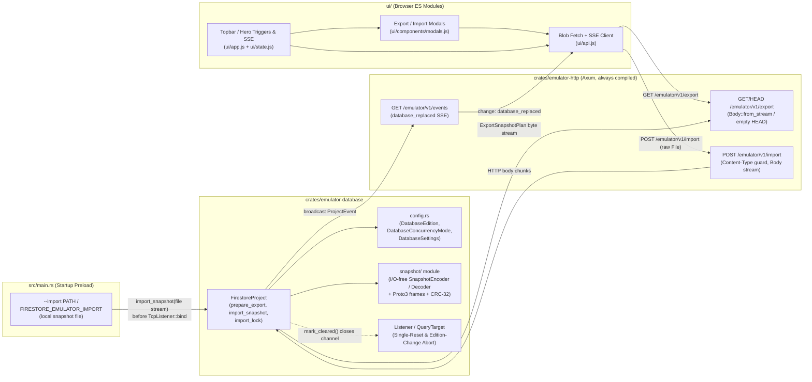
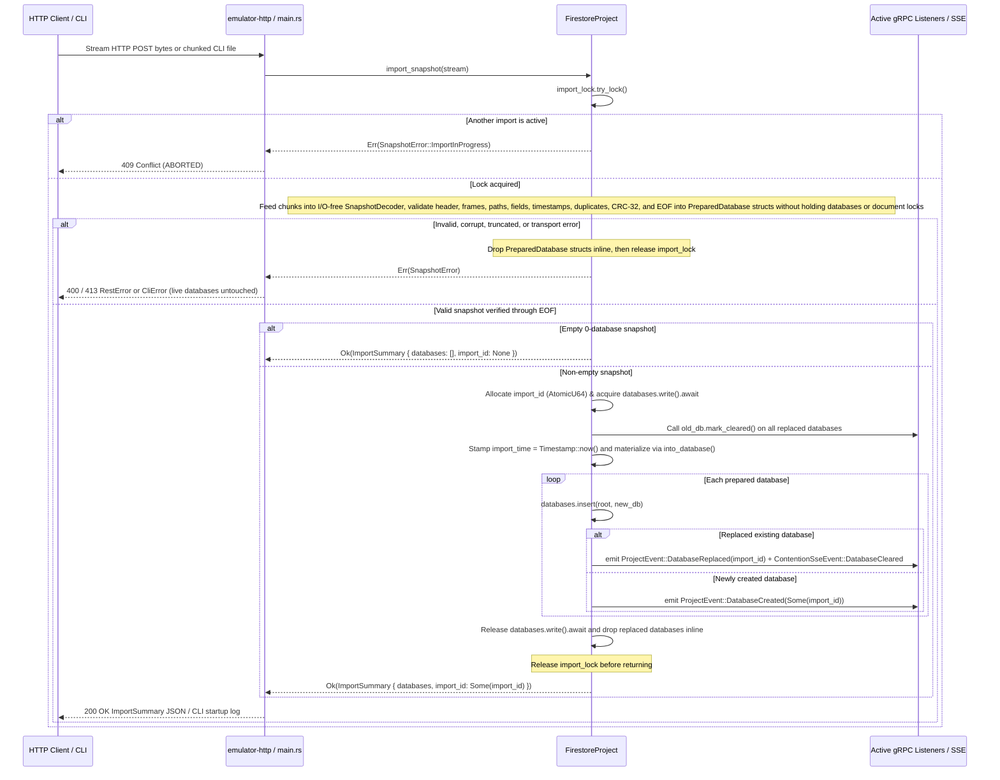

# Emulator State Export and Import

*   **Author:** Paco van der Linden
*   **Status:** Implemented
*   **Date:** 2026-11-25

--------------------------------------------------------------------------------

## Overview

This document specifies state export and import for `firestore-emulator`. Developers running manual tests against the emulator often drive an application into a target Firestore state and then run multiple test branches from that checkpoint. Because all databases currently live only in memory, restarting the emulator or resetting after a destructive branch requires recreating that state from scratch.

This feature introduces an emulator-specific, versioned binary snapshot format (`.fsemu`) owned by `crates/emulator-database`. It exposes that format through three interfaces:

1.  **HTTP control-plane endpoints** under `/emulator/v1` (compiled regardless of whether the `ui` Cargo feature is enabled) to export selected or all databases and import a snapshot into a running emulator.
2.  **Web UI controls** in `ui/` to upload and restore a snapshot file (including from the empty-emulator screen) or download a snapshot (current database or all databases).
3.  **A CLI startup option** (`--import <PATH>` and `FIRESTORE_EMULATOR_IMPORT`) in [`src/main.rs`](../../src/main.rs) to preload a snapshot file before binding the listening TCP socket.

Each exported snapshot captures selected or all databases—including empty (zero-document) databases—with each database's `databaseEdition` (`STANDARD`/`ENTERPRISE`) and `concurrencyMode` (`PESSIMISTIC`/`OPTIMISTIC`) settings alongside all live documents across root collections and subcollections (including subcollections under non-existent parent documents), zero-field documents (`fields: {}`), and all 11 storable Firestore v1 value types.

Importing replaces only the databases in the snapshot in one streaming pass; invalid inputs fail without modifying live databases, while open Web UI tabs viewing a replaced database refresh in place when live updates are active (and the initiating tab refreshes even under **Live Paused**). Active gRPC `DocumentsTarget` listeners and unchanged-edition `QueryTarget` listeners converge in a single reset, whereas active `QueryTarget` listeners whose database edition changed terminate with `FAILED_PRECONDITION` and an `ERROR`-level server log.

--------------------------------------------------------------------------------

## The Problem

Four current limitations in `firestore-emulator` prevent developers from saving and restoring manual test checkpoints:

1.  **No Checkpoint Persistence Across Test Branches or Restarts:** [`FirestoreProject`](../../crates/emulator-database/src/project.rs) stores all databases in memory. After driving an application into a complex state (multiple collections, nested subcollections, specific `STANDARD`/`ENTERPRISE` or `PESSIMISTIC`/`OPTIMISTIC` settings), a destructive test mutates or wipes that state with no way to roll back and branch again.
2.  **No Startup State Preloading:** [`src/main.rs`](../../src/main.rs) accepts host binding, edition defaults, and transaction timeout flags, but provides no way to seed the emulator from a saved file before client traffic begins.
3.  **No Server-Side Export or Import Control Plane:** [`crates/emulator-http/src/routes/emulator.rs`](../../crates/emulator-http/src/routes/emulator.rs) exposes state-management routes only for database listing (`GET /emulator/v1`), Server-Sent Events (`GET /emulator/v1/events`), and recursive deletion (`DELETE /emulator/v1/{*ref}`). External scripts crawling `/v1/projects/...` endpoints require many round trips; while document and query reads support `readTime`, scripts cannot read collection IDs at a `readTime` (`:listCollectionIds` returns `501 UNIMPLEMENTED`), read settings without lazy database creation, capture databases and settings atomically together, or share checkpoints with CLI startup.
4.  **Live-Client Breakage During Database Replacement:** Clearing a database and replaying writes breaks active clients in two ways:
    *   In the Web UI, [`ui/app.js`](../../ui/app.js) treats a `database_cleared` SSE event as a full deletion—deselecting the active database, showing a `"was cleared"` message, discarding unsaved edits, and switching to the first remaining database.
    *   In gRPC `Listen` streams, [`Listener`](../../crates/emulator-database/src/listener.rs) compiles `QueryTarget` filters against the database's `databaseEdition` when the target is registered. Changing `databaseEdition` (`STANDARD` <-> `ENTERPRISE`) without terminating active query listeners would evaluate subsequent updates under stale edition rules.

### Proposed Solution Summary

1.  Add a versioned, length-delimited binary Protobuf codec (I/O-free `SnapshotEncoder` and `SnapshotDecoder` with a fixed CRC-32 + EOF-magic trailer) and a single-pass `FirestoreProject` export/import engine in `crates/emulator-database`. Export reads queue-free point-in-time MVCC snapshots (including empty databases and settings); import decodes and validates into detached `PreparedDatabase` structs without holding `FirestoreProject::databases` or document locks, then swaps them atomically inside `FirestoreProject::databases`.
2.  Mount `/emulator/v1/export` and `/emulator/v1/import` in `crates/emulator-http` regardless of the `ui` Cargo feature, requiring `Content-Type: application/octet-stream` (with no `CorsLayer` mounted) to block cross-origin browser CSRF (returning an example `curl` command on `415 Unsupported Media Type`), rejecting overlapping imports with `409 Conflict (ABORTED)`, and streaming bodies without a fixed 2 MiB limit.
3.  Add `ProjectEvent::DatabaseReplaced` for in-place Web UI refresh and terminate active gRPC `QueryTarget` streams with `FAILED_PRECONDITION` and an `ERROR`-level server log (`edition-change termination`) when an import changes `databaseEdition`.
4.  Add Export/Import controls in `ui/` (handling snapshots as opaque binary blobs) and a fail-fast `--import <PATH>` / `FIRESTORE_EMULATOR_IMPORT` option in [`src/main.rs`](../../src/main.rs) that completes snapshot loading before binding the listening TCP socket.

--------------------------------------------------------------------------------

## Goals

*   **G1 — Versioned Lossless Binary Snapshot Format:** Provide an integrity-checked binary format owned by `crates/emulator-database` that round-trips settings, empty databases, zero-field documents, subcollections under non-existent parents, and all 11 storable Firestore v1 `Value` types, omitting document metadata timestamps per NG1 ([Technical Plan §3](#3-versioned-framed-binary-snapshot-format-v1)).
*   **G2 — Consistent Queue-Free Export Including Empty Databases:** Export selected or all databases at a single monotonic point-in-time timestamp without acquiring Wound-Wait transaction locks, preserving empty databases and settings while omitting tombstones and MVCC history.
*   **G3 — Single-Pass Streaming Build-and-Swap Import:** Validate snapshot structure, data, and end-to-end integrity in one streaming pass before swapping only listed databases and overwriting their settings, rejecting overlapping HTTP imports with `409 Conflict` and leaving live databases untouched on error.
*   **G4 — Consistent HTTP, Web UI, and CLI Surfaces:**
    *   Expose `/emulator/v1/export` and `/emulator/v1/import` regardless of whether the Web UI feature is enabled, enforcing `Content-Type: application/octet-stream`.
    *   Expose Web UI **Import** (topbar) / **Import Snapshot** (empty-emulator screen) and **Export** (`Current Database` and `All Databases` in the topbar when at least one database exists).
    *   Expose CLI `--import <PATH>` (`FIRESTORE_EMULATOR_IMPORT`) to preload a snapshot before accepting client traffic, reporting invalid input diagnostics or a visible startup summary at default error logging.
*   **G5 — Safe Live-Client Handling:** Refresh open Web UI tabs ([`docs/designs/emulator-web-ui.md`](./emulator-web-ui.md)) in place when live updates are active (and refresh initiating tabs even under **Live Paused**), converge compatible gRPC listeners in one reset, and terminate `QueryTarget` streams with `FAILED_PRECONDITION` immediately when an import changes `databaseEdition` (and before evaluating subsequent database events after a live edition `PATCH`).

--------------------------------------------------------------------------------

## Non-Goals

*   **NG1 — MVCC History, Tombstones, and Metadata Timestamps:** Exporting historical MVCC versions, deletion tombstones, or original `Document.createTime` / `Document.updateTime` metadata timestamps is out of scope. Restored documents receive fresh monotonic import-time metadata timestamps; user `timestampValue` fields inside documents are preserved at full nanosecond precision in the emulator (live Google Cloud Firestore truncates sub-microsecond nanoseconds to microsecond precision on write—a conformance difference discovered and gated with `notImplementedInRust` in [`test-suite/tests/1-get-set.test.ts`](../../test-suite/tests/1-get-set.test.ts)).
*   **NG2 — External Snapshot Formats:** Compatibility with Firebase Java emulator LevelDB/Datastore export directories or Cloud Firestore Admin API `exportDocuments`/`importDocuments` outputs is out of scope.
*   **NG3 — Hand-Editable Snapshot Format:** Designing the snapshot format to be read or edited directly in text editors or `jq` is out of scope.
*   **NG4 — Database Remapping and v1 Selective Import UI:** Remapping `project_id` or `database_id` on import, or selecting a subset of databases in the v1 Web UI, is out of scope.
*   **NG5 — Exit Hooks, Auto-Export, and Transaction Preservation:** CLI `--export-on-exit`, periodic auto-exports, cross-database global write locks, and preserving active transactions or locks across export/import are out of scope.

--------------------------------------------------------------------------------

## Open Questions

No open questions remain: all format, scoping, build-and-swap, live-client, HTTP media-type, and CRC-32 checksum decisions are settled and specified across Technical Plan §1–§9.

--------------------------------------------------------------------------------

## Critical User Journeys (CUJs)

### CUJ 1: Checkpoint and Repeatedly Restore Manual Test State in the Web UI

*   **Given:** The developer has driven their application against `firestore-emulator` into a checkpoint containing root collections, subcollections under non-existent parent documents (`rooms/r1/messages/m1`), zero-field documents (`flags/ready` with `fields: {}`), and typed fields (`i64::MAX`, `-0.0`, `NaN`, bytes, `timestampValue`, and a `VectorValue`).
*   **When:** The developer opens the Web UI, clicks **Export** and selects **Current Database** (or **All Databases**) to download a `.fsemu` file, runs a destructive manual test branch that modifies and deletes documents, clicks **Import**, selects the downloaded file, reviews the overwrite warning and confirms—then repeats a second branch and selects the same local file again.
*   **Then:** Both restores succeed (including selecting the same local file twice in a row), the active database remains selected without navigating away, settings pills and Explorer columns refresh in place (including on the initiating tab even when **Live Paused** is active), any open dirty document editor keeps unsaved edits and shows an external-update or external-deletion banner, and all documents and value types match the checkpoint.

### CUJ 2: Preload a Saved Checkpoint on Emulator Startup via CLI

*   **Given:** The developer has a saved `.fsemu` snapshot containing `projects/demo/databases/(default)` (`ENTERPRISE`/`OPTIMISTIC`) and `projects/demo/databases/analytics` (`STANDARD`/`PESSIMISTIC`).
*   **When:** The developer launches `firestore-emulator --host-port 127.0.0.1:8080 --import <path>` (or sets the `FIRESTORE_EMULATOR_IMPORT=<path>` environment variable), optionally passing `--default-enterprise`.
*   **Then:** The emulator validates and loads the snapshot before binding `127.0.0.1:8080`, logs a startup summary (`Loaded snapshot from <path>: 2 database(s), ... document(s)`) visible at the default `ERROR` log level (whether `RUST_LOG` is unset or set to `ERROR`), serves preloaded documents and settings on the first client request, and applies `--default-enterprise` (the startup flag that defaults newly created databases to Enterprise Edition and Optimistic Concurrency) only to databases created after startup.

### CUJ 3: Selective Database Replacement and Empty-Database Parity

*   **Given:** A running emulator holds `projects/p/databases/app` (50 documents, `STANDARD`), `projects/p/databases/audit` (0 documents, `ENTERPRISE`), and `projects/p/databases/scratch` (10 documents, `STANDARD`). The developer exports `app` and `audit` together. Later, a test deletes 20 documents from `app`, switches `app` to `ENTERPRISE`, writes 5 documents into `audit`, and writes 3 more documents into `scratch`.
*   **When:** The developer imports the snapshot containing `app` and `audit`.
*   **Then:** `app` is restored to its 50 documents and `STANDARD` setting, `audit` is reset to 0 documents and `ENTERPRISE` (removing the 5 leaked writes), and `scratch` remains untouched with all 13 documents.

### CUJ 4: Scripted HTTP Export/Import with CSRF Guard and Concurrency Rejection

*   **Given:** A running headless emulator (`--no-default-features`) holds populated databases.
*   **When:**
    1.  A script runs `curl` against `GET /emulator/v1/export?database=projects/p/databases/(default)` and saves the binary response, and separately queries an unknown `?database=` target.
    2.  A developer omits the `Content-Type` header (or uses `curl -d`, which sends `application/x-www-form-urlencoded`) on `POST /emulator/v1/import`.
    3.  The developer retries with `-H "Content-Type: application/octet-stream"` while a concurrent second `POST /emulator/v1/import` request arrives before the first finishes.
*   **Then:**
    1.  Export streams the binary snapshot with `Content-Type: application/octet-stream` and `Content-Disposition: attachment; filename="..."`, and returns `404 Not Found (NOT_FOUND)` without lazy creation if an unknown `?database=` target is requested.
    2.  The missing or CORS-safelisted ("simple") `Content-Type` request fails with `415 Unsupported Media Type (INVALID_ARGUMENT)` in a `RestError` JSON envelope giving an example `curl -H "Content-Type: application/octet-stream"` command.
    3.  The first valid import returns `200 OK` with an `ImportSummary` JSON response; the overlapping second import fails immediately with `409 Conflict (ABORTED)` without affecting the active import.

### CUJ 5: Active gRPC `Listen` Streams Across Compatible Restore vs. Edition Change

*   **Given:** An SDK client maintains an active gRPC `DocumentsTarget` listener and an active `QueryTarget` listener on `projects/p/databases/(default)` (currently `STANDARD`).
*   **When:**
    1.  An import replaces `projects/p/databases/(default)` with a checkpoint keeping `databaseEdition = STANDARD`.
    2.  A second import replaces `projects/p/databases/(default)` with a checkpoint setting `databaseEdition = ENTERPRISE`.
*   **Then:**
    1.  On `STANDARD` -> `STANDARD`, both listeners converge to the restored snapshot in a single reset without seeing an empty intermediate database.
    2.  On `STANDARD` -> `ENTERPRISE`, the server emits an `ERROR`-level log naming the database and edition transition, and terminates the active `QueryTarget` listener stream with `FAILED_PRECONDITION` so queries never continue under stale edition semantics, while the active `DocumentsTarget` listener converges via a single reset.

### CUJ 6: Failing Safely on Corrupt, Truncated, Unsupported-Version, or Non-Native Input

*   **Given:** An emulator holds live uncheckpointed data in `projects/p/databases/(default)`.
*   **When:** A client uploads a truncated file, a file with bad magic bytes, a snapshot with an unsupported `format_major`, a file exceeding a frame limit, or duplicate database or document paths, or the operator passes a Firebase Java export directory to `--import`.
*   **Then:**
    *   HTTP import rejects oversized frames (`>64 MiB`) with `413 Payload Too Large (RESOURCE_EXHAUSTED)` and all other malformed inputs with `400 Bad Request (INVALID_ARGUMENT)`, naming the defect in the response while leaving live databases untouched.
    *   CLI `--import` returns a `CliError` (the formatted CLI error type in [`src/main.rs`](../../src/main.rs)) and exits non-zero before binding the listening port, printing a directory/Firebase-export suggestion when passed a directory.

--------------------------------------------------------------------------------

## Technical Plan (Architecture)

### 1. System Architecture and Component Boundaries

`crates/emulator-database` remains an in-memory database engine owning snapshot handling: shared database settings, the versioned wire format and I/O-free `SnapshotEncoder`/`SnapshotDecoder`, queue-free MVCC export traversal, single-pass build-and-swap import with `import_lock`, `ProjectEvent::DatabaseReplaced`, and gRPC `QueryTarget` edition-change termination. `crates/emulator-http` and [`src/main.rs`](../../src/main.rs) act as HTTP and CLI adapters respectively (both streaming bytes into `import_snapshot`), while `ui/` handles snapshot files as opaque binary blobs.



No new third-party crates are added to `Cargo.lock`; `prost`, `bytes`, and `crc32fast` are already present.

---

### 2. Shared Database Settings and Tear-Free Atomic Reads

Before this design, [`crates/emulator-http/src/routes/projects/admin.rs`](../../crates/emulator-http/src/routes/projects/admin.rs) defined private `DatabaseEdition` and `ConcurrencyMode` enums, while [`FirestoreDatabase`](../../crates/emulator-database/src/database.rs) stored `enterprise_edition` and `optimistic_concurrency` in two `Relaxed` `AtomicBool` fields.

1.  **Share Configuration Types:** Define `DatabaseEdition` (`Standard`, `Enterprise`), `DatabaseConcurrencyMode` (`Pessimistic`, `Optimistic` — distinct from internal transaction concurrency enums), and `DatabaseSettings` (`edition`, `concurrency_mode`, with `for_edition` defaulting `Standard -> Pessimistic` and `Enterprise -> Optimistic`) in [`crates/emulator-database/src/config.rs`](../../crates/emulator-database/src/config.rs), removing the duplicate private enums in [`crates/emulator-http/src/routes/projects/admin.rs`](../../crates/emulator-http/src/routes/projects/admin.rs).
2.  **Atomic Packed Settings & Lazy `EventChannel`:** Store packed edition and concurrency flags inside one atomic value updated under the database's `events` mutex (`EventChannel::{Idle, Active, Cleared}`, avoiding eager 1,024-slot broadcast allocation on idle or imported databases) via `pub fn update_settings` (which returns the committed `DatabaseSettings` and emits `ProjectEvent::DatabaseConfigChanged` iff settings changed and the channel is not `Cleared`), so `db.settings()` returns a tear-free `DatabaseSettings` (`edition` and `concurrency_mode`) without acquiring a lock.
3.  **Direct Detached Construction:** Add internal constructors on `FirestoreDatabase`, [`Collection`](../../crates/emulator-database/src/database/collection.rs), and [`DocumentMeta`](../../crates/emulator-database/src/database/document.rs) to assemble prepared databases with any `(DatabaseEdition, DatabaseConcurrencyMode)` pair without holding `FirestoreProject::databases` or document locks, bypassing Wound-Wait locks and suppressing `DatabaseConfigChanged` events.

---

### 3. Versioned Framed Binary Snapshot Format (v1)

Snapshots use a length-delimited binary container with Proto3 frame payloads derived via `prost::Message` in `crates/emulator-database/src/snapshot/wire.rs` (no `protoc` step or `build.rs`). `DocumentRecord` embeds `googleapis::google::firestore::v1::Value` directly, preserving all 11 storable Firestore value types losslessly: `null`, `boolean`, 64-bit signed `integer`, IEEE-754 `double` (`-0.0`, `NaN`, `±Infinity`), user `timestamp`, `bytes`, `string`, `reference`, `geo point`, `array`, and `map` (including vector sentinel maps stored as `MapValue` entries with `"__type__": "__vector__"` and `"value"` keys). Canonical Firestore references (`RootRef` `projects/{p}/databases/{d}/documents`, `CollectionRef`, and `DocumentRef`) govern naming, with deterministic export order grouped by collection ([`CollectionRef::Ord`](../../crates/emulator-database/src/database/reference.rs)) and sorted within each collection via [`DocumentRef::Ord`](../../crates/emulator-database/src/database/reference.rs).

#### Binary Container Layout

```text
+-------------------------------------------------------------------------+
| Fixed File Header (10 bytes)                                            |
|   [0..8]   magic        = "FSEMUSNP" (8 ASCII bytes)                    |
|   [8..10]  format_major = 1u16 (little-endian)                          |
+-------------------------------------------------------------------------+
| Frame 0: Tag 0x01 (SnapshotHeader)                                      |
|   envelope: [tag: u8][payload_len: u32 LE] + Proto3 payload             |
|   fields:   emulator_version, snapshot_time                             |
+-------------------------------------------------------------------------+
| Repeated 0..N Database Sections (exported sorted by RootRef):           |
|   Frame: Tag 0x02 (DatabaseStart)                                       |
|     - project_id, database_id, database_edition, concurrency_mode       |
|   Frame: Tag 0x03 (DocumentRecord) x 0..M (collection-grouped order)    |
|     - document_path (relative under /documents/), fields map<k,Value>   |
+-------------------------------------------------------------------------+
| Final Frame: Tag 0x04 (EndOfSnapshot)                                   |
|   - total_databases: u64, total_documents: u64                          |
+-------------------------------------------------------------------------+
| Fixed EOF Trailer (12 bytes)                                            |
|   [0..4]   checksum_crc32 = u32 LE (IEEE CRC-32 of bytes                |
|                             [0 .. start_of_trailer) incl. Frame 0x04)   |
|   [4..12]  eof_magic      = "FSEMUEOF" (8 ASCII bytes)                  |
+-------------------------------------------------------------------------+
```

#### Wire Schema

```protobuf
// Conceptual Proto3 wire schema represented with #[derive(prost::Message)]
// in crates/emulator-database/src/snapshot/wire.rs.

enum DatabaseEditionWire {
  DATABASE_EDITION_UNSPECIFIED = 0;
  STANDARD = 1;
  ENTERPRISE = 2;
}

enum ConcurrencyModeWire {
  CONCURRENCY_MODE_UNSPECIFIED = 0;
  PESSIMISTIC = 1;
  OPTIMISTIC = 2;
}

message SnapshotHeader {
  string emulator_version = 1;
  google.protobuf.Timestamp snapshot_time = 2;
}

message DatabaseStart {
  string project_id = 1;
  string database_id = 2;
  DatabaseEditionWire database_edition = 3;
  ConcurrencyModeWire concurrency_mode = 4;
}

message DocumentRecord {
  string document_path = 1; // e.g. "users/alice" or "rooms/r1/messages/m1"
  map<string, google.firestore.v1.Value> fields = 2;
}

message EndOfSnapshot {
  uint64 total_databases = 1;
  uint64 total_documents = 2;
}
```

#### Framing, Versioning, and Safety Invariants

1.  **`SnapshotHeader` Metadata:** On export, `SnapshotHeader` records provenance metadata (`emulator_version` from `CARGO_PKG_VERSION` and the monotonic MVCC `snapshot_time`, used for debugging and v2 inspection); on import, both fields are ignored (not timestamp-validated).
2.  **Unified `DatabaseStart` & Relative `document_path` Validation:** `DatabaseStart` validates `project_id` and `database_id` through `RootRef::try_new` (rejecting empty segments, `'/'`, `.`, `..`, >1,500 UTF-8 bytes, and reserved `__.*__` names—preventing path-separator injection such as `database_id = "d1/documents"`). Shared resource-path parsing across gRPC writes, query reference/cursor operands, and `?database=` queries will be updated to enforce those same root-segment constraints so any exported database can re-import. `DocumentRecord.document_path` omits the `projects/{p}/databases/{d}/documents/` prefix, rejects leading or trailing `'/'`, and validates all path segments via `DocumentRef::from_str`.
3.  **Wire Enum Validation, Frame State Machine, Database Cap & Empty Snapshots:** Wire enums reject `0` (`*_UNSPECIFIED`) and unknown discriminants (`SnapshotError::InvalidFormat`). Frames must match the grammar `Header -> SnapshotHeader -> (DatabaseStart -> DocumentRecord*)* -> EndOfSnapshot -> Trailer -> EOF`, and `SnapshotDecoder` caps imported snapshots at `MAX_SNAPSHOT_DATABASES = 10_000`. While export emits deterministic `RootRef` / collection / document order, import accepts arbitrary database ordering and arbitrary document ordering within each database section as long as no duplicate database or document path exists. A valid snapshot with zero `DatabaseStart` frames (`total_databases == 0, total_documents == 0`) imports as a no-op returning `totalDatabases: 0, totalDocuments: 0` (omitting `importId`).
4.  **Progressive Bounded Frame Allocation, Pre-Buffer Prefix Validation & Terminal `Failed` State:** Both encoder and decoder enforce a maximum frame payload size (`MAX_FRAME_BYTES = 64 MiB`). In `FramePrefix`, right after rejecting `payload_len > MAX_FRAME_BYTES` (preserving `FrameTooLarge` precedence), `SnapshotDecoder` validates frame tag/grammar expectations and `MAX_SNAPSHOT_DATABASES` *before* entering `FramePayload` or allocating per-frame `BytesMut`. The decoder caps initial per-frame buffer capacity at `64 KiB` and accumulates frame payload bytes progressively across incoming chunks rather than pre-sizing buffers to the declared 4-byte `u32 LE` `payload_len`—avoiding premature (`> 64 KiB`) upfront allocations on truncated inputs claiming large payloads (which otherwise risk OOM aborts in release builds with `panic = "abort"` in `[profile.release]` of [`Cargo.toml`](../../Cargo.toml)). Any `feed` error transitions the decoder into terminal `DecodePhase::Failed` and clears `small_buf` so subsequent `feed` or `finish` calls fail immediately.
5.  **Versioning & Integrity Verification:** Wrong `magic`, unknown frame tags, CRC-32 mismatches across `[0 .. start_of_trailer)`, mismatched `EndOfSnapshot` totals, bad `eof_magic`, and trailing bytes after the 12-byte trailer fail import with `SnapshotError::InvalidFormat`. `format_major != 1` fails with `SnapshotError::UnsupportedVersion` naming found vs. supported major versions (while unknown optional Proto3 fields within `format_major == 1` are ignored for forward compatibility, and frozen v1 bytes are pinned by a `GOLDEN_V1_SNAPSHOT` test). EOF before completing the header, missing `EndOfSnapshot`, partial frames, or a partial trailer fail with `SnapshotError::Truncated`, detecting clipped HTTP transfers and exports cut short during Ctrl-C shutdown (`DEFAULT_SHUTDOWN_GRACE = 250ms`, the emulator's graceful shutdown cutoff).

---

### 4. Export Data Flow (Point-in-Time MVCC Streaming)

1.  **Target Resolution & Pinning (Single Read Lock):**
    *   Parse explicit `?database=` query parameters as `RootRef`, rejecting unknown keys or invalid names with `INVALID_ARGUMENT` (`400`), deduplicating, and sorting.
    *   Acquire `FirestoreProject::databases.read().await` once:
        *   Explicit targets use `databases.get(&root)`—returning `NOT_FOUND` (`404`) for missing databases without calling `project.database(...)`, so unknown targets are never lazily created.
        *   Omitting explicit targets captures all existing databases (0 databases exports a valid empty snapshot).
        *   Stamp a single monotonic `snapshot_time = Timestamp::now()`, clone `Arc<FirestoreDatabase>` handles, read each database's `db.settings()` atomically, and release the read lock immediately.
2.  **Deterministic Queue-Free Traversal & Error-Safe Async Streaming:**
    *   `ExportSnapshotPlan::into_stream()` drives the I/O-free `SnapshotEncoder` asynchronously with bounded per-export chunk buffering (`tx.is_closed()` checks at the top of each target/collection, every 256 documents, and before `encoder.finish()` exit promptly when the client disconnects; `HEAD /emulator/v1/export` skips `into_stream()` altogether and returns an empty body).
    *   Traversal on cloned `Arc<FirestoreDatabase>` handles ignores `is_cleared()` (so concurrent imports or deletes do not abort an in-progress export) and iterates sorted databases -> collections sorted segment-wise in Firestore reference order (`CollectionRef::Ord`) -> sorted documents (`DocumentRef::Ord`), reading `meta.read_mvcc_at(snapshot_time)` (queue-free MVCC lookups that bypass Wound-Wait transaction locks while taking short-lived physical read guards during committed-version reads). Tombstones and post-`snapshot_time` versions are skipped; zero-field documents (`fields: {}`) and empty databases are emitted.
    *   `SnapshotEncoder` enforces `payload_len <= MAX_FRAME_BYTES` per frame, encodes directly into `out_buf` without intermediate frame scratch buffers or cloning document field maps, and hashes every byte up to the start of the EOF trailer before appending `[checksum_crc32][eof_magic]`. Any mid-stream encoding failure is forwarded as `Err(io::Error)` on the stream so Hyper aborts the HTTP response instead of ending with a valid chunked EOF, and dropping the response receiver aborts the producer and releases cloned database handles.
3.  **Point-in-Time Consistency Guarantee:** Commit execution registers all touched collections and documents and acquires their physical write guards (short-lived per-document storage locks while writing committed versions) before stamping `commit_time = Timestamp::now()`. Therefore, `meta.read_mvcc_at(snapshot_time)` yields a tear-free cross-document snapshot without taking Wound-Wait locks.

---

### 5. Import Data Flow (Single-Pass Streaming Build-and-Swap)



#### Key Correctness Invariants

1.  **Mutual Exclusion (`import_lock`) & Cutover Memory Scope:** `FirestoreProject` owns an async import lock (`import_lock`); a non-blocking lock attempt fails with `409 Conflict (ABORTED)` whenever another import is active. Acquiring the `import_lock` guard before instantiating `SnapshotDecoder` ensures unswapped `PreparedDatabase` structs and import-held references to replaced databases (dropped immediately after releasing the `databases` write guard) are released before `import_lock` unlocks and `200 OK` returns, while any in-flight RPCs or listeners release remaining handles to replaced databases once they observe clearing or channel closure. Sequential imports never trigger spurious `409` races; absent prior exports or in-flight RPCs/listeners pinning older handles, live HTTP replacement holds at most old and new copies of replaced databases concurrently across cutover, and CLI preloading holds only the incoming databases.
2.  **Post-`mark_cleared()` Cutover & Monotonic `import_time`:** `SnapshotDecoder` outputs plain owned `PreparedDatabase` structs without holding `FirestoreProject::databases` or document locks and with no metadata timestamps. Inside `FirestoreProject::databases.write().await`:
    *   First call `old_db.mark_cleared()` on every replaced database. Because `FirestoreProject::databases.write().await` stays held throughout cutover, any gRPC listener woken by the closed channel blocks on `project.database_for_listener(...)` (`databases.read().await`) until all new databases are inserted.
    *   Next stamp one monotonic `import_time = Timestamp::now()`. This preserves two invariants: (1) each replacement database constructs isolated document state invisible until the project write lock drops after `import_time`, so every post-swap write obtains a timestamp `> import_time` (preserving monotonic per-document version ordering), and (2) clearing each replaced database transitions its `EventChannel` to `Cleared` *before* stamping `import_time`, preventing post-clear change events and listener `resume_token` timestamps `> import_time` even if a racing commit on the old database stamps a timestamp after passing the commit seal's active-database check prior to clearing.
    *   Allocate one `import_id` from `next_import_id: AtomicU64` (starting at `1`; zero-database snapshots fast-return `ImportSummary { databases: Vec::new(), import_id: None }` without acquiring `databases.write().await` or stamping `Timestamp::now()`), materialize each `PreparedDatabase` via `into_database(self, import_time)` with `create_time = import_time` and `update_time = import_time` (stored documents carry `create_time` and `update_time`, whereas phantom parent ancestors have none), insert into `databases`, emit `ProjectEvent::DatabaseReplaced { database, import_id }` (alongside `ContentionSseEvent::DatabaseCleared { database }` for live contention subscribers) or `ProjectEvent::DatabaseCreated { database, import_id: Some(import_id) }`, release the write lock, and drop replaced databases outside the write lock (returning `ImportSummary` with `import_id: Some(import_id)` so HTTP/UI clients can correlate SSE events with the import response).
3.  **Unified Path & Field Validation ([`crates/emulator-database/src/database/validation.rs`](../../crates/emulator-database/src/database/validation.rs)):**
    *   Validate `DatabaseStart` via `RootRef::try_new` and `DocumentRecord` via `DocumentRef::from_str`; reject duplicate database sections or duplicate document paths (`400 Bad Request (INVALID_ARGUMENT)` naming the duplicate).
    *   Validate every document through existing `validate_writable_fields` (no duplicate snapshot validator), extending live writes and snapshot imports together with `validate_timestamp` bounds (`0001-01-01T00:00:00Z` through `9999-12-31T23:59:59.999999999Z`, closing the gap with [`crates/googleapis/src/ser.rs`](../../crates/googleapis/src/ser.rs), whose ProtoJSON serializer already rejects timestamps outside `0001..9999`), alongside all existing checks (non-empty non-reserved keys, no `None` or query-only variants, no nested arrays, valid `LatLng`, and valid `"__type__": "__vector__"` / `"value"` sentinel maps). Snapshot imports rely on `prost::Message::decode`'s built-in 100-step recursion limit to guard against stack recursion aborts.

---

### 6. Live-Client Contracts (Web UI SSE and gRPC `Listener`)

#### Web UI SSE (`ProjectEvent::DatabaseReplaced` & `importId` Correlation)

*   Update [`crates/emulator-database/src/database/event.rs`](../../crates/emulator-database/src/database/event.rs) with `ProjectEvent::DatabaseReplaced { database: RootRef, import_id: u64 }` and `import_id: Option<u64>` on `ProjectEvent::DatabaseCreated`, serialized on SSE event `"change"` as `{"type": "database_replaced", "database": "<RootRef>", "importId": <u64>}` (and `"importId"` on `database_created` when created by an import, omitted on lazy creation).
*   In [`ui/app.js`](../../ui/app.js), incoming `database_replaced` SSE events are gated by **Live Paused**, whereas UI-initiated import completion (`onImportSuccess` invoked by [`ui/components/modals.js`](../../ui/components/modals.js)) queues the same shared replacement resync on the UI event queue even when **Live Paused** is active or SSE is still connecting (and, when no database is active, auto-selects the first database in the refreshed sorted list). Bounded correlation sets (`localAppliedImportIds` and `sseAppliedImportKeys`) deduplicate `importId` between the HTTP `ImportSummary` response and SSE `database_replaced`/`database_created` events in either arrival order so the initiating tab never reloads or resets `queryState` twice.
*   Unlike `database_cleared` (which clears selection and discards unsaved edits), replacement refreshes only the database list when the active database was not in the snapshot (while still syncing Contention state when `state.contention.scope === "all"`). When the active database was replaced, it stays selected while reloading metadata pills, collections, and documents in place: dirty open editors retain unsaved edits with external-update/external-deletion banners, Query Runner state resets, Contention snapshot state clears when off-view or refreshes in place (even under **Live Paused**) when viewing **Contention**, extracted `isStaleDb()` / `isStaleNav()` guards ensure mid-refresh navigation to root still prunes stale non-visible caches and re-renders, and clean stale path segments truncate back to the deepest surviving prefix using document-level state rather than page-1 column listings (which cap at 200 entries and omit phantom parent documents), updating the browser URL.

#### gRPC `Listener` Reset, Buffered-Event Guard, and `QueryTarget` Edition-Change Termination

*   **Safe Reset Convergence:** [`Listener`](../../crates/emulator-database/src/listener.rs) polls per-database `DatabaseEvent` broadcast streams, while `old_db.mark_cleared()` closes the old broadcast channel and marks cleared-database reads to abort. To converge active `DocumentsTarget` and unchanged-edition `QueryTarget` listeners in one reset without observing empty state or spurious `ABORTED` failures:
    *   Ignore events on cleared database handles both before reading and on non-`FailedPrecondition` read errors so buffered pre-swap events never abort on `old_db`.
    *   When a broadcast stream reports lagged messages without closing the channel, immediately re-subscribe to the active database before resetting so an already-replaced `old_db` channel cannot later deliver a redundant close notification.
    *   Retry cleared-database races with bounded retries during stream setup and resets only when `is_cleared_retryable` (`database.is_cleared() && matches!(err, GenericDatabaseError::Aborted(_))`) holds by re-acquiring the active database handle via `project.database_for_listener(&db_name, target.required_enterprise()).await` and re-subscribing; because resets read after `import_time`, compatible listeners emit one reset, the restored documents, `Current`, and `NoChange`. When a cleared database does not exist and an active `QueryTarget`'s `required_enterprise` differs from `project.default_enterprise`, `database_for_listener` returns `None` without resurrecting a ghost database or emitting `DatabaseCreated`, and `reacquire_database` returns `Err(edition_mismatch_error(...))`.
*   **Edition-Change Termination (`STANDARD` <-> `ENTERPRISE`):**
    *   Verify the query's compiled edition matches `database.enterprise_edition()` both on reset (and on `database_for_listener` non-resurrection after `clear_database` in either `ENTERPRISE -> STANDARD` or `STANDARD -> ENTERPRISE` direction) and on incoming database events before the stale-timestamp early return (which skips events whose `update_time` is at or before the query's `last_reset_time`). Live `PATCH /v1/projects/.../databases/...` emits `ProjectEvent::DatabaseConfigChanged` rather than a `DatabaseEvent`, so idle query listeners see live-`PATCH` edition changes on the next `DatabaseEvent` without spuriously evaluating updates under mismatched edition semantics.
    *   On mismatch, `edition_mismatch_error` emits an `ERROR`-level log naming the database and old/new editions (visible at the default `ERROR` log level) and returns `FAILED_PRECONDITION` (`tonic::Code::FailedPrecondition`) to terminate the stream immediately.

---

### 7. HTTP Control-Plane API (`/emulator/v1`)

Both routes are mounted in [`crates/emulator-http/src/routes/emulator.rs`](../../crates/emulator-http/src/routes/emulator.rs) before `DELETE /{*ref}` regardless of whether the `ui` Cargo feature is enabled. Neither [`crates/emulator-http/src/routes.rs`](../../crates/emulator-http/src/routes.rs) nor `emulator::router()` mounts a `CorsLayer`, so cross-origin preflighted browser requests fail.

#### `GET` / `HEAD /emulator/v1/export`

*   **Query Parameters:** Optional repeatable `database=<RootRef>` (URL-decoded; `RootRef::from_str` accepts paths with or without `/documents` and normalizes display canonically with `/documents`). Unknown keys, bare/empty values, and malformed `RootRef` values fail with `400 Bad Request (INVALID_ARGUMENT)` under unified root-segment validation; unknown databases fail with `404 Not Found (NOT_FOUND)` without lazy instantiation. Omitting `database` exports all existing databases.
*   **Response:**
    *   `200 OK`
    *   `Content-Type: application/octet-stream`
    *   `Content-Disposition: attachment; filename="<filename>.fsemu"` — uses `snapshot_time` formatted as UTC `YYYYMMDDTHHMMSSZ` and sanitizes IDs to ASCII `[A-Za-z0-9._-]` (replacing disallowed characters such as `(`, `)`, or control chars with `_`, truncating oversized `<project>-<database>` prefixes to `<= 200` ASCII bytes within OS filename length limits). Uses `<project>-<database>-<utc>.fsemu` when explicit `?database=` parameters deduplicate to one database target; uses `firestore-emulator-snapshot-<utc>.fsemu` for multi-database or all-database exports (even when only one database currently exists).
    *   `HEAD /emulator/v1/export` runs identical query validation and `prepare_export(...)` resolution (`200`/`400`/`404` and response headers) and returns `Body::empty()` without calling `plan.into_stream()` or spawning a background export task.
    *   `GET /emulator/v1/export` returns a streamed binary body (`Body::from_stream(plan.into_stream())`).

#### `POST /emulator/v1/import`

*   **Query Parameters:** Reject any non-empty query string in v1 with `400 Bad Request (INVALID_ARGUMENT)` so future `?database=` parameters cannot silently overwrite all databases on a v1 emulator.
*   **Body Limit:** A route-local body-limit override removes Axum's 2 MiB default on `POST /emulator/v1/import` while leaving `/v1/projects/...` routes' 50 MiB limit unchanged; single-frame allocation safety relies on progressive chunked reads up to `MAX_FRAME_BYTES` (64 MiB).
*   **CSRF & `Content-Type` Guard:** Require a single `Content-Type` header and inspect its media type (case-insensitive, stripping optional `; ...` parameters):
    *   Accept `application/octet-stream` (a non-simple CORS-preflighted media type blocked on cross-origin browser requests without `CorsLayer`).
    *   Reject missing, multiple, CORS-safelisted ("simple") media types (`application/x-www-form-urlencoded`, `text/plain`, `multipart/form-data`), and all other unsupported media types with `415 Unsupported Media Type (INVALID_ARGUMENT)` in a `RestError` JSON envelope ([`crates/emulator-http/src/error.rs`](../../crates/emulator-http/src/error.rs), formatted as `{"error": {"code": 415, "message": "...", "status": "INVALID_ARGUMENT"}}`):
        ```text
        Unsupported or missing Content-Type '<found>'. Snapshot import requires Content-Type: application/octet-stream (for example: curl -X POST --data-binary @snapshot.fsemu -H "Content-Type: application/octet-stream" http://<host>/emulator/v1/import).
        ```
        Here `<found>` is the single rejected header value (or `<missing>`, `<multiple>`, or `<non-utf8>`), and `<host>` resolves from trimmed, non-empty `Host` headers or HTTP/2 authority strings, falling back to `127.0.0.1:8080`.
*   **Error Mapping (`RestError` JSON Envelope):**
    *   `400 Bad Request (INVALID_ARGUMENT)`: unrecognized header magic/tags/enums, unsupported major version, truncated stream/header/trailer, HTTP body transport stream error or premature client disconnect, duplicate database/document, invalid path/field/timestamp, or non-empty query string.
    *   `409 Conflict (ABORTED)`: overlapping snapshot import active.
    *   `413 Payload Too Large (RESOURCE_EXHAUSTED)`: single frame header length exceeds `MAX_FRAME_BYTES` (delegated to `RestError::payload_too_large`).
    *   `415 Unsupported Media Type (INVALID_ARGUMENT)`: missing, duplicate, or unsupported `Content-Type`.
*   **Success Response (`200 OK`, `application/json`):**
    ```json
    {
      "databases": [
        {
          "name": "projects/demo/databases/(default)/documents",
          "projectId": "demo",
          "databaseId": "(default)",
          "databaseEdition": "ENTERPRISE",
          "concurrencyMode": "OPTIMISTIC",
          "documentCount": 42,
          "replaced": true
        }
      ],
      "totalDatabases": 1,
      "totalDocuments": 42,
      "importId": 1
    }
    ```
    (`importId` is omitted on 0-database no-op imports.)

---

### 8. CLI Startup Preload (`src/main.rs`)

*   Add `--import <PATH>` (environment variable `FIRESTORE_EMULATOR_IMPORT`) to `Args` in [`src/main.rs`](../../src/main.rs).
*   Run to completion after initializing `FirestoreProject` and before binding the listening TCP socket:
    1.  Open `<path>` in `src/main.rs` (checking directory paths before reading snapshot frames) and stream 64 KiB file chunks into the project importer (keeping `crates/emulator-database` free of filesystem I/O).
    2.  On failure, format structured CLI errors naming `<path>` with per-class remediation suggestions (directory/Firebase export folder, missing file, unsupported major version, or invalid/oversized/corrupt/truncated snapshot), exiting non-zero before binding the TCP port.
    3.  On success, emit `Loaded snapshot from <path>: <N> database(s), <M> document(s)` using the startup logging convention in [`src/lib.rs`](../../src/lib.rs), ensuring visibility at the default `ERROR` log level.
*   `--default-enterprise` continues to govern only newly created databases after startup; imported databases keep their snapshot `databaseEdition` and `concurrencyMode`.

---

### 9. Web UI Controls (`ui/`)

*   **Zero Format Parsing in Browser:** [`ui/api.js`](../../ui/api.js) adds `exportSnapshot(databases?)` (fetches `/emulator/v1/export`, extracts the filename from `Content-Disposition` falling back to `"firestore-emulator-snapshot.fsemu"`, throws `ApiError` via shared error parsing) and `importSnapshot(file)` (posts `file` through `requestJson` with `Content-Type: application/octet-stream`).
*   **Placement & State ([`ui/app.js`](../../ui/app.js), [`ui/components/modals.js`](../../ui/components/modals.js), [`ui/state.js`](../../ui/state.js)):**
    *   Topbar renders **Import** always and **Export** whenever at least one database exists (`ui/app.js`).
    *   Empty-emulator hero screen renders **Import Snapshot** beside **+ Open / Create Database** (`ui/app.js`).
*   **Export Modal ([`ui/components/modals.js`](../../ui/components/modals.js), `ActiveModal` in [`ui/state.js`](../../ui/state.js)):** Offers **Current Database** (enabled when a database is active) and **All Databases** (tracking `busyScope: 'current' | 'all' | null` so `"Exporting..."` renders only on the clicked button), triggering browser download via a temporary object URL anchor wrapped in `try { ... } finally { a?.remove?.(); setTimeout(..., 60_000); }` so `URL.revokeObjectURL` never leaks on throw and slow Save-As dialogs finish reading the blob URL. Failed exports clear `busy`/`busyScope` and show an inline modal error.
*   **Import Modal ([`ui/components/modals.js`](../../ui/components/modals.js), `ActiveModal` in [`ui/state.js`](../../ui/state.js)):** Provides a file picker (`accept=".fsemu,application/octet-stream"`, tracked via `importFileInputEl` in `ui/components/modals.js`), displays an overwrite banner plus a dirty-editor warning if any open editor has unsaved edits, disables actions while uploading, resets file-input state in `finally` (clearing selection after both successful and failed uploads so repeated selection of the same file always triggers `change`), shows errors inline in the modal, displays a success toast summarizing imported counts, and delegates to `onImportSuccess(summary)` in [`ui/app.js`](../../ui/app.js) to deduplicate `importId` and queue replacement refresh on `sseQueue` even when **Live Paused** is active (refreshing or clearing Contention state as well).

--------------------------------------------------------------------------------

## Alternatives Considered

### Alternative A: Firebase Java Emulator Export Format (LevelDB + Datastore v1 Entities)

*   **Pros:** Compatible with existing Firebase CLI `--export-on-exit` / `--import` directories.
*   **Cons:** Encodes documents as Cloud Datastore v1 `Entity` protobufs rather than Firestore v1 `Value` messages, adds LevelDB file/framing complexity, and lacks fields for `databaseEdition` or `concurrencyMode`.
*   **Reason for Rejection:** Introduces a foreign schema and LevelDB SSTable/log framing complexity without representing emulator database settings; Firebase Java export interoperability is out of scope.

### Alternative B: Client-Side Crawling via External Scripts or Browser `/v1/projects/...` Calls

*   **Pros:** Adds no new server endpoints or binary container code.
*   **Cons:** Requires many sequential HTTP calls across collections and subcollections; while single document and query reads support `readTime`, scripts cannot read collection IDs at a `readTime` (`:listCollectionIds` returns `501 UNIMPLEMENTED`), read settings without lazy database creation, capture or swap databases and settings atomically together, preload on CLI startup, or share checkpoints between the Web UI and CLI.
*   **Reason for Rejection:** Fails point-in-time consistency, atomic database replacement, and pre-bind CLI startup requirements.

### Alternative C: ProtoJSON NDJSON Text Format

*   **Pros:** Human-readable with standard text tools and `jq`; reuses ProtoJSON serializers in `crates/googleapis`.
*   **Cons:** Adds 33% Base64 size overhead on `bytesValue` fields, map key-sorting and JSON string-escaping overhead, and JSON text/number parsing overhead on large vector arrays.
*   **Reason for Rejection:** Higher size and CPU cost than framed binary Protobuf (`prost`), while hand-editability is a non-goal.

### Alternative D: Clear-First In-Place Streaming Import

*   **Pros:** Holds only incoming database memory during live HTTP import instead of old and new copies of replaced databases concurrently.
*   **Cons:** Calling `clear_database` before streaming closes `DatabaseEvent` channels, waking active gRPC listeners onto an empty database; subsequent streamed writes flood the 1,024-entry `DatabaseEvent` and `ProjectEvent` backlogs; any mid-stream validation failure destroys live uncheckpointed state.
*   **Reason for Rejection:** Disrupts live gRPC listeners, risks broadcast lag, and destroys existing live state on invalid uploads; single-pass build-and-swap avoids all three.

### Alternative E: Two-Pass Pre-Parse Before Importing

*   **Pros:** Validates the entire snapshot before touching live databases.
*   **Cons:** Buffers the full upload in memory or temporary disk files and parses every Protobuf frame twice, doubling Protobuf decoding CPU cost.
*   **Reason for Rejection:** Redundant buffering and parsing overhead; single-pass build-and-swap into detached `PreparedDatabase` structs validates the entire stream in one pass.

### Alternative F: Queuing Overlapping HTTP Imports Instead of Rejecting with `409 Conflict`

*   **Pros:** Concurrent callers succeed sequentially without client coordination.
*   **Cons:** Stacks multiple concurrent request streams, hides duplicate submissions or script races, and applies an earlier snapshot only for a queued import to overwrite it immediately.
*   **Reason for Rejection:** Immediate `409 Conflict (ABORTED)` makes overlapping restores explicit and prevents concurrent import states from accumulating in memory.

### Alternative G: Uncoordinated Current-Version Export Reads

*   **Pros:** Reads the latest document version directly without stamping `snapshot_time`.
*   **Cons:** Concurrent multi-document commits tear across exported documents and databases, producing snapshots that never existed at any single point in time.
*   **Reason for Rejection:** Existing `DocumentMeta::read_mvcc_at(snapshot_time)` already gives queue-free point-in-time reads with comparable complexity.

### Alternative H: Preserving Original `Document.createTime`/`updateTime` and MVCC History

*   **Cons:** Preserves original document metadata timestamps and historical MVCC versions across restarts.
*   **Cons:** Creates clock-skew hazards against the monotonic `Timestamp::now()` invariant asserted in [`DocumentContents::maybe_add_version`](../../crates/emulator-database/src/database/document.rs) when snapshots come from clocks ahead of the local host, and increases snapshot file size with dead version history.
*   **Reason for Rejection:** Adds clock-skew hazards and snapshot file-size overhead without serving the manual checkpoint workflow (user `timestampValue` fields are preserved at full nanosecond precision in the emulator, whereas live Cloud Firestore truncates sub-microsecond nanoseconds to microsecond precision—gated with `notImplementedInRust` in [`test-suite/tests/1-get-set.test.ts`](../../test-suite/tests/1-get-set.test.ts)).

### Alternative I: Omitting Empty (Zero-Document) Databases from Snapshots

*   **Pros:** Shrinks snapshot size slightly when empty databases exist and avoids empty-database materialization logic.
*   **Cons:** Leaks stale writes across repeated restores when a database was empty at checkpoint time, drops settings on empty databases, and makes single empty-database export ambiguous.
*   **Reason for Rejection:** Empty databases and their settings must export and import so restoring a checkpoint resets them to empty.

### Alternative J: Reusing `DatabaseCleared` + `DatabaseCreated` SSE Events for Replacement

*   **Pros:** Requires no new `ProjectEvent` variant or SSE message type.
*   **Cons:** Causes [`ui/app.js`](../../ui/app.js) to deselect the active database, show a `"was cleared"` toast, discard dirty edits, and switch to the first remaining database, while [`ui/api.js`](../../ui/api.js)'s 150 ms debounce can split the two events across batches.
*   **Reason for Rejection:** Emitting `ProjectEvent::DatabaseReplaced` keeps open Web UI tabs anchored on the replaced database and preserves dirty-editor warnings.

### Alternative K: Retaining or Auto-Recompiling Active gRPC `QueryTarget` Listeners Across `databaseEdition` Changes

*   **Pros:** Keeps gRPC `Listen` streams open when an import switches a database between `STANDARD` and `ENTERPRISE`.
*   **Cons:** Silently produces inaccurate filter evaluation, ordering/tie-breaking, or vector distance threshold handling once query evaluation diverges between `STANDARD` and `ENTERPRISE` semantics.
*   **Reason for Rejection:** Terminating active `QueryTarget` listeners with `FAILED_PRECONDITION` and an `ERROR`-level server log forces SDK clients to detect `databaseEdition` transitions explicitly instead of evaluating under stale edition semantics.

### Alternative L: Accepting Missing or CORS-Safelisted ("Simple") `Content-Type` Headers on `POST /emulator/v1/import`

*   **Pros:** Lets `curl -X POST --data-binary @file` omit `-H "Content-Type: application/octet-stream"`.
*   **Cons:** Exposes localhost emulators to cross-origin browser CSRF via `<form>` or `fetch(..., { mode: "no-cors" })`.
*   **Reason for Rejection:** Requiring `Content-Type: application/octet-stream` (with no `CorsLayer` mounted) blocks cross-origin simple-request browser CSRF, and returning `415 Unsupported Media Type` with an example `curl` header keeps script usage clear.

### Alternative M: CRC-32C (`crc32c`) or SHA-256 (`sha2`) for the EOF Checksum

*   **Pros:** CRC-32C uses Castagnoli polynomial instructions; SHA-256 adds cryptographic tamper resistance.
*   **Cons:** Both add new third-party crates to `Cargo.lock` and the Nix `naersk` vendor cache; SHA-256 also adds cryptographic digest CPU work for a non-adversarial integrity check.
*   **Reason for Rejection:** `crc32fast` (IEEE CRC-32) is already in `Cargo.lock` via `flate2`/`tonic`, adds zero new crates to `Cargo.lock`, and detects truncation and single/burst-bit corruption.

--------------------------------------------------------------------------------

## Non-Functional Requirements

*   **Security & Panic Safety:**
    *   `POST /emulator/v1/import` requires `Content-Type: application/octet-stream` to block cross-origin localhost browser CSRF (since no `CorsLayer` is mounted).
    *   `SnapshotDecoder` verifies `payload_len <= MAX_FRAME_BYTES` (64 MiB), accumulates frame buffers progressively (avoiding premature `> 64 KiB` allocations on truncated frames while limiting valid payloads to `64 MiB`), and relies on `prost::Message::decode`'s built-in 100-step recursion limit.
    *   All new Rust code inherits `unsafe_code = "forbid"` from `[workspace.lints.rust]` in [`Cargo.toml`](../../Cargo.toml).
*   **Performance & Memory Bounds:**
    *   `SnapshotEncoder` buffers up to one active frame (`<= 64 MiB`) before slicing chunks while the async export channel buffers up to ~1 MiB (`16 x 64 KiB` chunks), using queue-free MVCC lookups (`read_mvcc_at`) and incremental CRC-32 computation.
    *   Import streams in one pass, holding only incoming databases during CLI startup and holding old and new copies of replaced databases concurrently across cutover during live HTTP replacement (enforced by `import_lock` rejecting overlapping imports with `409 Conflict (ABORTED)` until inline teardown finishes).
*   **Build, Packaging & Compatibility:**
    *   Zero new third-party crates added to `Cargo.lock` (`prost`, `bytes`, and `crc32fast` are already present), keeping the vendored third-party crate set for offline and `nix build` (`naersk`) builds unchanged.
    *   `/emulator/v1/export`, `/emulator/v1/import`, and CLI `--import` compile identically in both default and `--no-default-features` headless builds.
    *   All Web UI edits pass `just ui-check` (`tsc --noEmit --allowJs --checkJs --strict`).

--------------------------------------------------------------------------------

## Risks & Mitigations

| Risk | Impact | Mitigation |
|---|---|---|
| Large multi-frame upload or large browser download exhausts host/tab memory | OOM pressure during large multi-frame checkpoints or browser `fetch().blob()` buffering | Progressive reads cap per-frame buffer allocation (`64 MiB` max, `<= 64 KiB` upfront), with no aggregate multi-frame upload cap under the localhost trust boundary. `import_lock` prevents concurrent imports from stacking and drops replaced databases before `200 OK` (a stalled `POST /emulator/v1/import` holds `import_lock` until client disconnect, returning `409` to overlapping imports). Active or stalled `GET /emulator/v1/export` streams pin point-in-time `Arc<FirestoreDatabase>` handles until completion or disconnect; use `curl` for HTTP uploads to avoid browser `fetch().blob()` buffering, or CLI `--import` to avoid holding old and new copies on the host. |
| Active gRPC `QueryTarget` stays open across `databaseEdition` change (via import or live `PATCH`) | Silent stale edition query evaluation | `QueryTarget` checks edition matching on reset (terminating mismatched listeners immediately on snapshot import replacement) and on incoming database events before the stale-timestamp early return (`PATCH` emits only `ProjectEvent::DatabaseConfigChanged`, so idle listeners catch live-`PATCH` changes on the next database write), logging an `ERROR`-level event and terminating with `FAILED_PRECONDITION`. |
| Unauthenticated localhost HTTP endpoint abused via cross-origin browser request | Unauthorized local database overwrite | Neither `routes.rs` nor `emulator.rs` mounts a `CorsLayer`, and `POST /emulator/v1/import` rejects missing, multiple, CORS-safelisted ("simple"), and unknown `Content-Type` headers with `415 Unsupported Media Type`, matching existing localhost trust boundaries. |
| Concurrent live commits or `mark_cleared()` overlap HTTP decode or listener reads | Missed restored docs on `DocumentsTarget` or spurious `ABORTED` on `Listener` | `old_db.mark_cleared()` runs inside `databases.write().await` *before* stamping `import_time = Timestamp::now()` and materializing `PreparedDatabase` into `FirestoreDatabase`; `Listener` ignores `is_cleared()` channels on buffered events, re-subscribes on broadcast lag before resetting, retries cleared-database races only when `is_cleared_retryable` (`database.is_cleared() && matches!(err, GenericDatabaseError::Aborted(_))`), and uses `database_for_listener` to avoid resurrecting mismatched-edition ghost DBs after `clear_database` (continuously overlapping replacements exceeding bounded retries terminate the `Listen` stream with `ABORTED`). |
| Mid-stream HTTP disconnect, oversized document, or Ctrl-C (`DEFAULT_SHUTDOWN_GRACE = 250ms`) aborts snapshot | Incomplete restore or silently accepted partial export | Export forwards `Err(io::Error)` on stream failure (including a single document grown past `MAX_FRAME_BYTES` (`64 MiB`) via repeated masked writes aborting mid-stream with `FrameTooLarge`) so Hyper aborts transfer encoding; import validates `EndOfSnapshot`, CRC-32, `FSEMUEOF`, and EOF (no trailing bytes) before touching live databases. |
| Active `TransactionId`s or concurrent `PATCH` settings span import cutover | Stale txn handles, torn settings reads, or last-writer-wins races with concurrent `PATCH` | Cleared `old_db` aborts active transactions (`ABORTED`) and `new_db` rejects unknown pre-import `TransactionId`s (`INVALID_ARGUMENT`); `db.settings()` reads a tear-free packed atomic settings value, while settings carry no revision/ETag (a pre-cutover `PATCH` is overwritten on swap and a post-cutover `PATCH` overwrites imported settings—serialize admin `PATCH` with `POST /emulator/v1/import`). |

--------------------------------------------------------------------------------

## Additional Resources

*   System architecture overview: [`README.md`](../../README.md)
*   Existing Web UI, SSE, and ProtoJSON design: [`docs/designs/emulator-web-ui.md`](./emulator-web-ui.md)
*   Database engine architecture: [`crates/emulator-database/README.md`](../../crates/emulator-database/README.md)
*   HTTP control-plane architecture: [`crates/emulator-http/README.md`](../../crates/emulator-http/README.md)

--------------------------------------------------------------------------------

## Future Improvements

*   **Selective Per-Database Import (v2):** Add a server-side snapshot inspection endpoint (such as `POST /emulator/v1/inspect` scanning frame headers) and an optional `?database=` streaming filter on `POST /emulator/v1/import` so v2 UI and CLI callers can inspect and selectively import databases without browser Protobuf parsing.
*   **Optional Snapshot Compression (v2):** Introduce `format_major = 2` with compressed frame payloads for large text-heavy checkpoints while v1 readers fail with `UnsupportedVersion`.
*   **Project/Database ID Remapping:** Support remapping `project_id` or `database_id` during import for copying fixtures across test environments.
*   **CLI `--export-on-exit`:** Persist emulator state on graceful `Ctrl-C` shutdown when opted in.

--------------------------------------------------------------------------------

## Detailed Implementation Plan

All changes are partitioned into six phases. Each phase leaves the affected crates compiling and passing its verification checks before advancing to the next phase.

### Phase 1 — Core Database Settings, Validation Unification, Storage, and Listener Fixes

*   **Write Allowlist:** [`crates/emulator-database/src/config.rs`](../../crates/emulator-database/src/config.rs), [`crates/emulator-database/src/database/event.rs`](../../crates/emulator-database/src/database/event.rs), [`crates/emulator-http/src/routes/emulator.rs`](../../crates/emulator-http/src/routes/emulator.rs), [`crates/emulator-database/src/database/reference.rs`](../../crates/emulator-database/src/database/reference.rs), [`crates/emulator-database/src/database/validation.rs`](../../crates/emulator-database/src/database/validation.rs), [`crates/emulator-database/src/database/query.rs`](../../crates/emulator-database/src/database/query.rs), [`crates/emulator-database/src/database.rs`](../../crates/emulator-database/src/database.rs), [`crates/emulator-database/src/listener.rs`](../../crates/emulator-database/src/listener.rs).

#### 1. [`crates/emulator-database/Cargo.toml`](../../crates/emulator-database/Cargo.toml) (Verify Existing Dependencies)

*   `serde = { workspace = true, features = ["derive"] }` and `prost = { workspace = true }` already existed in `crates/emulator-database/Cargo.toml` for `DatabaseEdition` / `DatabaseConcurrencyMode` serialization and page-token encoding (only `bytes` and `crc32fast` are added in Phase 2, keeping `unused_crate_dependencies = "warn"` satisfied across phases).

#### 2. [`crates/emulator-database/src/config.rs`](../../crates/emulator-database/src/config.rs) (Modify)

*   Define public database configuration types (re-exported via `pub use config::*;` in `lib.rs`, which Phase 3 uses to replace the private enums in `emulator-http`):
    *   `pub enum DatabaseEdition { Standard, Enterprise }` (`Clone, Copy, Debug, PartialEq, Eq, Serialize, Deserialize`, `#[serde(rename_all = "UPPERCASE")]`), implementing `fmt::Display` (`"STANDARD"` / `"ENTERPRISE"`).
    *   `pub enum DatabaseConcurrencyMode { Pessimistic, Optimistic }` (`Clone, Copy, Debug, PartialEq, Eq, Serialize, Deserialize`, `#[serde(rename_all = "UPPERCASE")]`) — distinct from `crate::database::transaction::ConcurrencyMode` and Protobuf `transaction_options::ConcurrencyMode`.
    *   `pub struct DatabaseSettings { pub edition: DatabaseEdition, pub concurrency_mode: DatabaseConcurrencyMode }` (`Clone, Copy, Debug, PartialEq, Eq`) with `pub const fn for_edition(edition: DatabaseEdition) -> Self` mapping `Standard -> Pessimistic` and `Enterprise -> Optimistic`.

#### 3. [`crates/emulator-database/src/database/event.rs`](../../crates/emulator-database/src/database/event.rs) and [`crates/emulator-http/src/routes/emulator.rs`](../../crates/emulator-http/src/routes/emulator.rs) (Modify)

*   Add `ProjectEvent::DatabaseReplaced { database: RootRef, import_id: u64 }` and `import_id: Option<u64>` on `ProjectEvent::DatabaseCreated` in `event.rs` to distinguish snapshot replacement from `DatabaseCleared` events and correlate imports with SSE events.
*   Map `ProjectEvent::DatabaseReplaced { database, import_id }` in `sse_events` (`emulator.rs`) to `{"type": "database_replaced", "database": database.to_string(), "importId": import_id}` and include `"importId"` on `database_created` when `Some(import_id)` (omitted when `None`) under SSE event `"change"`.

#### 4. [`crates/emulator-database/src/database/reference.rs`](../../crates/emulator-database/src/database/reference.rs) (Modify)

*   Extract new `is_valid_segment_base(s: &str) -> bool` rejecting empty segments, `'/'`, `"."`, `".."`, and `> 1500` UTF-8 bytes.
*   Add `pub fn try_new(project_id: &str, database_id: &str) -> crate::error::Result<Self>` on `RootRef` enforcing `is_valid_segment_base(s) && !is_reserved_name(s)` (`__.*__`) and returning `GenericDatabaseError::InvalidReference("database", format!("projects/{project_id}/databases/{database_id}"))`.
*   Update `parse_resource_path` to enforce `is_valid_segment_base(s) && !is_reserved_name(s)` on `project_id` and `database_id` while preserving its existing collection/document validation (`is_valid_segment_base` plus `!is_reserved_name`, with the Datastore compatibility exemption for `__id<N>__` document IDs), so `Ref::from_str`, `RootRef::from_str`, `CollectionRef::from_str`, `DocumentRef::from_str`, and `parse_query_ref_root` (the query `ReferenceValue` operand and cursor key parser) share those root rules (`RootRef::from_str` continues accepting inputs with or without `/documents` and formatting canonically with `/documents`).
*   Add unit tests covering valid IDs (`"(default)"`) and rejected `project_id`/`database_id` values (`"d/documents"`, `"."`, `".."`, empty, `> 1500` bytes, `"__reserved__"`) via both `RootRef::try_new` and `RootRef::from_str`.

#### 5. [`crates/emulator-database/src/database/validation.rs`](../../crates/emulator-database/src/database/validation.rs) (Modify)

*   Keep `validate_writable_fields(fields)` and `validate_writable_value(value, in_array)` signatures unchanged (leaving callers such as `validate_field_transforms` unchanged):
    *   Call `validate_timestamp(ts)` on every `ValueType::TimestampValue(ts)` (`0001-01-01T00:00:00Z` through `9999-12-31T23:59:59.999999999Z`).
    *   Preserve all existing rules: non-empty non-reserved keys, rejecting `None` and query-only variants (`FieldReferenceValue`, `VariableReferenceValue`, `FunctionValue`, `PipelineValue`), rejecting nested arrays, validating `LatLng`, and validating `"__type__": "__vector__"` / `"value"` sentinel maps.
*   Add unit tests covering out-of-range vs. boundary timestamps, zero-field maps, and invalid writable values.

#### 6. [`crates/emulator-database/src/database/query.rs`](../../crates/emulator-database/src/database/query.rs) (Modify)

*   Add `pub(crate) fn enterprise_edition(&self) -> bool` returning `self.enterprise_edition` (the edition captured when the query was built).

#### 7. [`crates/emulator-database/src/database.rs`](../../crates/emulator-database/src/database.rs) (Modify)

*   Change `mod collection;` and `mod validation;` visibility to `pub(crate)` so `crate::snapshot` can access them.
*   Replace `enterprise_edition: AtomicBool` and `optimistic_concurrency: AtomicBool` with a single private `settings: AtomicU8` (`BIT_ENTERPRISE = 0b01`, `BIT_OPTIMISTIC = 0b10`) and private `pack_settings` / `unpack_settings` helpers inside `database.rs`.
*   Replace `events: std::sync::Mutex<Option<broadcast::Sender<Arc<DatabaseEvent>>>>` with `enum EventChannel { Idle, Active(broadcast::Sender<Arc<DatabaseEvent>>), Cleared }` starting in `EventChannel::Idle` in `new_with_config_and_collections` (zero eager 1,024-slot broadcast allocation):
    *   `subscribe` lazily creates `EventChannel::Active(broadcast::channel(MAX_EVENT_BACKLOG).0)` only on first subscriber (`Cleared` returns `broadcast::channel(1).1`).
    *   `send_event` returns immediately on `Cleared`, emits `ProjectEvent::DocumentsChanged` whenever `!event.updates.is_empty()` (even in `Idle`), and forwards `event.into()` if `Active(sender)`.
    *   `mark_cleared` sets `cleared` (`Ordering::Release`), transitions `events` to `EventChannel::Cleared` (dropping any `Active` sender), aborts locks, and clears transactions.
*   Add `pub fn settings(&self) -> DatabaseSettings` loading `settings` lock-free with `Ordering::Acquire` and `pub fn update_settings(&self, update: impl FnOnce(&mut DatabaseSettings)) -> DatabaseSettings` (updating under `self.events.lock()` with `Ordering::Release`, returning the committed `DatabaseSettings`, and emitting `ProjectEvent::DatabaseConfigChanged` iff `next != prev && !matches!(*events, EventChannel::Cleared)`). Update `enterprise_edition()` and `optimistic_concurrency()` to read from `self.settings()` (`Ordering::Acquire`), and have `set_config`, `set_enterprise_edition`, and `set_optimistic_concurrency` delegate to `update_settings`.
*   Add `pub(crate) fn new_with_config_and_collections(project: &'static FirestoreProject, name: RootRef, settings: DatabaseSettings, collections: HashMap<DefaultAtom, Arc<Collection>>) -> Arc<Self>`:
    *   Key `collections` by interned `/documents/`-relative collection paths (`collection_ref.collection_id`, such as `"rooms/r1/messages"`).
    *   Initialize `LockManager` and `RunningTransactions` via `Arc::new_cyclic(...)`, call `db.locks.set_reaper(Arc::downgrade(&db))` (registering a weak database back-reference for expired pessimistic lock cleanup), start `events` in `EventChannel::Idle`, and skip emitting `DatabaseConfigChanged` events.
    *   Keep `FirestoreDatabase::new`'s existing `enterprise_edition: bool` signature and map `bool -> DatabaseEdition` (`DatabaseEdition::Enterprise` when true, `DatabaseEdition::Standard` when false) when delegating to `new_with_config_and_collections(project, name, DatabaseSettings::for_edition(edition), HashMap::new())`.
*   Change `get_all_collections(&self)` visibility to `pub(crate)`.

#### 8. [`crates/emulator-database/src/listener.rs`](../../crates/emulator-database/src/listener.rs) (Modify)

*   In `Listener::process_event`, add `if database.is_cleared() { return Ok(()); }` after `event.database.upgrade()`, and if `target.process_event(&database, event).await` returns `Err(err)` when `database.is_cleared() && !matches!(err, GenericDatabaseError::FailedPrecondition(_))`, return `Ok(())` so pre-swap events or concurrent cutover reads never abort compatible listeners on `old_db`.
*   In `Listener::go`, update both channel-event arms to pass owned `Arc<FirestoreDatabase>` handles instead of borrowing `&*self.project.database(&db_name).await`, propagating `Result` across `reacquire_database`:
    *   `(db_name, None)` (channel closure signaled by `StreamNotifyClose` after `mark_cleared()`): call `reacquire_database(self.project, &mut self.database_events, &db_name, self.target.as_ref().and_then(ListenerTarget::required_enterprise)).await?` and pass the owned `database` handle to `self.reset(database).await`.
    *   `BroadcastStreamRecvError::Lagged`: acquire `let database = reacquire_database(...).await?;`, re-insert `StreamNotifyClose::new(BroadcastStream::new(database.subscribe()))` into `self.database_events`, and then call `self.reset(database).await` so an already-replaced `old_db` channel cannot later emit `(db_name, None)` and trigger a duplicate reset.
*   Narrow `is_cleared_retryable` to `database.is_cleared() && matches!(err, GenericDatabaseError::Aborted(_))` (ensuring `InvalidArgument`/`Internal` errors on a cleared DB never trigger retries), add `ListenerTarget::required_enterprise(&self) -> Option<bool>`, and share `edition_mismatch_error(db_name, query_enterprise, db_enterprise)` between `QueryTarget::ensure_matching_edition` and `reacquire_database`. When `project.database_for_listener(db_name, required_enterprise).await` returns `None` (absent DB whose `default_enterprise` disagrees with `required_enterprise`), `reacquire_database` returns `Err(edition_mismatch_error(...))` without resurrecting a ghost database or emitting `DatabaseCreated`.
*   Update `Listener::{reset, set_document, set_query}` signatures to accept `mut database: Arc<FirestoreDatabase>` (`set_document` and `set_query` sending `TargetChangeType::Add` once before looping, and `set_document` recomputing `read_time = Timestamp::now()` per retry). When reading/resetting fails with `err` while `is_cleared_retryable(&database, &err)` (`retries < MAX_RESET_RETRIES` [`3`]), re-acquire via `reacquire_database(...).await?`, replace the subscription in `self.database_events`, and retry.
*   Add `QueryTarget::ensure_matching_edition(&self, database: &FirestoreDatabase) -> Result<()>` called at the start of both `QueryTarget::reset` and `QueryTarget::process_event` (before the `if event.update_time <= self.last_reset_time` early return), delegating mismatch logging/errors to `edition_mismatch_error`.
*   Add unit tests covering buffered pre-clear events on compatible listeners, `Lagged` re-subscription recovery, concurrent `mark_cleared()` time-of-check/time-of-use (TOCTOU) retries during `set_document` / `set_query` / `reset` (`is_cleared_retryable` ignoring non-`Aborted` errors), single-reset convergence driven via `project.import_snapshot(...)`, `FailedPrecondition` termination on edition change across import, and non-resurrection on `clear_database` in both `ENTERPRISE -> STANDARD` and `STANDARD -> ENTERPRISE` directions.

*   **Phase 1 Verification:** `cargo nextest run -p emulator-database && cargo check --workspace --all-targets --all-features`.

---

### Phase 2 — Snapshot Wire Format, I/O-Free Codec, and `FirestoreProject` API

*   **Write Allowlist:** [`Cargo.toml`](../../Cargo.toml), [`crates/emulator-database/Cargo.toml`](../../crates/emulator-database/Cargo.toml), [`crates/emulator-database/src/lib.rs`](../../crates/emulator-database/src/lib.rs), [`crates/emulator-database/src/database/document.rs`](../../crates/emulator-database/src/database/document.rs), [`crates/emulator-database/src/database/collection.rs`](../../crates/emulator-database/src/database/collection.rs), `crates/emulator-database/src/snapshot/mod.rs`, `crates/emulator-database/src/snapshot/wire.rs`, `crates/emulator-database/src/snapshot/codec.rs`, [`crates/emulator-database/src/project.rs`](../../crates/emulator-database/src/project.rs).

#### 9. [`Cargo.toml`](../../Cargo.toml) (Modify — Workspace Dependency)

*   Add `crc32fast = "1.5"` (`1.5.4` already resolved in `Cargo.lock` via `flate2`/`tonic`) to `[workspace.dependencies]`.

#### 10. [`crates/emulator-database/Cargo.toml`](../../crates/emulator-database/Cargo.toml) (Modify)

*   Add `bytes = { workspace = true }` and `crc32fast = { workspace = true }` to `[dependencies]` (`prost = { workspace = true }` and `serde = { workspace = true, features = ["derive"] }` already existed).

#### 11. [`crates/emulator-database/src/lib.rs`](../../crates/emulator-database/src/lib.rs) (Modify)

*   Expose `pub mod snapshot;`.

#### 12. [`crates/emulator-database/src/database/document.rs`](../../crates/emulator-database/src/database/document.rs) (Modify)

*   Add `pub(crate) fn from_imported_version(name: DocumentRef, fields: HashMap<String, Value>, import_time: Timestamp) -> Self` on `DocumentMeta`, initializing `DocumentContents` with one `DocumentVersion::Stored(Arc::new(StoredDocumentVersion { name, create_time: import_time, update_time: import_time, fields }))`, bypassing `LockManager` and `CommitSeal` (the transactional commit-lock proof omitted for detached snapshot construction), and add unit tests in `document.rs` exercising `from_imported_version`.

#### 13. [`crates/emulator-database/src/database/collection.rs`](../../crates/emulator-database/src/database/collection.rs) (Modify)

*   Add `pub(crate) fn from_docs(name: CollectionRef, documents: HashMap<DefaultAtom, Arc<DocumentMeta>>) -> Self` on `Collection`, where keys are interned document IDs (`doc_ref.document_id`), and add unit tests in `collection.rs` exercising `from_docs`.

#### 14. `crates/emulator-database/src/snapshot/mod.rs` (Create)

*   Declare `pub(crate) mod wire;` and `pub(crate) mod codec;` (keeping internal `snapshot/` items `pub(super)`/`pub(crate)` to satisfy `unreachable_pub`) and define public format constants: `pub const SNAPSHOT_MAGIC: [u8; 8] = *b"FSEMUSNP"`, `pub const EOF_MAGIC: [u8; 8] = *b"FSEMUEOF"`, `pub const FORMAT_MAJOR: u16 = 1`, `pub const MAX_FRAME_BYTES: usize = 64 * 1024 * 1024`, `pub const MAX_SNAPSHOT_DATABASES: usize = 10_000`, `pub const EXPORT_CHUNK_BYTES: usize = 64 * 1024`.
*   Define `#[derive(Debug, thiserror::Error)] pub enum SnapshotError`:
    *   `InvalidFormat(String)` (wrong magic, unknown frame tags, malformed Protobuf or unknown enum values, duplicate database/document paths, CRC-32 mismatch, mismatched `EndOfSnapshot` totals, invalid `eof_magic`, trailing bytes)
    *   `UnsupportedVersion { found_major: u16, supported_major: u16 }`
    *   `Truncated(String)` (premature EOF in header, frame prefix/payload, missing `EndOfSnapshot`, or partial trailer)
    *   `FrameTooLarge { len: usize, max: usize }`
    *   `Validation(#[from] GenericDatabaseError)`
    *   `ImportInProgress`
    *   `Stream(String)` (caller byte-stream read error from HTTP body or CLI file reader)
*   Define HTTP-agnostic domain summary structs (`#[derive(Clone, Debug, PartialEq, Eq)]`):
    *   `pub struct ImportedDatabase { pub name: RootRef, pub settings: DatabaseSettings, pub document_count: u64, pub replaced: bool }`
    *   `pub struct ImportSummary { pub databases: Vec<ImportedDatabase>, pub import_id: Option<u64> }` with `pub fn total_databases(&self) -> usize` and `pub fn total_documents(&self) -> u64`.
*   Define `#[derive(Debug)] pub struct ExportSnapshotPlan`:
    *   Store private `snapshot_time: Timestamp` and `RootRef`-sorted `targets: Vec<ExportTarget>` (holding `(Arc<FirestoreDatabase>, DatabaseSettings)` per database) alongside `pub fn snapshot_time(&self) -> Timestamp` and `pub fn single_target(&self) -> Option<&RootRef>` (returning `Some(&target)` when `targets.len() == 1`).
    *   Provide `pub fn into_stream(self) -> impl tokio_stream::Stream<Item = std::io::Result<bytes::Bytes>> + Send + 'static` traversing `targets` while sorting collections via `CollectionRef::Ord` and documents via `DocumentRef::Ord`, checking `tx.is_closed()` at the top of each target/collection, every 256 documents, and before `encoder.finish()` to stop promptly when the receiver drops, driving `SnapshotEncoder` over a bounded `mpsc::channel(16)` with up to 64 KiB `Bytes` chunks (`tx.send(Ok(chunk)).await`), and forwarding any `SnapshotError` as `tx.send(Err(std::io::Error::other(err))).await`.

#### 15. `crates/emulator-database/src/snapshot/wire.rs` (Create)

*   Keep internal wire items `pub(super)` / `pub(crate)`.
*   Define frame tags (`TAG_SNAPSHOT_HEADER = 0x01`, `TAG_DATABASE_START = 0x02`, `TAG_DOCUMENT_RECORD = 0x03`, `TAG_END_OF_SNAPSHOT = 0x04`), `#[derive(prost::Enumeration)]` (`DatabaseEditionWire`, `ConcurrencyModeWire`), and `#[derive(prost::Message)]` (`SnapshotHeader { emulator_version, snapshot_time }`, `DatabaseStart`, `DocumentRecord`, `EndOfSnapshot { total_databases: u64, total_documents: u64 }`).
*   Implement `TryFrom` conversions rejecting `0` (`UNSPECIFIED`) and unknown discriminants with `SnapshotError::InvalidFormat`.

#### 16. `crates/emulator-database/src/snapshot/codec.rs` (Create)

*   Derive `Debug` on internal codec structs (`PreparedDatabase`, `SnapshotEncoder`, `SnapshotDecoder`, satisfying `missing_debug_implementations`) alongside `pub(super)` / `pub(crate)` visibility:
    *   `#[derive(Debug)] PreparedDatabase` (owning private `PreparedCollectionDocs` and `collections` map, `name: RootRef`, `settings: DatabaseSettings`, `document_count: u64`) exposing `pub(crate) fn name(&self) -> &RootRef` and `pub(crate) fn into_database(self, project: &'static FirestoreProject, import_time: Timestamp) -> (RootRef, DatabaseSettings, u64, Arc<FirestoreDatabase>)` (materializing detached `Collection::from_docs` and `DocumentMeta::from_imported_version` instances without holding database locks or `Arc` wrappers during decoding; nested `HashMap` keyed by `(collection_id, document_id)` gives expected O(1) duplicate-document rejection).
    *   `#[derive(Debug)] SnapshotEncoder` (I/O-free: `new(snapshot_time) -> Self`, `start_database(&mut self, &RootRef, DatabaseSettings) -> Result<(), SnapshotError>`, `write_document(&mut self, &DocumentRef, &HashMap<String, Value>) -> Result<(), SnapshotError>`, `finish(&mut self) -> Result<(), SnapshotError>`, `take_chunk(&mut self) -> Option<Bytes>`), with a test-only `#[cfg(test)] encode_to_writer` adapter:
        *   Appends the 10-byte file header (`SNAPSHOT_MAGIC`, `FORMAT_MAJOR`), writes `[tag: u8][payload_len: u32 LE]` + Proto3 payload directly into `self.out_buf` (truncating back to `start` on error and encoding `DocumentRecord` from borrowed `&str` path and `&HashMap<String, Value>` via `prost::encoding` helpers without cloning `fields`), verifies `payload_len <= MAX_FRAME_BYTES`, writes `SnapshotHeader` (`env!("CARGO_PKG_VERSION")`, `snapshot_time`), `EndOfSnapshot`, and the 12-byte `[crc32: u32 LE][EOF_MAGIC]` trailer while feeding `crc32fast::Hasher` on every byte before the trailer.
        *   Slices `take_chunk(&mut self)` output to at most `EXPORT_CHUNK_BYTES` per call (even for multi-64 KiB frames) and encodes `DocumentRecord.document_path` as `<collection_id>/<document_id>`, where `collection_id` is `CollectionRef::collection_id` (for example `"rooms/r1/messages"`).
    *   `#[derive(Debug)] SnapshotDecoder` (I/O-free: `feed(&mut self, chunk: &[u8]) -> Result<(), SnapshotError>`, `finish(self) -> Result<Vec<PreparedDatabase>, SnapshotError>`):
        *   Transitions to terminal `DecodePhase::Failed` (clearing `small_buf`) on any `feed` error so subsequent `feed`/`finish` calls return `SnapshotError::InvalidFormat`.
        *   Validates 10-byte header (`< 10` bytes on EOF -> `Truncated`, wrong magic -> `InvalidFormat`, `format_major != 1` -> `UnsupportedVersion`).
        *   Reads 5-byte `[tag: u8][payload_len: u32 LE]` frame headers; right after checking `payload_len > MAX_FRAME_BYTES` (`FrameTooLarge` precedence), validates `(self.grammar, self.current_db.is_some(), tag)` and `tag == TAG_DATABASE_START && self.total_databases >= MAX_SNAPSHOT_DATABASES as u64` *before* entering `FramePayload` or allocating `BytesMut` (which caps initial capacity at `payload_len.min(64 * 1024)`).
        *   Enforces the frame state machine (`Header -> SnapshotHeader -> (DatabaseStart -> DocumentRecord*)* -> EndOfSnapshot -> 12-byte Trailer -> EOF`), ignoring unused `SnapshotHeader` provenance fields and rejecting duplicate databases or documents while accepting unsorted order.
        *   Validates `DatabaseStart` via `RootRef::try_new`, decodes `DocumentRecord.document_path` (rejecting leading/trailing `'/'` and parsing `format!("{root}/{document_path}")` as `DocumentRef`), calls `validate_writable_fields(&record.fields)`, returns an empty `Vec` for valid zero-database snapshots, and verifies `EndOfSnapshot` counts + trailer CRC-32 + `EOF_MAGIC` + exact EOF.
    *   Unit and `proptest` property tests covering lossless round-trip of all 11 storable Firestore value types (`null`, `boolean`, 64-bit signed `integer`, IEEE-754 `double` including `-0.0`/`NaN`/`±Infinity`, user `timestamp`, `bytes`, `string`, `reference`, `geoPoint`, `array`, and `map` including `VectorValue` `"__type__": "__vector__"` and `"value"` sentinel maps), frozen v1 golden byte-vector decoding/encoding (`GOLDEN_V1_SNAPSHOT`), zero-clone borrowed `DocumentRecord` byte identity, zero-field documents, subcollections under non-existent parent documents, empty databases, zero-database snapshots, truncation at every byte offset (including inside the 10-byte header and 12-byte trailer), flipped bits, unsupported major versions, unknown tags/enums, prefix-stage rejection before payload allocation, `FrameTooLarge` precedence, terminal `DecodePhase::Failed`, `MAX_SNAPSHOT_DATABASES + 1` rejection, length prefixes above 64 MiB, trailing bytes after EOF, duplicate databases/documents, invalid `DatabaseStart` segments, and out-of-range timestamps.

#### 17. [`crates/emulator-database/src/project.rs`](../../crates/emulator-database/src/project.rs) (Modify)

*   Add `import_lock: tokio::sync::Mutex<()>` and `next_import_id: AtomicU64` (starting at `1`) on `FirestoreProject`, plus `pub(crate) async fn database_for_listener(&'static self, name: &RootRef, required_enterprise: Option<bool>) -> Option<Arc<FirestoreDatabase>>` (returning `None` without lazily creating a database or emitting `DatabaseCreated` when absent and `required_enterprise.is_some_and(|req| req != self.default_enterprise)`).
*   Add two public snapshot methods on `FirestoreProject`:
    1.  `pub async fn prepare_export(&self, targets: Option<&[RootRef]>) -> Result<ExportSnapshotPlan, GenericDatabaseError>`: acquires `databases.read().await` once, deduplicates explicit `Some(roots)` targets and looks them up via `databases.get` (never lazily creating missing databases; `Some(&[])` exports 0 databases), captures all existing databases when `targets` is `None`, sorts resolved targets canonically by `RootRef`, stamps `snapshot_time = Timestamp::now()`, clones `Arc<FirestoreDatabase>` handles, reads `db.settings()` atomically, and releases the read lock.
    2.  `pub async fn import_snapshot(&'static self, stream: impl tokio_stream::Stream<Item = std::result::Result<bytes::Bytes, SnapshotError>> + Unpin) -> Result<ImportSummary, SnapshotError>`: acquires `let _guard = self.import_lock.try_lock().map_err(|_| SnapshotError::ImportInProgress)?;` **before** constructing `SnapshotDecoder` (so Rust drop order frees `SnapshotDecoder` / `PreparedDatabase` structs before releasing `_guard` on error or cancellation), feeds every stream chunk into `SnapshotDecoder::feed` (propagating stream `Err` instead of treating transport errors as EOF), calls `SnapshotDecoder::finish()?`, fast-returns `ImportSummary { databases: Vec::new(), import_id: None }` when `prepared.is_empty()` without acquiring `databases.write().await` or calling `Timestamp::now()`, and otherwise executes cutover inline:
        *   Allocates `import_id` from `next_import_id` (`fetch_add(1, Ordering::Relaxed)`), acquires `self.databases.write().await`, and calls `old_db.mark_cleared()` on all replaced databases first.
        *   Stamps `let import_time = Timestamp::now();`.
        *   Materializes each `PreparedDatabase` via `db_spec.into_database(self, import_time)` into `Arc<FirestoreDatabase>`, inserts into `databases`, emits `ProjectEvent::DatabaseReplaced { database, import_id }` (plus `ContentionSseEvent::DatabaseCleared { database }`) or `ProjectEvent::DatabaseCreated { database, import_id: Some(import_id) }` (while non-import lazy creations emit `import_id: None`), and collects `replaced_dbs`.
        *   Releases `databases.write().await`, drops `replaced_dbs` inline before `_guard` drops, and returns `ImportSummary { databases, import_id: Some(import_id) }`.
*   Add unit tests covering concurrent-write MVCC point-in-time export, reconnecting a `DocumentsTarget` listener with a pre-import `resume_token` while live writes race with import, selective database overwrite leaving unrelated databases intact, empty-database round-trips (including resetting a populated database back to empty), zero-database no-op import, `DatabaseReplaced` vs. `DatabaseCreated` events, and `import_lock` rejecting overlapping imports until teardown completes while releasing after failures or cancelled streams.

*   **Phase 2 Verification:** `cargo nextest run -p emulator-database`.

---

### Phase 3 — HTTP Control Plane and Admin API Tests

*   **Write Allowlist:** [`crates/googleapis/src/timestamp_ext.rs`](../../crates/googleapis/src/timestamp_ext.rs), [`crates/emulator-http/Cargo.toml`](../../crates/emulator-http/Cargo.toml), [`crates/emulator-http/src/error.rs`](../../crates/emulator-http/src/error.rs), [`crates/emulator-http/src/routes/projects/mod.rs`](../../crates/emulator-http/src/routes/projects/mod.rs), [`crates/emulator-http/src/routes/projects/admin.rs`](../../crates/emulator-http/src/routes/projects/admin.rs), [`crates/emulator-http/src/routes/projects/query_params.rs`](../../crates/emulator-http/src/routes/projects/query_params.rs), [`crates/emulator-http/src/routes/emulator.rs`](../../crates/emulator-http/src/routes/emulator.rs), [`crates/emulator-http/tests/admin_api.rs`](../../crates/emulator-http/tests/admin_api.rs).

#### 18. [`crates/googleapis/src/timestamp_ext.rs`](../../crates/googleapis/src/timestamp_ext.rs) and [`crates/emulator-http/Cargo.toml`](../../crates/emulator-http/Cargo.toml) (Modify)

*   Add `pub fn format_utc_compact(self) -> String` on `Timestamp` in `timestamp_ext.rs` (reusing `googleapis`'s existing `time` dependency), guarding `(MIN_TIMESTAMP_SECONDS..=MAX_TIMESTAMP_SECONDS).contains(&self.seconds)` before converting `self` via `OffsetDateTime::try_from(self)` and falling back to `OffsetDateTime::UNIX_EPOCH` (`"19700101T000000Z"`) for pre-CE / post-9999 or out-of-range timestamps, formatted as UTC `YYYYMMDDTHHMMSSZ` via `time::macros::format_description!("[year][month][day]T[hour][minute][second]Z")` with `.expect("valid UTC timestamp format")`, plus unit tests covering normal timestamps as well as pre-CE and post-9999 fallback cases.
*   Update `[dev-dependencies]` `tokio = { workspace = true, features = ["test-util"] }` in `crates/emulator-http/Cargo.toml` to `features = ["sync", "test-util"]` for deterministic streaming `409 Conflict` tests in `tests/admin_api.rs`.

#### 19. [`crates/emulator-http/src/error.rs`](../../crates/emulator-http/src/error.rs) (Modify)

*   Add `RestError::unsupported_media_type(message)` (`415`, `"INVALID_ARGUMENT"`) and `RestError::conflict(message)` (`409`, `"ABORTED"`), reusing existing `RestError::payload_too_large(message)` (`413`, `"RESOURCE_EXHAUSTED"`).
*   Implement `From<SnapshotError> for RestError` mapping `ImportInProgress -> 409 ABORTED`, `FrameTooLarge -> Self::payload_too_large(value.to_string())` (`413 RESOURCE_EXHAUSTED`), `InvalidFormat | UnsupportedVersion | Truncated | Stream -> 400 INVALID_ARGUMENT`, and `Validation(err) -> err.into()`.

#### 20. [`crates/emulator-http/src/routes/projects/mod.rs`](../../crates/emulator-http/src/routes/projects/mod.rs), [`admin.rs`](../../crates/emulator-http/src/routes/projects/admin.rs), and [`query_params.rs`](../../crates/emulator-http/src/routes/projects/query_params.rs) (Modify)

*   In [`crates/emulator-http/src/routes/projects/admin.rs`](../../crates/emulator-http/src/routes/projects/admin.rs): remove private `DatabaseEdition` and `ConcurrencyMode` enums; import `emulator_database::{DatabaseConcurrencyMode, DatabaseEdition, DatabaseSettings}`; update `DatabaseMetadata` and `PatchDatabase` to use `DatabaseEdition` / `DatabaseConcurrencyMode`; update `DatabaseMetadata::new(name: &RootRef, settings: DatabaseSettings)` and `get_database` to pass `db.settings()`; update `patch_database` to perform atomic updates via `db.update_settings(|settings| { ... })`.
*   In [`crates/emulator-http/src/routes/projects/mod.rs`](../../crates/emulator-http/src/routes/projects/mod.rs): update `parse_root_ref` to delegate validation to `RootRef::try_new(project_id, database_id)`, and re-export `decode_raw_path_segments` and `parse_query_pairs` from `query_params.rs` (omitting unused `percent_decode` re-exports).
*   In [`crates/emulator-http/src/routes/projects/query_params.rs`](../../crates/emulator-http/src/routes/projects/query_params.rs): expose `pub(in crate::routes) fn parse_query_pairs(raw_query: &str) -> Result<Vec<(String, String)>>` (skipping empty `&` segments and calling `percent_decode` on keys and values) and reuse it in `parse_patch_database_mask` (`admin.rs`), `DocumentQueryParams::parse` (`query_params.rs`), and `emulator.rs` (`export_snapshot`, `parse_database_query`).

#### 21. [`crates/emulator-http/src/routes/emulator.rs`](../../crates/emulator-http/src/routes/emulator.rs) (Modify)

*   Mount `.route("/export", get(export_snapshot))` and `.route("/import", post(import_snapshot).layer(DefaultBodyLimit::disable()))` before `DELETE /{*ref}`, regardless of whether the `ui` Cargo feature is enabled.
*   Implement `default_export_filename(single_target: Option<&RootRef>, snapshot_time: Timestamp) -> String`:
    *   Format `snapshot_time` as UTC `YYYYMMDDTHHMMSSZ` via `snapshot_time.format_utc_compact()`.
    *   Use `<project>-<database>-<utc>.fsemu` when `single_target` is `Some(root)`, sanitizing characters outside ASCII `[A-Za-z0-9._-]` to `_` and truncating sanitized `<project>-<database>` prefixes to `<= 200` ASCII bytes so the full filename stays within the 255-byte `NAME_MAX` limit; otherwise use `firestore-emulator-snapshot-<utc>.fsemu`.
*   Implement `export_snapshot` (accepting `method: Method`):
    *   Parse query pairs via `super::projects::parse_query_pairs`, rejecting bare `database` / `database=`, unknown keys, or invalid `RootRef` strings with `400 Bad Request (INVALID_ARGUMENT)` via `RootRef::from_str`.
    *   Pass `None` to `project.prepare_export` when `?database=` was absent vs. `Some(&targets)` when present (`GenericDatabaseError::NotFound` maps via `RestError::from` to `404` without lazy creation).
    *   Derive `single_target = (!targets.is_empty()).then(|| plan.single_target()).flatten()`, call `default_export_filename(single_target, plan.snapshot_time())`, return `200 OK` with `Content-Type: application/octet-stream` and `Content-Disposition: attachment; filename="..."`, and return `Body::empty()` when `method == Method::HEAD` (avoiding `plan.into_stream()` and background task creation) or `Body::from_stream(plan.into_stream())` on `GET`.
*   Refactor `parse_database_query` to iterate `super::projects::parse_query_pairs`.
*   Implement `import_snapshot`:
    *   Reject any non-empty `uri.query()` with `400 Bad Request (INVALID_ARGUMENT)`.
    *   Enforce a single `Content-Type` header (`headers.get_all(CONTENT_TYPE)`) matching `application/octet-stream` (case-insensitive, ignoring `; ...` parameters) and reject missing, multiple, non-UTF-8, and all other media types (including CORS-safelisted types) with `415 Unsupported Media Type (INVALID_ARGUMENT)`. Resolve `<host>` in the error's `curl` hint by trimming non-empty `Host` headers or `uri.authority()` values, falling back to `"127.0.0.1:8080"`.
    *   Stream `body.into_data_stream()` mapped with `SnapshotError::Stream(err.to_string())` into `project.import_snapshot(...)`, mapping `ImportSummary` into private `#[derive(Serialize)] #[serde(rename_all = "camelCase")]` HTTP DTOs (`ImportSummaryResponse` and `ImportedDatabaseResponse`) to return `200 OK` JSON matching §7 (`databases` entries with `name`, `projectId`, `databaseId`, `databaseEdition`, `concurrencyMode`, `documentCount`, `replaced`; plus `totalDatabases`, `totalDocuments`, and `#[serde(skip_serializing_if = "Option::is_none")] import_id`).

#### 22. [`crates/emulator-http/tests/admin_api.rs`](../../crates/emulator-http/tests/admin_api.rs) (Modify)

*   Add a streaming request helper (`Body::from_stream`) on `TestRequestBuilder` and remove the obsolete `#[cfg_attr(not(feature = "ui"), allow(dead_code))]` attribute on `TestResponse::headers()`.
*   Add integration tests covering:
    *   `GET` and `HEAD /emulator/v1/export` (empty emulator, explicit single vs. deduplicated repeated single vs. multi-database vs. all-database filenames including 1-database all-export naming, `404` on unknown database without lazy creation, `400` on invalid ref/unknown query key, `Content-Type: application/octet-stream`, `Content-Disposition`, and empty body on `HEAD`).
    *   `POST /emulator/v1/import` verifying `serde_json::Value` response JSON across:
        *   lossless round-trip (settings, empty databases, zero-field documents, subcollections under non-existent parents), selective overwrite preserving unrelated databases, > 2 MiB upload (verifying Axum's 2 MiB limit override), and zero-database no-op (omitting `importId`);
        *   `400` on non-empty query string, corrupt/truncated/wrong-major/duplicate input, or abrupt body stream error; `413` (`RESOURCE_EXHAUSTED`) on frame length > 64 MiB; deterministic streaming `409` on overlapping import;
        *   `415` on missing, multiple, non-UTF-8, `text/plain`, `application/x-www-form-urlencoded`, and `multipart/form-data` checking `<host>` and `curl` hint;
        *   no-CORS / `OPTIONS` preflight rejection (`405` + `Allow: POST` with no `access-control-allow-*` headers, and no `Access-Control-Allow-Origin` on `GET /export` / `POST /import` with `Origin`).
    *   SSE `/emulator/v1/events` asserting monotonic `importId` correlation across `database_replaced` / `database_created` (while omitting `importId` on lazy non-import `database_created`).

*   **Phase 3 Verification:** `cargo nextest run -p googleapis && cargo nextest run -p emulator-http --all-features --test admin_api && cargo nextest run -p emulator-http --test admin_api` (default `[]`, omitting `ui`).

---

### Phase 4 — CLI `--import`, Black-Box HTTP/gRPC Suite, and Cloud Conformance Tests

*   **Write Allowlist:** [`Cargo.toml`](../../Cargo.toml), [`src/main.rs`](../../src/main.rs), `tests/cli_import.rs`, `crates/emulator-tests/src/suites/snapshot.rs`, [`crates/emulator-tests/src/suites/mod.rs`](../../crates/emulator-tests/src/suites/mod.rs), [`crates/emulator-tests/src/harness/client.rs`](../../crates/emulator-tests/src/harness/client.rs), [`test-suite/tests/1-get-set.test.ts`](../../test-suite/tests/1-get-set.test.ts).

#### 23. [`Cargo.toml`](../../Cargo.toml) (Modify — Root Dependencies)

*   Add `bytes = { workspace = true }` to root `[dependencies]` (reusing `bytes` already in `[workspace.dependencies]` and shared with tests; `futures-util` is already in root `[dependencies]`, adding zero new crates to `Cargo.lock`).
*   Add `[dev-dependencies]` referencing crates already declared in `[workspace.dependencies]`: `googleapis = { workspace = true }`, `serde_json = { workspace = true }`, `http-body-util = { workspace = true }`, and `hyper = { workspace = true, features = ["client", "http1"] }`.

#### 24. [`src/main.rs`](../../src/main.rs) (Modify)

*   Update `CliError.context` to `Option<Cow<'static, str>>` (updating existing literals—including the existing `CliError` unit test in `src/main.rs`—and borrowing `self.context` by reference in `Display::fmt`).
*   Add `#[arg(long = "import", value_name = "PATH", env = "FIRESTORE_EMULATOR_IMPORT")] import_path: Option<PathBuf>` to `Args`.
*   After `let project = Box::leak(project);` and before `TcpListener::bind(host_port).await`, when `import_path` is set, open `std::fs::File::open(path)`, reject directories (`file.metadata()?.is_dir()`) before reading snapshot frames, and wrap `file` in a chunked `futures_util::stream::unfold` stream (reading 64 KiB `Bytes` chunks and mapping `std::io::Error` to `SnapshotError::Stream`) passed to `project.import_snapshot(Box::pin(stream)).await`:
    *   Map filesystem I/O and `SnapshotError` failures to `CliError` with `context: Some(Cow::Owned(format!("Could not import snapshot from '{}'", path.display())))` and `suggestion` messages per failure class (directory / Firebase export directory -> point to `.fsemu` export via `/emulator/v1/export` or Web UI; missing/unreadable file -> check file path and permissions; unsupported major version -> re-export with compatible emulator version; invalid/oversized/corrupt/truncated snapshot including `SnapshotError::Validation` and `FrameTooLarge` -> verify snapshot validity/integrity and re-export), returning `Err(CliError { ... })` so the process exits non-zero before `TcpListener::bind`.
    *   On success, emit `Loaded snapshot from {}: {} database(s), {} document(s)` using `summary.total_databases()` and `summary.total_documents()` via `if enabled!(Level::INFO) { info!(...) } else { eprintln!(...) }`.
*   Extend `args_parse_cli_flags` to verify `--import` and `FIRESTORE_EMULATOR_IMPORT`.

#### 25. `tests/cli_import.rs` (Create)

*   Declare `#![allow(unused_crate_dependencies)]` at crate root.
*   Use unique per-test subdirectories inside `env!("CARGO_TARGET_TMPDIR")` with RAII cleanup (never `/tmp`), plus an RAII child kill+wait guard.
*   Seed in-memory `FirestoreProject` databases via `FirestoreDatabase` + `googleapis::google::firestore::v1::Value` (and `set_config` for database settings), export `.fsemu` fixtures via `prepare_export` (collecting `ExportSnapshotPlan::into_stream()` with `futures_util::StreamExt`), then spawn `env!("CARGO_BIN_EXE_firestore-emulator")` synchronously via `std::process::Command` + `BufReader` (because root `Cargo.toml` omits `tokio` `"process"` / `"io-util"`) with `--host-port 127.0.0.1:0` and `.env("RUST_LOG", "ERROR")`, reading `stderr` lines to extract the bound ephemeral port and asserting `Loaded snapshot from ...` appears before `"Firestore emulator listening on "` (`tests/cli_import.rs` runs under both default features and `--no-default-features` in `just test`).
*   Verify `--import`, `FIRESTORE_EMULATOR_IMPORT`, `--default-enterprise` governing only post-startup databases, preloaded settings and ProtoJSON documents over REST (`/v1/projects/...`) via `hyper` + `http-body-util` + `serde_json`, and pre-bind non-zero exit with formatted `CliError` output on directory paths, missing files, truncated files, bad CRC-32, and unsupported major versions.

#### 26. `crates/emulator-tests/src/suites/snapshot.rs` (Create), [`crates/emulator-tests/src/suites/mod.rs`](../../crates/emulator-tests/src/suites/mod.rs), and [`crates/emulator-tests/src/harness/client.rs`](../../crates/emulator-tests/src/harness/client.rs) (Modify)

*   Add `http_raw_request` on in-memory `TestDb` in `harness/client.rs` (accepting `Method`, `&str`, headers, and `Body` and returning `(StatusCode, HeaderMap, Bytes)`, delegating existing `http_raw_body` to `http_raw_request`) for `POST /emulator/v1/import` bodies and `Content-Disposition` assertions, register `mod snapshot;` in `suites/mod.rs`, and run black-box HTTP + gRPC tests against `TestDb` (no TCP socket binds):
    *   Streaming HTTP export/import round-trip preserving all 11 value types, empty databases, and settings.
    *   Point-in-time MVCC export consistency across concurrent multi-document gRPC transactions.
    *   Active gRPC `DocumentsTarget` (including `resume_token` convergence during concurrent writes while an import decodes) and compatible `QueryTarget` converging in a single reset without observing empty state.
    *   Active gRPC `QueryTarget` terminating on database replacement with `tonic::Code::FailedPrecondition` and emitting an `ERROR`-level server log (captured via `/emulator/v1/logging`—creating a filtered capture handle via `POST /emulator/v1/logging/{name}`, reading buffered log lines via `POST /emulator/v1/logging/{name}:poll`, and releasing the handle via `DELETE /emulator/v1/logging/{name}`) when `databaseEdition` changes across import.

#### 27. [`test-suite/tests/1-get-set.test.ts`](../../test-suite/tests/1-get-set.test.ts) (Modify — Cloud Firestore Validation Conformance)

*   Extend `describe('edge cases', ...)` with live conformance tests matching production Google Cloud Firestore; keep all `/emulator/v1` tests out of `test-suite/tests/`:
    *   **`TimestampValue` bounds:** `seconds: -62_135_596_800, nanos: 0` and `seconds: 253_402_300_799, nanos: 999_999_000` (and `nanos: 999_999_999`) succeed; live Cloud Firestore sub-microsecond `timestampValue` truncation to microsecond precision on write is documented and gated with `notImplementedInRust`; and `seconds: -62_135_596_801`, `seconds: 253_402_300_800`, `nanos: -1`, and `nanos: 1_000_000_000` reject with `3 INVALID_ARGUMENT` at top level and inside nested `mapValue`, `arrayValue`, and `appendMissingElements` (`update` + `updateTransforms`) payloads (sent via `callRawUnaryRpc(fs.firestore, 'commit', ...)` using `RawDocument` / `RawProtoValue` from `./utils` with a `ttl` cleanup field matching `test-suite/tests/utils/firestore.ts`).

*   **Phase 4 Verification:** `just test`, `just sdk-test`, and (with GCP credentials and `FIRESTORE_EMULATOR_HOST` unset) `cd test-suite && npm test` on `1-get-set.test.ts`.

---

### Phase 5 — Web UI Controls and Regression Tests

*   **Write Allowlist:** [`ui/api.js`](../../ui/api.js), [`ui/state.js`](../../ui/state.js), [`ui/components/modals.js`](../../ui/components/modals.js), [`ui/app.js`](../../ui/app.js), [`ui/styles.css`](../../ui/styles.css), [`crates/emulator-http/tests/ui_regressions.rs`](../../crates/emulator-http/tests/ui_regressions.rs).

#### 28. [`ui/api.js`](../../ui/api.js) (Modify)

*   Add `'database_replaced'` and optional `importId?: number` to the `EmulatorSseEvent` JSDoc union.
*   Add `ImportedDatabaseSummary` and `ImportSummary` (with optional `importId?: number`) JSDoc `@typedef` definitions matching the camelCase JSON payload (`name` using canonical `RootRef` `.../documents`).
*   Extract shared `parseApiError(res, text)` helper reused by `requestJson` and `exportSnapshot`.
*   Add `exportSnapshot(databases = [])` (`@param {string[]} [databases]`) fetching `/emulator/v1/export` (appending repeatable `?database=` query parameters when non-empty), extracting filename from `Content-Disposition` with regex matching quoted or unquoted filenames while stripping any directory prefix to keep only the basename (fallback `"firestore-emulator-snapshot.fsemu"`), throwing `ApiError` via `parseApiError` on non-2xx, and returning `{ blob, filename }`.
*   Add `importSnapshot(file)` calling `requestJson("/emulator/v1/import", { method: "POST", headers: { "Content-Type": "application/octet-stream" }, body: file })`.

#### 29. [`ui/state.js`](../../ui/state.js) and [`ui/components/modals.js`](../../ui/components/modals.js) (Modify)

*   In [`ui/state.js`](../../ui/state.js), add exact `ActiveModal` JSDoc union variants:
    *   `{ kind: 'export_snapshot', busy: boolean, busyScope: 'current' | 'all' | null, error: string | null }`
    *   `{ kind: 'import_snapshot', file: File | null, busy: boolean, error: string | null }`
*   In [`ui/components/modals.js`](../../ui/components/modals.js):
    *   Track the file picker element via a module-level `importFileInputEl` (`HTMLInputElement | null`) updated from the `<input>` `@change` handler (Lit event listener binding) and cleared when opening/closing/succeeding in the modal, avoiding DOM queries (`modalRootEl === null` in Node tests).
    *   Implement `renderExportSnapshotModal`:
        *   Renders **Current Database** (enabled when an active database is selected) and **All Databases** actions, setting `m.busyScope = scope` on click, clearing `m.busyScope = null` on error, and displaying `"Exporting..."` only on whichever button matches `m.busyScope`.
        *   Triggers browser download via `document.createElement("a")` + `URL.createObjectURL` wrapped in `try { ... } finally { a?.remove?.(); setTimeout(() => { URL.revokeObjectURL(objectUrl); }, 60_000); }` so `objectUrl` is always scheduled for deferred revocation after 60s even if `a.click()` throws.
        *   On download trigger, clears `state.modal = null` and pushes an info toast via `callbacks.onToast`; shows errors inline inside the modal.
    *   Implement `renderImportSnapshotModal`:
        *   Renders a file picker (`accept=".fsemu,application/octet-stream"`), an overwrite warning banner, and a dirty-editor warning whenever any `state.documentLevels` entry has `level.editorSession?.isDirty`.
        *   Disables buttons while uploading (`m.busy === true`), captures `importFileInputEl` before `await importSnapshot(file)`, resets the captured input's `.value` and `m.file = null` inside `finally`, and keeps errors inline in the modal on failure.
        *   On success, sets `state.modal = null`, clears `importFileInputEl = null`, calls `callbacks.onToast` with a summary toast, and awaits `callbacks.onImportSuccess(summary)`.

#### 30. [`ui/app.js`](../../ui/app.js) (Modify)

*   Add bounded `importId` deduplication sets reset in `init()` (`localAppliedImportIds` capped at 64 entries and `sseAppliedImportKeys` capped at 256 entries, evicting oldest) so `onImportSuccess(summary)` and `handleSseBatch` skip redundant reloads/query resets on the initiating tab regardless of HTTP vs. SSE arrival order.
*   Unify replacement sync inside `export async function handleSseBatch(events, options)` (`@param {{ ignorePaused?: boolean }} [options]`):
    *   Honor **Live Paused** unless `options?.ignorePaused` is set (`if (state.ssePaused && !options?.ignorePaused) return;`).
    *   Extract `isStaleDb()` and `isStaleNav()` helpers to replace repeated inline staleness checks:
        *   `isStaleDb()` returns early silently.
        *   `isStaleNav()` (after `listCollectionIds` or inside the `segmentsSnapshot` hydration loop) stops hydrating old `segmentsSnapshot` and skips `truncateStaleSegmentsAfterReplace(activeRoot)`, **while still** calling `pruneInvisibleCachesAfterReplace(activeRoot)` when `replacedActiveDb` is true and calling `renderApp()`.
    *   In `handleSseBatch`'s `events` loop, on `ev.type === "database_replaced"`:
        *   Deduplicate via `localAppliedImportIds` / `sseAppliedImportKeys` when numeric `ev.importId` is present; otherwise track `anyDatabaseReplaced = true` and `shouldRefreshDbList = true` (reusing `handleSseBatch`'s existing `!state.activeProjectId && state.databases.length > 0` auto-selection picking `state.databases[0]`—the first sorted database by `rootPath`) and match `activeRoot !== null && ev.database === activeRoot` (narrowing `activeRoot` for `tsc --strict`).
        *   When the active database was replaced (unless `clearedActiveDb` is set in the same batch), set `fullResyncActiveDb = true` and `replacedActiveDb = true`, subsuming earlier `documents_changed`/`database_config_changed` events on `activeRoot`; an unrelated replaced database refreshes only `state.databases` (and Contention state when `state.contention.scope === "all"`).
        *   `database_cleared` wins regardless of event order: if `database_cleared` either precedes or follows `database_replaced` on `activeRoot` within a single batch, `clearedActiveDb` stays `true` (deselecting the active database so `shouldRefreshDbList` auto-selects from the refreshed list instead of rehydrating `activeRoot`).
    *   As soon as `replacedActiveDb && !clearedActiveDb` is confirmed (immediately after the early-return guard before Step 1 `await`s), reset `state.queryState = createQueryRunnerState()` synchronously (matching `confirmClearDb`).
    *   Sync Contention state when `anyDatabaseReplaced` and `affectsContention = replacedActiveDb || state.contention.scope === "all"`: clear `state.contention.snapshot`, `lastFetchedAtMs`, `lastFetchedIso`, and `error`, and when `state.view === "contention"`, call `await refreshContention()` (even when `state.ssePaused === true`, updating/stopping dead waiter tickers); also ensure `renderApp()` runs if metadata or contention state changed outside the collection hydration block.
    *   Inside `if (fullResyncActiveDb || changedPaths.size > 0)`:
        1. Run `handleSseBatch`'s existing reload loop with `preserveDirty = true` (reloading `activeDbMeta`, `state.rootCollections`, visible columns, and segment `DocumentLevelState`s—including dirty levels even when `segments[0]` vanished so `deletedExternally` surfaces).
        2. When `replacedActiveDb && !isStaleNav()` holds and no `DocumentLevelState` along `state.segments` has `level.editorSession?.isDirty`, compute the deepest surviving prefix using `state.rootCollections.includes(segments[0])`, `level.exists || level.subcollections.length > 0` for document segments, and `parentLevel.subcollections.includes(colId)` for subcollection segments (avoiding page-1 `pageSize: 200` `collectionColumns` truncation), truncate `state.segments`, and call `syncBrowserUrl(true)` if shortened.
        3. When `replacedActiveDb` holds (even after `isStaleNav()`), prune non-visible entries from `collectionColumns` and non-dirty non-visible entries from `documentLevels` (along with `colRequestSeq`/`docRequestSeq`).
    *   Wire `renderModal()` `onImportSuccess` callback to filter `summary.databases` against `sseAppliedImportKeys`, record `importId` in `localAppliedImportIds`, and enqueue non-empty `handleSseBatch` refreshes on `sseQueue` with `{ ignorePaused: true }` (awaiting `sseQueue` before returning from the modal submit handler; empty `summary.databases` is a no-op).
*   Export `renderTopbar` (alongside the already-exported `handleSseBatch`) for `ui_regressions.rs`.
*   Render **Import** always in `renderTopbar()`, **Export** in `renderTopbar()` whenever `state.databases.length > 0`, and **Import Snapshot** in `renderWorkspace()`'s empty-emulator hero view, initializing `openExportModal()` with `busyScope: null`.

#### 31. [`ui/styles.css`](../../ui/styles.css) (Modify)

*   Add `.empty-hero-actions` and `.snapshot-action-row` layout classes; reuse `.conflict-banner` with a modal modifier class for full borders and border-radius inside `.modal-body` instead of introducing a duplicate banner class.

#### 32. [`crates/emulator-http/tests/ui_regressions.rs`](../../crates/emulator-http/tests/ui_regressions.rs) (Modify)

*   Extend `NODE_BOOTSTRAP` (the Node test DOM/fetch shim) and `jsonResponse` (the mock `Response` builder) with `headers`, `blob()`, `URL.createObjectURL` / `URL.revokeObjectURL`, `document.createElement("a")` + optional `document.body` hooks, a purely manual `setTimeout`/`clearTimeout` shim for `delay >= 1000` (with cancellation flags respected by `flushLongTimeouts`), and mock `@change` file-input capture.
*   Add Node-based regression tests verifying:
    *   `handleSseBatch` on `database_replaced`:
        *   Retains active database selection, refreshes `activeDbMeta`, and reloads collections/documents with `preserveDirty = true` (preserving unsaved editor buffers and setting conflict fields `externalDoc` / `deletedExternally`).
        *   Resets `state.queryState` when the active database was replaced while leaving `state.queryState` intact for non-active imports (matching CUJ 3 selective replacement).
        *   Truncates clean stale `state.segments` back to the deepest surviving `DocumentLevelState` prefix (preserving documents beyond page-1 `pageSize: 200` and phantom parent ancestors while leaving dirty paths intact), prunes non-visible caches afterward, and still prunes caches + calls `renderApp()` when `navEpoch` changes mid-`listCollectionIds`.
        *   Deduplicates `importId` across `onImportSuccess` and SSE `database_replaced`/`database_created` in both arrival orders, while syncing Contention state off-view (clearing `snapshot`) and on-view (refreshing and stopping dead waiter tickers even under `ssePaused`).
    *   UI import completion queues `handleSseBatch(..., { ignorePaused: true })` on `sseQueue` (both live and when `state.ssePaused === true`), and when no database is active, auto-selects the first database in the refreshed sorted list while handling zero-database imports as a no-op.
    *   `exportSnapshot` (including no-arg `All Databases` call) `Content-Disposition` filename regex parsing and `ApiError` propagation; `importSnapshot` sending `Content-Type: application/octet-stream`.
    *   `renderExportSnapshotModal` `busyScope` button labels, `>= 60_000` ms `finally` `URL.revokeObjectURL` scheduling even when `a.click()` throws, `renderTopbar` / empty-hero rendering exposing **Import** always and **Export** only when `state.databases.length > 0`, and input `.value` / `m.file = null` reset across repeated imports of the same file.

*   **Phase 5 Verification:** `cargo nextest run -p emulator-http --test ui_regressions` and `just ui-check`.

---

### Phase 6 — Documentation Updates and Full CI Gate

*   **Write Allowlist:** [`README.md`](../../README.md), [`src/README.md`](../../src/README.md), [`crates/googleapis/src/README.md`](../../crates/googleapis/src/README.md), [`crates/emulator-database/README.md`](../../crates/emulator-database/README.md), [`crates/emulator-database/src/README.md`](../../crates/emulator-database/src/README.md), [`crates/emulator-database/src/database/README.md`](../../crates/emulator-database/src/database/README.md), `crates/emulator-database/src/snapshot/README.md`, [`crates/emulator-http/README.md`](../../crates/emulator-http/README.md), [`crates/emulator-http/src/README.md`](../../crates/emulator-http/src/README.md), [`crates/emulator-http/src/routes/README.md`](../../crates/emulator-http/src/routes/README.md), [`ui/README.md`](../../ui/README.md), [`ui/components/README.md`](../../ui/components/README.md), [`crates/emulator-tests/src/README.md`](../../crates/emulator-tests/src/README.md), [`test-suite/tests/README.md`](../../test-suite/tests/README.md).

#### 33. Documentation Updates (Modify / Create)

*   [`README.md`](../../README.md) (Modify — CLI `--import`, `/emulator/v1/export` & `/emulator/v1/import` `curl` quick-start and Web UI pointer, `.fsemu` format overview).
*   [`src/README.md`](../../src/README.md) (Modify — `--import` pre-bind file streaming via chunked `futures_util::stream::unfold` into `project.import_snapshot` and `CliError.context` `Cow` change).
*   [`crates/googleapis/src/README.md`](../../crates/googleapis/src/README.md) (Modify — document `Timestamp::format_utc_compact`).
*   [`crates/emulator-database/README.md`](../../crates/emulator-database/README.md) and [`crates/emulator-database/src/README.md`](../../crates/emulator-database/src/README.md) (Modify — pure in-memory `snapshot/` module and domain `ImportSummary` / `ImportedDatabase` types, shared settings types, `AtomicU8` packing, `EventChannel`, `update_settings`, `database_for_listener`, `QueryTarget` edition-change termination, `Listener` TOCTOU retry).
*   [`crates/emulator-database/src/database/README.md`](../../crates/emulator-database/src/database/README.md) (Modify — `RootRef::try_new`, unified `parse_resource_path` root checks, unified `validate_timestamp`, `ProjectEvent::DatabaseReplaced` & `import_id`, `DocumentMeta::from_imported_version`, `Collection::from_docs`, `Query::enterprise_edition`).
*   [`crates/emulator-database/src/snapshot/README.md`](../../crates/emulator-database/src/snapshot/README.md) (Create — wire format, `MAX_SNAPSHOT_DATABASES`, `DecodePhase::Failed`, pre-buffer `FramePrefix` validation, `PreparedDatabase::into_database`, and I/O-free codec subsystem overview).
*   [`crates/emulator-http/README.md`](../../crates/emulator-http/README.md) (Modify — `/emulator/v1/export` and `/emulator/v1/import` control-plane overview), [`crates/emulator-http/src/README.md`](../../crates/emulator-http/src/README.md) (Modify — new `RestError` constructors, HTTP status mappings including `413 RESOURCE_EXHAUSTED`, and `From<SnapshotError>`), and [`crates/emulator-http/src/routes/README.md`](../../crates/emulator-http/src/routes/README.md) (Modify — `GET`/`HEAD /emulator/v1/export`, `/emulator/v1/import`, `ImportSummaryResponse` / `ImportedDatabaseResponse` with `importId`, `default_export_filename`, `database_replaced` SSE with `importId`, `DefaultBodyLimit::disable()`, `db.update_settings`, shared `parse_query_pairs` without unused `percent_decode` re-export).
*   [`ui/README.md`](../../ui/README.md) and [`ui/components/README.md`](../../ui/components/README.md) (Modify — `api.js:exportSnapshot`, `api.js:importSnapshot`, `ImportedDatabaseSummary` / `ImportSummary` typedefs, `ActiveModal` (`busyScope`) in `ui/state.js`, Export/Import modals (`importFileInputEl`, `finally` `60_000ms` `URL.revokeObjectURL`) in `ui/components/modals.js`, unified `handleSseBatch` `database_replaced` handling (`importId` dedup, `isStaleDb`/`isStaleNav`, contention sync) and `renderTopbar` export in `ui/app.js`).
*   [`crates/emulator-tests/src/README.md`](../../crates/emulator-tests/src/README.md) (Modify — `TestDb::http_raw_request` and `suites/snapshot.rs`).
*   [`test-suite/tests/README.md`](../../test-suite/tests/README.md) (Modify — update `1-get-set.test.ts` description with `TimestampValue` bounds conformance checks across top-level, nested `mapValue`, `arrayValue`, and `appendMissingElements`, plus Cloud sub-microsecond truncation note).

*   **Phase 6 Verification:** Run the full Verification Plan below (`just`, plus `cd test-suite && npm test` with GCP credentials).

---

### Verification Plan

*   **Compilation & Build Parity:**
    *   `cargo build` (default debug build loading UI assets from disk) must compile with zero warnings.
    *   `cargo build --release --no-default-features` (headless release build with `panic = "abort"`) must compile with zero warnings (runtime inclusion of `/emulator/v1/export`, `/emulator/v1/import`, and `--import` in headless builds is verified by `admin_api` without `ui` and `cli_import` under `--no-default-features`).
*   **Formatting, Linting & Static Type Checking:**
    *   `just fmt-check` (`cargo +nightly fmt --all --check`) must pass.
    *   `just lint` must pass (`cargo clippy --workspace --all-targets --all-features -- -D warnings`, `just sdk-lint` [ESLint + Prettier + `tsc` on `test-suite/`], and `just ui-check` [`tsc --noEmit --allowJs --checkJs --strict` on `ui/`]).
*   **Environment Precondition:** Loopback TCP binding (outside restricted network sandboxes) is required for CLI startup socket tests in `just test`, `just sdk-test`, and `just`.
*   **Unit, Property, HTTP, UI, CLI & Black-Box Tests:**
    *   `just test` must pass across the workspace (`cargo nextest run --workspace`, `cargo nextest run --workspace --exclude emulator-tests --no-default-features`, and doctests):
        *   `emulator-database`: unit and `proptest` property tests for lossless round-trips, corruption, arbitrary truncation, oversized frames, MVCC export, post-`mark_cleared()` cutover, `import_lock`, `Listener` TOCTOU retry, and `QueryTarget` edition-change termination.
        *   `emulator-http`: `tests/admin_api.rs` (under both default workspace features with `ui` and `--no-default-features` without `ui`) and `tests/ui_regressions.rs`.
        *   `emulator-tests`: `suites/snapshot.rs` (in-memory HTTP/gRPC streaming on `TestDb`, concurrent MVCC export, active gRPC `Listener` reset and edition-change error + `/emulator/v1/logging` verification).
        *   `firestore-emulator`: `tests/cli_import.rs` (`--import` and `FIRESTORE_EMULATOR_IMPORT` pre-bind loading and fail-fast error cases).
    *   `just sdk-test` (builds `cargo build --no-default-features` and runs `npm run test:rust-emulator` in `test-suite/`) must pass.
*   **Full CI & Cloud Conformance Verification:**
    *   `just` (`fmt-check`, `lint`, `test`, `sdk-test`) must pass.
    *   With GCP credentials and `FIRESTORE_EMULATOR_HOST` unset, `cd test-suite && npm test` must pass for the `TimestampValue` bounds conformance tests in [`test-suite/tests/1-get-set.test.ts`](../../test-suite/tests/1-get-set.test.ts) against live Google Cloud Firestore.
*   **Manual Browser Check (CUJ 1):**
    *   Run `cargo run -- --host-port 127.0.0.1:8080` and seed documents (via the Web UI, Raw ProtoJSON tab for `VectorValue`, or REST/SDK) covering the CUJ 1 typed fields (`i64::MAX`, `-0.0`, `NaN`, bytes, `timestampValue`, `VectorValue`), a zero-field document (`fields: {}`), and a subcollection under a non-existent parent document (`rooms/r1/messages/m1`).
    *   Click **Export** (**Current Database** and **All Databases**), mutate state, leave an unsaved edit open in a document editor, click **Import** on the same `.fsemu` file once in live mode and once with **Live Paused** enabled, and verify both in-place UI refresh (live and paused) and preservation of the unsaved edit with an external-update or external-deletion banner.

--------------------------------------------------------------------------------

<!-- Provenance: Indicates initial structural drafting via EGM. -->

*Drafted with EGM*
