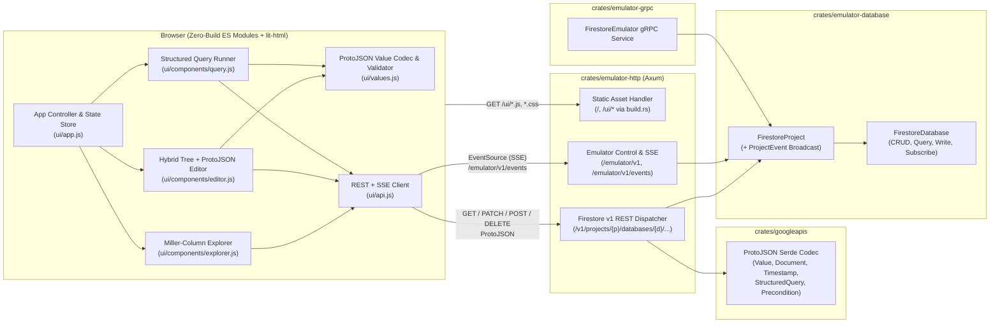

# Firestore Emulator REST-First Web UI & Core ProtoJSON API

*   **Author:** Paco van der Linden
*   **Status:** Draft
*   **Date:** 2026-11-10

--------------------------------------------------------------------------------

## Overview

This document specifies the design for replacing the read-only HTML status page in `firestore-emulator` with a full-featured, interactive Web UI for inspecting, creating, editing, deleting, and querying Firestore documents in real time, backed by the official Google Cloud Firestore v1 ProtoJSON REST API.

*   **Objectives (Plain-Language Goal):** Give developers using the Rust Firestore Emulator a built-in browser interface where they can browse databases, collections, documents, and nested subcollections side by side, add or delete documents, edit individual fields without corrupting data types (such as 64-bit whole numbers vs. decimal numbers, timestamps, document links, and binary data), run filtered queries, and watch database changes appear live while automated tests run—all compiled into the single `firestore-emulator` binary with `cargo build` and zero external JavaScript build tools.
*   **State of the Art (Current Practice & Limits):** Today, the emulator ships a 211-line single-file page ([`ui/index.html`](../../ui/index.html)) backed by two ad-hoc endpoints (`GET /emulator/v1/{*ref}` and `DELETE /emulator/v1/{*ref}`). It only supports clicking through database, collection, and document links on separate pages, dumping raw untagged JSON in a `<pre>` block, and wiping an entire database. Because [`crates/googleapis/build.rs`](../../crates/googleapis/build.rs) currently serializes `google.firestore.v1.Value` with `#[serde(untagged)]`, strings, document references, and base64 byte arrays all serialize as identical JSON strings, timestamps and geographic coordinates collide with regular maps, and JavaScript's `JSON.parse` collapses 64-bit integers and 64-bit floats into a single 53-bit float type. Developers cannot create or edit documents, cannot delete a single document or collection, cannot run queries in the UI, and must manually refresh the browser to see test changes.
*   **New Approach:** We will replace the untagged JSON serialization in `crates/googleapis` with standard Firestore v1 ProtoJSON serialization and deserialization (`integerValue` as string, `doubleValue` with `NaN`/`±Infinity` support, RFC 3339 `timestampValue`, padded Base64 `bytesValue`), expose the core Firestore v1 REST CRUD and query endpoints under `/v1/projects/{project_id}/databases/{database_id}/documents/...`, add a single project-wide Server-Sent Events (SSE) invalidation endpoint (`GET /emulator/v1/events`), and build a modular, zero-build ES-module frontend in `ui/` (using the existing vendored [`ui/lit-html.js`](../../ui/lit-html.js)). A dependency-free `build.rs` in `crates/emulator-http` will embed the `ui/` files for release and Nix (`naersk`) builds while reading directly from disk in debug builds for instant browser reload.
*   **Impact:** Developers writing and debugging tests against `firestore-emulator` can inspect and mutate test fixtures, verify exact stored data types (`i64` vs. `f64`), test `StructuredQuery` filters interactively, and observe live state transitions during test runs without writing ad-hoc setup scripts or installing the external Node.js/Java Firebase CLI toolchain. External HTTP tools and scripts also gain standard Firestore v1 REST CRUD and query endpoints on the same port.
*   **Risks & Payoffs:**
    *   *Risk 1 — JavaScript 53-bit number precision loss:* Browser `Number` truncates 64-bit `integerValue` fields beyond $\pm(2^{53}-1)$ and conflates `1` with `1.0`. *Mitigation:* Keep `integerValue` as a string in ProtoJSON and validate integer inputs in the UI using native JavaScript `BigInt` (`-9223372036854775808n` to `9223372036854775807n`).
    *   *Risk 2 — Live SSE updates contending on document locks or clobbering active UI edits:* High-throughput test suites create/clear hundreds of databases and perform thousands of writes per second; unthrottled UI re-fetches could contend on per-document FIFO read/write locks ([`crates/fifo-rwlock/src/lib.rs`](../../crates/fifo-rwlock/src/lib.rs)) or overwrite unsaved user edits in the browser. *Mitigation:* Stream only coarse-grained path invalidation events over a single SSE connection per tab, debounce client-side REST refreshes (`150ms`), fetch collection lists with `?mask.fieldPaths=__name__&showMissing=true`, avoid re-fetching cleared databases on `database_cleared` events, and guard dirty editor state with a non-destructive `"Updated externally — Reload"` banner.
    *   *Risk 3 — Nix (`naersk`) two-phase build failures and working-directory mismatches:* `naersk` compiles crate dependencies in a phase where `ui/` is not present in the build sandbox, and `test-suite` starts the debug binary from `test-suite/` rather than the workspace root. *Mitigation:* Have `crates/emulator-http/build.rs` emit an empty asset table when `../../ui` is absent during dependency compilation, and resolve debug-mode disk assets via `FIRESTORE_EMULATOR_UI_DIR` or `env!("CARGO_MANIFEST_DIR")` with fallback to embedded bytes.
*   **Cost:** Zero new external runtime or build toolchains (no Node.js, npm, or WASM bundlers required for `cargo build` or `nix build`), zero new third-party Cargo crate dependencies required (reusing workspace `serde`, `serde_json`, `time`, `base64`, `axum`, `tokio-stream`, and `tracing`), and `< 150 KB` added to the compiled binary size for the modular ES-module UI assets.
*   **Timeline:** Estimated 4 incremental implementation milestones (~5–7 engineering days total):
    *   *Milestone 1 (1.5 days):* ProtoJSON codec in `crates/googleapis` (`Value`, `Document`, `Timestamp`, `LatLng`, `DocumentMask`, `Precondition`, `StructuredQuery`) + unit tests.
    *   *Milestone 2 (1.5 days):* Shared CRUD/Query service methods and `Query::missing_docs` fix in `emulator-database`, `/v1/projects/...` REST dispatcher and structured `RestError` in `emulator-http`, and project-level SSE event bus (`/emulator/v1/events`) + `reqwest` integration tests.
    *   *Milestone 3 (2 days):* Multi-file `ui/` ES-module architecture (`build.rs` asset loader, Miller-column explorer with phantom document support, cold-start database bootstrap, and SSE live-sync manager).
    *   *Milestone 4 (1–2 days):* Hybrid document editor (structured typed field tree + raw ProtoJSON tab), structured query runner, and JSDoc type-checking (`tsc --noEmit`).
*   **Metrics & Exams:**
    *   *Mid-term Exam (Backend & ProtoJSON Check):* `cargo nextest run --workspace` passes 100% of unit and `reqwest` integration tests covering round-trip ProtoJSON fidelity for all 11 storable Firestore value types (`i64::MIN`/`i64::MAX`, `NaN`, `±Infinity`, `-0.0`, padded Base64, RFC 3339 timestamps), REST CRUD (`GetDocument`, `ListDocuments` with `showMissing` and `mask`, `CreateDocument`, `UpdateDocument` with `updateMask`, `DeleteDocument`), `:listCollectionIds`, `:runQuery`, and SSE invalidation across `clear_database`.
    *   *Final Exam (End-to-End UI, Build & Compatibility Check):*
        1. `cargo build`, `cargo build --no-default-features`, and `nix build` succeed with zero warnings (`just lint`).
        2. Existing gRPC SDK test suite (`just sdk-test`) passes without regression.
        3. Static type verification (`npx tsc --noEmit` on `ui/**/*.js`) passes with zero errors.
        4. All five Critical User Journeys (cold-start database/document creation, Miller-column phantom ancestor traversal, lossless `i64`/`f64`/nested field editing, structured query execution, and live SSE updates under concurrent writes without clobbering dirty edits) succeed in the browser.

--------------------------------------------------------------------------------

## The Problem

The current HTTP and UI layer in `crates/emulator-http` and `ui/index.html` has four structural limitations that prevent developers from using the UI to inspect and manipulate test state:

1.  **Lossy Untagged JSON Representation:** [`crates/googleapis/build.rs`](../../crates/googleapis/build.rs) configures `google.firestore.v1.Value` with `#[serde(transparent)]` and `#[serde(untagged)]`. In the resulting JSON:
    *   `StringValue("projects/...")`, `ReferenceValue("projects/...")`, and `BytesValue(...)` all serialize to plain JSON strings and cannot be distinguished or deserialized back into their original Firestore types.
    *   `TimestampValue` (`{"seconds": ..., "nanos": ...}`) and `GeoPointValue` (`{"latitude": ..., "longitude": ...}`) are indistinguishable from a `MapValue` containing those keys.
    *   `IntegerValue(42)` and `DoubleValue(42.0)` both parse as IEEE-754 `number` in browser JavaScript, losing the distinction between `i64` and `f64` (which Firestore's `Value::storage_eq` treats as distinct storage representations) and truncating 64-bit integers outside $\pm(2^{53}-1)$.
2.  **Missing REST CRUD and Query Endpoints:** [`crates/emulator-http/src/routes/projects.rs`](../../crates/emulator-http/src/routes/projects.rs) only implements `GET` and `PATCH` on `/v1/projects/{project_id}/databases/{database_id}` for database edition and concurrency mode metadata. Document CRUD (`GetDocument`, `ListDocuments`, `CreateDocument`, `UpdateDocument`, `DeleteDocument`), collection listing (`:listCollectionIds`), and queries (`:runQuery`) are not exposed on `/v1/projects/...`, and `CreateDocument`, `UpdateDocument`, and `DeleteDocument` return `Status::unimplemented` via the local `unimplemented!()` macro in [`crates/emulator-grpc/src/lib.rs`](../../crates/emulator-grpc/src/lib.rs).
3.  **Read-Only Single-Page Navigation & Destructive Error Handling:** [`ui/index.html`](../../ui/index.html) renders one level at a time via full pathname navigation, provides no controls to create or edit documents or fields, cannot delete individual documents, cannot run queries, and overwrites the entire `#canvas` DOM with a red stack trace whenever any request fails. Furthermore, `RouterBuilder::build` uses a blanket `.fallback(get(async || Html(HTML)))` that returns `200 OK` (`text/html`) for mistyped API routes or missing `.js` files.
4.  **No Live Update Stream Across Database Lifecycles:** `FirestoreDatabase` maintains an internal 1024-event broadcast channel for gRPC `Listen` streams, but `FirestoreProject` has no project-level event bus when databases are lazily created or cleared (`clear_database`), and `emulator-http` exposes no mechanism to notify the browser when tests mutate data.

### Proposed Solution Summary

We will solve these four problems by:

1.  Implementing official Firestore v1 ProtoJSON `Serialize` and `Deserialize` in `crates/googleapis` for `Value`, `Document`, `Timestamp`, `LatLng`, `DocumentMask`, `Precondition`, and `StructuredQuery`.
2.  Extracting shared CRUD/Query helpers into `crates/emulator-database` and mounting a unified `/v1/projects/{project_id}/databases/{database_id}/documents` REST dispatcher and Google Cloud JSON `RestError` handler in `crates/emulator-http`.
3.  Adding a project-level event broadcast channel in `FirestoreProject` and exposing `GET /emulator/v1/events` (SSE) to push lightweight invalidation and `resync` events to the browser.
4.  Building a multi-file, zero-build ES-module UI in `ui/` (embedded via a `naersk`-safe `build.rs` and served from disk in debug mode) providing Miller-column navigation, a hybrid structured-tree and raw-ProtoJSON document editor, a query runner, and debounced SSE live updates.

--------------------------------------------------------------------------------

## Goals

*   **G1 — Lossless Firestore v1 ProtoJSON Serialization:** Round-trip all 11 storable Firestore `Value` types (`nullValue`, `booleanValue`, `integerValue` as decimal string, `doubleValue` including `"NaN"`/`"Infinity"`/`"-Infinity"`/`-0.0`, RFC 3339 `timestampValue`, `stringValue`, padded Base64 `bytesValue`, `referenceValue`, `geoPointValue`, `arrayValue`, `mapValue`), `Document`, `DocumentMask`, `Precondition`, and `StructuredQuery` through `serde_json` in full compliance with Google's Proto3 JSON specification.
*   **G2 — Core Firestore v1 REST CRUD & Query API:** Expose `GetDocument`, `ListDocuments` (supporting `showMissing`, `mask.fieldPaths`, `pageSize`, `pageToken`), `CreateDocument` (with client-supplied `documentId`), `UpdateDocument` (supporting `updateMask.fieldPaths` and `currentDocument` preconditions), `DeleteDocument`, `:listCollectionIds`, and `:runQuery` under `/v1/projects/{project_id}/databases/{database_id}/documents`, returning standard Google Cloud `google.rpc.Status` JSON error envelopes on failure.
*   **G3 — Zero-Build Multi-File UI with Instant Debug Reload & Hermetic Release Builds:** Organize the frontend into modular ES-module `.js` and `.css` files under `ui/` using the existing vendored `lit-html.js`, served directly from disk in debug builds (resolved via `FIRESTORE_EMULATOR_UI_DIR` or `CARGO_MANIFEST_DIR`) and compiled into the binary in release builds without breaking two-phase `naersk` builds in `flake.nix`.
*   **G4 — Cloud-Console-Style Miller-Column Explorer & Hybrid Document Editor:** Provide side-by-side Miller-column navigation (Database selector & settings $\rightarrow$ Root Collections $\rightarrow$ Documents $\rightarrow$ Document Fields & Subcollections) including phantom ancestor document discovery (`?showMissing=true`), cold-start database/collection creation (with client-side 20-char auto-ID generation), in-place field editing via a type-safe tree editor (`BigInt`-validated `i64` vs. `f64`) paired with a synced "Raw ProtoJSON" tab, and recursive/single document deletion.
*   **G5 — Interactive Query Runner & Non-Intrusive Live Updates:** Allow executing filtered/sorted queries (via a visual filter builder or raw `StructuredQuery` JSON) and automatically refresh visible UI columns/documents via debounced SSE invalidation events (`GET /emulator/v1/events`) without overwriting unsaved edits in an open editor.

--------------------------------------------------------------------------------

## Non-Goals

*   **NG1 — Non-UI Firestore v1 REST Endpoints (Deferred to Phase 2):** Implementing `:beginTransaction`, `:rollback`, `:commit`, `:batchGet`, `:batchWrite`, `:runAggregationQuery`, `:executePipeline`, server-side `DocumentTransform`s (`FieldTransform.ServerValue`, `increment`, `arrayUnion`), and running the full `@google-cloud/firestore` Node.js test suite in `preferRest: true` mode are out of scope for Phase 1.
*   **NG2 — Proprietary WebChannel / gRPC-Web Streaming Protocol:** We will not implement Google's proprietary WebChannel wire protocol or gRPC-Web framing for browser `Listen` streams; the UI uses `/emulator/v1/events` (SSE) + REST re-fetching instead.
*   **NG3 — External Frontend Build Toolchains:** We will not introduce Node.js, npm, Vite, Webpack, TypeScript compilation, or Rust-to-WASM bundlers (`trunk`, `dx`, `cargo-leptos`) into `cargo build` or `flake.nix`.
*   **NG4 — Security Rules, Indexes, or LevelDB Import/Export:** Simulating Firestore Security Rules, managing composite index definitions, or importing/exporting LevelDB backup files are out of scope.

--------------------------------------------------------------------------------

## Open Questions

All architectural and scope questions raised during ideation have been resolved:

*   *Resolved:* REST API scope is staged so Phase 1 implements only the ProtoJSON types and REST CRUD/Query endpoints needed by the UI (`GetDocument`, `ListDocuments`, `CreateDocument`, `UpdateDocument`, `DeleteDocument`, `:listCollectionIds`, and `:runQuery`).
*   *Resolved:* Document IDs on `CreateDocument` are required client-side (matching official Firestore SDK behavior); the UI provides a client-side 20-character alphanumeric auto-ID generator using `crypto.getRandomValues`.
*   *Resolved:* Static UI assets use a `naersk`-safe `build.rs` in `crates/emulator-http` rather than adding external proc-macro crate dependencies.
*   *Resolved:* The document editor ships with the structured typed field-row/tree editor as primary view alongside a synced "Raw ProtoJSON" tab.

--------------------------------------------------------------------------------

## Critical User Journeys (CUJs)

### CUJ 1: Cold-Start Database Bootstrap & Document Creation

*   **Given**: The developer starts `firestore-emulator --host-port 127.0.0.1:8080` with no databases created yet and opens `http://127.0.0.1:8080/` in a browser.
*   **When**: The developer clicks **"+ Open / Create Database"**, accepts or enters project `demo-project` and database `(default)` (optionally toggling `STANDARD` / `ENTERPRISE` edition), clicks **"+ Start Collection"**, enters collection ID `users`, enters document ID `alice` (or clicks **"Auto-ID"** to populate a 20-character alphanumeric ID client-side), adds an `integerValue` field `age = "30"`, a `doubleValue` field `score = 99.5`, and a `mapValue` field `profile` containing `stringValue` `role = "admin"`, and clicks **Save**.
*   **Then**: The UI issues `PATCH /v1/projects/demo-project/databases/(default)` and `POST /v1/projects/demo-project/databases/(default)/documents/users?documentId=alice`; the Miller columns immediately display `users` $\rightarrow$ `alice` $\rightarrow$ the typed fields (`age: int64`, `score: double`, `profile: map`) with `createTime` and `updateTime` metadata.

### CUJ 2: Lossless In-Place Editing of 64-Bit Integers, Special Floats, and Nested Fields

*   **Given**: Document `projects/p/databases/(default)/documents/metrics/m1` exists with `max_int` = `IntegerValue(9223372036854775807)` (`i64::MAX`), `whole_float` = `DoubleValue(1.0)`, and `ratio` = `DoubleValue(f64::NAN)`.
*   **When**: The developer selects `metrics/m1` in the UI, edits a sibling field `label` to `"updated"` in the Structured Tree Editor (or switches to the Raw ProtoJSON tab and back), and clicks **Save**.
*   **Then**: The UI sends `PATCH /v1/projects/p/databases/(default)/documents/metrics/m1?updateMask.fieldPaths=label` (or full document with `currentDocument.updateTime`), preserving `max_int` as exact `i64::MAX` (`"9223372036854775807"` without 53-bit truncation), `whole_float` as `DoubleValue(1.0)` (not coerced to `IntegerValue(1)`), and `ratio` as `DoubleValue(NaN)`. If the user enters an out-of-range integer (`9223372036854775808`), the editor highlights a `BigInt` range validation error inline before any network call is made.

### CUJ 3: Navigating Subcollections Under Phantom (Non-Existent) Ancestor Documents

*   **Given**: A test writes document `projects/p/databases/(default)/documents/rooms/room-1/messages/msg-1` without ever creating the parent document `rooms/room-1`.
*   **When**: The developer opens database `projects/p/databases/(default)` and clicks collection `rooms` in the Miller columns.
*   **Then**: The UI requests `GET /v1/projects/p/databases/(default)/documents/rooms?showMissing=true&mask.fieldPaths=__name__`, renders `room-1` in italics with a `"Non-existent ancestor"` badge, and when clicked, concurrently calls `GET .../rooms/room-1` (handling the `404 NOT_FOUND` response gracefully) and `POST .../rooms/room-1:listCollectionIds`, displaying the `messages` subcollection and a **"+ Create Document at rooms/room-1"** button so the developer can traverse into `messages/msg-1`.

### CUJ 4: Interactive Structured Query Execution

*   **Given**: Collection `users` contains 50 documents with `age` (`integerValue`), `active` (`booleanValue`), and `created_at` (`timestampValue`).
*   **When**: The developer switches the collection pane to **Query Mode**, adds filter rows `active == true` (boolean) and `age >= 21` (int64), adds sort `age DESC`, sets `limit = 10`, and clicks **Run Query** (or edits the synced `StructuredQuery` JSON tab and clicks **Run Query**).
*   **Then**: The UI sends `POST /v1/projects/p/databases/(default)/documents:runQuery`, displays the matching documents with execution time and `readTime`, and clicking any result opens that document in the inspector/editor pane.

### CUJ 5: Real-Time SSE Updates During Concurrent Test Execution Without Clobbering Active Edits

*   **Given**: The developer has `users/alice` open in the document editor with an unsaved change to field `age`, while a background test run modifies `users/alice`, adds `users/bob`, and creates a new database `projects/test-2/databases/(default)`.
*   **When**: `GET /emulator/v1/events` streams the corresponding invalidation events to the browser.
*   **Then**: Within ~150ms (debounced), the database list adds `test-2/(default)` and the `users` collection column adds `bob` automatically, while the open dirty editor for `users/alice` is **not** overwritten—instead displaying a non-destructive banner: *"This document was updated externally. [Reload external version] [Keep my edits]"*.

--------------------------------------------------------------------------------

## Technical Plan (Architecture)

### 1. System Architecture & Data Flow

The architecture separates responsibilities across four workspace layers while keeping `emulator-database` as the single source of truth for document storage, query execution, and event emission:



### 2. Layer 1: Firestore v1 ProtoJSON Codec (`crates/googleapis`)

Instead of relying on `#[serde(untagged)]` on `Value` in [`crates/googleapis/build.rs`](../../crates/googleapis/build.rs), [`crates/googleapis/src/ser.rs`](../../crates/googleapis/src/ser.rs) will implement canonical Proto3 JSON (`Serialize` and `Deserialize`) for the Firestore v1 types used by the REST API (while retaining the post-generation string replacement in `build.rs` that removes Prost's derived `PartialEq` from `Value` and `ValueType` so [`crates/googleapis/src/value_ext.rs`](../../crates/googleapis/src/value_ext.rs) can provide custom `PartialEq`/`Eq`/`Ord`):

| Protobuf Type | Rust Type (`googleapis::google::...`) | ProtoJSON Wire Contract |
| :--- | :--- | :--- |
| `firestore.v1.Value` | `firestore::v1::Value` (`ValueType` oneof) | Single-key JSON object with `camelCase` variant key (`nullValue`, `booleanValue`, `integerValue`, `doubleValue`, `timestampValue`, `stringValue`, `bytesValue`, `referenceValue`, `geoPointValue`, `arrayValue`, `mapValue`). Empty `{}` objects or multi-key objects are rejected during deserialization. Write-invalid variants (`fieldReferenceValue`, `functionValue`, `pipelineValue`) are rejected during document write validation in `FirestoreDatabase::perform_write` with `INVALID_ARGUMENT`. |
| `int64` (`integer_value`) | `i64` | Serializes as a decimal string (`"42"`, `"-9223372036854775808"`). Deserializes from either a decimal string or a JSON integer within `i64::MIN..=i64::MAX`. |
| `double` (`double_value`) | `f64` | Serializes finite floats as JSON numbers (preserving `-0.0` vs. `0.0` on parse) and non-finite floats as `"NaN"`, `"Infinity"`, or `"-Infinity"`. Deserializes both JSON numbers and those three strings. |
| `protobuf.Timestamp` | `protobuf::Timestamp` | Serializes as RFC 3339 UTC string (`"YYYY-MM-DDTHH:MM:SS.fffffffffZ"`, reusing `Timestamp`'s existing `Display` implementation in [`crates/googleapis/src/timestamp_ext.rs`](../../crates/googleapis/src/timestamp_ext.rs)). Deserializes RFC 3339 strings via `time::OffsetDateTime::parse(&s, &Iso8601::DEFAULT)`. |
| `bytes` (`bytes_value`) | `prost::bytes::Bytes` | Serializes using standard padded Base64 (`BASE64_STANDARD`). Deserializes from standard or URL-safe Base64 (with or without padding). |
| `protobuf.NullValue` | `i32` (`0`) | Serializes as `null`. Deserializes from `null`, `"NULL_VALUE"`, or `0`. |
| `type.LatLng` | `r#type::LatLng` | `{ "latitude": <f64>, "longitude": <f64> }` with `#[serde(default)]` so omitted zero coordinates (`{}`) deserialize as `0.0`. |
| `firestore.v1.ArrayValue` / `MapValue` | `ArrayValue` / `MapValue` | `{ "values": [...] }` and `{ "fields": {...} }` with `#[serde(default)]` so `{}` deserializes as an empty vector or map. |
| `firestore.v1.Document` | `Document` | `{ "name": "...", "fields": {...}, "createTime": "...", "updateTime": "..." }` with `#[serde(rename_all = "camelCase", default)]` and `skip_serializing_if = "Option::is_none"` on timestamps (so missing/phantom documents serialize without `createTime`/`updateTime`). |
| `firestore.v1.StructuredQuery` | `StructuredQuery` + nested filter/order types | Custom `Serialize`/`Deserialize` handling `camelCase` field names, flattened `oneof` unions (`Filter::filter_type`, `Value`), string enum names (`CompositeFilter::Operator`, `FieldFilter::Operator`, `UnaryFilter::Operator`, `Direction`), and unwrapped `google.protobuf.Int32Value` for `limit`. Requires `filter_type`, `field`, `op`, `value`, and `operand_type` on filter nodes so malformed queries fail with `400 INVALID_ARGUMENT` during deserialization. |

### 3. Layer 2: Shared CRUD & Project-Wide Event Bus (`crates/emulator-database`)

1.  **Shared Document CRUD & Listing Operations on `FirestoreDatabase`:**
    To prevent logic drift between `emulator-grpc` and `emulator-http`, [`FirestoreDatabase`](../../crates/emulator-database/src/database.rs) will expose transport-agnostic methods using the resource reference types (`Ref`, `RootRef`, `CollectionRef`, `DocumentRef` in [`crates/emulator-database/src/database/reference.rs`](../../crates/emulator-database/src/database/reference.rs)), field projections ([`crates/emulator-database/src/database/projection.rs`](../../crates/emulator-database/src/database/projection.rs)), and read consistency modes (`ReadConsistency`):

    *   `create_doc`: Validates that the client-supplied `document_id` is non-empty and `document.name` is empty, constructs `DocumentRef` via `Ref::from_str` validation, executes `self.write(...)` with `Precondition::Exists(false)`, and returns the stored `Document` projected by `DocumentMask`.
    *   `update_doc`: Executes `self.write(...)` with `write::Operation::Update`, applies `update_mask` and `current_document` preconditions, and returns the projected `Document`.
    *   `delete_doc`: Executes `self.write(...)` with `write::Operation::Delete` and optional `current_document` precondition.
    *   `delete_prefix`: Enumerates existing documents matching or residing in subcollections under a target `Ref` (`Ref::Collection` or `Ref::Document`) using `Ref::is_parent_of` and deletes each existing document via `delete_doc` so MVCC tombstones, lock guards, and event notifications are preserved.
    *   `list_docs`: Executes `QueryBuilder`, merges phantom ancestor documents from `Query::missing_docs` when `show_missing` is `true` (rejecting non-empty `order_by` when `show_missing` is `true` per `firestore.proto`), and applies `page_token` cursor slicing and `page_size` bounds instead of returning `Status::unimplemented`.
    *   Writable `Value` validation (rejecting `FieldReferenceValue`, `FunctionValue`, `PipelineValue`, and directly nested `ArrayValue` inside `ArrayValue`) is enforced centrally inside `FirestoreDatabase::perform_write` so all gRPC and REST write paths share the same invariant.
    *   The `create_document`, `update_document`, `delete_document`, and `list_documents` handlers in [`crates/emulator-grpc/src/lib.rs`](../../crates/emulator-grpc/src/lib.rs) will delegate directly to these methods.

2.  **Project-Level Lifecycle & Mutation Event Bus on `FirestoreProject`:**
    [`FirestoreProject`](../../crates/emulator-database/src/project.rs) will hold a `broadcast::Sender<ProjectEvent>` (capacity `1024`) exposed via `subscribe_project_events()` and emitting coarse-grained notifications:

    *   `ProjectEvent::DatabaseCreated { database: RootRef }` (emitted inside the `get_or_insert` initializer closure in `FirestoreProject::database` when a new `FirestoreDatabase` is inserted).
    *   `ProjectEvent::DatabaseCleared { database: RootRef }` (emitted in `FirestoreProject::clear_database`).
    *   `ProjectEvent::DatabaseConfigChanged { database: RootRef }` (emitted when edition or concurrency mode changes).
    *   `ProjectEvent::DocumentsChanged { database: RootRef, paths: Vec<String>, update_time: Timestamp }` (forwarded from `FirestoreDatabase::send_event` using only stringified `DocumentRef` paths so `ProjectEvent` never holds strong or weak `Arc<FirestoreDatabase>` pointers).

### 4. Layer 3: HTTP Routing, Error Envelopes, SSE & Asset Serving (`crates/emulator-http`)

1.  **Google Cloud JSON Error Envelope (`crates/emulator-http/src/error.rs`):**
    `RestError` will serialize as `application/json` matching `google.rpc.Status`:
    ```json
    {
      "error": {
        "code": 409,
        "message": "document already exists: projects/p/databases/(default)/documents/users/alice",
        "status": "ALREADY_EXISTS"
      }
    }
    ```
    Status mapping from `GenericDatabaseError`:

    *   `InvalidArgument(_)` / `InvalidReference(_, _)` $\rightarrow$ `400 BAD_REQUEST` / `"INVALID_ARGUMENT"`
    *   `FailedPrecondition(_)` $\rightarrow$ `400 BAD_REQUEST` / `"FAILED_PRECONDITION"`
    *   `AlreadyExists(_)` $\rightarrow$ `409 CONFLICT` / `"ALREADY_EXISTS"`
    *   `Aborted(_)` $\rightarrow$ `409 CONFLICT` / `"ABORTED"`
    *   `Cancelled(_)` $\rightarrow$ `499` / `"CANCELLED"`
    *   `NotImplemented(_)` $\rightarrow$ `501 NOT_IMPLEMENTED` / `"UNIMPLEMENTED"`
    *   `Internal(_)` $\rightarrow$ `500 INTERNAL_SERVER_ERROR` / `"INTERNAL"`

    Missing resources construct `404 NOT_FOUND` / `"NOT_FOUND"` via `RestError::not_found()` or `RestError::not_found_msg(...)`. JSON request bodies will be extracted through a custom wrapper in `emulator-http` that logs the `serde_json::Error` message (including line and column) at `DEBUG` level and returns `400 INVALID_ARGUMENT`.

2.  **Unified `/v1/projects` Dispatcher (`crates/emulator-http/src/routes/projects.rs`):**
    Because Axum's `matchit` router cannot split `:customVerb` suffixes on catch-all wildcards or distinguish odd-segment collection paths from even-segment document paths, `projects::router()` will mount:

    *   `GET / PATCH /{project_id}/databases/{database_id}`: Existing database metadata handler.
    *   `ANY /{project_id}/databases/{database_id}/documents` and `ANY /{project_id}/databases/{database_id}/documents/{*tail}`: Handled by a single `dispatch_documents` entry point that:
        1. Splits any trailing `:verb` suffix (`:listCollectionIds`, `:runQuery`) from the path.
        2. Constructs the full resource path `projects/{project_id}/databases/{database_id}/documents[/...]` and parses it into `emulator_database::reference::Ref` (`Ref::Root`, `Ref::Collection`, `Ref::Document`).
        3. Parses query parameters from `uri.query()` supporting repeated keys (`mask.fieldPaths`, `updateMask.fieldPaths`) and scalars (`documentId`, `pageSize`, `pageToken`, `orderBy`, `showMissing`, `currentDocument.exists`, `currentDocument.updateTime`).
        4. Dispatches by `(http::Method, Ref, Option<&str>)`:
            *   `(POST, Ref::Root | Ref::Document, Some("listCollectionIds"))` $\rightarrow$ `list_collection_ids` (`{ "collectionIds": [...] }`)
            *   `(POST, Ref::Root | Ref::Document, Some("runQuery"))` $\rightarrow$ `run_query` (returns JSON array `[{ "document": ..., "readTime": ... }]`, or `[{ "readTime": ... }]` when zero documents match)
            *   `(GET, Ref::Collection, None)` $\rightarrow$ `list_documents` (`{ "documents": [...], "nextPageToken": "..." }`)
            *   `(POST, Ref::Collection, None)` $\rightarrow$ `create_document` (requires `?documentId=...`)
            *   `(GET, Ref::Document, None)` $\rightarrow$ `get_document` (returns `404 NOT_FOUND` if document does not exist)
            *   `(PATCH, Ref::Document, None)` $\rightarrow$ `update_document`
            *   `(DELETE, Ref::Document, None)` $\rightarrow$ `delete_document` (returns `{}`)

3.  **Emulator Control Plane & SSE Stream (`crates/emulator-http/src/routes/emulator.rs`):**
    *   `GET /emulator/v1`: Preserves the existing response returning `Json(Vec<RootRef>)` (`["projects/{p}/databases/{d}/documents"]`) for 100% backward compatibility. The UI fetches and updates database edition and concurrency mode for the active database via `GET` / `PATCH /v1/projects/{project_id}/databases/{database_id}`. The legacy `GET /emulator/v1/{*ref}` (`get_by_ref`) route is removed because the UI now reads collections and documents via `/v1/projects/...`.
    *   `DELETE /emulator/v1/{*ref}`: Clears the specified database when `{*ref}` is a `Ref::Root` (`project.clear_database(&root)`), and performs recursive prefix deletion via `db.delete_prefix(&prefix)` when `{*ref}` is a `Ref::Collection` or `Ref::Document` (used by the UI's "Delete Document & Subcollections" and "Delete Collection" actions).
    *   `GET /emulator/v1/events`: Returns an `axum::response::sse::Sse` stream subscribed to `project.subscribe_project_events()`.
        *   Emits JSON SSE events with `event: change` (`database_created`, `database_cleared`, `database_config_changed`, `documents_changed`) and `KeepAlive` comments every 15 seconds.
        *   If the receiver encounters `BroadcastStreamRecvError::Lagged(skipped)`, logs a `warn!` and emits `event: resync` (`{ "type": "resync", "skipped": skipped }`) so the client refreshes its active view.

4.  **Hermetic `build.rs` Asset Embedding & Fallback Isolation (`crates/emulator-http/build.rs` & `routes.rs`):**
    *   `crates/emulator-http/build.rs` inspects `../../ui`. If the directory does not exist (as in Phase 1 of `naersk`'s Nix build), it generates an empty `UI_ASSETS` slice in `$OUT_DIR/ui_assets.rs`. When `../../ui` exists, it collects all `.html`, `.js`, `.css`, and `.svg` files under `../../ui`, emits `cargo:rerun-if-changed=../../ui`, and generates static `(rel_path, content_type, include_bytes!(...))` entries.
    *   Route isolation in `RouterBuilder::build`:
        *   `/v1/{*unmatched}` and `/emulator/{*unmatched}` always return `404 NOT_FOUND` JSON `RestError` (whether `feature = "ui"` is enabled or disabled).
        *   When `feature = "ui"` is enabled, `GET /ui/{*asset_path}` serves the requested asset (from disk in debug mode via `FIRESTORE_EMULATOR_UI_DIR` or `CARGO_MANIFEST_DIR/../../ui`, or from `UI_ASSETS` in release mode) with exact `Content-Type`. Unknown `/ui/*` paths return `404 Not Found`. Non-API, non-asset `GET` navigation routes serve `ui/index.html` with `<script>window.EMULATOR_VERSION="...";</script>` injected before `</head>`.

### 5. Layer 4: Zero-Build Multi-File Frontend (`ui/`)

The frontend uses native browser ES modules (`<script type="module" src="/ui/app.js">`) with relative module specifiers (`./lit-html.js`, `../lit-html.js`) and the existing vendored [`ui/lit-html.js`](../../ui/lit-html.js) (accompanied by `ui/lit-html.d.ts`), organized into focused modules checked with `// @ts-check` JSDoc annotations:

*   `ui/index.html` & `ui/styles.css`: Responsive app shell (top header with emulator version, SSE connection badge, database selector/creator, database edition/concurrency toggle, and view switcher between **Explorer** and **Query Runner**) and Miller-column layout CSS.
*   `ui/app.js`: Top-level application controller and state store coordinating URL routing (`window.history.pushState`), active database selection and metadata (`GET`/`PATCH /v1/projects/{p}/databases/{d}`), SSE invalidation handling (clearing in-memory columns and calling `GET /emulator/v1` on `database_cleared` without re-creating the deleted database), and toast notifications.
*   `ui/api.js`: Typed wrapper around `fetch` for `/v1/projects/...` and `/emulator/v1/...`, plus the single `EventSource("/emulator/v1/events")` listener with `150ms` debounce and `resync` handling.
*   `ui/values.js`: Lossless Firestore v1 ProtoJSON value helpers and client-side ID generator:
    *   Generates 20-character alphanumeric document IDs client-side via `crypto.getRandomValues`.
    *   Validates `integerValue` strings using `BigInt` (`-9223372036854775808n`..=`9223372036854775807n`) without converting to `Number`.
    *   Formats and parses `doubleValue` (including `"NaN"`, `"Infinity"`, `"-Infinity"`, `-0.0`), `timestampValue` (preserving nanosecond precision), `bytesValue` (UTF-8 / Hex / Base64 input modes), `geoPointValue`, `referenceValue` (auto-expanding relative `col/doc` paths to `projects/{p}/databases/{d}/documents/col/doc`), `arrayValue` (preventing directly nested arrays), and `mapValue`.
    *   Inspects raw ProtoJSON text before `JSON.parse` to warn if an `integerValue` or number literal exceeds `Number.MAX_SAFE_INTEGER` unquoted.
*   `ui/components/explorer.js`: Cloud-Console-style horizontal Miller columns:
    *   Each selected document level renders `[Collections Column | Documents Column | Document Fields & Subcollections Panel]`.
    *   Calls `ListDocuments` with `?showMissing=true&mask.fieldPaths=__name__` so phantom ancestor documents appear in italics and remain navigable via `:listCollectionIds`.
*   `ui/components/editor.js`: Hybrid Document & Field Editor:
    *   **Structured Tree Tab (Default):** Recursive field tree where users can edit a single field in-place (sending `PATCH ?updateMask.fieldPaths=...`), add/delete fields at any nesting depth, or create a new document (with an **"Auto-ID"** button powered by `generateAutoId()`).
    *   **Raw ProtoJSON Tab:** Textarea displaying `JSON.stringify({ fields: doc.fields }, null, 2)` with syntax/schema validation and `currentDocument.updateTime` precondition on save.
    *   **Dirty-State Guard:** Tracks `isDirty` when a user is editing; if an SSE invalidation arrives for the active document path while `isDirty == true`, displays an inline conflict banner instead of overwriting the editor buffer.
*   `ui/components/query.js`: Structured Query Runner:
    *   Visual builder for collection ID (with `allDescendants` collection-group toggle), `where` filter rows (`fieldPath`, operator dropdown for the 8 supported `FieldFilter` operators `EQUAL` / `NOT_EQUAL` / `LESS_THAN` / `LESS_THAN_OR_EQUAL` / `GREATER_THAN` / `GREATER_THAN_OR_EQUAL` / `ARRAY_CONTAINS` / `IN` + 4 unary operators `IS_NAN` / `IS_NULL` / `IS_NOT_NAN` / `IS_NOT_NULL`, value type & input), `orderBy` rows, and `limit`.
    *   Synced "Raw `StructuredQuery` JSON" tab and results table with `readTime` and execution duration.

--------------------------------------------------------------------------------

## Alternatives Considered

### Alternative A: Pure Server-Side Rendering (Axum + Maud/Askama + HTMX)

*   **Pros**:
    *   Keeps 100% of application logic in Rust with compile-time HTML template type checking.
    *   No client-side JavaScript state management needed for read-only collection and document lists.
*   **Cons**:
    *   Server endpoints return HTML fragments rather than JSON, which does not advance the official Firestore v1 REST API and prevents external HTTP tools or alternative UIs from reusing the backend.
    *   Editing deeply nested Firestore documents (`mapValue`, `arrayValue`, and switching field types dynamically before saving) either requires holding ephemeral draft form state on the Rust server across HTMX round-trips or still requires writing a client-side JavaScript editor component.
*   **Reason for Rejection**: Choosing a REST-first backend (`google.firestore.v1` ProtoJSON) provides a reusable, standard API surface that can be tested independently and allows future UIs or HTTP clients to plug in directly.

### Alternative B: Full-Stack Rust WASM Frameworks (Leptos or Dioxus)

*   **Pros**:
    *   Allows sharing Rust data structures and validation logic directly between the Axum backend and the browser via WebAssembly.
    *   Provides reactive client-side state management for complex nested document forms without writing JavaScript.
*   **Cons**:
    *   Requires a separate `wasm32-unknown-unknown` compilation target and external CLI build orchestrators (`trunk`, `cargo-leptos`, or `dx`).
    *   Breaks the requirement that standard `cargo build` and `naersk` in `flake.nix` compile the self-contained emulator binary out of the box, and increases compile times and binary footprint for a default-enabled feature (`default = ["ui"]`).
*   **Reason for Rejection**: Preserving a pure `cargo build` workflow without extra WASM/bundler steps is a hard constraint.

### Alternative C: Bundled Frontend SPA Frameworks (React, Svelte, or Vue with Vite/npm)

*   **Pros**:
    *   Rich component ecosystems, TypeScript compilation, and mature UI component libraries.
*   **Cons**:
    *   Introduces a mandatory Node.js/npm build step prior to `cargo build` (breaking hermetic Cargo and Nix builds unless compiled bundles are committed to git).
*   **Reason for Rejection**: Native ES modules combined with the already-vendored `ui/lit-html.js` and JSDoc `// @ts-check` annotations provide modular code organization and static type checking with zero build step.

### Alternative D: Untagged JSON Text Editor for Document Editing

*   **Pros**:
    *   Produces compact JSON (`{"age": 30, "name": "Alice"}`) that is familiar to write by hand.
*   **Cons**:
    *   Browser `JSON.parse` converts all JSON numbers into IEEE-754 double-precision floats (`number`), making it impossible to distinguish `IntegerValue(1)` (`i64`) from `DoubleValue(1.0)` (`f64`) and silently corrupting 64-bit integers outside $\pm(2^{53}-1)$.
    *   Cannot distinguish `StringValue`, `ReferenceValue`, and Base64 `BytesValue` (all strings in untagged JSON), nor `TimestampValue`/`GeoPointValue` from a regular `MapValue`.
*   **Reason for Rejection**: Preserving exact Firestore storage types (`i64` vs. `f64`, timestamps, references, bytes) is mandatory when creating and editing test fixtures.

### Alternative E: Blocking UI Delivery on 100% `preferRest: true` Node SDK Test-Suite Parity

*   **Pros**:
    *   Allows running the entire existing Jest `test-suite` (`@google-cloud/firestore` with `preferRest: true`) against `emulator-http` immediately.
*   **Cons**:
    *   Requires implementing REST transcoding for `:beginTransaction`, `:rollback`, `:commit` with server-side `DocumentTransform`s, `:batchGet`, `:runAggregationQuery`, and `:executePipeline` (including `FunctionValue` and `PipelineValue` ProtoJSON codecs)—none of which are used by the Emulator UI.
*   **Reason for Rejection**: The primary goal is delivering a feature-complete Emulator UI quickly; non-UI REST endpoints are deferred to Phase 2 so they do not delay the UI.

--------------------------------------------------------------------------------

## Non-Functional Requirements

*   **Performance & Contention Isolation:**
    *   Collection document listings in the UI must always pass `?mask.fieldPaths=__name__&showMissing=true&pageSize=200` so browsing collections with large documents does not serialize full field maps over HTTP.
    *   SSE invalidation bursts during automated test runs must be coalesced on the client (`150ms` trailing debounce) and only trigger REST re-fetches for the currently visible Miller-column path.
*   **Security & Resource Limits:**
    *   All state-mutating `POST` and `PATCH` REST endpoints under `/v1/projects/...` (including `:listCollectionIds` and `:runQuery`) extract request bodies via Axum's `Json<T>` extractor, requiring `Content-Type: application/json`. In browsers, this forces a CORS preflight on cross-origin requests, which is rejected because the emulator does not emit permissive `Access-Control-Allow-Origin` headers, mitigating cross-origin "simple request" CSRF from unrelated tabs.
    *   All document paths, collection IDs, field names, and field values in `ui/` must be rendered exclusively through `lit-html` template value bindings (never `innerHTML` or `unsafeHTML`) to prevent DOM XSS when inspecting untrusted test fixtures.
    *   The project-level SSE broadcast channel is bounded to `1024` events; lagging subscribers automatically recover via an explicit `event: resync` notification without unbounded memory growth.
*   **Build & Rollout Safety:**
    *   `cargo build` (default features), `cargo build --no-default-features`, and `nix build` must all succeed without network access or Node.js.
    *   Existing `/emulator/v1` endpoints used by external test harnesses (`GET /emulator/v1` returning database names, `DELETE /emulator/v1/projects/{p}/databases/{d}/documents` clearing a database, and `/emulator/v1/logging/{name}`) must remain 100% backward-compatible.

--------------------------------------------------------------------------------

## Additional Resources

*   [`crates/googleapis/include/google/firestore/v1/firestore.proto`](../../crates/googleapis/include/google/firestore/v1/firestore.proto) — Official Firestore v1 gRPC and `google.api.http` REST endpoint definitions.
*   [`crates/googleapis/include/google/firestore/v1/document.proto`](../../crates/googleapis/include/google/firestore/v1/document.proto) — `Document` and `Value` (`ValueType`) protobuf definitions.
*   [`crates/googleapis/include/google/firestore/v1/query.proto`](../../crates/googleapis/include/google/firestore/v1/query.proto) — `StructuredQuery` protobuf specification.
*   [`crates/emulator-database/src/database/reference.rs`](../../crates/emulator-database/src/database/reference.rs) — Resource path reference types (`Ref`, `RootRef`, `CollectionRef`, `DocumentRef`).
*   [`crates/fifo-rwlock/src/lib.rs`](../../crates/fifo-rwlock/src/lib.rs) — Fair FIFO read-write lock implementation used for per-document concurrency control.

--------------------------------------------------------------------------------

## Future Improvements

*   **Phase 2 Full `preferRest: true` SDK Compatibility**: Implement `:beginTransaction`, `:rollback`, `:commit`, `:batchGet`, `:batchWrite`, `:runAggregationQuery`, `:executePipeline`, and `DocumentTransform` ProtoJSON codecs so the full `test-suite` can run against the REST API with `preferRest: true`.
*   **JSON Fixture Import / Export**: Add a one-click export/import action in the UI to dump an entire database or collection hierarchy to a single ProtoJSON snapshot file and restore it for local test reproduction.
*   **In-UI Live Log Drawer**: Connect a collapsible bottom drawer in the UI to `/emulator/v1/logging/{name}` so developers can inspect emulator debug traces alongside document mutations.

--------------------------------------------------------------------------------

## Detailed Implementation Plan

### Implementation Phasing & Checkpoints

To ensure the workspace remains buildable and passes `cargo nextest run --workspace` and `cargo clippy --workspace --all-targets --all-features` at every step, the implementation is partitioned into four sequential phases:

1.  **Phase 1 — ProtoJSON Codec (`crates/googleapis`)**: Replace untagged `Value` serialization with canonical Firestore v1 ProtoJSON `Serialize` and `Deserialize` across `Value`, `Document`, `Timestamp`, `LatLng`, `DocumentMask`, `Precondition`, and `StructuredQuery`, and add round-trip unit tests for all 11 storable `Value` variants and query types.
2.  **Phase 2 — Shared Database CRUD, Phantom Document Fix & Project Event Bus (`crates/emulator-database`, `crates/emulator-grpc`)**: Fix `Query::missing_docs` in `query.rs`, add `ProjectEvent` broadcasting to `FirestoreProject`, implement centralized writable `Value` validation in `perform_write` plus `create_doc`, `update_doc`, `delete_doc`, `delete_prefix`, and paginated `list_docs` on `FirestoreDatabase`, and wire the corresponding `emulator-grpc` handlers.
3.  **Phase 3 — REST v1 Dispatcher, SSE Endpoint & `naersk`-Safe Asset Loader (`crates/emulator-http`)**: Standardize `RestError` to Google Cloud Status JSON, implement the `/v1/projects/{project_id}/databases/{database_id}/documents` REST dispatcher, add `GET /emulator/v1/events` SSE streaming, add the `build.rs` static asset table generator, and verify all routes with `reqwest` integration tests.
4.  **Phase 4 — Zero-Build Multi-File ES-Module UI (`ui/`, `justfile`)**: Implement the modular ES-module frontend (`index.html`, `styles.css`, `lit-html.d.ts`, `app.js`, `api.js`, `values.js`, `components/explorer.js`, `components/editor.js`, `components/query.js`), update directory `README.md` files, and verify with `tsc --noEmit` and end-to-end checks.

---

### Target Files to Create/Modify

#### 1. [`crates/googleapis/Cargo.toml`](../../crates/googleapis/Cargo.toml) (Modify)

*   **Type / Scope**: Crate Manifest (`googleapis`)
*   **Rationale**: Enable RFC 3339 timestamp string parsing (`time/parsing`) needed for `Timestamp` ProtoJSON deserialization in `crates/googleapis/src/ser.rs` without introducing unused crate dependencies (`unused_crate_dependencies = "warn"`).
*   **Proposed Changes**:
    *   Update the `time` dependency feature list from `["formatting", "macros"]` to `["formatting", "macros", "parsing"]`.
    *   Keep `serde_json = { workspace = true }` in `[dev-dependencies]` only (custom visitors in `src/ser.rs` use `serde::de` and `serde::ser` directly).

#### 2. [`crates/googleapis/build.rs`](../../crates/googleapis/build.rs) (Modify)

*   **Type / Scope**: Protobuf Build Configuration (`googleapis`)
*   **Rationale**: Remove the lossy `#[serde(transparent)]` / `#[serde(untagged)]` attributes on `google.firestore.v1.Value` and raw struct `#[derive(serde::Serialize)]` on `Timestamp`, replacing them with standard ProtoJSON derives and custom `serde` implementations in `crates/googleapis/src/ser.rs`.
*   **Proposed Changes**:
    *   Remove `.type_attribute(".google.protobuf.Timestamp", "#[derive(PartialOrd, Ord, serde::Serialize)]")` and replace it with `.type_attribute(".google.protobuf.Timestamp", "#[derive(PartialOrd, Ord)]")` (as `Serialize` and `Deserialize` for `Timestamp` are implemented manually in `src/ser.rs`).
    *   Remove `.type_attribute(".google.firestore.v1.Value", "#[derive(serde::Serialize)]")`, `.message_attribute(".google.firestore.v1.Value", "#[serde(transparent)]")`, `.enum_attribute(".google.firestore.v1.Value", "#[serde(untagged)]")`, `.type_attribute(".google.firestore.v1.Function", "#[derive(serde::Serialize)]")`, `.type_attribute(".google.firestore.v1.Pipeline", "#[derive(serde::Serialize)]")`, and the `bytes_value` / `null_value` field attributes.
    *   Derive both `serde::Serialize` and `serde::Deserialize` with `#[serde(rename_all = "camelCase", default)]` on `.google.type.LatLng`, `.google.firestore.v1.ArrayValue`, `.google.firestore.v1.MapValue`, `.google.firestore.v1.Document`, `.google.firestore.v1.DocumentMask`, `.google.firestore.v1.StructuredQuery.CollectionSelector`, `.google.firestore.v1.StructuredQuery.FieldReference`, `.google.firestore.v1.StructuredQuery.Projection`, and `.google.firestore.v1.Cursor`.
    *   On `.google.firestore.v1.Document`, annotate `create_time` and `update_time` with `#[serde(skip_serializing_if = "Option::is_none")]` and `fields` with `#[serde(default)]`.
    *   Update the post-generation string-replacement constants in `build.rs` (which strip Prost's derived `PartialEq` from `google.firestore.v1.rs` so `src/value_ext.rs` can implement custom `PartialEq`/`Eq`/`Ord`) to match the generated `Value` and `ValueType` definitions without `#[serde(transparent)]` and `#[serde(untagged)]`:
        *   `VALUE_STRUCT_TARGET`: `"#[derive(Clone, PartialEq, ::prost::Message)]\npub struct Value"`
        *   `VALUE_TYPE_ENUM_TARGET`: `"    #[derive(Clone, PartialEq, ::prost::Oneof)]\n    pub enum ValueType"`

#### 3. [`crates/googleapis/src/ser.rs`](../../crates/googleapis/src/ser.rs) (Modify)

*   **Type / Scope**: ProtoJSON Serialization & Deserialization Module (`googleapis`)
*   **Rationale**: Provide canonical Proto3 JSON serialization and deserialization for `Timestamp`, `Value`, `Precondition`, `StructuredQuery` (and its nested filter and order types), `RunQueryRequest`, `RunQueryResponse`, `ListDocumentsResponse`, `ListCollectionIdsRequest`, and `ListCollectionIdsResponse`.
*   **Proposed Changes**:
    *   Implement `serde::Serialize` and `serde::Deserialize` for `google::protobuf::Timestamp`:
        *   `Serialize`: Format as RFC 3339 UTC string using `OffsetDateTime::try_from(*self)` and `Iso8601::DEFAULT` (producing `"YYYY-MM-DDTHH:MM:SS.fffffffffZ"`).
        *   `Deserialize`: Parse RFC 3339 string via `OffsetDateTime::parse(s, &Iso8601::DEFAULT)` and convert into `Timestamp { seconds, nanos }`, returning a descriptive `serde::de::Error::custom` on invalid format or out-of-range dates.
    *   Implement `serde::Serialize` and `serde::Deserialize` for `google::firestore::v1::Value`:
        *   `nullValue`: Serializes as `{"nullValue": null}`; deserializes `"nullValue"` from `null`, `"NULL_VALUE"`, or `0` into `ValueType::NullValue(0)`.
        *   `booleanValue`: Serializes/deserializes `{"booleanValue": bool}`.
        *   `integerValue`: Serializes `ValueType::IntegerValue(i)` as `{"integerValue": i.to_string()}`; deserializes `"integerValue"` from either a string (`s.parse::<i64>()`) or a JSON integer within `i64` bounds.
        *   `doubleValue`: Serializes `ValueType::DoubleValue(d)` as `"NaN"`, `"Infinity"`, or `"-Infinity"` when `!d.is_finite()`, and as a JSON float otherwise (preserving `-0.0`); deserializes from JSON numbers or `"NaN"` / `"Infinity"` / `"-Infinity"` strings (preserving `-0.0`).
        *   `timestampValue`: Serializes/deserializes `{"timestampValue": Timestamp}`.
        *   `stringValue`: Serializes/deserializes `{"stringValue": String}`.
        *   `bytesValue`: Serializes `Bytes` using `base64::prelude::BASE64_STANDARD` (with padding); deserializes from standard or URL-safe Base64 (padded or unpadded).
        *   `referenceValue`: Serializes/deserializes `{"referenceValue": String}`.
        *   `geoPointValue`: Serializes/deserializes `{"geoPointValue": LatLng}`.
        *   `arrayValue`: Serializes/deserializes `{"arrayValue": ArrayValue}`.
        *   `mapValue`: Serializes/deserializes `{"mapValue": MapValue}`.
        *   Exhaustive non-storable arms in `Value::serialize`: serialize `ValueType::FieldReferenceValue(s)` as `{"fieldReferenceValue": s}`, and return `serde::ser::Error::custom` if `value_type` is `None`, `FunctionValue`, or `PipelineValue`.
        *   In `Value::deserialize`: reject empty `{}` (zero keys), unknown keys, or multiple keys in a single `Value` object with a `serde::de::Error` so `Value { value_type: None }` is never produced.
    *   Implement `serde::Serialize` and `serde::Deserialize` for `Precondition` (`{"exists": bool}` or `{"updateTime": Timestamp}`), `StructuredQuery` (mapping `Select`, `CollectionSelector`, `Filter` oneof `compositeFilter`/`fieldFilter`/`unaryFilter`, `Order`, `Cursor`, `offset`, and `limit` unwrapped from `i32` / `Int32Value`, plus string enum names for `CompositeFilter::Operator`, `FieldFilter::Operator`, `UnaryFilter::Operator`, and `Direction`), `RunQueryRequest`, `RunQueryResponse`, `ListCollectionIdsRequest`, `ListCollectionIdsResponse`, and `ListDocumentsResponse`.
        *   In `Filter`, `FieldFilter`, and `UnaryFilter` deserializers, require `filter_type`, `field`, `op`, `value`, and `operand_type` to be present (returning `serde::de::Error::missing_field` when omitted) so `emulator-database/src/database/query/filter.rs` never panics on `.expect(...)`.
    *   Add unit tests verifying round-trip serialization/deserialization for all 11 storable `ValueType` variants, empty `{}` rejection, `i64::MIN`/`i64::MAX`, `NaN`/`±Infinity`/`-0.0`, padded/unpadded Base64, RFC 3339 timestamps, `Document`, and `StructuredQuery`.

#### 4. [`crates/googleapis/src/README.md`](../../crates/googleapis/src/README.md) (Modify)

*   **Type / Scope**: Module Documentation (`googleapis`)
*   **Rationale**: Keep crate documentation synchronized with the new ProtoJSON `Serialize`/`Deserialize` implementations in `ser.rs`.
*   **Proposed Changes**:
    *   Update the `Interface` and `Invariants` sections for `ser.rs` to document the canonical ProtoJSON `Serialize` and `Deserialize` implementations for `Value`, `Timestamp`, `Document`, `Precondition`, `StructuredQuery`, and REST request/response messages.

#### 5. [`crates/emulator-database/src/database/query.rs`](../../crates/emulator-database/src/database/query.rs) (Modify)

*   **Type / Scope**: Query & Phantom Document Discovery (`emulator-database`)
*   **Rationale**: Fix two existing bugs in `Query::missing_docs` that prevent `ListDocuments?showMissing=true` from returning phantom ancestor documents accurately and cause deleted subcollections to leave permanent phantom ancestors.
*   **Proposed Changes**:
    *   In `Query::missing_docs` (lines 509–528):
        1. When iterating `for col in db.get_all_collections().await`, check `if !col.has_doc().await? { continue; }` (matching `FirestoreDatabase::get_collection_ids` and `get_document_ids`) so collections with zero existing documents are ignored.
        2. Replace `if db.get_doc(&name, self.consistency).await.is_ok()` with `if db.get_doc(&name, self.consistency).await?.is_none()` so only non-existent ancestor documents are returned as phantom documents.

#### 6. [`crates/emulator-database/src/database/event.rs`](../../crates/emulator-database/src/database/event.rs) (Modify)

*   **Type / Scope**: Database & Project Event Types (`emulator-database`)
*   **Rationale**: Define the project-wide event type (`ProjectEvent`) used to notify SSE subscribers of database lifecycle and document mutation events without holding references to `FirestoreDatabase`.
*   **Proposed Changes**:
    *   Define `#[derive(Clone, Debug)] pub enum ProjectEvent`:
        *   `DatabaseCreated { database: RootRef }`
        *   `DatabaseCleared { database: RootRef }`
        *   `DatabaseConfigChanged { database: RootRef }`
        *   `DocumentsChanged { database: RootRef, paths: Vec<String>, update_time: Timestamp }`

#### 7. [`crates/emulator-database/src/project.rs`](../../crates/emulator-database/src/project.rs) (Modify)

*   **Type / Scope**: Project Manager (`emulator-database`)
*   **Rationale**: Add the project-level `broadcast::Sender<ProjectEvent>` channel so SSE subscribers receive notifications when databases are created, cleared, reconfigured, or mutated.
*   **Proposed Changes**:
    *   Add `events: tokio::sync::broadcast::Sender<ProjectEvent>` (initialized with capacity `1024` in `FirestoreProject::new`) to `FirestoreProject`.
    *   Add `pub fn send_project_event(&self, event: ProjectEvent)` and `pub fn subscribe_project_events(&self) -> tokio::sync::broadcast::Receiver<ProjectEvent>`.
    *   In `FirestoreProject::database`, emit `ProjectEvent::DatabaseCreated { database: name.clone() }` inside the `self.databases.get_or_insert(name, || ...)` initializer closure (which only executes when the key is absent under the write lock).
    *   In `FirestoreProject::clear_database`, emit `ProjectEvent::DatabaseCleared { database: name.clone() }` after removing the database from `self.databases`.

#### 8. [`crates/emulator-database/src/database.rs`](../../crates/emulator-database/src/database.rs) (Modify)

*   **Type / Scope**: Core Database Engine (`emulator-database`)
*   **Rationale**: Enforce writable `Value` validation in `perform_write`, forward document mutation events to `FirestoreProject`, and provide shared `create_doc`, `update_doc`, `delete_doc`, `delete_prefix`, and paginated `list_docs` methods shared by `emulator-grpc` and `emulator-http`.
*   **Proposed Changes**:
    *   In `FirestoreDatabase::perform_write` (on `write::Operation::Update`), validate all field `Value`s recursively, rejecting `FieldReferenceValue`, `FunctionValue`, `PipelineValue`, and directly nested `ArrayValue` inside `ArrayValue` with `GenericDatabaseError::invalid_argument(...)`.
    *   In `FirestoreDatabase::send_event`, forward `ProjectEvent::DocumentsChanged { database: self.name.clone(), paths: event.updates.keys().map(ToString::to_string).collect(), update_time: event.update_time }` via `self.project.send_project_event(...)`.
    *   In `set_enterprise_edition` and `set_optimistic_concurrency`, check if `AtomicBool::swap(value, Ordering::Relaxed) != value` and only emit `ProjectEvent::DatabaseConfigChanged { database: self.name.clone() }` when the setting actually changed.
    *   Add `pub async fn create_doc(self: &Arc<Self>, parent: &CollectionRef, document_id: &str, fields: HashMap<String, Value>, mask: Option<DocumentMask>) -> Result<Document>`:
        *   Return `GenericDatabaseError::invalid_argument("document_id is required")` if `document_id.is_empty()`.
        *   Construct and validate `doc_ref = format!("{parent}/{document_id}").parse::<DocumentRef>()?` (reusing `Ref::from_str` validation).
        *   Call `self.write(...)` with `Precondition { condition_type: Some(precondition::ConditionType::Exists(false)) }`, then read the created `StoredDocumentVersion` and project it via `Projection::try_from(mask)?.project(&doc)`.
    *   Add `pub async fn update_doc(self: &Arc<Self>, doc_ref: &DocumentRef, fields: HashMap<String, Value>, update_mask: Option<DocumentMask>, current_document: Option<Precondition>, mask: Option<DocumentMask>) -> Result<Document>`:
        *   Execute `self.write(...)` with `write::Operation::Update`, then read the updated `StoredDocumentVersion` and project it via `Projection::try_from(mask)?.project(&doc)` (or return an empty `Document { name: doc_ref.to_string(), ..Default::default() }` if all fields were masked-deleted on a non-existent document).
    *   Add `pub async fn delete_doc(self: &Arc<Self>, doc_ref: &DocumentRef, current_document: Option<Precondition>) -> Result<()>`:
        *   Execute `self.write(...)` with `write::Operation::Delete(doc_ref.to_string())` and `current_document`.
    *   Add `pub async fn delete_prefix(self: &Arc<Self>, prefix: &Ref) -> Result<usize>`:
        *   Collect existing `DocumentRef`s where `&Ref::Document(doc_ref) == prefix` or `prefix.is_parent_of(&Ref::Collection(col.name.clone()))` / `&Ref::Collection(col.name.clone()) == prefix` and `doc_meta.read().await?.exists()` is `true`, and delete each via `self.delete_doc(&doc_ref, None).await?`.
    *   Add `pub async fn list_docs(&self, parent: Ref, collection_id: String, page_size: i32, page_token: String, order_by: String, mask: Option<DocumentMask>, show_missing: bool, consistency: ReadConsistency) -> Result<(Vec<Document>, String)>`:
        *   Reject `page_size < 0` or `show_missing && !order_by.is_empty()` with `GenericDatabaseError::invalid_argument(...)`.
        *   Build and run the collection query via `QueryBuilder`, merge `query.missing_docs(self)` when `show_missing` is `true` and `!collection_id.is_empty()` (deduplicating and sorting by `DocumentRef` when `order_by.is_empty()`), skip documents with `doc.name.as_str() <= page_token.as_str()` when `!page_token.is_empty()`, slice to `page_size as usize` (when `page_size > 0`), and return `(documents, next_page_token)` where `next_page_token` is the last returned document's `name` if more results remain or `String::new()` otherwise.

#### 9. [`crates/emulator-database/src/README.md`](../../crates/emulator-database/src/README.md) & [`crates/emulator-database/src/database/README.md`](../../crates/emulator-database/src/database/README.md) (Modify)

*   **Type / Scope**: Module Documentation (`emulator-database`)
*   **Rationale**: Document the new `ProjectEvent` enum, `FirestoreProject` event subscription methods, and `FirestoreDatabase` CRUD/listing methods.
*   **Proposed Changes**:
    *   Update `Interface` and `Side Effects` sections in both README files to list `ProjectEvent`, `send_project_event`, `subscribe_project_events`, `create_doc`, `update_doc`, `delete_doc`, `delete_prefix`, and `list_docs`.

#### 10. [`crates/emulator-grpc/src/lib.rs`](../../crates/emulator-grpc/src/lib.rs) & [`crates/emulator-grpc/src/README.md`](../../crates/emulator-grpc/src/README.md) (Modify)

*   **Type / Scope**: gRPC Service Adapter (`emulator-grpc`)
*   **Rationale**: Wire `create_document`, `update_document`, `delete_document`, and `list_documents` in `FirestoreEmulator` to the new shared `FirestoreDatabase` methods so gRPC and REST behave identically.
*   **Proposed Changes**:
    *   Replace `unimplemented!()` in `create_document`, `update_document`, and `delete_document` with calls to `database.create_doc(...)` (rejecting non-empty `req.document.name`), `database.update_doc(...)`, and `database.delete_doc(...)`.
    *   Delegate `list_documents` to `database.list_docs(...)`.
    *   Update `crates/emulator-grpc/src/README.md` to reflect that `create_document`, `update_document`, `delete_document`, and `list_documents` pagination are now implemented.

#### 11. [`crates/emulator-http/Cargo.toml`](../../crates/emulator-http/Cargo.toml) (Modify)

*   **Type / Scope**: Crate Manifest (`emulator-http`)
*   **Rationale**: Add only the workspace dependencies directly referenced by `emulator-http/src/` (`googleapis`, `tokio-stream`, `tracing`) so `unused_crate_dependencies = "warn"` passes under `cargo clippy -- -D warnings`.
*   **Proposed Changes**:
    *   Add `googleapis = { workspace = true }`, `tokio-stream = { workspace = true, features = ["sync"] }`, and `tracing = { workspace = true }` to `[dependencies]`.

#### 12. [`crates/emulator-http/build.rs`](../../crates/emulator-http/build.rs) (Create)

*   **Type / Scope**: Build Script (`emulator-http`)
*   **Rationale**: Generate the compile-time static UI asset table (`$OUT_DIR/ui_assets.rs`) for `feature = "ui"` without adding external proc-macro dependencies and without breaking `naersk`'s two-phase Nix build when `../../ui` is absent during Phase 1 dependency compilation.
*   **Proposed Changes**:
    *   Emit `println!("cargo:rerun-if-changed=../../ui");`.
    *   Check if `Path::new("../../ui")` exists. If it does not exist, write `pub const UI_ASSETS: &[(&str, &str, &[u8])] = &[];` to `$OUT_DIR/ui_assets.rs` and exit `0`.
    *   If `../../ui` exists, walk all files recursively in deterministic sorted order, filter to asset extensions (`.html` $\rightarrow$ `"text/html; charset=utf-8"`, `.js` $\rightarrow$ `"text/javascript; charset=utf-8"`, `.css` $\rightarrow$ `"text/css; charset=utf-8"`, `.svg` $\rightarrow$ `"image/svg+xml"`, skipping `.md` and `.d.ts` files), and generate `pub const UI_ASSETS: &[(&str, &str, &[u8])] = &[ ... ];` using `include_bytes!` with absolute paths rooted at `CARGO_MANIFEST_DIR`.

#### 13. [`crates/emulator-http/src/error.rs`](../../crates/emulator-http/src/error.rs) (Modify)

*   **Type / Scope**: HTTP Error Envelope & Status Mapping (`emulator-http`)
*   **Rationale**: Format HTTP errors as standard Google Cloud `google.rpc.Status` JSON envelopes and fix HTTP status mappings while preserving 0-argument `RestError::not_found()` compatibility for `crates/emulator-http/src/routes/logging.rs`.
*   **Proposed Changes**:
    *   Add `grpc_status: &'static str` to `RestError`.
    *   Keep `pub fn not_found() -> Self` (returning `StatusCode::NOT_FOUND`, `grpc_status: "NOT_FOUND"`, `message: String::new()`) so `.ok_or_else(RestError::not_found)` in `logging.rs` continues to compile unchanged, and add `RestError::not_found_msg(msg: impl Into<String>)`, `RestError::bad_request(msg: impl Into<String>)`, and `RestError::not_implemented(msg: impl Into<String>)`.
    *   Map `GenericDatabaseError` variants to `(StatusCode, &'static str)`:
        *   `Aborted(_)` $\rightarrow$ `(StatusCode::CONFLICT, "ABORTED")`
        *   `AlreadyExists(_)` $\rightarrow$ `(StatusCode::CONFLICT, "ALREADY_EXISTS")`
        *   `Cancelled(_)` $\rightarrow$ `(StatusCode::from_u16(499).unwrap_or(StatusCode::INTERNAL_SERVER_ERROR), "CANCELLED")`
        *   `Internal(_)` $\rightarrow$ `(StatusCode::INTERNAL_SERVER_ERROR, "INTERNAL")`
        *   `InvalidArgument(_)` / `InvalidReference(_, _)` $\rightarrow$ `(StatusCode::BAD_REQUEST, "INVALID_ARGUMENT")`
        *   `FailedPrecondition(_)` $\rightarrow$ `(StatusCode::BAD_REQUEST, "FAILED_PRECONDITION")`
        *   `NotImplemented(_)` $\rightarrow$ `(StatusCode::NOT_IMPLEMENTED, "UNIMPLEMENTED")`
    *   In `From<SetLogLevelsError> for RestError`, set `grpc_status` to `"INVALID_ARGUMENT"` for `InvalidDirectives` and `"INTERNAL"` for `ReloadError`.
    *   In `IntoResponse::into_response`, log a `tracing::debug!` event with status, `grpc_status`, and message, and return `(self.status, axum::Json(json!({ "error": { "code": self.status.as_u16(), "message": self.message, "status": self.grpc_status } })))`.

#### 14. [`crates/emulator-http/src/routes.rs`](../../crates/emulator-http/src/routes.rs) (Modify)

*   **Type / Scope**: Root Axum Router & Static Asset Handler (`emulator-http`)
*   **Rationale**: Serve multi-file ES modules under `/ui/*` (and `/lit-html.js`) from disk in debug mode and embedded memory in release mode, return strict `404` JSON errors for unmatched `/v1/*` and `/emulator/*` paths, and isolate the `index.html` fallback to browser navigation routes.
*   **Proposed Changes**:
    *   Include `include!(concat!(env!("OUT_DIR"), "/ui_assets.rs"));` under `#[cfg(feature = "ui")]`.
    *   Implement `serve_ui_asset(rel_path: &str) -> Response`:
        *   Reject any `rel_path` containing `..` segments with `404 Not Found`.
        *   Under `#[cfg(debug_assertions)]`, resolve `std::env::var_os("FIRESTORE_EMULATOR_UI_DIR").map(PathBuf::from).unwrap_or_else(|| Path::new(env!("CARGO_MANIFEST_DIR")).join("../../ui"))`. If the target file exists on disk, read and return it with its MIME type (`text/html; charset=utf-8`, `text/javascript; charset=utf-8`, `text/css; charset=utf-8`, `image/svg+xml`).
        *   Otherwise look up `rel_path` in `UI_ASSETS`; if missing, return `StatusCode::NOT_FOUND`.
        *   When serving `index.html` (both from disk and from `UI_ASSETS`), inject `<script>window.EMULATOR_VERSION="...";</script>` before `</head>` so `ui/app.js` can read `window.EMULATOR_VERSION` without conflicting with `lit-html` rendering.
    *   Mount `/v1/{*unmatched}` and `/emulator/{*unmatched}` fallback routes that return `RestError::not_found_msg(...)` (active regardless of `feature = "ui"`).
    *   Under `#[cfg(feature = "ui")]`, mount `/ui/{*path}` and `/lit-html.js` to `serve_ui_asset`, and set the router `.fallback(...)` to serve `index.html` only for `GET` requests.

#### 15. [`crates/emulator-http/src/routes/projects.rs`](../../crates/emulator-http/src/routes/projects.rs) (Modify)

*   **Type / Scope**: Firestore v1 REST API Handlers (`emulator-http`)
*   **Rationale**: Implement the official `/v1/projects/{project_id}/databases/{database_id}/documents` REST endpoints for document CRUD, collection listing, and structured queries.
*   **Proposed Changes**:
    *   Keep `GET` and `PATCH /{project_id}/databases/{database_id}` for database metadata.
    *   Register `/{project_id}/databases/{database_id}/documents` and `/{project_id}/databases/{database_id}/documents/{*tail}` routed to `dispatch_documents`:
        *   Strip optional `:listCollectionIds` or `:runQuery` suffix from the request URI path.
        *   Construct `full_path = format!("projects/{project_id}/databases/{database_id}/documents...")` and parse into `Ref`.
        *   Parse query string key-value pairs into `DocumentQueryParams` (`document_id`, `page_size`, `page_token`, `order_by`, `show_missing`, `mask: Vec<String>`, `update_mask: Vec<String>`, `current_document_exists: Option<bool>`, `current_document_update_time: Option<Timestamp>`).
        *   Implement handlers with `#[tracing::instrument(level = Level::DEBUG, skip_all, fields(...), err)]`:
            *   `handle_get_document`: Calls `db.get_doc(&doc_ref, ReadConsistency::Default).await?`, projects fields via `Projection::try_from(mask)?.project(&doc)`, or returns `RestError::not_found_msg(...)` if `None`.
            *   `handle_list_documents`: Splits `Ref::Collection(col_ref)` into `(col_ref.parent(), leaf_collection_id)` (where `leaf_collection_id` is `col_ref.collection_id.rsplit('/').next().unwrap_or(&col_ref.collection_id)`), calls `db.list_docs(...)`, and returns `Json(ListDocumentsResponse { documents, next_page_token })`.
            *   `handle_create_document`: Parses `Document` JSON body (rejecting non-empty `doc.name`), requires `params.document_id`, calls `db.create_doc(&col_ref, &document_id, doc.fields, mask).await?`, and returns `Json(doc)`.
            *   `handle_update_document`: Parses `Document` JSON body, constructs `update_mask` and `Precondition` from query parameters, calls `db.update_doc(...)`, and returns `Json(doc)`.
            *   `handle_delete_document`: Constructs `Precondition` from query parameters, calls `db.delete_doc(...)`, and returns `Json(json!({}))`.
            *   `handle_list_collection_ids`: Parses `Json<ListCollectionIdsRequest>` body, calls `db.get_collection_ids(&parent).await?`, and returns `Json(ListCollectionIdsResponse { collection_ids, next_page_token: String::new() })`.
            *   `handle_run_query`: Parses `Json<RunQueryRequest>` body, builds `Query::from_structured(...)`, calls `db.run_query(&mut query).await?`, and returns `Json(Vec<RunQueryResponse>)` (padded with a single `RunQueryResponse { read_time: Some(read_time), ..Default::default() }` when `docs.is_empty()`).

#### 16. [`crates/emulator-http/src/routes/emulator.rs`](../../crates/emulator-http/src/routes/emulator.rs) (Modify)

*   **Type / Scope**: Emulator Control Plane & SSE Endpoints (`emulator-http`)
*   **Rationale**: Add the `GET /emulator/v1/events` SSE live-invalidation stream, remove the legacy `get_by_ref` route, and support recursive document/collection deletion (`DELETE /emulator/v1/{*ref}`) while preserving backward compatibility for `GET /emulator/v1` and `DELETE /emulator/v1/projects/{p}/databases/{d}/documents`.
*   **Proposed Changes**:
    *   Keep `GET /` (`list_databases`) returning `Json(Vec<RootRef>)` unchanged.
    *   Remove `get_by_ref` (`GET /{*ref}`).
    *   Mount `GET /events` (`sse_events`) before `/{*ref}`:
        *   Subscribes to `project.subscribe_project_events()`.
        *   Serializes `Ok(ProjectEvent)` into SSE `Event::default().event("change").json_data(...)` with exact JSON schemas:
            *   `ProjectEvent::DatabaseCreated { database }` $\rightarrow$ `{ "type": "database_created", "database": database.to_string() }`
            *   `ProjectEvent::DatabaseCleared { database }` $\rightarrow$ `{ "type": "database_cleared", "database": database.to_string() }`
            *   `ProjectEvent::DatabaseConfigChanged { database }` $\rightarrow$ `{ "type": "database_config_changed", "database": database.to_string() }`
            *   `ProjectEvent::DocumentsChanged { database, paths, update_time }` $\rightarrow$ `{ "type": "documents_changed", "database": database.to_string(), "paths": paths, "updateTime": update_time }`
        *   Maps `Err(BroadcastStreamRecvError::Lagged(skipped))` to `Event::default().event("resync").json_data(json!({ "type": "resync", "skipped": skipped }))`.
        *   Configures `KeepAlive::new().interval(Duration::from_secs(15)).text("heartbeat")`.
    *   Update `delete_by_ref` (`DELETE /{*ref}`) to take `State(project): State<&'static FirestoreProject>`:
        *   `Ref::Root(r)` $\rightarrow$ `project.clear_database(&r).await`.
        *   `Ref::Collection(c)` $\rightarrow$ `project.database(&c.root_ref).await.delete_prefix(&Ref::Collection(c)).await?`.
        *   `Ref::Document(d)` $\rightarrow$ `project.database(d.root()).await.delete_prefix(&Ref::Document(d)).await?`.

#### 17. [`crates/emulator-http/tests/admin_api.rs`](../../crates/emulator-http/tests/admin_api.rs) (Modify)

*   **Type / Scope**: HTTP & REST Integration Tests (`emulator-http`)
*   **Rationale**: Verify all new `/v1/projects/...` REST endpoints, ProtoJSON type round-tripping, error envelopes, `/emulator/v1/events` SSE notifications, and `/ui/*` asset routing.
*   **Proposed Changes**:
    *   Add integration test `test_firestore_v1_rest_crud_and_types`: Tests `CreateDocument`, `GetDocument`, `UpdateDocument` (with `updateMask.fieldPaths` and `currentDocument.updateTime`), `ListDocuments` (including `?showMissing=true&mask.fieldPaths=__name__` for phantom ancestor documents and verifying phantom removal after deleting subcollection documents), `:listCollectionIds`, and `DeleteDocument` across all 11 storable Firestore value types (`i64::MIN`/`i64::MAX`, `f64` `1.0` vs `i64` `1`, `NaN`/`Infinity`/`-0.0`, `Timestamp`, `Bytes`, `LatLng`, `ReferenceValue`, `ArrayValue`, `MapValue`).
    *   Add integration test `test_firestore_v1_rest_run_query`: Tests `POST .../documents:runQuery` with composite/field/unary filters, ordering, limit, and empty-result `[{ "readTime": ... }]` behavior.
    *   Add integration test `test_rest_error_envelopes_and_404_isolation`: Verifies that precondition failures, duplicate creates, missing `documentId`, malformed JSON / empty `{}` `Value`, unmatched `/v1/...` routes, and missing `/ui/nonexistent.js` assets return appropriate `400`/`404`/`409` status codes and `google.rpc.Status` JSON envelopes rather than `200 OK` HTML.
    *   Add integration test `test_sse_events_stream`: Connects to `GET /emulator/v1/events`, performs database creation, document write, and `clear_database`, and asserts that the SSE stream emits `database_created`, `documents_changed`, and `database_cleared` events in order.

#### 18. [`crates/emulator-http/src/README.md`](../../crates/emulator-http/src/README.md) & [`crates/emulator-http/src/routes/README.md`](../../crates/emulator-http/src/routes/README.md) (Modify)

*   **Type / Scope**: Module Documentation (`emulator-http`)
*   **Rationale**: Document the new `build.rs` UI asset loader, `/v1/projects` REST CRUD/Query handlers, `/emulator/v1/events` SSE endpoint, recursive `delete_by_ref`, and updated `RestError` status mappings.
*   **Proposed Changes**:
    *   Update `Interface`, `Invariants`, and `Side Effects` in both README files to reflect the new endpoints, status codes, and asset-serving rules.

#### 19. [`ui/index.html`](../../ui/index.html) (Modify)

*   **Type / Scope**: Application HTML Shell (`ui`)
*   **Rationale**: Replace the inline `<style>` and `<script>` blocks in the 211-line file with an HTML shell that loads `/ui/styles.css` and `/ui/app.js` as a native ES module.
*   **Proposed Changes**:
    *   Link `<link rel="stylesheet" href="/ui/styles.css">` and `<script type="module" src="/ui/app.js"></script>`.
    *   Provide root mount containers for the top bar (`#topbar`), main workspace (`#workspace`), modal portal (`#modal-root`), and non-destructive toast notifications (`#toast-root`).

#### 20. [`ui/styles.css`](../../ui/styles.css) (Create)

*   **Type / Scope**: Application Stylesheet (`ui`)
*   **Rationale**: Provide layout and visual styling for the Cloud-Console-inspired Miller-column explorer, type badges, hybrid structured/ProtoJSON editor, query builder, and status banners.
*   **Proposed Changes**:
    *   Define CSS custom properties for colors, typography, and type badges (`int64`, `double`, `string`, `boolean`, `null`, `timestamp`, `reference`, `bytes`, `geopoint`, `array`, `map`).
    *   Style the horizontal scrolling Miller-column container, phantom document italic/badge state, split document inspector (Subcollections + Fields), recursive tree editor rows, raw JSON code editor textarea, query builder filter rows, and non-destructive error/conflict banners.

#### 21. [`ui/lit-html.d.ts`](../../ui/lit-html.d.ts) (Create)

*   **Type / Scope**: TypeScript Declaration File for Vendored `ui/lit-html.js` (`ui`)
*   **Rationale**: Provide type declarations for the minified 1-line [`ui/lit-html.js`](../../ui/lit-html.js) bundle so `npx tsc --noEmit --allowJs --checkJs` checks `ui/**/*.js` against `lit-html.d.ts` without reporting false errors inside minified `ui/lit-html.js`.
*   **Proposed Changes**:
    *   Declare exported bindings `html(strings: TemplateStringsArray, ...values: unknown[]): unknown`, `svg(strings: TemplateStringsArray, ...values: unknown[]): unknown`, `render(value: unknown, container: HTMLElement | DocumentFragment, options?: { host?: object; renderBefore?: ChildNode | null; creationScope?: { importNode(node: Node, deep?: boolean): Node } }): unknown`, `nothing: symbol`, and `noChange: symbol`.

#### 22. [`ui/values.js`](../../ui/values.js) (Create)

*   **Type / Scope**: Firestore ProtoJSON Value Codec, Validator & Auto-ID Generator (`ui`)
*   **Rationale**: Centralize type-safe construction, validation, formatting, and conversion of all 11 storable Firestore v1 ProtoJSON `Value` types in JavaScript (`// @ts-check`), preserving 64-bit integer (`integerValue`) precision and non-finite float (`doubleValue`) representations, and generating 20-character alphanumeric document IDs client-side.
*   **Proposed Changes**:
    *   Export `generateAutoId()` using `crypto.getRandomValues(new Uint8Array(20))` mapped over the 62-character `[0-9A-Za-z]` alphabet.
    *   Export `VALUE_TYPES` metadata (`stringValue`, `integerValue`, `doubleValue`, `booleanValue`, `nullValue`, `timestampValue`, `referenceValue`, `bytesValue`, `geoPointValue`, `arrayValue`, `mapValue`).
    *   Export `validateInteger64(str)` using `BigInt` (`-9223372036854775808n <= n && n <= 9223372036854775807n`), returning `{ valid: boolean, error?: string }`.
    *   Export `validateDouble(str)` supporting finite numbers, `-0.0`, `"NaN"`, `"Infinity"`, and `"-Infinity"`.
    *   Export `validateTimestamp(str)` checking RFC 3339 format with up to 9 fractional nanosecond digits.
    *   Export `encodeBytes(input, mode)` and `decodeBytes(base64Str, mode)` supporting `'base64'`, `'utf8'`, and `'hex'` views in the UI.
    *   Export `normalizeReference(input, projectId, databaseId)` expanding relative `col/doc` paths to `projects/${projectId}/databases/${databaseId}/documents/col/doc`.
    *   Export `validateRawProtoJsonFields(rawText)` checking JSON syntax, unquoted unsafe integer literals (`/:\s*-?\d{16,}/`), and recursive Firestore `Value` schema rules (including rejecting nested `arrayValue` inside `arrayValue`).

#### 23. [`ui/api.js`](../../ui/api.js) (Create)

*   **Type / Scope**: REST & SSE Client Module (`ui`)
*   **Rationale**: Encapsulate all HTTP calls to `/v1/projects/...` and `/emulator/v1/...` plus the multiplexed `EventSource("/emulator/v1/events")` connection with automatic `150ms` trailing debounce.
*   **Proposed Changes**:
    *   Export REST methods (all setting `Content-Type: application/json` on `POST`/`PATCH`): `listDatabases()`, `getDatabase(projectId, dbId)`, `patchDatabase(projectId, dbId, patch)`, `clearDatabase(projectId, dbId)`, `listCollectionIds(parentPath)`, `listDocuments(parentPath, collectionId, opts)`, `getDocument(docPath)`, `createDocument(parentPath, collectionId, docId, fields)`, `updateDocument(docPath, fields, updateMask, updateTime)`, `deleteDocument(docPath, recursive)`, and `runQuery(parentPath, structuredQuery)`.
    *   Parse Google Cloud `google.rpc.Status` JSON error responses (`err.error.code`, `err.error.status`, `err.error.message`) into a structured `ApiError`.
    *   Export `connectEventStream(onInvalidate, onStatusChange)` managing a single `EventSource("/emulator/v1/events")`, coalescing incoming `change` and `resync` events over a `150ms` window before invoking `onInvalidate(batchedEvents)`.

#### 24. [`ui/components/editor.js`](../../ui/components/editor.js) (Create)

*   **Type / Scope**: Hybrid Document & Field Editor Component (`ui`)
*   **Rationale**: Provide the structured field-tree editor (1-to-1 with Firestore ProtoJSON types) and the synced "Raw ProtoJSON" tab for creating documents and editing fields in-place without losing unsaved changes during SSE updates.
*   **Proposed Changes**:
    *   Use relative ES module imports (`../lit-html.js`, `../values.js`).
    *   Render the **Structured Tree View** (recursive `mapValue` and `arrayValue` nodes, inline type selector dropdown, type-specific value input controls, per-field save/revert/delete actions using `updateMask.fieldPaths`, and "+ Add Field" / "+ Add Element" controls).
    *   Render the **Raw ProtoJSON View** (`<textarea>` bound to `{"fields": ...}` with live `validateRawProtoJsonFields` diagnostics and save via `PATCH` with `currentDocument.updateTime`).
    *   Maintain `dirtyState` tracking so external SSE updates to the currently edited document surface the non-destructive *"Updated externally — [Reload] [Keep my edits]"* banner rather than clobbering user input.

#### 25. [`ui/components/explorer.js`](../../ui/components/explorer.js) (Create)

*   **Type / Scope**: Miller-Column Explorer Component (`ui`)
*   **Rationale**: Render the side-by-side Cloud-Console-style navigation columns (`Root Collections` $\rightarrow$ `Documents` $\rightarrow$ `Subcollections & Fields` $\rightarrow$ nested `Subcollection Documents` ...), supporting phantom ancestor documents and document/collection creation and deletion.
*   **Proposed Changes**:
    *   Use relative ES module imports (`../lit-html.js`, `../values.js`, `./editor.js`).
    *   Render arbitrary-depth horizontal Miller columns based on the active path (`/projects/{p}/databases/{d}/documents/...`), syncing with `window.history.pushState`.
    *   Display phantom documents (entries returned by `listDocuments(..., { showMissing: true })` without `createTime`/`updateTime`) in italics with a `"phantom"` pill, loading their subcollections via `listCollectionIds` even when `getDocument` returns `404` and offering a one-click **"+ Create Document"** action.
    *   Provide **"+ Start Collection"**, **"+ Add Document"** (with an **"Auto-ID"** button calling `generateAutoId()` and defaulting to `generateAutoId()` if left blank on submit), **"Delete Document"** (with a checkbox to also delete subcollections recursively via `DELETE /emulator/v1/...`), and **"Delete Collection"** modals.

#### 26. [`ui/components/query.js`](../../ui/components/query.js) (Create)

*   **Type / Scope**: Structured Query Runner Component (`ui`)
*   **Rationale**: Allow developers to build, inspect, and execute `StructuredQuery` requests against any collection or collection group and inspect/open the resulting documents.
*   **Proposed Changes**:
    *   Use relative ES module imports (`../lit-html.js`, `../values.js`).
    *   Provide visual controls for target `collectionId`, `allDescendants` toggle, dynamic `where` filter rows (`fieldPath`, supported `FieldFilter` operators `EQUAL` / `NOT_EQUAL` / `LESS_THAN` / `LESS_THAN_OR_EQUAL` / `GREATER_THAN` / `GREATER_THAN_OR_EQUAL` / `ARRAY_CONTAINS` / `IN` and `UnaryFilter` operators `IS_NAN` / `IS_NULL` / `IS_NOT_NAN` / `IS_NOT_NULL`, `valueType`, `value`), `orderBy` rows (`fieldPath`, `ASCENDING` / `DESCENDING`), and `limit`.
    *   Provide a synced **"Raw `StructuredQuery` JSON"** tab so developers can paste or tweak raw query JSON directly.
    *   Execute `runQuery(parentPath, structuredQuery)`, display `readTime`, elapsed milliseconds, and result count, and render clickable result rows that open the selected document in the editor/inspector.

#### 27. [`ui/app.js`](../../ui/app.js) (Create)

*   **Type / Scope**: Top-Level Application Controller & State Store (`ui`)
*   **Rationale**: Coordinate URL routing, database selection/creation, edition/concurrency toggles, SSE live updates, toast notifications, and rendering of `explorer.js`, `editor.js`, and `query.js` via `lit-html`.
*   **Proposed Changes**:
    *   Use relative ES module imports (`./lit-html.js`, `./api.js`, `./values.js`, `./components/explorer.js`, `./components/editor.js`, `./components/query.js`).
    *   Initialize the application state store, load active databases via `listDatabases()`, fetch active database edition/concurrency metadata via `getDatabase(projectId, dbId)`, and provide the **"+ Open / Create Database"** modal (defaulting to project `demo-project` and database `(default)` on cold start) plus inline `STANDARD`/`ENTERPRISE` and `PESSIMISTIC`/`OPTIMISTIC` badges/toggles in the header.
    *   Connect `connectEventStream` and selectively refresh only the affected visible Miller columns or database list when SSE invalidations arrive (on `database_cleared`, clear cached columns for that database and call `listDatabases()` without re-fetching `/v1/projects/...`; respect the "Pause Live Updates" toggle and `editor.js` dirty-state guard).

#### 28. [`ui/README.md`](../../ui/README.md) (Modify)

*   **Type / Scope**: Module Documentation (`ui`)
*   **Rationale**: Update the UI directory documentation to reflect the new multi-file ES-module architecture (`index.html`, `styles.css`, `lit-html.d.ts`, `app.js`, `api.js`, `values.js`, `components/explorer.js`, `components/editor.js`, `components/query.js`).
*   **Proposed Changes**:
    *   Update `Overview`, `Interface`, `Invariants`, `Side Effects`, and `Verification` to document the new ES modules and `/v1/projects/...` + `/emulator/v1/events` integration.

#### 29. [`justfile`](../../justfile) (Modify)

*   **Type / Scope**: Developer Workflow & Linting Configuration
*   **Rationale**: Ensure `just lint` type-checks the zero-build JSDoc-annotated JavaScript files in `ui/**/*.js` using the TypeScript compiler in `test-suite/node_modules` (installed via `npm ci` in `test-suite/` or the Nix devshell).
*   **Proposed Changes**:
    *   Add a `ui-check` recipe to `justfile` that runs `cd test-suite && npx tsc --noEmit --allowJs --checkJs --strict --target es2022 --module es2022 ../ui/app.js`, and invoke `just ui-check` from the `lint` recipe.

---

### Verification Plan

*   **Compilation & Hermetic Builds**:
    *   `cargo build` (default features including `ui`)
    *   `cargo build --no-default-features` (verifying `/v1/projects/...` and `/emulator/v1/...` compile without `ui`)
    *   `cargo build --release`
*   **Unit & Integration Tests**:
    *   `cargo nextest run --workspace` (running all unit tests in `googleapis`, `emulator-database`, `emulator-grpc`, and the new `reqwest` REST + SSE integration tests in `emulator-http`)
    *   `cargo test --doc --workspace --exclude googleapis`
*   **Static Analysis & Linting**:
    *   `cargo clippy --workspace --all-targets --all-features -- -D warnings`
    *   `cargo +nightly fmt --all --check`
    *   `cd test-suite && npx tsc --noEmit --allowJs --checkJs --strict --target es2022 --module es2022 ../ui/app.js` (requires `test-suite/node_modules` populated via `cd test-suite && npm ci` or `nix develop`)
*   **Test Coverage Requirement**:
    *   100% coverage of all 11 storable Firestore `ValueType` variants in `crates/googleapis/src/ser.rs` round-trip tests and all Phase 1 `/v1/projects/...` REST endpoints in `crates/emulator-http/tests/admin_api.rs`.
*   **End-to-End SDK Compatibility**:
    *   `just sdk-test` (confirming zero regressions across the existing Jest `@google-cloud/firestore` test suite).

--------------------------------------------------------------------------------

<!-- Provenance: Indicates initial structural drafting via EGM. -->

*Drafted with EGM*
