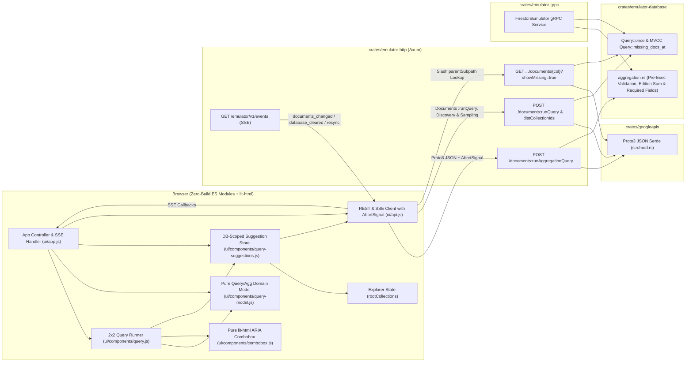

# Query Runner Autosuggestions & Aggregation Queries

*   **Author:** Paco van der Linden
*   **Status:** Implemented
*   **Date:** 2026-11-24

--------------------------------------------------------------------------------

## Overview

`firestore-emulator` provides a built-in, zero-build Web UI (`ui/`) backed by the official Google Cloud Firestore v1 Proto3 JSON REST API (`crates/googleapis`, `crates/emulator-http`, `crates/emulator-database`) alongside existing `/emulator/v1` admin and SSE invalidation endpoints (`/emulator/v1/events`), as specified in [emulator-web-ui.md](./emulator-web-ui.md). Previously, its Query Runner executed document `StructuredQuery` requests (`POST .../documents:runQuery`), offering only a root-only `<datalist>` for `Collection ID`, plain text inputs for `parentSubpath` and field paths, and no REST or UI support for aggregation queries.

This design adds two capabilities to the backend and Web UI Query Runner:

1.  **Cloud-Conformant Multi-Aggregation Queries (`COUNT`, `SUM`, `AVG`):** Expose standard Firestore v1 `POST .../documents:runAggregationQuery` (root and document-parent paths) with Proto3 JSON serialization for the 8 supported aggregation request/response messages in `crates/googleapis`. Fix pre-existing validation, Standard Edition implicit field-existence filtering, and execution-order defects in `FirestoreDatabase::run_aggregation_query` backed by live Cloud Firestore conformance tests in `test-suite/tests/`, and extend the Query Runner UI into a 2x2 (`Documents`/`Aggregations` × `Visual`/`Raw JSON`) workspace supporting `COUNT`, `SUM`, and `AVG` rows with custom aliases (`Count.upTo` supported in Proto3 JSON and Raw JSON).
2.  **Best-Effort Standard-REST Autosuggestions:** Provide keyboard-accessible suggestions for root collections, direct subcollections, slash-triggered `parentSubpath` navigation, collection groups (`allDescendants: true`), and collection field paths (nested maps up to depth 5 with Firestore backtick escaping, non-clobbering filter auto-type detection, and numeric prioritization for `SUM`/`AVG`). Discovery relies strictly on standard Firestore v1 REST endpoints and existing SSE invalidation notifications with zero custom `/emulator/v1` introspection endpoints, paired with MVCC snapshot evaluation for `Query::missing_docs_at` and a reusable pure `lit-html` WAI-ARIA 1.2 combobox.

All backend, conformance-suite, and Web UI changes ship together in single-PR delivery (PR #310), with the pure query/aggregation domain model (`ui/components/query-model.js`), DB-scoped autosuggestion store (`ui/components/query-suggestions.js`), and pure `lit-html` combobox (`ui/components/combobox.js`) extracted into dedicated sibling modules alongside [`ui/components/query.js`](../../ui/components/query.js).

--------------------------------------------------------------------------------

## The Problem

Developers inspecting emulated Firestore state in the Web UI and HTTP clients calling the REST API previously encountered four gaps:

1.  **Limited Path and Field Authoring in the Query Runner:**
    *   In [`ui/components/query.js`](../../ui/components/query.js), `Collection ID` used a root-only `<datalist id="known-collections-list">` backed by loaded root collections—lacking subcollection discovery, collection-group discovery, value-type badges, refresh controls, and consistent empty-focus opening across browsers—while `Parent Document Path` (`parentSubpath`), `Where` field paths, and `Order By` field paths were plain text `<input>` elements with no completion.
    *   Fields containing dots, spaces, or special characters required manual Firestore backtick escaping (for example, `` user.`first.name` ``), and every new filter row defaulted to `stringValue` regardless of the selected field's stored value type.
2.  **No REST `:runAggregationQuery` Endpoint or Aggregation UI:**
    *   [`crates/emulator-http/src/routes/projects/mod.rs`](../../crates/emulator-http/src/routes/projects/mod.rs) and [`crates/emulator-http/src/routes/projects/documents.rs`](../../crates/emulator-http/src/routes/projects/documents.rs) had no implemented `documents:runAggregationQuery` route and routed `:runAggregationQuery` to a placeholder `501 UNIMPLEMENTED` response on both root and document subpaths.
    *   [`crates/googleapis/src/ser/mod.rs`](../../crates/googleapis/src/ser/mod.rs) (formerly `ser.rs`) had no Proto3 JSON serializers or deserializers for `RunAggregationQueryRequest`, `StructuredAggregationQuery`, `Aggregation`, `Count`, `Sum`, `Avg`, `AggregationResult`, or `RunAggregationQueryResponse`.
    *   Developers could not verify document counts, sums, or averages against an emulated database from the Query Runner UI or via REST tools.
3.  **Pre-Existing Aggregation Validation Bugs and `missing_docs_at` Lock Contention in `crates/emulator-database`:**
    *   In [`crates/emulator-database/src/database.rs`](../../crates/emulator-database/src/database.rs) (now extracted to [`crates/emulator-database/src/database/aggregation.rs`](../../crates/emulator-database/src/database/aggregation.rs)), `FirestoreDatabase::run_aggregation_query` executed the underlying query before validating aggregations, clamped negative `Count.up_to` into negative results (such as `-5`), stored omitted `alias` values as `""` instead of Cloud Firestore's sequential `field_1`, `field_2`, ... defaults, silently overwrote duplicate aliases inside a `HashMap`, executed empty `aggregations: []` requests and returned `{}`, parsed `SUM`/`AVG` field syntax only after execution while skipping empty-segment, reserved `__...__`, and `__name__` checks, omitted Standard Edition's implicit field-existence filter for `SUM`/`AVG`, and returned `12 UNIMPLEMENTED` over gRPC on `StructuredQuery.select`. Exposing `:runAggregationQuery` over REST and Raw JSON makes these edge cases directly reachable.
    *   In [`crates/emulator-database/src/database/query.rs`](../../crates/emulator-database/src/database/query.rs), `Query::missing_docs` / `Query::missing_docs_at` acquired pessimistic read locks on `LockTable` under `ReadConsistency::Default` (and evaluated subcollections without `txn.read_time()` MVCC pinning for `ReadOnly` and Enterprise `Optimistic` transactions) even though regular queries run lock-free over MVCC snapshots. Any `listDocuments?showMissing=true` lookup—used by Explorer and slash-triggered `parentSubpath` completion—could therefore contend on locks held by concurrent transactions in running test suites.
4.  **Monolithic Query Extension Risk and Unscoped Async Fetch Lifecycle:**
    *   [`ui/components/query.js`](../../ui/components/query.js) bundled pure Query Runner domain state, visual form rendering, Proto3 JSON query building, Raw JSON parsing, and result rendering; adding inline combobox popup mechanics and async DB-scoped discovery/sampling caches directly into it would bloat the component and prevent pure Node unit testing without DOM stubs ([`ui/tests/`](../../ui/tests/)).
    *   Every `/v1/projects/{p}/databases/{d}/documents/...` request lazily instantiates the target database in `emulator-http` if absent. Active Explorer reads, queued SSE refreshes, and background suggestion fetches must therefore be cancelled synchronously on `database_cleared` and database switches, and stale responses must be rejected via database-scoped epoch guards so zero post-notification `/v1` requests hit the cleared database.

--------------------------------------------------------------------------------

## Goals

*   **G1 — Cloud-Conformant `RunAggregationQuery` Backend & Proto3 JSON Wire Support:**
    *   Verify ground-truth Cloud Firestore behavior for `RunAggregationQuery` edge cases against live Cloud Firestore (`cd test-suite && npm test`) and add permanent conformance tests in `test-suite/tests/`.
    *   Fix `FirestoreDatabase::run_aggregation_query` in `crates/emulator-database` (`database/aggregation.rs` and `database/query.rs`) so all validation and Standard Edition's implicit field-existence filter for `SUM`/`AVG` (`Query::require_existing_fields` / `matches_prefilters`) execute properly and match live Cloud Firestore across both gRPC and REST.
    *   Implement Proto3 JSON serialization and deserialization in `crates/googleapis` (`ser/mod.rs`) for all 8 aggregation request and response types with single-pass unsupported-field placeholder decoding.
    *   Mount root and document-parent `POST .../documents:runAggregationQuery` routes in `crates/emulator-http` returning the standard 1-element JSON array `[RunAggregationQueryResponse]`, sharing single-pass validation and `validate_request_parent` checks with `:runQuery`, and capturing request traces when `/emulator/v1/logging` is active.
*   **G2 — Shared 2x2 (`Documents`/`Aggregations` × `Visual`/`Raw JSON`) Query Runner UI:**
    *   Present separate controls for **Query Kind** (`Documents` vs. `Aggregations`) and **Editor Mode** (`Visual` vs. `Raw JSON`) with mode-aware Run button labels, independent Raw JSON buffers, and separate result, read-time, and execution-timing slots per query kind.
    *   Support multi-aggregation rows (`COUNT`, `SUM`, `AVG` with customizable `alias`, seeded with one default `COUNT` row, capped at `5` rows on Standard Edition or `64` rows on Enterprise Edition, and validated for unique edition-conformant aliases) sharing target, `Where`, `Order By`, and `Limit` clauses.
    *   Decouple untouched `Limit` defaults (`"50"` in Documents vs. `""` in Aggregations) on **Query Kind** switches while preserving explicit user-entered limits across both **Query Kind** and **Editor Mode** switches, displaying an inline `!` warning beside `Limit` whenever a non-empty limit is entered in `Aggregations` mode and a results-header provenance note whenever an executed aggregation carries `limit` or `orderBy`.
    *   Guard Raw JSON execution against unsafe 64-bit integer literals and overflowing floats, allow `Visual -> Raw` from pristine default state while blocking invalid user-entered visual clauses, and render aggregation values losslessly with Proto3 JSON type badges (`int64`, `double`, `null`).
*   **G3 — Best-Effort Standard-REST Autosuggestions & MVCC `missing_docs_at`:**
    *   Deliver autosuggestions using standard Firestore v1 REST endpoints (`:listCollectionIds`, `listDocuments?showMissing=true&mask.fieldPaths=__name__`, and `:runQuery`) plus existing SSE invalidation notifications.
    *   Discover root collections from loaded Explorer state, direct subcollections on valid even-segment `parentSubpath`, slash-triggered `parentSubpath` segments alternating `listDocuments?showMissing=true` and `:listCollectionIds`, and collection groups (`allDescendants: true`) seeded uniformly with direct child collections (root or non-root `parentSubpath`) plus a single lock-free key-only `:runQuery` keyed per `parentSubpath`.
    *   Update `Query::missing_docs_at` to evaluate MVCC snapshots lock-free under `ReadConsistency::Default` and `ReadConsistency::ReadTime(_)` and evaluate subcollection existence at `txn.read_time()` for `ReadOnly` and Enterprise `Optimistic` transactions while retaining `db.get_doc` ancestor checks for pessimistic read leases and optimistic `observed_docs`.
    *   Sample collection field paths lazily without `where` filters (`Collection ID` required), traversing nested maps up to the nesting bound without expanding vector maps, escaping segments per Firestore syntax, excluding reserved `__...__` fields while injecting `__name__` for `Where`/`Order By` (excluded from `SUM`/`AVG`), applying non-clobbering filter auto-type detection, and prioritizing numeric fields for `SUM`/`AVG`.
*   **G4 — Reusable Pure `lit-html` WAI-ARIA Combobox & Safe Cache Lifecycle:**
    *   Build a pure `lit-html` WAI-ARIA 1.2 combobox without `HTMLElement` Custom Elements so Node unit/regression tests remain compatible, using unclipped viewport positioning, keyboard navigation, raw + escaped matching, type badges, status/Refresh footers, `col/` continuation on `parentSubpath`, and theme tokens.
    *   Propagate request cancellation across UI read calls, flush `database_cleared` and `resync` SSE events immediately out of debounce, preempt queued Explorer refreshes synchronously on `database_cleared`, isolate DB-scoped suggestion caches outside query form state, mark caches stale lazily on SSE updates without background re-crawls, and issue zero post-notification `/v1` requests against the cleared database.
*   **G5 — Modular Extraction & Single-PR Delivery:**
    *   Extract the pure query/aggregation domain model (`ui/components/query-model.js`), reusable combobox (`ui/components/combobox.js`), and suggestion store (`ui/components/query-suggestions.js`) as sibling modules alongside `ui/components/query.js`, extract aggregation execution into `crates/emulator-database/src/database/aggregation.rs`, split `crates/googleapis/src/ser/` into `mod.rs` and `tests.rs`, organize Node UI unit tests under `ui/tests/*.test.mjs` (`just ui-test`), update affected directory `README.md` contracts, and deliver all changes together in PR #310.

--------------------------------------------------------------------------------

## Non-Goals

*   **NG1 — `Count.upTo` Controls in the Visual Builder:** `Count.upTo` is a Cloud billing cap that creates visual ambiguity alongside `Limit`. It is supported in `crates/googleapis` Proto3 JSON, REST `:runAggregationQuery`, and Raw JSON mode, but omitted from the Visual Builder form.
*   **NG2 — Additional `StructuredQuery` Visual Clauses:** Visual Builder inputs for `select` field projections, `offset`, `startAt`/`endAt` pagination cursors, and nested `AND`/`OR` composite filter groups beyond top-level `compositeOp` remain out of scope (all remain available in Raw JSON mode).
*   **NG3 — Historical `readTime` Picker or Envelope Forwarding in the UI:** The Query Runner UI neither adds a `readTime` picker nor forwards `readTime` envelopes from Raw JSON (REST `:runAggregationQuery` still accepts `readTime` for parity with `:runQuery`).
*   **NG4 — Vector Search (`findNearest`) over REST or UI:** `findNearest` remains gRPC-only and continues returning `501 UNIMPLEMENTED` (or `400 INVALID_ARGUMENT` on malformed field types) over REST `:runQuery` and `:runAggregationQuery`.
*   **NG5 — Bidirectional Raw-to-Visual JSON Parsing:** Switching from `Raw JSON` back to `Visual` retains existing visual state rather than reverse-parsing arbitrary hand-edited JSON into visual rows.
*   **NG6 — Enterprise Edition Pipelines (`:executePipeline`):** Pipeline authoring and execution require a distinct stage-based UX and are deferred to a separate tab and design document.
*   **NG7 — Custom `/emulator/v1/...` Schema or Collection Introspection Endpoints:** No non-standard server introspection APIs are added; autosuggestions use standard Firestore v1 REST endpoints and existing SSE notifications only.
*   **NG8 — External Frontend Build Toolchains, Packages, or `HTMLElement` Custom Elements:** The UI remains zero-build ES modules using the vendored `ui/lit-html.js` with no npm bundler, third-party combobox libraries, or DOM Custom Elements incompatible with Node UI tests (`ui/tests/*.test.mjs` via `just ui-test`).

--------------------------------------------------------------------------------

## Open Questions (Resolved)

Live Google Cloud Firestore verification (`firestore-test-406503`, `cd test-suite && npm test -- tests/12-structured-query-validation.test.ts` across Standard Edition, Enterprise Edition optimistic, and Enterprise Edition pessimistic) resolved all `RunAggregationQuery` behavioral questions:

1.  **`StructuredQuery.select` (Populated `{ fields: [{ fieldPath: "a" }] }` and Empty `{ fields: [] }`):** Valid `select` projections **succeed (`OK`)** on both Standard and Enterprise editions and are ignored during aggregation execution; invalid field paths inside `select` (`__custom__`, `a..b`) return `3 INVALID_ARGUMENT`, and `select` + `aggregations: []` returns `3 INVALID_ARGUMENT`.
2.  **Aggregation List Bounds:** Empty `aggregations: []` returns `3 INVALID_ARGUMENT` on both editions; maximum aggregations per query are **`5` on Standard Edition** (`6` -> `3 INVALID_ARGUMENT`) vs. **`64` on Enterprise Edition** (`6`, `10`, `64` -> `OK`; `65` -> `3 INVALID_ARGUMENT`).
3.  **Missing `Aggregation.operator`:** `{}` and `{ alias: "x" }` return `3 INVALID_ARGUMENT` on both editions.
4.  **`Count.upTo`:** Standard Edition accepts `0` (`"0"`), positive integers, `{}` (`"0"`), and `null` (uncapped) and rejects `< 0` (`3 INVALID_ARGUMENT`); Enterprise Edition accepts only `upTo: null` and rejects `-1`, `0`, `1`, `2`, and `{}` with `3 INVALID_ARGUMENT` (`"The \`count_up_to(...)\` accumulator is not supported in Enterprise edition."`).
5.  **Aliases:** Omitted aliases resolve sequentially (`field_1`, `field_2`, ... incrementing only on omitted aliases), and duplicate aliases, `"field_1"` collisions, and `> 1,500`-byte UTF-8 limits reject with `3 INVALID_ARGUMENT` on both editions; reserved `__...__` explicit aliases (`length >= 5`) reject with `3 INVALID_ARGUMENT` on Standard Edition (`"____"` length 4 accepted) while **succeeding (`OK`)** on Enterprise Edition.
6.  **`SUM`/`AVG` Field Paths:** Missing `field`, empty/malformed paths (`""`, `a..b`, `.a`, `a.`, `` `` ``, `` `unclosed ``, `` `a`b ``), and non-`__name__` reserved segments (`__custom__`, `a.__custom__`) return `3 INVALID_ARGUMENT` on both editions; `__name__`, `` `__name__` ``, and `a.__name__` reject with `3 INVALID_ARGUMENT` on Standard Edition while **succeeding (`OK`, returning `nullValue`)** on Enterprise Edition.
7.  **Standard Edition `SUM`/`AVG` Implicit Field Existence & Index Constraints:** On collections containing documents missing field `a`, combining `[count(), sum(a), avg(a)]` applies an implicit existence filter for `a` on Standard Edition (`count` excludes docs missing `a`, while `{ a: null }` is included) vs. full count on Enterprise Edition—implemented in the emulator via `Query::require_existing_fields` and `Query::matches_prefilters`. Separately, live Standard Edition rejects combining two distinct `SUM`/`AVG` field paths in one query with `9 FAILED_PRECONDITION` when composite indexes are absent (deploy-time composite index enforcement remains a non-goal in the index-free emulator).

--------------------------------------------------------------------------------

## Critical User Journeys (CUJs)

### CUJ 1: Running Multi-Aggregation Queries (`COUNT`, `SUM`, `AVG`) with Safe Defaults and Provenance Hints

*   **Given**: A database contains 120 documents in collection `orders` with `status` (`stringValue`), `totalCents` (`integerValue`), and `taxRate` (`doubleValue`).
*   **When**: The developer opens the Query Runner, switches Query Kind from **Documents** to **Aggregations** (leaving the untouched default `Limit` alone), keeps the pre-populated `COUNT` row (alias `total_orders`), adds `SUM` on `totalCents` (alias `revenue`) and `AVG` on `totalCents` (alias `avg_order`), adds `Where status == "paid"`, and clicks **Run Aggregation**. Next, the developer enters an explicit `Limit` of `50`, switches to **Raw JSON** to inspect or add `"upTo": "25"` on `COUNT`, and re-runs.
*   **Then**:
    *   Switching to **Aggregations** with an untouched `Limit` clears `"50"` to `""` (`No limit`), so the first run aggregates across all matching documents via `POST /v1/projects/{p}/databases/{d}/documents:runAggregationQuery`.
    *   Results render each alias (`total_orders`, `revenue`, `avg_order`) with lossless formatted values (`BigInt`-safe `integerValue`, exact `doubleValue`, or `null`) paired with Proto3 JSON type badges (`int64`, `double`, `null`), aggregation duration, and read time.
    *   Entering an explicit `Limit` of `50` persists across both **Query Kind** and **Editor Mode** switches and shows an inline `!` warning beside `Limit` plus a provenance note in the aggregation results header indicating that the aggregation was constrained by `limit: 50` (and/or `orderBy`).
    *   In **Raw JSON** mode, unquoted unsafe 64-bit integers (`|n| >= 2^53`) and overflowing floats are rejected client-side before sending, while `"upTo": "25"` serializes and executes through `:runAggregationQuery`.

### CUJ 2: Cloud-Conformant `RunAggregationQuery` Validation Across gRPC and HTTP REST

*   **Given**: Standard Edition and Enterprise Edition databases populated with numeric, non-numeric, `null`, missing-field, and empty collections, tested through both `@google-cloud/firestore` / raw GAPIC gRPC (`test-suite/`) and HTTP `POST .../documents:runAggregationQuery` (root and document-parent paths).
*   **When**: A client submits edge-case aggregation queries: negative or zero/positive `Count.upTo`, omitted aliases (including mixed explicit + omitted lists), duplicate or reserved `__...__` aliases, an empty `aggregations: []` list, exceeding Standard (`5`) vs. Enterprise (`64`) aggregation limits, `SUM`/`AVG` targeting `__name__`, reserved/malformed field paths, or fields missing from some documents alongside `COUNT`/`limit`, an inner `StructuredQuery` containing valid or invalid `select`, or `SUM`/`AVG` over an empty result set.
*   **Then**:
    *   All validation checks run before executing the underlying query, returning `400 INVALID_ARGUMENT` over REST / `3 INVALID_ARGUMENT` over gRPC for invalid inputs while matching Standard vs. Enterprise Cloud Firestore (`Count.upTo == 0` returns `0` on Standard and `InvalidArgument` on Enterprise; valid `select` is ignored while invalid `select` paths fail with `InvalidArgument`; Standard caps at `5` and rejects reserved aliases and `__name__` `SUM`/`AVG` fields, whereas Enterprise allows up to `64`, reserved `__...__` aliases, and `__name__` `SUM`/`AVG` returning `nullValue`).
    *   On Standard Edition, `SUM`/`AVG` fields automatically enforce field existence in `Query::matches_prefilters` so documents missing those fields are excluded from combined `[count(), sum(a), avg(a)]` results and do not consume `limit` slots (while documents with `{ a: null }` remain counted).
    *   Omitted aliases receive deterministic sequential `field_1`, `field_2`, ... keys in `AggregationResult.aggregateFields` (incrementing only for omitted aliases, per `google/firestore/v1/query.proto`).
    *   Empty `SUM` returns `integerValue: "0"` on Standard Edition and `nullValue: null` on Enterprise Edition, matching Cloud Firestore.
    *   REST requests with unsupported `transaction` return `501 UNIMPLEMENTED` for valid base64 `bytes` strings (`400 INVALID_ARGUMENT` for non-string or malformed base64 values), while requests with `findNearest`, `newTransaction`, `explainOptions`, or `requestOptions` return `501 UNIMPLEMENTED` for object values (or `400 INVALID_ARGUMENT` for malformed non-object, non-null field types, matching `:runQuery`), and `readTime` executes an MVCC snapshot aggregation.

### CUJ 3: Discovering Collections, `parentSubpath`, and Collection Groups via Standard REST

*   **Given**: A database contains root collections `users` and `orgs`, plus nested documents `orgs/acme/projects/p1/tasks/t1` where `orgs/acme` and `orgs/acme/projects/p1` are phantom (non-existent) ancestor documents, while a background test holds pessimistic write locks on unrelated documents.
*   **When**: The developer opens the Query Runner, focuses `Collection ID` (root mode), then focuses `Parent Document Path` (`parentSubpath`), types `orgs/`, selects `acme`, types `/` to see `projects`, and finally toggles **Collection Group (`allDescendants`)** and opens the `Collection ID` combobox.
*   **Then**:
    *   Root `Collection ID` suggests `orgs` and `users` synchronously from loaded root collections with zero extra network calls.
    *   In `Parent Document Path` (`parentSubpath`), typing `/` alternates `listDocuments?showMissing=true&mask.fieldPaths=__name__` (on odd segments, executing lock-free over MVCC without blocking on concurrent transaction locks) and `:listCollectionIds` (on even segments). Selecting a collection inserts `col/` and keeps the popup open to continue drilling; selecting a document inserts `col/doc` and closes the popup (typing `/` re-opens for subcollections).
    *   Enabling **Collection Group** runs a single lock-free key-only `POST .../documents:runQuery` (`allDescendants: true`, `__name__` projection, `limit: 500`), seeded uniformly with direct child collections (from loaded root collections at root scope, or direct subcollections under a non-root `parentSubpath`), surfacing `orgs`, `projects`, and `tasks` (including under phantom ancestors) with a footer showing `Partial` when capped and a manual **Refresh** button.

### CUJ 4: Nested Field-Path Suggestions, Non-Clobbering Auto-Type Detection, and Vector Safety

*   **Given**: Collection `products` contains documents with `price` (`doubleValue`), `stock` (`integerValue`), `tags` (`arrayValue` of `stringValue`), nested map `meta.sku.code` (`stringValue`), dotted map key `meta` -> `display.name` (`stringValue`), and a vector field `embedding` (`__vector__` map).
*   **When**: The developer selects `products`, adds a `Where` filter row, focuses the field combobox, filters by typing `display.name`, selects the suggested field, adds a second filter on `tags` and switches its operator to `array-contains`, and switches to **Aggregations** to configure a `SUM` row.
*   **Then**:
    *   Lazy unfiltered sampling (`limit: 25`) suggests `price`, `stock`, `tags`, `meta`, `meta.sku`, `meta.sku.code`, `` meta.`display.name` ``, `embedding`, and `__name__`, stopping recursion at vector maps (`embedding`) so invalid `embedding.__type__` or `embedding.value` paths are never suggested.
    *   Typing either `display.name` or `` `display.name` `` matches `` meta.`display.name` `` and displays its observed type badge (`string`).
    *   Selecting a field—or switching a filter row's operator across scalar comparison and array-membership operators (`ARRAY_CONTAINS`, `ARRAY_CONTAINS_ANY`)—automatically sets the filter value type (for example, `doubleValue` for `price`, `integerValue` for `stock`, or the dominant non-null scalar element type `stringValue` for `tags` under `ARRAY_CONTAINS`) only if the developer has not manually changed the type or edited the filter value.
    *   In `SUM` and `AVG` rows, numeric fields (`price`, `stock`) appear prioritized at the top and `__name__` is excluded, while free-form typing remains accepted for sparse or unsampled fields.

### CUJ 5: Concurrent Test Writes, Database Clears, and Keyboard-Only Navigation

*   **Given**: Automated tests are writing rapidly to database `(default)` and periodically clearing databases (`DELETE /emulator/v1/...`), while the developer is authoring a query using only the keyboard inside the Query Runner view.
*   **When**: High-volume `documents_changed` SSE events arrive, SSE is paused and later resumed, or a `database_cleared` SSE event fires while a field-sampling request is in flight.
*   **Then**:
    *   On `documents_changed`, `resync`, or resuming from paused SSE, matching suggestion caches are marked stale immediately without firing automatic background re-crawls (and in-flight fetches invalidated mid-flight preserve `stale = true`); refreshes run only when the user opens a combobox or clicks **Refresh**.
    *   When `database_cleared` arrives (flushed immediately out of the SSE 150ms debounce and preempting any queued async Explorer refresh synchronously) or the developer switches databases, all in-flight Explorer reads, suggestion fetches, and query requests are aborted via request cancellation signals, stale responses are dropped via database/store epoch guards, and zero post-notification `/v1` requests are issued against the cleared database.
    *   Every combobox opens, moves selection (`ArrowDown`/`ArrowUp`), confirms (`Enter`), and dismisses (`Escape`/`Tab`) by keyboard with WAI-ARIA 1.2 attributes (leaving `Home`/`End` unintercepted for native input caret navigation), rendering unclipped outside scrolling containers.

--------------------------------------------------------------------------------

## Technical Plan (Architecture)

### 1. System Architecture & Data Flow

Both capabilities extend the existing four-layer emulator architecture (`crates/googleapis`, `crates/emulator-database`, `crates/emulator-http` + `crates/emulator-grpc`, and `ui/`). All aggregation validation, Standard Edition implicit existence filtering, and MVCC snapshot semantics stay centralized in `crates/emulator-database` so gRPC (`crates/emulator-grpc`) and HTTP/REST (`crates/emulator-http`) enforce identical rules.

### 2. Firestore v1 Aggregation Proto3 JSON Codecs (`crates/googleapis`)

[`crates/googleapis/src/ser/mod.rs`](../../crates/googleapis/src/ser/mod.rs) (with unit tests split into [`crates/googleapis/src/ser/tests.rs`](../../crates/googleapis/src/ser/tests.rs) and leaving [`crates/googleapis/build.rs`](../../crates/googleapis/build.rs) untouched) implements canonical Proto3 JSON `Serialize` and `Deserialize` for all 8 Firestore v1 aggregation request and response types, reusing the crate's existing Proto3 JSON null-default, sorted-map, `i64` decimal-string (with `ProtoInt64` error messages aligned to `"integer {v} out of i64 bounds"` / `"invalid 64-bit integer '{v}': {e}"`), and base64-byte codec conventions. A shared private `UnsupportedMessageObject` helper decodes unsupported message fields (`findNearest`, `newTransaction`, `explainOptions`, `requestOptions`) in a single pass—accepting `null` -> `None`, draining JSON objects `{ ... }` into placeholder defaults so HTTP handlers can emit `501 UNIMPLEMENTED`, and rejecting non-object values with a serde type error—while enforcing `oneof consistency_selector` across all three selector fields (`readTime`, `transaction`, `newTransaction`).

| Protobuf Message | Rust Type (`googleapis::google::firestore::v1::...`) | Proto3 JSON Wire Contract |
| :--- | :--- | :--- |
| `RunAggregationQueryRequest` | `RunAggregationQueryRequest` | `{ "parent"?, "structuredAggregationQuery"?, "readTime"? \| "transaction"? \| "newTransaction"?, "explainOptions"?, "requestOptions"? }` in canonical `camelCase` rejecting unknown fields, defaulting `parent` on `null`, decoding `transaction` from base64 `bytes`, enforcing mutual exclusivity across `readTime`, `transaction`, and `newTransaction`, and accepting `null` (-> `None`) or `{ ... }` (-> placeholder `Default::default()`) while rejecting non-objects for unsupported `newTransaction`, `explainOptions`, and `requestOptions` (matching `RunQueryRequest`). Returns a serialization error if `NewTransaction`, `explainOptions`, or `requestOptions` are populated. |
| `StructuredAggregationQuery` | `StructuredAggregationQuery` | `{ "structuredQuery"?: StructuredQuery, "aggregations"?: [Aggregation] }` rejecting unknown fields, defaulting empty collections on `null`, and omitting empty `aggregations` on serialize. |
| `StructuredAggregationQuery.Aggregation` | `structured_aggregation_query::Aggregation` | Flattened `oneof operator` requiring exactly one of `"count"`, `"sum"`, or `"avg"` (returning a serialization error when unset), plus optional `"alias"` (defaulting to empty on `null`, omitted on serialize when empty), rejecting unknown fields. |
| `Aggregation.Count` | `aggregation::Count` | `{ "upTo"?: "<i64 decimal string>" }` rejecting unknown fields. `upTo` (`google.protobuf.Int64Value`) serializes as a quoted decimal string (omitted when unset) and deserializes from decimal strings, JSON integers within `i64` bounds, or `null`. Semantic `< 0` validation runs centrally in `emulator-database`. |
| `Aggregation.Sum` / `Aggregation.Avg` | `aggregation::Sum`, `aggregation::Avg` | `{ "field"?: { "fieldPath": "..." } }` (optional field reference, omitted on serialize when unset, rejecting unknown fields). Presence and path validity are validated uniformly in `emulator-database`. |
| `AggregationResult` | `AggregationResult` | `{ "aggregateFields"?: { "<alias>": Value } }` with sorted keys, omitting empty maps on serialize, and defaulting on `null` (permitting unknown fields, matching `RunQueryResponse`). |
| `RunAggregationQueryResponse` | `RunAggregationQueryResponse` | `{ "result"?, "transaction"?, "readTime"? }` omitting empty `transaction` and unset fields, returning a serialization error if `explainMetrics` is set, and matching `RunQueryResponse` decode semantics (permitting unknown fields). |

### 3. Aggregation Validation, Standard Existence Filtering & `missing_docs_at` (`crates/emulator-database`)

#### 3.1 Pre-Execution Validation & Standard Implicit Existence Filter (`aggregation.rs`, `query.rs`)

[`crates/emulator-database/src/database/aggregation.rs`](../../crates/emulator-database/src/database/aggregation.rs) (declared via `mod aggregation;` in [`crates/emulator-database/src/database.rs`](../../crates/emulator-database/src/database.rs)) enforces Cloud-conformant edition arithmetic, ordering, and validation: Standard Edition accumulates integer sums promoting 64-bit overflow to double and returns `0` on empty `SUM`; Enterprise Edition orders unordered scans deterministically by `(collection, document ID)`, rejects sequential 64-bit integer overflow via `sum_enterprise_checked` with `InvalidArgument`, and returns `null` on empty `SUM`, matching Cloud Firestore.

Execution runs in exact pre-execution validation and filtering order: `database ownership validation (ensure_owns_root) -> StructuredQuery parsing & projection field-path validation (Query::from_structured) -> edition-aware aggregation compilation and validation (compile_aggregations) -> Standard Edition implicit field-existence filter registration (Query::require_existing_fields) -> query execution (query.once)`.

*   **Standard Edition Implicit Field-Existence Filter (`Query::require_existing_fields` / `Query::matches_prefilters`):** On `Query` ([`crates/emulator-database/src/database/query.rs`](../../crates/emulator-database/src/database/query.rs)), `required_fields: Vec<FieldPath>` (populated via `Query::require_existing_fields`) is checked inside `Query::matches_prefilters` after `filter` and `order_by` checks: any document where `field.get_value(&doc.fields).is_none()` is excluded (`{ a: null }` returns `Some(...)` and remains included, while missing `a` is excluded before `start_at`/`end_at`/`offset`/`limit`/`find_nearest` and preserved when `Query` is cloned into `ExecutedQuery`). When `!enterprise`, `FirestoreDatabase::run_aggregation_query` collects all `FieldPath`s referenced by `SUM` or `AVG`—excluding virtual `findNearest` `distance_result_field` paths and their synthesized ancestors (`query.distance_result_field().is_some_and(|dp| dp.starts_with(fp))`) since distance values are synthesized after vector ranking—and calls `query.require_existing_fields(...)` prior to `query.once(self)`.

| Condition | Standard Edition | Enterprise Edition |
| :--- | :--- | :--- |
| Valid `StructuredQuery.select` (populated or empty `{ fields: [] }`) | Accepted (ignored during aggregation); invalid field paths (`__custom__`, `a..b`) return `InvalidArgument` | Accepted (ignored during aggregation); invalid field paths (`__custom__`, `a..b`) return `InvalidArgument` |
| Empty `aggregations: []` or count exceeding cap | `InvalidArgument` when empty or count `> 5` | `InvalidArgument` when empty or count `> 64` |
| Missing `Aggregation.operator` (`None`) | `InvalidArgument` | `InvalidArgument` |
| `Count.up_to` | `< 0` -> `InvalidArgument`; `0` -> `0`; positive -> capped | Any `Some(_)` (`-1`, `0`, `> 0`) -> `InvalidArgument` (`count_up_to(...)` unsupported); `None` -> uncapped |
| Omitted/empty `alias` | Assigned sequentially via `field_<next>` (`field_1`, `field_2`, ...) incrementing **only** for omitted aliases | Same (`field_1`, `field_2`, ...) |
| Duplicate resolved alias (including explicit `"field_1"` collision) or alias `> 1,500` UTF-8 bytes | `InvalidArgument` | `InvalidArgument` |
| Reserved `__...__` explicit alias (`length >= 5`; `"____"` length 4 accepted on both) | `InvalidArgument` | Accepted (`OK`) |
| `Sum`/`Avg` missing `field`, invalid `FieldPath`, empty segment, or non-`__name__` reserved `__...__` segment | `InvalidArgument` | `InvalidArgument` |
| `Sum`/`Avg` targeting `__name__`, `` `__name__` ``, or `a.__name__` | `InvalidArgument` | Accepted (`OK`, returning `nullValue`) |
| Documents missing a `Sum`/`Avg` field path | Excluded from matched query docs (`Query::require_existing_fields`) before `COUNT`/cursors/`limit` (while `{ a: null }` remains counted) | Included in `COUNT` / query window while skipped during `SUM`/`AVG` accumulation |

Aggregation execution records structured tracing metadata (`agg_count`, `enterprise`, and `matched_docs`) for capture when `/emulator/v1/logging` is active.

#### 3.2 MVCC Snapshot Reads in `Query::missing_docs_at`

In [`crates/emulator-database/src/database/query.rs`](../../crates/emulator-database/src/database/query.rs), `Query::missing_docs` delegates to `Query::missing_docs_at(self, None, None)` (`pub(crate) async fn missing_docs_at(&self, db: &FirestoreDatabase, snapshot_time: Option<Timestamp>, after_cursor: Option<&str>) -> Result<Vec<String>>`), and `FirestoreDatabase::list_docs(..., show_missing: true)` calls `query.missing_docs_at(self, Some(read_time), cursor_name)` with the parent query's MVCC snapshot timestamp and `after_cursor` boundary:

*   **`ReadConsistency::Default` & `ReadConsistency::ReadTime(_)`:** Resolve `ts` (reaping timed-out transactions when `snapshot_time` is supplied, otherwise calling `db.get_read_time(self.consistency).await?`), setting both `subcol_ts = Some(ts)` and `lock_free_ancestor_ts = Some(ts)`. Subcollection existence (`Collection::has_doc_at(ts)`) and ancestor absence (`db.peek_doc_meta(&name).await?.and_then(|meta| meta.read_mvcc_at(ts)).is_none()`) evaluate lock-free over the MVCC snapshot without acquiring `LockTable` locks or allocating absent `DocumentMeta` entries.
*   **`ReadConsistency::Transaction(id)`:** Validate `let txn = db.transactions.get_active(id)?;` upfront (so expired transactions return `Aborted` and rolled-back/unknown transactions return `InvalidArgument` even when zero subcollections match) and set `subcol_ts = txn.read_time()`: `ReadOnly` and Enterprise `Optimistic` transactions pin subcollection existence checks (`Collection::has_doc_at(rt)`) to the transaction's MVCC `read_time()`, while `Pessimistic` read-write transactions retain `Collection::has_doc()`. Across all transactional modes, `lock_free_ancestor_ts` stays `None` so ancestor checks continue calling `db.get_doc(&name, self.consistency).await?.is_none()`, preserving pessimistic `ReadLease` retention and optimistic `observed_docs` write-skew tracking on phantom ancestors (covered by [`query/tests.rs`](../../crates/emulator-database/src/database/query/tests.rs), [`list_and_collections.rs`](../../crates/emulator-tests/src/suites/list_and_collections.rs), and [`transactions_mvcc.rs`](../../crates/emulator-tests/src/suites/transactions_mvcc.rs)).
*   **Cursor & Deduplication:** Candidate ancestor paths `<= after_cursor` in Firestore reference order are filtered before subcollection/ancestor inspection, and `seen_doc_ids` deduplicates ancestor document IDs across multiple nested subcollections to short-circuit redundant cursor and existence checks.

### 4. HTTP REST `:runAggregationQuery` Routing & Observability (`crates/emulator-http`)

In [`crates/emulator-http/src/routes/projects/mod.rs`](../../crates/emulator-http/src/routes/projects/mod.rs) and [`crates/emulator-http/src/routes/projects/documents.rs`](../../crates/emulator-http/src/routes/projects/documents.rs):

*   **Routes & Dispatch:** Mount `POST /{project_id}/databases/{database_id}/documents:runAggregationQuery` alongside `:runQuery` in `projects/mod.rs` with `405 METHOD_NOT_ALLOWED` fallback. Enable the `runAggregationQuery` custom verb on both root and document subpaths in `projects/documents.rs` (`dispatch_documents`) instead of routing it to the Phase 2 `501` placeholder (`PHASE2_VERBS`).
*   **Single-Pass Deserialization & Parent Validation:** Both `handle_run_query` and `handle_run_aggregation_query` deserialize once via `parse_json_body::<RunQueryRequest>` / `parse_json_body::<RunAggregationQueryRequest>` (backed by `crates/googleapis/src/ser/mod.rs` single-pass `UnsupportedMessageObject` decoding), enforce `validate_request_parent(&req.parent, &parent)` (rejecting mismatched non-empty body `parent` with `400 INVALID_ARGUMENT`), extract required `structuredQuery` / `structuredAggregationQuery` (+ inner `structuredQuery`) returning `400 INVALID_ARGUMENT` if absent or `null`, and then inspect unsupported decoded fields (`explain_options`, `request_options`, `structured_query.find_nearest`, `NewTransaction`, `Transaction`) to return `501 UNIMPLEMENTED`. Because deserialization runs in a single strict `camelCase` pass, malformed non-object unsupported fields, snake-case keys, and conflicting `consistency_selector` fields (`readTime` + `newTransaction`, etc.) always fail with `400 INVALID_ARGUMENT` ahead of `501 UNIMPLEMENTED`.
*   **Handler Execution & Response Envelope:** Map consistency selectors (`None` -> `ReadConsistency::Default`, `ReadTime(ts)` -> `ReadConsistency::ReadTime(ts)`, `Transaction`/`NewTransaction` -> `501 UNIMPLEMENTED`), record `agg_count` and execute `db.run_aggregation_query(...)`, instrument request traces for `/emulator/v1/logging`, and serialize the standard 1-element JSON array `[RunAggregationQueryResponse]`.

### 5. Web UI Query Runner, Autosuggestions & Combobox (`ui/`)

#### 5.1 Zero-Build Sibling Module Layout

The Query Runner and its pure domain/discovery subsystems are split across focused `// @ts-check` ES modules alongside [`ui/components/query.js`](../../ui/components/query.js), allowing Node unit tests ([`ui/tests/`](../../ui/tests/)) to test pure query models and suggestion pipelines directly without DOM stubs:

| Module | Ownership |
| :--- | :--- |
| [`ui/components/query-model.js`](../../ui/components/query-model.js) | Pure, `lit-html`-free, DOM-free query & aggregation domain model (`FILTER_OPERATORS`, `SCALAR_FILTER_TYPES`, row/state constructors, `isUntouchedDefaultQueryState`, `applyFilterAutoType`, `transitionFilterOperator`, `buildScalarFilterValue`, `buildStructuredQueryFromVisual`, `buildAggregationQueryFromVisual`, `formatAggProvenanceNote`, `UNSUPPORTED_QUERY_ENVELOPE_KEYS`, `parseRawQueryPayload`, `extractAggProvenance`). |
| [`ui/components/query.js`](../../ui/components/query.js) | 2x2 Visual/Raw Query Runner view component (`renderQueryRunner`, shared `renderFieldCombobox` helper across `Where`/`Order By`/`SUM`/`AVG`, inline `!` limit warning, combobox reconciliation/wiring, and discriminated Document vs. Aggregation result cards; re-exports core `query-model.js` functions for caller compatibility). |
| [`ui/components/query-suggestions.js`](../../ui/components/query-suggestions.js) | DB-scoped discovery & field-sampling store (4 single-owner caches, read-side selectors `parseNormalizedParentSubpath`, `getParentSubpathSuggestions`, `getCollectionIdSuggestions`, `getFieldScopeEntry`, active-request cancellation + `inflight` deduplication, `epoch` + `invalidationSeq` guards, and SSE stale invalidation). |
| [`ui/components/combobox.js`](../../ui/components/combobox.js) | Reusable pure `lit-html` WAI-ARIA 1.2 combobox widget (no `HTMLElement` Custom Element) with viewport-clamped geometry, `focusout`/`Escape` handling, configurable clip selectors, and centralized reconciliation. |

#### 5.2 2x2 Mode Separation, Decoupled `limit`, and Lossless Raw Execution

*   **State Separation:** Maintains separate **Query Kind** (`Documents` vs. `Aggregations`) and **Editor Mode** (`Visual` vs. `Raw JSON`) axes, independent pre-populated raw JSON buffers per query kind, and separate result, read-time, timing, and provenance slots so switching modes never clobbers the inactive kind's output. Switching **Query Kind** aborts any active query run via `onAbortQueryRun`.
*   **Decoupled Untouched Limit & Provenance Hints:** Tracks whether the user modified `Limit` (starting untouched at `"50"` in Documents). Switching **Query Kind** transitions an untouched `Limit` between `"50"` and `""` (`No limit`), while editing `Limit` marks it user-modified so explicit limits persist across both **Query Kind** and **Editor Mode** switches. Whenever Aggregations has a non-empty `Limit`, an inline `!` warning renders beside `Limit`; independently, whenever an executed aggregation carries a query `limit` (including `0`) or non-empty `orderBy` (in Visual or Raw mode), the aggregation results header displays a provenance note explaining the constraint.
*   **Aggregation Builder Rows:** Initialized with one default `COUNT` row (delete button disabled when only 1 row remains, `+ Add Aggregation` disabled at the edition-aware limit: `5` rows on Standard Edition vs. `64` rows on Enterprise Edition). Blank aliases display their sequential Cloud default (`field_1`, `field_2`, ..., incrementing only for blank rows) as placeholder hints and omit `"alias"` in emitted JSON. Client-side validation checks `1..=maxAggregations` aggregations (`5` Standard / `64` Enterprise), non-empty `SUM`/`AVG` field paths, `<= 1,500`-byte explicit aliases (rejecting reserved `__...__` aliases on Standard Edition while allowing them on Enterprise Edition), and prototype-safe unique effective aliases before issuing a request.
*   **Safe `Visual -> Raw` & Raw Execution:** Switching `Visual -> Raw` compiles valid Visual clauses and overwrites the active raw buffer, opens the existing raw buffer without error when Visual is in pristine default state (no collection, parent path, collection-group flag, filters, orders, or modified limit, and at most the untouched default `COUNT` row), and surfaces an error while staying in `Visual` if user-entered visual clauses fail validation. Toggling **Query Kind** while in `Raw JSON` swaps directly between the two pre-populated raw buffers. `parseRawQueryPayload(rawText, queryKind, expectedParentPath)` validates against non-plain-object JSON values, unsafe unquoted integers (`|n| >= 2^53`) and non-finite/overflowing floats via [`ui/values.js`](../../ui/values.js), and top-level envelope keys: bare payloads reject non-`null` `UNSUPPORTED_QUERY_ENVELOPE_KEYS` (`readTime`, `transaction`, `newTransaction`, `explainOptions`, `requestOptions`), while wrapped payloads (`{ structuredQuery }` / `{ structuredAggregationQuery }`) accept `null` for those optional keys and accept optional `parent` only when `null`, `""`, or matching `expectedParentPath` (rejecting mismatched `parent` and any extra keys). `executeCurrentQuery` aborts prior in-flight queries and guards both result writes and running-state resets against database switches, query-kind changes, and newer runs.

#### 5.3 DB-Scoped Suggestion Store & Cache Lifecycle

To preserve discovered schemas across Explorer's **Query** navigation while guaranteeing zero stale cache writes or post-notification requests against a cleared database:

*   **Store Ownership, `invalidationSeq` & `inflight` Deduplication:** `QuerySuggestionStore` (`ui/components/query-suggestions.js`) lives on application state outside query form state and owns a monotonic `epoch`, a monotonic `invalidationSeq` (incremented on `markSuggestionsStale` and `resetQuerySuggestionStore`), a keyed `controllers` `AbortController` map, a keyed `inflight` `Promise` map (deduplicating concurrent non-`force` fetches and chaining same-epoch `force: true`-aborted callers to the replacement in-flight promise), four single-owner caches (`subcollectionsByParent`, `docIdsByCollection`, `collectionGroupsByParent`, and `fieldsByScope` keyed by canonical JSON 3-tuple `JSON.stringify([normParent, colId, allDescendants])` via `makeFieldScopeKey`), and `comboboxUi`. `FieldScopeEntry` tracks `{ items, aggItems, fieldHints, scope, loading, stale, partial, sampledDocs }`. When an async fetch resolves without abort under the active `epoch`, it checks whether `store.invalidationSeq` changed while awaiting and marks the returned entry `stale = true` if a concurrent SSE invalidation landed in flight (and `ensureCollectionGroups` propagates `Boolean(subEntry?.stale)` from non-root subcollection seeding). On transient non-abort errors, `unpopulatedPlaceholders` ensures never-settled initial placeholders are evicted from the cache map instead of remaining poisoned, while previously populated entries retain their last-known items with `loading = false, stale = true` for retry on next open. Database cache resets (`resetDatabaseCaches`) cancel every active fetch, reset `rootLoading = false`, advance the store/DB epochs, clear all discovery/field caches, close active combobox state, and issue zero network calls.
*   **`AbortSignal`, Urgent SSE Flush & Synchronous Preemption ([`ui/api.js`](../../ui/api.js), [`ui/app.js`](../../ui/app.js)):** Optional request cancellation (`AbortSignal`) spans database, document, collection, query, and aggregation API clients, wired to `getDbSignal()` for Explorer and SSE reads (leaving explicit user mutations un-aborted). The SSE client flushes `database_cleared` and `resync` immediately outside its 150ms trailing debounce, paired with a `1000ms` max-wait ceiling on regular `documents_changed` batches. `applySyncSseBatch` handles synchronous cache clearing, `nextDbListSeq()` invalidation on `database_cleared` (discarding any in-flight pre-clear `GET /emulator/v1` response), and stale marking before serialized `applyAsyncSseRefresh`, which executes project-wide `refreshDatabaseList()` even if the active DB becomes stale while gating active-DB resync/metadata/path refreshes strictly on `!state.ssePaused && !isStale() && !clearedActiveDb && !state.rootLoading`.
*   **Lazy Stale Invalidation ([`ui/app.js`](../../ui/app.js)):**
    *   `database_cleared`: calls `nextDbListSeq()` in `applySyncSseBatch` to invalidate any in-flight pre-clear `GET /emulator/v1` database list fetch, aborts all in-flight Explorer reads, suggestion fetches, and query requests immediately, and issues zero post-notification `/v1` requests against the cleared database.
    *   `documents_changed`: strips full resource prefixes and marks matching discovery/field cache entries stale synchronously at exact segment boundaries without firing background HTTP calls.
    *   `resync` or resuming from paused SSE: marks all cached suggestion entries stale (re-fetched only when a combobox opens or the user clicks **Refresh**).

#### 5.4 Standard-REST Discovery & Field-Sampling Pipelines

Subcollection discovery, collection-group discovery, and field sampling require a normalized `parentPath` (after trimming leading/trailing `/`) that is empty or a valid even-segment document path with no empty, `.`, `..`, or reserved `__...__` segments. Slash-triggered `parentSubpath` completion validates segment safety uniformly and splits odd prefixes (`col/`, `col/doc/sub/`) into a valid even `parentPath` plus `collectionId`. Invalid inputs silently skip network requests. Result counts from `:runQuery` count only returned document rows (excluding metadata-only `{ readTime }` rows) so empty results report `0` documents.

| Suggestion Context | Primary Data Source (0-Cost) | Lazy Standard-REST Fetch (On Open / Refresh) | Bounds & Failure Mitigation |
| :--- | :--- | :--- | :--- |
| Root `Collection ID` (`parentSubpath == ""`, `!allDescendants`) | Loaded root collections | None (hydrated on database load and SSE) | Served synchronously from memory once loaded; free-form typing permitted. |
| Direct subcollection `Collection ID` (even `parentSubpath`, `!allDescendants`) | Subcollection cache | `POST /v1/{parentPath}:listCollectionIds` | Skips empty `""` (root) and invalid/odd-segment `parentSubpath`; shares cache with even-prefix `parentSubpath` completion. |
| Slash-triggered `parentSubpath` | Loaded root collections, document-ID cache, subcollection cache | Before `/`: loaded root collections only. Odd prefix (`col/`): `GET /v1/{parentPath}/{col}?showMissing=true&mask.fieldPaths=__name__&pageSize=100` (lock-free MVCC). Even prefix (`col/doc/`): delegates to direct subcollection discovery (`POST /v1/{root}/{col}/{doc}:listCollectionIds`). | Selecting a collection inserts `col/` and keeps popup open for chained path entry; selecting a document inserts `col/doc` and closes popup (typing `/` drills further). Shows `Partial` footer badge when `listDocuments` returns a non-empty `nextPageToken`. |
| Collection Group (`allDescendants: true`) | Direct child collections (loaded root collections at root scope, or direct subcollections cached under a non-root `parentSubpath`) | Direct child collection seed + a single lock-free key-only `POST /v1/{parentPath}:runQuery` (`from: [{ collectionId: "", allDescendants: true }]`, `select: { fields: [{ fieldPath: "__name__" }] }`, `limit: 500`) | Cached per normalized `parentSubpath`. Extracts descendant collection IDs from document resource names paired with direct child collections; sets `Partial` when 500 documents are returned. |
| Field Paths (`Where`, `Order By`, `SUM`/`AVG`) | Per-scope field cache (`JSON.stringify([parentSubpath, collectionId, allDescendants])`) | Unfiltered `POST /v1/{parentPath}:runQuery` (`from: [{ collectionId, allDescendants }]`, `limit: 25`, no `where`/`orderBy`) | Skips fetch when `collectionId` is empty. Traverses maps (emitting intermediate map containers and leaves) up to 1-based depth `5`, caps unique paths at `200`, caps array element scans at `32` items, discards raw docs after folding, stops recursion at vector sentinel maps, uses prototype-safe lookup tables, escapes field segments per Firestore syntax ([`ui/values.js`](../../ui/values.js)), excludes reserved `__...__` segments while injecting `__name__` for `Where`/`Order By` (excluded from `SUM`/`AVG`), and prioritizes numeric fields for `SUM`/`AVG`. |

*   **Non-Clobbering Filter Auto-Type Detection (`transitionFilterOperator` / `applyFilterAutoType` in `query-model.js`):** Each `Where` row remembers whether the user manually changed its type or edited its value/coordinates. When neither flag is set, selecting a suggested field—or switching a row's operator across scalar comparison and array-membership groups—automatically picks a non-null observed scalar type (`stringValue`, `integerValue`, `doubleValue`, `booleanValue`, `timestampValue`, `geoPointValue`, `referenceValue`, `bytesValue`):
    *   Under array-membership operators (`ARRAY_CONTAINS`, `ARRAY_CONTAINS_ANY`), selects the dominant non-null element type observed across sampled arrays (tie-breaking deterministically); unary operators (`IS_NULL`, `IS_NAN`) leave the filter value type unchanged.
    *   Under scalar comparison operators (`==`, `!=`, `<`, `<=`, `>`, `>=`) and multi-value scalar operators (`IN`, `NOT_IN`), selects the dominant non-null scalar type (never auto-selecting `arrayValue`, `mapValue`, `nullValue`, or `vector`).
    *   Switching to an array operator (`IN`, `ARRAY_CONTAINS_ANY`, `NOT_IN`) initializes non-array value text to `"[]"`, entering a scalar operator (`nextMeta?.kind === "field"`) resets unedited `"[]"` to `""` regardless of prior operator kind (including across unary hops such as `IN` -> `IS_NULL` -> `EQUAL`), whenever `nextMeta?.kind === "field" && f.valueType === "booleanValue"` with non-boolean text (`!== "true" && !== "false"`) `transitionFilterOperator` normalizes `f.valueText = "true"` (matching `buildScalarFilterValue`'s `!== "false"` coercion), and auto-switching away from `booleanValue` clears unedited boolean text.

#### 5.5 Pure `lit-html` WAI-ARIA 1.2 Combobox (`ui/components/combobox.js`)

*   **Node-Test Compatibility:** Pure `lit-html` render functions and typed popup state (with tracked listener cleanup) use zero `HTMLElement` / `customElements` references and per-member browser-API guards so Node unit and regression tests run cleanly via `just ui-test` (`ui/tests/*.test.mjs` and [`ui/tests/helpers/dom-harness.mjs`](../../ui/tests/helpers/dom-harness.mjs)), alongside pure-Rust `#![cfg(feature = "ui")]` CSS/WCAG assertions in [`ui_regressions.rs`](../../crates/emulator-http/tests/ui_regressions.rs).
*   **Unclipped Positioning & Centralized Lifecycle:** `ComboboxRect` computes viewport-clamped `popupLeft`, `popupWidth`, `popupBottom` (anchored on `flipUp`), `maxListboxHeight` (`[80, 260]` px), and `flipUp` whenever viewport space below is insufficient and space above is larger, while `syncOrDismiss` skips re-renders when geometry is unchanged (`comboboxRectsEqual`, including `popupBottom`). External capture-phase `scroll` and `resize` listeners (ignoring scrolls inside `.combobox-listbox`) reposition or dismiss detached popups or anchors clipped past configurable `topObstructionSelector` (`#topbar`) or `clipContainerSelector` (`.query-builder-pane`) bounds, while `lit-html` remains the single render/style owner and `reconcileComboboxUi` closes inactive popups across view, database, modal, **Query Kind**, **Editor Mode**, and row-removal transitions.
*   **WAI-ARIA 1.2 & Interaction:** `
` keeps `<ul role="listbox" aria-label=${ariaLabel} ?hidden=${filteredItems.length === 0}>` limited to `option` children (collapsing cleanly when empty while preserving `aria-controls`), places `"Loading..."` / `"No matching suggestions"` status text and the summary/non-tabbable **Refresh** footer in sibling containers outside the list, guards both `<input>` and popup `@keydown` against IME composition (`e.isComposing`), supports `ArrowDown`/`ArrowUp`/`Enter`/`Escape`/`Tab` on `<input>` (leaving `Home`/`End` unintercepted for native input caret movement and `Shift+Home`/`Shift+End` selection), tracks `#<id>-popup` `@mousedown` pointer gestures so native scrollbar drags and chrome clicks survive blur (including Safari `relatedTarget === null`) and restore focus to `<input>` on release, refocuses `<input>` from `selectItem` (keeping focus without reopening on closing selections), handles popup `Escape`/`Tab`/`ArrowDown`/`ArrowUp`/`Enter` (preserving `<button>` `Enter` on **Refresh**), filters against raw and escaped field paths, displays type badges, and uses only existing `:root` CSS custom properties in [`ui/styles.css`](../../ui/styles.css).

--------------------------------------------------------------------------------

## Alternatives Considered

### Alternative A: Custom `/emulator/v1` Schema and Collection Introspection Endpoint

*   **Pros**: Could return exact collection-group catalogs and full per-collection field histograms in a single server call without sampling limits.
*   **Cons**: Breaks the standard Firestore v1 REST architecture established in [emulator-web-ui.md](./emulator-web-ui.md), adds non-standard server API surface to maintain and test, and encourages UI features that diverge from real Cloud Firestore query paths.
*   **Reason for Rejection**: Best-effort client-side discovery over standard Firestore v1 REST endpoints (`:listCollectionIds`, `listDocuments`, `:runQuery`) meets the developer workflow without expanding custom `/emulator/v1` endpoints.

### Alternative B: Multi-Hop Client-Side BFS Crawler for Collection Groups

*   **Pros**: Walks the collection/document hierarchy explicitly using only `:listCollectionIds` and `listDocuments?showMissing=true`.
*   **Cons**: Issues one `listDocuments` and one `:listCollectionIds` request per visited container across nested subtrees, contends for the browser's limited HTTP/1.1 connection pool alongside `/emulator/v1/events`, generates noisy per-hop request traffic when `/emulator/v1/logging` capture is active, risks missing sibling branches if request budgets cancel traversal mid-tree, and triggers pessimistic `LockTable` read locks when traversing under transactions.
*   **Reason for Rejection**: A single lock-free key-only `POST .../documents:runQuery` (`allDescendants: true`, `__name__` projection, `limit: 500`), seeded uniformly with direct child collections across root and non-root parent paths, discovers nested collection groups and phantom ancestor prefixes in one round-trip with zero document field bytes.

### Alternative C: Native HTML `<datalist>` for Query Inputs

*   **Pros**: Zero custom popup positioning or keyboard-handling JavaScript.
*   **Cons**: Does not open consistently on empty focus across Safari and Firefox, cannot render type-badge hints or provenance/Refresh footers, cannot match both raw and backtick-escaped paths, and closes immediately after inserting `col/` during `parentSubpath` navigation.
*   **Reason for Rejection**: A pure `lit-html` WAI-ARIA 1.2 combobox delivers consistent keyboard behavior, type badges, refresh footers, and chained `parentSubpath` completion without external dependencies.

### Alternative D: Browser `HTMLElement` Custom Element (`<fs-combobox>`)

*   **Pros**: Encapsulates popup DOM and event listeners inside a native Web Component class.
*   **Cons**: Node-based UI unit and regression tests ([`ui/tests/*.test.mjs`](../../ui/tests/) via `just ui-test`) execute `ui/*.js` modules directly in Node.js without `HTMLElement` or `customElements`, which would break tests or require heavy DOM polyfills.
*   **Reason for Rejection**: A pure `lit-html` function component integrates directly with existing render helpers and Node tests without extending the test stub layer.

### Alternative E: Exposing `Count.upTo` in the Visual Builder

*   **Pros**: Allows configuring `Count.upTo` without switching to Raw JSON mode.
*   **Cons**: `upTo` is primarily a Cloud Firestore billing cap and creates visual ambiguity alongside the inner `StructuredQuery.limit` control for local emulator debugging.
*   **Reason for Rejection**: Keeping `Count.upTo` in `crates/googleapis` Proto3 JSON, REST `:runAggregationQuery`, and Raw JSON preserves `Count.upTo` wire parity while keeping the visual builder uncluttered.

### Alternative F: Filter-Aware Field Sampling

*   **Pros**: Restricts sampled documents to the subset matching the user's current `where` filters.
*   **Cons**: Narrow, incomplete, or temporarily invalid filters return zero documents and hide valid collection fields right when the developer is trying to compose additional filters.
*   **Reason for Rejection**: Lazy unfiltered sampling (`limit: 25`) per `(parentSubpath, collectionId, allDescendants)` yields predictable field hints and avoids triggering failing or overly narrow filter scans while typing.

### Alternative G: Eager SSE-Driven Cache Refresh on Every `documents_changed` Event

*   **Pros**: Keeps cached field histograms up to date immediately after every write.
*   **Cons**: High-throughput automated test suites writing hundreds of documents per second would continuously trigger background sampling requests over localhost HTTP/1.1 sockets.
*   **Reason for Rejection**: Marking matching discovery and field caches stale on `documents_changed` while deferring re-fetches until a combobox opens or the user clicks Refresh avoids background request storms.

### Alternative H: Hiding `Limit` or Silently Carrying Untouched `limit: 50` into Aggregations

*   **Pros**: Either eliminates mode-specific limit logic (carrying `"50"`) or hides the `limit` interaction entirely (omitting the input in Aggregations mode).
*   **Cons**: Silently applying `"50"` produces misleadingly capped `COUNT`/`SUM`/`AVG` results by default, whereas hiding `Limit` diverges from Cloud Firestore semantics where developers can intentionally aggregate over a limited/ordered query.
*   **Reason for Rejection**: Tracking whether `Limit` was user-modified clears untouched defaults (`"50"` -> `""`) when switching **Query Kind** to Aggregations while preserving explicit user-entered limits alongside inline `!` and results-header provenance warnings.

### Alternative I: Bidirectional Raw-to-Visual JSON Sync

*   **Pros**: Hand-edited Raw JSON queries would automatically repopulate Visual Builder rows when switching back.
*   **Cons**: Reverse-parsing arbitrary `StructuredQuery` and `StructuredAggregationQuery` payloads (including `select`, `offset`, cursors, nested `AND`/`OR` trees, and `Count.upTo`) into a subset visual form introduces complex edge cases and silent field loss.
*   **Reason for Rejection**: One-way `Visual -> Raw` generation (allowing pristine default state through while blocking invalid user-entered visual clauses) keeps visual state intact without reverse parsers.

### Alternative J: Bundling Enterprise Pipelines (`:executePipeline`) or Extra Visual Query Clauses

*   **Pros**: Ships pipelines, `select`, `offset`, cursors, nested `AND`/`OR`, and vector search in a single large UI release.
*   **Cons**: Enterprise Pipelines use a different ordered-stage model that does not fit a `StructuredQuery` form, and extra visual clauses expand scope and delay core aggregation and autosuggestion delivery.
*   **Reason for Rejection**: Enterprise Pipelines warrant a dedicated workspace tab and separate design document; additional `StructuredQuery` visual clauses can be added in follow-up increments.

### Alternative K: Bundling Domain Model, Combobox, and Suggestion Store Inside `ui/components/query.js`

*   **Pros**: Avoids creating any new UI modules under `ui/components/`.
*   **Cons**: Combining pure Query Runner domain builders/parsers, combobox popup geometry/listeners, and async DB-scoped discovery/sampling caches into [`ui/components/query.js`](../../ui/components/query.js) mixes unrelated DOM, async cache-lifecycle, and pure domain concerns in one file and prevents direct Node unit testing without `lit-html`/DOM harnesses.
*   **Reason for Rejection**: Extracting `ui/components/query-model.js`, `ui/components/query-suggestions.js`, and `ui/components/combobox.js` as focused sibling modules alongside `ui/components/query.js` cleanly separates pure domain logic, cache lifecycle, and ARIA widget rendering while shipping cohesively in PR #310.

--------------------------------------------------------------------------------

## Non-Functional Requirements

*   **Performance & Resource Bounds:**
    *   **Lock-Free Discovery:** Both `:runQuery` and `listDocuments?showMissing=true` execute lock-free over MVCC snapshots under `ReadConsistency::Default`, ensuring UI discovery does not block concurrent transactions in running test suites.
    *   **Bounded Network & Memory Footprint:** Collection-group discovery runs a single key-only `:runQuery` (`limit: 500`, zero document field bytes) per `parentSubpath`. Field sampling is capped at `limit: 25`, 1-based map recursion depth `5`, `200` field paths per scope, and `32` elements scanned per `arrayValue`, discarding raw sampled documents immediately after folding.
    *   **No Background Suggestion Re-Crawls:** SSE `documents_changed`, `resync`, and paused-SSE resume events only mark cached suggestion scopes stale without firing background HTTP requests.
*   **Correctness, Concurrency & Data Safety:**
    *   **Zero Stale Cache Writes & Cleared-DB Isolation:** Flushing `database_cleared` and `resync` immediately in the SSE stream, preempting queued async Explorer refreshes synchronously on receipt, aborting all active Explorer, query, and suggestion requests on `database_cleared` and database switches, and checking the database/store epochs and `invalidationSeq` on every async write prevent cross-database cache writes and issue zero post-notification `/v1` requests against the cleared database.
    *   **Lossless Numeric & Prototype Safety:** Raw JSON execution validates against unquoted unsafe integers (`|n| >= 2^53`) and non-finite/overflowing floats via [`ui/values.js`](../../ui/values.js); aggregation results preserve exact `i64`/`f64`/`null` types; and field histograms, alias collision checks, and aggregation result rendering use prototype-safe lookup structures and own-property iteration to stay safe against `"__proto__"` and `"constructor"`.
*   **Compatibility, Accessibility & Delivery:**
    *   **Zero New Build/Runtime Dependencies:** No new Cargo crates, npm packages, or JS bundlers; Rust maintains `unsafe_code = "forbid"`; Web UI modules and tests pass `just ui-check` (`tsc --checkJs --strict` on `ui/` and `ui/tests/` plus ESLint on `ui/tests/`) and Node tests (`just ui-test`, `ui/tests/*.test.mjs`), alongside pure-Rust `#![cfg(feature = "ui")]` CSS/WCAG checks in `crates/emulator-http/tests/ui_regressions.rs`.
    *   **Theme & ARIA Parity:** All new UI components use WAI-ARIA 1.2 keyboard semantics and only `:root` CSS custom properties from [`ui/styles.css`](../../ui/styles.css), enforced by the static color-token gate inside `ui_regressions.rs`.
    *   **Single-PR Delivery & Backward-Compatible Exports:** Backend aggregation routes/validation, Standard Edition implicit field-existence filtering, MVCC `missing_docs_at`, conformance tests, and Web UI modules ship together in PR #310 with zero breaking changes to existing gRPC APIs, REST routes, or [`ui/components/query.js`](../../ui/components/query.js) public exports.

--------------------------------------------------------------------------------

## Risks & Mitigations

| Risk / Constraint | Category | Mitigation |
| :--- | :--- | :--- |
| **Full-DB Scan on `allDescendants` Collection-Group Discovery:** Kindless `allDescendants` queries scan and sort all documents in a database before truncating to `limit`. | Scalability | Restrict collection-group discovery to a single lock-free key-only `:runQuery` (`limit: 500`, zero document field bytes), cache results per `parentSubpath`, and surface a `Partial` indicator rather than issuing multi-hop `startAt` scans. |
| **Large / Multi-Vector Documents During Field Sampling:** Unfiltered `limit: 25` sampling transfers full documents, which can be multi-MB in vector-heavy collections (`emulator-http` permits 50 MiB bodies). | Scalability | Sampling runs lazily only on combobox open or manual Refresh, caps array element scanning at `32` items, stops recursion at vector sentinel maps, and discards raw documents immediately after folding into the `200`-path schema table. |
| **Loopback TCP Teardown Race on `database_cleared`:** An HTTP request already written to loopback TCP before the browser receives SSE `database_cleared` can still reach the document route dispatcher and lazily instantiate the cleared database. | Concurrency / Failure Mode | Flush `database_cleared` and `resync` immediately out of SSE debounce, preempt queued Explorer refreshes synchronously upon receipt, abort all active Explorer, query, and suggestion requests immediately, and drop late responses via database and store epoch guards—narrowing the race window and suppressing all post-notification `/v1` requests and UI writes against the cleared database. |
| **Untrusted Database Identifiers in Combobox & Aggregation Results / Cross-Origin POSTs:** Collection names, field paths, and aliases may contain HTML characters or prototype keys (`__proto__`, `constructor`); `:runAggregationQuery` adds a new `POST` route. | Security | Render all strings exclusively through `lit-html` text/attribute bindings (no `unsafeHTML`), enforce `Content-Type: application/json` matching `:runQuery`, and use prototype-safe lookup structures (`Map`, `Set`, `Object.hasOwn`, JSON-tuple scope keys) for all schema/alias tables. |
| **Best-Effort Partial or Stale Suggestions:** Sparse fields outside the first 25 sampled docs or collections beyond 500 keys may not appear in dropdowns. | Usability / Failure Mode | Every combobox accepts free-form typing without validation lockouts and exposes `Sampled N docs` / `Partial` / `Stale` indicators paired with a manual **Refresh** button. |

--------------------------------------------------------------------------------

## Additional Resources

*   [emulator-web-ui.md](./emulator-web-ui.md) — Baseline REST-first Web UI, Proto3 JSON serialization, and SSE architecture.
*   [structured-query-filters-and-validation.md](./structured-query-filters-and-validation.md) — Unified `StructuredQuery` validation pipeline and `ui/values.js` numeric validation rules.
*   [vector-search.md](./vector-search.md) — Canonical `__vector__` sentinel map structure and edition-aware query constraints.
*   [test-suite/README.md](../../test-suite/README.md) & [test-suite/tests/README.md](../../test-suite/tests/README.md) — Cloud Firestore conformance gate and kindless descendant query tests (`7-descendants-query.test.ts`).

--------------------------------------------------------------------------------

## Future Improvements

*   **Enterprise Edition Pipelines Tab (`:executePipeline`):** Dedicated stage-based pipeline workspace and REST/Proto3 JSON support in a separate design document.
*   **Additional Visual `StructuredQuery` Clauses:** Visual form controls for `select` projections, `offset`, `startAt`/`endAt` pagination cursors, nested `AND`/`OR` filter groups, and historical `readTime` queries.
*   **Query Explain Metrics & Visual `Count.upTo`:** Rendering execution statistics once `explainOptions` is implemented in `emulator-database`, plus an optional advanced `upTo` toggle if requested by users.
*   **Local Query History & Saved Queries:** Persisting recent document and aggregation queries per database in `localStorage` for quick re-execution across test runs.

--------------------------------------------------------------------------------

## Implemented Architecture & Module Contracts

All changes ship cohesively in PR #310 across the conformance suite, core Rust crates, Web UI modules, Node test suites, and directory documentation contracts:

*   **Cloud Conformance Suite ([`test-suite/`](../../test-suite/README.md)):**
    *   [`test-suite/tests/utils/common.ts`](../../test-suite/tests/utils/common.ts) & [`test-suite/tests/utils/README.md`](../../test-suite/tests/utils/README.md): Expose `rawRunAggregationQuery` (`RawRunAggregationQueryRequest` / `RawRunAggregationQueryResponseChunk`) built on a shared stream-rollback helper with `rawRunQuery`.
    *   [`test-suite/tests/12-structured-query-validation.test.ts`](../../test-suite/tests/12-structured-query-validation.test.ts) & [`test-suite/tests/README.md`](../../test-suite/tests/README.md): Add `3. RunAggregationQuery wire validation` across Standard and Enterprise (optimistic and pessimistic) editions with zero `notImplementedInRust` or `notImplementedInJava` guards—verifying `Count.upTo`, sequential omitted `field_1`/`field_2` aliases and collision/byte-limit/reserved-alias rules, `5` vs. `64` caps, `SUM`/`AVG` field syntax, Standard Edition implicit field-existence filtering (`nonNumCol` combined `[count(), sum('a'), avg('a')]` returning `count === '2'` on Standard vs. `'3'` on Enterprise, alongside standalone `[count()]` returning `'3'`), `StructuredQuery.select`, `limit`/`orderBy`, and Standard `0` vs. Enterprise `null` empty numeric `SUM`.

*   **Database Engine ([`crates/emulator-database`](../../crates/emulator-database/src/README.md)):**
    *   [`crates/emulator-database/src/database/aggregation.rs`](../../crates/emulator-database/src/database/aggregation.rs) (declared via `mod aggregation;` in [`crates/emulator-database/src/database.rs`](../../crates/emulator-database/src/database.rs)): Owns `compile_aggregations`, `sum_enterprise_checked`, `FirestoreDatabase::run_aggregation_query` pre-execution validation order (`ensure_owns_root` -> `Query::from_structured` -> `compile_aggregations` -> Standard `Query::require_existing_fields` -> `query.once`), structured `#[instrument]` tracing spans (`agg_count`, `enterprise`, `matched_docs`), and `WithSubscriber`-scoped span tests.
    *   [`crates/emulator-database/src/database/field_path.rs`](../../crates/emulator-database/src/database/field_path.rs): Adds `FieldPath::validate_non_reserved_allowing_doc_name` permitting `a.__name__` on Enterprise `SUM`/`AVG` while rejecting non-`__name__` reserved segments.
    *   [`crates/emulator-database/src/database/collection.rs`](../../crates/emulator-database/src/database/collection.rs) & [`crates/emulator-database/src/database/query.rs`](../../crates/emulator-database/src/database/query.rs): Add `Collection::has_doc_at(time)`, `Query::require_existing_fields` enforced inside `Query::matches_prefilters` (preserved on clone into `ExecutedQuery`), and `Query::missing_docs_at(db, snapshot_time, after_cursor)` (invoked by `FirestoreDatabase::list_docs` as `query.missing_docs_at(self, Some(read_time), cursor_name)`), evaluating MVCC snapshots lock-free under `Default`/`ReadTime`, pinning subcollections to `txn.read_time()` for `ReadOnly`/`Optimistic` transactions while retaining `db.get_doc` ancestor checks for leases/`observed_docs`, validating `transactions.get_active(id)` upfront, deduplicating `seen_doc_ids`, and preserving `after_cursor` filtering.
    *   [`crates/emulator-database/src/database/query/tests.rs`](../../crates/emulator-database/src/database/query/tests.rs), [`crates/emulator-tests/src/suites/aggregation.rs`](../../crates/emulator-tests/src/suites/aggregation.rs), & [`crates/emulator-tests/src/suites/list_and_collections.rs`](../../crates/emulator-tests/src/suites/list_and_collections.rs): Verify Standard implicit existence filtering (mixed types, nested paths, `limit` interaction, multi-field `[count(), sum('a'), avg('b')]`), edition rules, lock-free `missing_docs_at`, `ReadOnly`/`Optimistic` MVCC snapshot isolation, and aborted expired transactions.

*   **Proto3 JSON Codecs & HTTP REST ([`crates/googleapis`](../../crates/googleapis/src/README.md), [`crates/emulator-http`](../../crates/emulator-http/src/README.md)):**
    *   [`crates/googleapis/src/ser/mod.rs`](../../crates/googleapis/src/ser/mod.rs) & [`crates/googleapis/src/ser/tests.rs`](../../crates/googleapis/src/ser/tests.rs): Implement canonical `camelCase` Proto3 JSON codecs for all 8 aggregation types, single-pass `UnsupportedMessageObject` placeholder decoding on `StructuredQueryDe`, `RunQueryRequestDe`, and `RunAggregationQueryRequestDe` with `oneof consistency_selector` validation across `readTime`/`transaction`/`newTransaction` and `null`-as-`None` tolerance, and aligned `ProtoInt64` error messages.
    *   [`crates/emulator-http/src/routes/projects/mod.rs`](../../crates/emulator-http/src/routes/projects/mod.rs) & [`crates/emulator-http/src/routes/projects/documents.rs`](../../crates/emulator-http/src/routes/projects/documents.rs): Mount root and document-parent `POST .../documents:runAggregationQuery`, validate `req.parent` via shared `validate_request_parent`, share single-pass `parse_json_body` + `400`/`501` checks with `:runQuery`, and return `[RunAggregationQueryResponse]`.
    *   [`crates/emulator-http/tests/admin_api.rs`](../../crates/emulator-http/tests/admin_api.rs) & [`crates/emulator-tests/src/suites/http_and_multiplex.rs`](../../crates/emulator-tests/src/suites/http_and_multiplex.rs): Verify `:runAggregationQuery` routes, percent-encoded paths, `400` vs. `501` precedence, body `parent` validation, special floats (`"NaN"`, `"Infinity"`, `"-Infinity"`), edition rules, and `/ui/*` static asset serving.

*   **Web UI & Node Test Suites ([`ui/`](../../ui/README.md), [`ui/components/`](../../ui/components/README.md)):**
    *   [`ui/values.js`](../../ui/values.js), [`ui/api.js`](../../ui/api.js), [`ui/state.js`](../../ui/state.js), & [`ui/styles.css`](../../ui/styles.css): Export `findNonFiniteNumber` and `isReservedName`; add `runAggregationQuery`, `{ signal }` cancellation on read calls, and `MAX_WAIT_MS = 1000` + urgent FIFO SSE flush; add `querySuggestions`, `getDbSignal`, `beginQueryRun`/`finishQueryRun`/`abortActiveQueryRun`, and `rootLoading = false` in `resetDatabaseCaches`; style 2x2 mode controls, aggregation cards, inline `!` / provenance hints, and `.combobox-*` popups using `:root` theme tokens only.
    *   [`ui/components/query-model.js`](../../ui/components/query-model.js), [`ui/components/query.js`](../../ui/components/query.js), [`ui/components/query-suggestions.js`](../../ui/components/query-suggestions.js), [`ui/components/combobox.js`](../../ui/components/combobox.js), & [`ui/app.js`](../../ui/app.js): Implement the pure query/aggregation domain model, 2x2 Query Runner with shared `renderFieldCombobox`, DB-scoped suggestion store (`FieldScopeEntry`, `QuerySuggestionStore` with `inflight` & `invalidationSeq`, JSON-tuple `fieldsByScope` keys, read-side selectors), pure `lit-html` WAI-ARIA 1.2 combobox, synchronous SSE preemption (`applySyncSseBatch` / `applyAsyncSseRefresh`), and centralized combobox reconciliation.
    *   [`ui/tests/`](../../ui/tests/) (`*.test.mjs` run via `node --test` / `just ui-test`, checked by `just ui-check`) & [`crates/emulator-http/tests/ui_regressions.rs`](../../crates/emulator-http/tests/ui_regressions.rs) (`#![cfg(feature = "ui")]` pure-Rust CSS/WCAG checks): Cover pure query/aggregation models, Raw JSON validation, suggestion discovery/sampling/auto-type/SSE cache lifecycles, and combobox ARIA/geometry/clip-bounds in Node.js (`ui/tests/*.test.mjs`), plus static CSS layout, `:root` color-token, and WCAG contrast verification in `ui_regressions.rs`, accompanied by updated `README.md` contracts across all touched modules and root [`README.md`](../../README.md).

--------------------------------------------------------------------------------

## Verification Criteria

All checks below confirm parity across Cloud Firestore, the Java emulator, Rust workspace crates, and the Web UI:

*   **Ground-Truth Cloud Firestore Conformance:**
    *   Inside `test-suite/` (with GCP Application Default Credentials and unset `FIRESTORE_EMULATOR_HOST`): `npm test -- tests/12-structured-query-validation.test.ts` passes across Standard Edition, Enterprise Edition optimistic, and Enterprise Edition pessimistic databases.
*   **Java Emulator Comparison:**
    *   Inside `test-suite/`: `npm run test:java-emulator -- tests/12-structured-query-validation.test.ts` passes with zero `notImplementedInJava` guards on `3. RunAggregationQuery wire validation`.
*   **Rust Compilation & Formatting:**
    *   `cargo build`, `cargo build --no-default-features`, and `cargo build --release` succeed with zero warnings.
    *   `just fmt-check` (`cargo +nightly fmt --all --check`) exits `0`.
*   **Static Analysis, Linting & JSDoc Type-Checking:**
    *   `just lint` (`cargo clippy --workspace --all-targets --all-features -- -D warnings`, `just sdk-lint` [ESLint + Prettier + `tsc` on `test-suite/`], and `just ui-check` [`tsc --checkJs --strict` on `ui/app.js` and `ui/tests/` plus ESLint on `ui/tests/`]) exits `0`.
*   **Unit, Integration & Black-Box Rust Tests:**
    *   `just test` (`cargo nextest run --workspace`, `--no-default-features`, and doctests—covering `googleapis`, `emulator-database`, `emulator-http` `admin_api.rs` & `ui_regressions.rs`, and `emulator-tests`) exits `0`.
*   **Web UI Node Test Suite:**
    *   `just ui-test` (`node --test ui/tests/*.test.mjs`) passes all pure domain, suggestion-store, combobox, and SSE/controller regression tests.
*   **End-to-End SDK Conformance & Full CI Gate:**
    *   `just sdk-test` (builds `--no-default-features` and executes the Jest conformance suite against the fresh Rust binary) and `just` (`fmt-check`, `lint`, `test`, `ui-test`, `sdk-test`) exit `0`.
*   **Manual Browser Smoke Verification (Debug & Release Builds):**
    *   Verify CUJs 1–5 across light and dark themes in Debug (disk-served `ui/`) and Release (embedded `UI_ASSETS`) builds: multi-aggregation execution, decoupled `limit` defaults and provenance hints, pristine `Visual -> Raw` and Raw JSON validation, unclipped fixed combobox positioning inside scrolling `.query-builder-pane`, keyboard-only navigation (including native `Home`/`End` input caret navigation), phantom-ancestor `parentSubpath` completion, vector field non-expansion, and `database_cleared` abort behavior with zero post-notification `/v1` requests.
