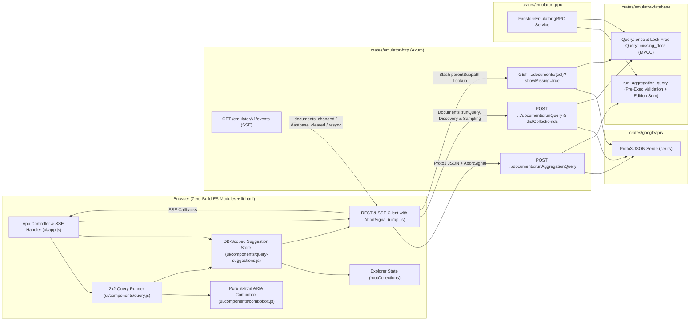

# Query Runner Autosuggestions & Aggregation Queries

*   **Author:** Paco van der Linden
*   **Status:** Draft
*   **Date:** 2026-11-24

--------------------------------------------------------------------------------

## Overview

`firestore-emulator` provides a built-in, zero-build Web UI (`ui/`) backed by the official Google Cloud Firestore v1 Proto3 JSON REST API (`crates/googleapis`, `crates/emulator-http`, `crates/emulator-database`) alongside existing `/emulator/v1` admin and SSE invalidation endpoints (`/emulator/v1/events`), as specified in [emulator-web-ui.md](./emulator-web-ui.md). Its Query Runner currently executes document `StructuredQuery` requests (`POST .../documents:runQuery`), but offers only a root-only `<datalist>` for `Collection ID`, plain text inputs for `parentSubpath` and field paths, and no REST or UI support for aggregation queries.

This design adds two capabilities to the backend and Web UI Query Runner:

1.  **Cloud-Conformant Multi-Aggregation Queries (`COUNT`, `SUM`, `AVG`):** Expose standard Firestore v1 `POST .../documents:runAggregationQuery` (root and document-parent paths) with Proto3 JSON serialization for the 8 supported aggregation request/response messages in `crates/googleapis`. Fix pre-existing validation and execution-order defects in `FirestoreDatabase::run_aggregation_query` backed by live Cloud Firestore conformance tests in `test-suite/tests/`, and extend the Query Runner UI into a 2x2 (`Documents`/`Aggregations` × `Visual`/`Raw JSON`) workspace supporting `COUNT`, `SUM`, and `AVG` rows with custom aliases (`Count.upTo` supported in Proto3 JSON and Raw JSON).
2.  **Best-Effort Standard-REST Autosuggestions:** Provide keyboard-accessible suggestions for root collections, direct subcollections, slash-triggered `parentSubpath` navigation, collection groups (`allDescendants: true`), and collection field paths (nested maps up to depth 5 with Firestore backtick escaping, non-clobbering filter auto-type detection, and numeric prioritization for `SUM`/`AVG`). Discovery relies strictly on standard Firestore v1 REST endpoints and existing SSE invalidation notifications with zero custom `/emulator/v1` introspection endpoints, paired with a lock-free MVCC snapshot fix for `Query::missing_docs` and a reusable pure `lit-html` WAI-ARIA 1.2 combobox.

Delivery is organized into two sequential PRs: **Slice 1** ships and tests Aggregation Queries end-to-end independently, and **Slice 2** builds on Slice 1 to add lock-free `missing_docs` and deliver the autosuggestion engine and reusable combobox as dedicated sibling modules alongside `ui/components/query.js` (revertible independently of Slice 1).

--------------------------------------------------------------------------------

## The Problem

Developers inspecting emulated Firestore state in the Web UI and HTTP clients calling the REST API encounter four gaps:

1.  **Limited Path and Field Authoring in the Query Runner:**
    *   In [`ui/components/query.js`](../../ui/components/query.js), `Collection ID` currently uses a root-only `<datalist id="known-collections-list">` backed by loaded root collections—lacking subcollection discovery, collection-group discovery, value-type badges, refresh controls, and consistent empty-focus opening across browsers—while `Parent Document Path` (`parentSubpath`), `Where` field paths, and `Order By` field paths are plain text `<input>` elements with no completion.
    *   Fields containing dots, spaces, or special characters require manual Firestore backtick escaping (for example, `` user.`first.name` ``), and every new filter row defaults to `stringValue` regardless of the selected field's stored value type.
2.  **No REST `:runAggregationQuery` Endpoint or Aggregation UI:**
    *   [`crates/emulator-http/src/routes/projects.rs`](../../crates/emulator-http/src/routes/projects.rs) has no implemented `documents:runAggregationQuery` route and routes `:runAggregationQuery` to a placeholder `501 UNIMPLEMENTED` response on both root and document subpaths.
    *   [`crates/googleapis/src/ser.rs`](../../crates/googleapis/src/ser.rs) has no Proto3 JSON serializers or deserializers for `RunAggregationQueryRequest`, `StructuredAggregationQuery`, `Aggregation`, `Count`, `Sum`, `Avg`, `AggregationResult`, or `RunAggregationQueryResponse`.
    *   Developers cannot verify document counts, sums, or averages against an emulated database from the Query Runner UI or via REST tools.
3.  **Pre-Existing Aggregation Validation Bugs and `missing_docs` Lock Contention in `crates/emulator-database`:**
    *   In [`crates/emulator-database/src/database.rs`](../../crates/emulator-database/src/database.rs), `FirestoreDatabase::run_aggregation_query` executes the underlying query before validating aggregations, clamps negative `Count.up_to` into negative results (such as `-5`), stores omitted `alias` values as `""` instead of Cloud Firestore's sequential `field_1`, `field_2`, ... defaults, silently overwrites duplicate aliases inside a `HashMap`, executes empty `aggregations: []` requests and returns `{}`, parses `SUM`/`AVG` field syntax only after execution while skipping empty-segment, reserved `__...__`, and `__name__` checks, and returns `12 UNIMPLEMENTED` over gRPC on `StructuredQuery.select`. Exposing `:runAggregationQuery` over REST and Raw JSON makes these edge cases directly reachable.
    *   In [`crates/emulator-database/src/database/query.rs`](../../crates/emulator-database/src/database/query.rs), `Query::missing_docs` acquires pessimistic read locks on `LockTable` under `ReadConsistency::Default` even though regular queries run lock-free over MVCC snapshots. Any `listDocuments?showMissing=true` lookup—used by Explorer and slash-triggered `parentSubpath` completion—can therefore contend on locks held by concurrent transactions in running test suites.
4.  **Monolithic Query Extension Risk and Unscoped Async Fetch Lifecycle:**
    *   [`ui/components/query.js`](../../ui/components/query.js) (`864` lines) bundles Query Runner state, visual form rendering, Proto3 JSON query building, and result rendering; adding inline combobox popup mechanics and async DB-scoped discovery/sampling caches directly into it would bloat the component and complicate Node regression testing ([`crates/emulator-http/tests/ui_regressions.rs`](../../crates/emulator-http/tests/ui_regressions.rs)).
    *   Every `/v1/projects/{p}/databases/{d}/documents/...` request lazily instantiates the target database in `emulator-http` if absent. Active Explorer reads, queued SSE refreshes, and background suggestion fetches must therefore be cancelled synchronously on `database_cleared` and database switches, and stale responses must be rejected via database-scoped epoch guards so zero post-notification `/v1` requests hit the cleared database.

--------------------------------------------------------------------------------

## Goals

*   **G1 — Cloud-Conformant `RunAggregationQuery` Backend & Proto3 JSON Wire Support:**
    *   Verify ground-truth Cloud Firestore behavior for `RunAggregationQuery` edge cases against live Cloud Firestore (`cd test-suite && npm test`) and add permanent conformance tests in `test-suite/tests/`.
    *   Fix `FirestoreDatabase::run_aggregation_query` in `crates/emulator-database` so all validation executes before executing the underlying query and matches live Cloud Firestore across both gRPC and REST.
    *   Implement Proto3 JSON serialization and deserialization in `crates/googleapis` for all 8 aggregation request and response types.
    *   Mount root and document-parent `POST .../documents:runAggregationQuery` routes in `crates/emulator-http` returning the standard 1-element JSON array `[RunAggregationQueryResponse]`, sharing vector-search and unsupported-envelope pre-checks with `:runQuery`, and capturing request traces when `/emulator/v1/logging` is active.
*   **G2 — Shared 2x2 (`Documents`/`Aggregations` × `Visual`/`Raw JSON`) Query Runner UI:**
    *   Present separate controls for **Query Kind** (`Documents` vs. `Aggregations`) and **Editor Mode** (`Visual` vs. `Raw JSON`) with mode-aware Run button labels, independent Raw JSON buffers, and separate result, read-time, and execution-timing slots per query kind.
    *   Support multi-aggregation rows (`COUNT`, `SUM`, `AVG` with customizable `alias`, seeded with one default `COUNT` row, capped at `5` rows, and validated for unique non-reserved aliases) sharing target, `Where`, `Order By`, and `Limit` clauses.
    *   Decouple untouched `Limit` defaults (`"50"` in Documents vs. `""` in Aggregations) on **Query Kind** switches while preserving explicit user-entered limits across both **Query Kind** and **Editor Mode** switches, displaying an inline `!` warning beside `Limit` whenever a non-empty limit is entered in `Aggregations` mode and a results-header provenance note whenever an executed aggregation carries `limit` or `orderBy`.
    *   Guard Raw JSON execution against unsafe 64-bit integer literals and overflowing floats, allow `Visual -> Raw` from pristine default state while blocking invalid user-entered visual clauses, and render aggregation values losslessly with Proto3 JSON type badges (`int64`, `double`, `null`).
*   **G3 — Best-Effort Standard-REST Autosuggestions & Lock-Free `missing_docs`:**
    *   Deliver autosuggestions using standard Firestore v1 REST endpoints (`:listCollectionIds`, `listDocuments?showMissing=true&mask.fieldPaths=__name__`, and `:runQuery`) plus existing SSE invalidation notifications.
    *   Discover root collections from loaded Explorer state, direct subcollections on valid even-segment `parentSubpath`, slash-triggered `parentSubpath` segments alternating `listDocuments?showMissing=true` and `:listCollectionIds`, and collection groups (`allDescendants: true`) seeded uniformly with direct child collections (root or non-root `parentSubpath`) plus a single lock-free key-only `:runQuery` keyed per `parentSubpath`.
    *   Update `Query::missing_docs` under `ReadConsistency::Default` and `ReadConsistency::ReadTime` to evaluate MVCC snapshots without acquiring `LockTable` locks.
    *   Sample collection field paths lazily without `where` filters (`Collection ID` required), traversing nested maps up to the nesting bound without expanding vector maps, escaping segments per Firestore syntax, excluding reserved `__...__` fields while injecting `__name__` for `Where`/`Order By` (excluded from `SUM`/`AVG`), applying non-clobbering filter auto-type detection, and prioritizing numeric fields for `SUM`/`AVG`.
*   **G4 — Reusable Pure `lit-html` WAI-ARIA Combobox & Safe Cache Lifecycle:**
    *   Build a pure `lit-html` WAI-ARIA 1.2 combobox without `HTMLElement` Custom Elements so Node regression tests remain compatible, using unclipped viewport positioning, keyboard navigation, raw + escaped matching, type badges, status/Refresh footers, `col/` continuation on `parentSubpath`, and theme tokens.
    *   Propagate request cancellation across UI read calls, flush `database_cleared` and `resync` SSE events immediately out of debounce, preempt queued Explorer refreshes synchronously on `database_cleared`, isolate DB-scoped suggestion caches outside query form state, mark caches stale lazily on SSE updates without background re-crawls, and issue zero post-notification `/v1` requests against the cleared database.
*   **G5 — Sibling Module Extraction & Two-Slice Delivery:**
    *   Extract the reusable combobox and suggestion store as sibling modules alongside `ui/components/query.js`, update affected directory `README.md` contracts, and deliver in two sequential PRs (Slice 1: Aggregations end-to-end; Slice 2: Lock-free `missing_docs` and autosuggestions).

--------------------------------------------------------------------------------

## Non-Goals

*   **NG1 — `Count.upTo` Controls in the Visual Builder:** `Count.upTo` is a Cloud billing cap that creates visual ambiguity alongside `Limit`. It is supported in `crates/googleapis` Proto3 JSON, REST `:runAggregationQuery`, and Raw JSON mode, but omitted from the Visual Builder form.
*   **NG2 — Additional `StructuredQuery` Visual Clauses:** Visual Builder inputs for `select` field projections, `offset`, `startAt`/`endAt` pagination cursors, and nested `AND`/`OR` composite filter groups beyond top-level `compositeOp` remain out of scope (all remain available in Raw JSON mode).
*   **NG3 — Historical `readTime` Picker or Envelope Forwarding in the UI:** The Query Runner UI neither adds a `readTime` picker nor forwards `readTime` envelopes from Raw JSON (REST `:runAggregationQuery` still accepts `readTime` for parity with `:runQuery`).
*   **NG4 — Vector Search (`findNearest`) over REST or UI:** `findNearest` remains gRPC-only and continues returning `501 UNIMPLEMENTED` (or `400 INVALID_ARGUMENT` on malformed field types) over REST `:runQuery` and `:runAggregationQuery`.
*   **NG5 — Bidirectional Raw-to-Visual JSON Parsing:** Switching from `Raw JSON` back to `Visual` retains existing visual state rather than reverse-parsing arbitrary hand-edited JSON into visual rows.
*   **NG6 — Enterprise Edition Pipelines (`:executePipeline`):** Pipeline authoring and execution require a distinct stage-based UX and are deferred to a separate tab and design document.
*   **NG7 — Custom `/emulator/v1/...` Schema or Collection Introspection Endpoints:** No non-standard server introspection APIs will be added; autosuggestions use standard Firestore v1 REST endpoints and existing SSE notifications only.
*   **NG8 — External Frontend Build Toolchains, Packages, or `HTMLElement` Custom Elements:** The UI remains zero-build ES modules using the vendored `ui/lit-html.js` with no npm bundler, third-party combobox libraries, or DOM Custom Elements incompatible with Node `ui_regressions.rs`.

--------------------------------------------------------------------------------

## Open Questions

One empirical verification dependency remains before merging Slice 1: confirming the six pinned `RunAggregationQuery` wire validation rules tabulated in [Section 3.1](#31-pre-execution-validation-in-firestoredatabaserun_aggregation_query) against live Cloud Firestore (`cd test-suite && npm test`), and reconciling conformance tests alongside Rust/UI rules if live Cloud behavior differs.

--------------------------------------------------------------------------------

## Critical User Journeys (CUJs)

### CUJ 1: Running Multi-Aggregation Queries (`COUNT`, `SUM`, `AVG`) with Safe Defaults and Provenance Hints

*   **Given**: A database contains 120 documents in collection `orders` with `status` (`stringValue`), `totalCents` (`integerValue`), and `taxRate` (`doubleValue`).
*   **When**: The developer opens the Query Runner, switches Query Kind from **Documents** to **Aggregations** (leaving the untouched default `Limit` alone), keeps the pre-populated `COUNT` row (alias `total_orders`), adds `SUM` on `totalCents` (alias `revenue`) and `AVG` on `totalCents` (alias `avg_order`), adds `Where status == "paid"`, and clicks **Run Aggregation**. Next, the developer enters an explicit `Limit` of `50`, switches to **Raw JSON** to inspect or add `"upTo": "25"` on `COUNT`, and re-runs.
*   **Then**:
    *   Switching to **Aggregations** with an untouched `Limit` clears `"50"` to `""` (`No limit`), so the first run aggregates across all matching documents via `POST /v1/projects/{p}/databases/{d}/documents:runAggregationQuery`.
    *   Results render each alias (`total_orders`, `revenue`, `avg_order`) with lossless formatted values (`BigInt`-safe `integerValue`, exact `doubleValue`, or `null`) paired with Proto3 JSON type badges (`int64`, `double`, `null`), aggregation duration, and read time.
    *   Entering an explicit `Limit` of `50` persists across both **Query Kind** and **Editor Mode** switches and shows an inline `!` warning beside `Limit` plus a provenance note in the aggregation results header indicating that the aggregation was constrained by `limit: 50` (and/or `orderBy`).
    *   In **Raw JSON** mode, unquoted unsafe 64-bit integers (`|n| >= 2^53`) and overflowing floats are rejected client-side before sending, while `"upTo": "25"` serializes and executes through `:runAggregationQuery`.

### CUJ 2: Cloud-Conformant `RunAggregationQuery` Validation Across gRPC and HTTP REST

*   **Given**: Standard Edition and Enterprise Edition databases populated with numeric, non-numeric, `null`, and empty collections, tested through both `@google-cloud/firestore` / raw GAPIC gRPC (`test-suite/`) and HTTP `POST .../documents:runAggregationQuery` (root and document-parent paths).
*   **When**: A client submits edge-case aggregation queries: negative `Count.upTo`, `Count.upTo == 0`, omitted aliases (including mixed explicit + omitted lists), duplicate aliases, an empty `aggregations: []` list, exceeding max aggregation count, `SUM`/`AVG` targeting `__name__` or reserved/malformed field paths, an inner `StructuredQuery` containing `select`, or `SUM`/`AVG` over an empty result set.
*   **Then**:
    *   All validation checks run before executing the underlying query, returning `400 INVALID_ARGUMENT` over REST / `3 INVALID_ARGUMENT` over gRPC for invalid inputs and `0` for `Count.upTo == 0` (to be verified against live Cloud Firestore before merging Slice 1).
    *   Omitted aliases receive deterministic sequential `field_1`, `field_2`, ... keys in `AggregationResult.aggregateFields` (incrementing only for omitted aliases, per `google/firestore/v1/query.proto`).
    *   Empty `SUM` returns `integerValue: "0"` on Standard Edition and `nullValue: null` on Enterprise Edition, matching Cloud Firestore.
    *   REST requests with unsupported `transaction` return `501 UNIMPLEMENTED` for valid base64 `bytes` strings (`400 INVALID_ARGUMENT` for non-string or malformed base64 values), while requests with `findNearest`, `newTransaction`, `explainOptions`, or `requestOptions` return `501 UNIMPLEMENTED` for object values (or `400 INVALID_ARGUMENT` for malformed non-object, non-null field types, matching updated `:runQuery`), and `readTime` executes an MVCC snapshot aggregation.

### CUJ 3: Discovering Collections, `parentSubpath`, and Collection Groups via Standard REST

*   **Given**: A database contains root collections `users` and `orgs`, plus nested documents `orgs/acme/projects/p1/tasks/t1` where `orgs/acme` and `orgs/acme/projects/p1` are phantom (non-existent) ancestor documents, while a background test holds pessimistic write locks on unrelated documents.
*   **When**: The developer opens the Query Runner, focuses `Collection ID` (root mode), then focuses `Parent Document Path` (`parentSubpath`), types `orgs/`, selects `acme`, types `/` to see `projects`, and finally toggles **Collection Group (`allDescendants`)** and opens the `Collection ID` combobox.
*   **Then**:
    *   Root `Collection ID` suggests `orgs` and `users` synchronously from loaded root collections with zero extra network calls.
    *   In `Parent Document Path` (`parentSubpath`), typing `/` alternates `listDocuments?showMissing=true&mask.fieldPaths=__name__` (on odd segments, executing lock-free over MVCC without blocking on concurrent transaction locks) and `:listCollectionIds` (on even segments). Selecting a collection inserts `col/` and keeps the popup open to continue drilling; selecting a document inserts `col/doc` and closes the popup (typing `/` re-opens for subcollections).
    *   Enabling **Collection Group** runs a single lock-free key-only `POST .../documents:runQuery` (`allDescendants: true`, `__name__` projection, `limit: 500`), seeded uniformly with direct child collections (from loaded root collections at root scope, or direct subcollections under a non-root `parentSubpath`), surfacing `orgs`, `projects`, and `tasks` (including under phantom ancestors) with a footer showing `Partial` when capped and a manual **Refresh** button.

### CUJ 4: Nested Field-Path Suggestions, Non-Clobbering Auto-Type Detection, and Vector Safety

*   **Given**: Collection `products` contains documents with `price` (`doubleValue`), `stock` (`integerValue`), `tags` (`arrayValue` of `stringValue`), nested map `meta.sku.code` (`stringValue`), dotted map key `meta` -> `display.name` (`stringValue`), and a vector field `embedding` (`__vector__` map).
*   **When**: The developer selects `products`, adds a `Where` filter row, focuses the field combobox, filters by typing `display.name`, selects the suggested field, adds a second filter on `tags` and switches its operator to `array-contains`, and switches to **Aggregations** to configure a `SUM` row.
*   **Then**:
    *   Lazy unfiltered sampling (`limit: 25`) suggests `price`, `stock`, `tags`, `meta`, `meta.sku`, `meta.sku.code`, `` meta.`display.name` ``, `embedding`, and `__name__`, stopping recursion at vector maps (`embedding`) so invalid `embedding.__type__` or `embedding.value` paths are never suggested.
    *   Typing either `display.name` or `` `display.name` `` matches `` meta.`display.name` `` and displays its observed type badge (`string`).
    *   Selecting a field—or switching a filter row's operator across scalar comparison and array-membership operators (`ARRAY_CONTAINS`, `ARRAY_CONTAINS_ANY`)—automatically sets the filter value type (for example, `doubleValue` for `price`, `integerValue` for `stock`, or the dominant non-null scalar element type `stringValue` for `tags` under `ARRAY_CONTAINS`) only if the developer has not manually changed the type or edited the filter value.
    *   In `SUM` and `AVG` rows, numeric fields (`price`, `stock`) appear prioritized at the top and `__name__` is excluded, while free-form typing remains accepted for sparse or unsampled fields.

### CUJ 5: Concurrent Test Writes, Database Clears, and Keyboard-Only Navigation

*   **Given**: Automated tests are writing rapidly to database `(default)` and periodically clearing databases (`DELETE /emulator/v1/...`), while the developer is authoring a query using only the keyboard inside the Query Runner view.
*   **When**: High-volume `documents_changed` SSE events arrive, SSE is paused and later resumed, or a `database_cleared` SSE event fires while a field-sampling request is in flight.
*   **Then**:
    *   On `documents_changed`, `resync`, or resuming from paused SSE, matching suggestion caches are marked stale immediately without firing automatic background re-crawls; refreshes run only when the user opens a combobox or clicks **Refresh**.
    *   When `database_cleared` arrives (flushed immediately out of the SSE 150ms debounce and preempting any queued async Explorer refresh synchronously) or the developer switches databases, all in-flight Explorer reads, suggestion fetches, and query requests are aborted via request cancellation signals, stale responses are dropped via database/store epoch guards, and zero post-notification `/v1` requests are issued against the cleared database.
    *   Every combobox opens, moves selection (`ArrowDown`/`ArrowUp`/`Home`/`End`), confirms (`Enter`), and dismisses (`Escape`/`Tab`) by keyboard with WAI-ARIA 1.2 attributes, rendering unclipped outside scrolling containers.

--------------------------------------------------------------------------------

## Technical Plan (Architecture)

### 1. System Architecture & Data Flow

Both capabilities extend the existing four-layer emulator architecture (`crates/googleapis`, `crates/emulator-database`, `crates/emulator-http` + `crates/emulator-grpc`, and `ui/`). All aggregation validation and MVCC snapshot semantics stay centralized in `crates/emulator-database` so gRPC (`crates/emulator-grpc`) and HTTP/REST (`crates/emulator-http`) enforce identical rules.

### 2. Firestore v1 Aggregation Proto3 JSON Codecs (`crates/googleapis`)

[`crates/googleapis/src/ser.rs`](../../crates/googleapis/src/ser.rs) adds canonical Proto3 JSON `Serialize` and `Deserialize` implementations (leaving [`crates/googleapis/build.rs`](../../crates/googleapis/build.rs) untouched) for all 8 Firestore v1 aggregation request and response types, reusing the crate's existing Proto3 JSON null-default, sorted-map, `i64` decimal-string, and base64-byte codec conventions:

| Protobuf Message | Rust Type (`googleapis::google::firestore::v1::...`) | Proto3 JSON Wire Contract |
| :--- | :--- | :--- |
| `RunAggregationQueryRequest` | `RunAggregationQueryRequest` | `{ "parent"?, "structuredAggregationQuery"?, "readTime"? \| "transaction"? }` in canonical `camelCase` rejecting unknown fields, defaulting `parent` on `null`, decoding `transaction` from base64 `bytes`, and accepting `null` (while failing on non-null values) for unsupported `newTransaction`, `explainOptions`, and `requestOptions` (matching updated `RunQueryRequest` decoding). Rejects conflicting `readTime` + `transaction`, and returns a serialization error if unsupported `newTransaction`, `explainOptions`, or `requestOptions` are populated. |
| `StructuredAggregationQuery` | `StructuredAggregationQuery` | `{ "structuredQuery"?: StructuredQuery, "aggregations"?: [Aggregation] }` rejecting unknown fields, defaulting empty collections on `null`, and omitting empty `aggregations` on serialize. |
| `StructuredAggregationQuery.Aggregation` | `structured_aggregation_query::Aggregation` | Flattened `oneof operator` requiring exactly one of `"count"`, `"sum"`, or `"avg"` (returning a serialization error when unset), plus optional `"alias"` (defaulting to empty on `null`, omitted on serialize when empty), rejecting unknown fields. |
| `Aggregation.Count` | `aggregation::Count` | `{ "upTo"?: "<i64 decimal string>" }` rejecting unknown fields. `upTo` (`google.protobuf.Int64Value`) serializes as a quoted decimal string (omitted when unset) and deserializes from decimal strings, JSON integers within `i64` bounds, or `null`. Semantic `< 0` validation runs centrally in `emulator-database`. |
| `Aggregation.Sum` / `Aggregation.Avg` | `aggregation::Sum`, `aggregation::Avg` | `{ "field"?: { "fieldPath": "..." } }` (optional field reference, omitted on serialize when unset, rejecting unknown fields). Presence and path validity are validated uniformly in `emulator-database`. |
| `AggregationResult` | `AggregationResult` | `{ "aggregateFields"?: { "<alias>": Value } }` with sorted keys, omitting empty maps on serialize, and defaulting on `null` (permitting unknown fields, matching `RunQueryResponse`). |
| `RunAggregationQueryResponse` | `RunAggregationQueryResponse` | `{ "result"?, "transaction"?, "readTime"? }` omitting empty `transaction` and unset fields, returning a serialization error if `explainMetrics` is set, and matching `RunQueryResponse` decode semantics (permitting unknown fields). |

### 3. Aggregation Validation & Lock-Free `missing_docs` (`crates/emulator-database`)

#### 3.1 Pre-Execution Validation in `FirestoreDatabase::run_aggregation_query`

[`FirestoreDatabase::run_aggregation_query`](../../crates/emulator-database/src/database.rs) enforces Cloud-conformant edition arithmetic and ordering: Standard Edition accumulates integer sums promoting 64-bit overflow to double and returns `0` on empty `SUM`; Enterprise Edition orders unordered scans deterministically by `(collection, document ID)`, rejects sequential 64-bit integer overflow with `InvalidArgument`, and returns `null` on empty `SUM`, matching Cloud Firestore. Currently, aggregation checks run *after* query execution and omit multiple Cloud Firestore rules.

We add a dedicated pre-execution validation and compilation pass running in exact order: `database ownership validation -> projection (select) rejection -> StructuredQuery parsing -> aggregation compilation and validation -> query execution`. Deterministic validation rules (to be confirmed against live Cloud Firestore before merging Slice 1):

| Condition | Expected Behavior (Live Cloud Verification Gate) |
| :--- | :--- |
| Populated `StructuredQuery.select` (and empty `Projection { fields: [] }`) | `InvalidArgument` (instead of `UNIMPLEMENTED`) |
| Empty `aggregations: []` or count `> 5` | `InvalidArgument` |
| Missing `Aggregation.operator` (`None`) | `InvalidArgument` |
| `Count.up_to < 0` | `InvalidArgument` |
| `Count.up_to == 0` | Accepted (returns `0`) |
| Omitted/empty `alias` | Assigned sequentially via `field_<next>` (`field_1`, `field_2`, ...) incrementing **only** for omitted aliases |
| Duplicate resolved alias (including explicit `"field_1"` colliding with an omitted alias), reserved `__...__` alias (length >= 5), or alias > 1,500 UTF-8 bytes | `InvalidArgument` |
| `Sum`/`Avg` missing `field`, invalid `FieldPath`, empty segment, reserved `__...__`, or `__name__` | `InvalidArgument` |

Aggregation execution records structured tracing metadata (aggregation count, database edition, and matched-document count) for capture when `/emulator/v1/logging` is active.

#### 3.2 Lock-Free MVCC Snapshot Reads in `Query::missing_docs`

Under `ReadConsistency::Default`, regular queries execute lock-free over an MVCC snapshot, whereas `FirestoreDatabase::list_docs(..., show_missing: true)` calls [`Query::missing_docs`](../../crates/emulator-database/src/database/query.rs), which acquires pessimistic `LockTable` read locks.

We add snapshot-pinned MVCC evaluation for missing-document discovery:

*   **`ReadConsistency::Default` & `ReadConsistency::ReadTime(_)`:** Evaluate descendant presence and ancestor absence purely over the MVCC snapshot timestamp associated with the query read time (after checking database clear state) without acquiring `LockTable` locks.
*   **`ReadConsistency::Transaction(_)`:** Retain existing transactional pessimistic read-lock acquisition and optimistic read-time pinning (covered by [`transactions_mvcc.rs`](../../crates/emulator-tests/src/suites/transactions_mvcc.rs)).

`FirestoreDatabase::list_docs` shares the parent query's MVCC snapshot timestamp with missing-document lookup, ensuring both Explorer and slash-triggered `parentSubpath` completion list phantom ancestors lock-free and point-in-time consistently.

### 4. HTTP REST `:runAggregationQuery` Routing & Observability (`crates/emulator-http`)

In [`crates/emulator-http/src/routes/projects.rs`](../../crates/emulator-http/src/routes/projects.rs):

*   **Routes & Dispatch:** Mount `POST /{project_id}/databases/{database_id}/documents:runAggregationQuery` alongside `:runQuery` with `405 METHOD_NOT_ALLOWED` fallback. Enable the `runAggregationQuery` custom verb on both root and document subpaths in the document dispatcher instead of routing it to the Phase 2 `501` placeholder.
*   **Shared Pre-Validation Helpers:** Extract two focused pre-checks shared by `:runQuery` and `:runAggregationQuery` within `projects.rs`:
    1.  Top-level unsupported envelope fields in canonical `camelCase` (`newTransaction`, `explainOptions`, `requestOptions`): return `501 UNIMPLEMENTED` for objects and `400 INVALID_ARGUMENT` for non-object, non-null values; pass canonical `null` through to deserialization.
    2.  Inner `StructuredQuery.findNearest`: inspect `structuredQuery.findNearest` on `:runQuery` (preserving legacy snake-case field fallback for backwards compatibility) and nested `structuredAggregationQuery.structuredQuery.findNearest` on `:runAggregationQuery`, returning `501 UNIMPLEMENTED` for objects and `400 INVALID_ARGUMENT` for non-object, non-null values.
*   **Handler Execution & Response Envelope:** Deserialize `RunAggregationQueryRequest`, reject non-empty body `parent` differing from the URL `parent` with `400 INVALID_ARGUMENT` (matching document updates), return `400 INVALID_ARGUMENT` if `structuredAggregationQuery` or its inner `structuredQuery` is absent or `null`, map consistency selectors (none to default MVCC, `readTime` to historical MVCC, and `transaction` to `501 UNIMPLEMENTED`), execute `run_aggregation_query`, instrument request traces for `/emulator/v1/logging`, and serialize the standard 1-element JSON array `[RunAggregationQueryResponse]`.

### 5. Web UI Query Runner, Autosuggestions & Combobox (`ui/`)

#### 5.1 Zero-Build Sibling Module Layout

[`ui/components/query.js`](../../ui/components/query.js) continues to own Query Runner state initialization, 2x2 Visual/Raw building, and discriminated Document/Aggregation result rendering directly—matching the single-module structure of sibling UI views—while the two new subsystems are extracted into dedicated `// @ts-check` ES modules alongside it:

| Module | Ownership |
| :--- | :--- |
| [`ui/components/query.js`](../../ui/components/query.js) | Query Runner form state, filter/order/aggregation row constructors, untouched-limit mode transitions, Visual-to-Proto3 JSON builders, 2x2 Visual/Raw builder with combobox wiring, inline `!` limit warning, and discriminated Document vs. Aggregation result cards. |
| `ui/components/query-suggestions.js` | DB-scoped discovery & field-sampling store (4 single-owner caches), active-request cancellation registry, single internal store epoch, and SSE stale invalidation. |
| `ui/components/combobox.js` | Reusable pure `lit-html` WAI-ARIA 1.2 combobox widget (no `HTMLElement` Custom Element) with centralized reconciliation. |

#### 5.2 2x2 Mode Separation, Decoupled `limit`, and Lossless Raw Execution

*   **State Separation:** Maintains separate **Query Kind** (`Documents` vs. `Aggregations`) and **Editor Mode** (`Visual` vs. `Raw JSON`) axes, independent pre-populated raw JSON buffers per query kind, and separate result, read-time, timing, and provenance slots so switching modes never clobbers the inactive kind's output.
*   **Decoupled Untouched Limit & Provenance Hints:** Tracks whether the user modified `Limit` (starting untouched at `"50"` in Documents). Switching **Query Kind** transitions an untouched `Limit` between `"50"` and `""` (`No limit`), while editing `Limit` marks it user-modified so explicit limits persist across both **Query Kind** and **Editor Mode** switches. Whenever Aggregations has a non-empty `Limit`, an inline `!` warning renders beside `Limit`; independently, whenever an executed aggregation carries a query `limit` (including `0`) or non-empty `orderBy` (in Visual or Raw mode), the aggregation results header displays a provenance note explaining the constraint.
*   **Aggregation Builder Rows:** Initialized with one default `COUNT` row (delete button disabled when only 1 row remains, `+ Add Aggregation` disabled at the 5-row limit). Blank aliases display their sequential Cloud default (`field_1`, `field_2`, ..., incrementing only for blank rows) as placeholder hints and omit `"alias"` in emitted JSON. Client-side validation checks `1..=5` aggregations, non-empty `SUM`/`AVG` field paths, non-reserved (`__...__`) `<= 1,500`-byte explicit aliases, and prototype-safe unique effective aliases before issuing a request.
*   **Safe `Visual -> Raw` & Raw Execution:** Switching `Visual -> Raw` compiles valid Visual clauses and overwrites the active raw buffer, opens the existing raw buffer without error when Visual is in pristine default state (no collection, parent path, collection-group flag, filters, orders, or modified limit, and at most the untouched default `COUNT` row), and surfaces an error while staying in `Visual` if user-entered visual clauses fail validation. Toggling **Query Kind** while in `Raw JSON` swaps directly between the two pre-populated raw buffers. Executing Raw JSON validates against non-plain-object JSON values, unsafe unquoted integers (`|n| >= 2^53`) and non-finite/overflowing floats via [`ui/values.js`](../../ui/values.js), and unsupported top-level envelope keys (such as `readTime` or `transaction`, enforcing `NG3`), aborts any prior in-flight query, and guards both result writes and running-state reset against database switches and newer runs.

#### 5.3 DB-Scoped Suggestion Store & Cache Lifecycle

To preserve discovered schemas across Explorer's **Query** navigation while guaranteeing zero stale cache writes or post-notification requests against a cleared database:

*   **Store Ownership & Single Epoch:** The suggestion store lives on application state outside query form state and owns a single monotonic store epoch alongside its keyed request-cancellation map. Database cache resets cancel every active fetch, advance the store epoch, clear all discovery/field caches, close active combobox state, and issue zero network calls.
*   **`AbortSignal`, Urgent SSE Flush & Synchronous Preemption ([`ui/api.js`](../../ui/api.js), [`ui/app.js`](../../ui/app.js)):** Add optional request cancellation (`AbortSignal`) across database, document, collection, query, and aggregation API clients, wired to a database-lifetime cancellation scope for Explorer and SSE reads (leaving explicit user mutations un-aborted). Update the SSE client to flush `database_cleared` and `resync` immediately outside its 150ms trailing debounce, paired with a `1000ms` max-wait ceiling on regular `documents_changed` batches so sustained write streams cannot starve other queued events. Factor SSE batch handling into a synchronous pre-queue phase (preserving paused-SSE semantics) followed by serialized async Explorer refreshes guarded by the database epoch after each async step, so `database_cleared` immediately aborts active Explorer, suggestion, and query requests, resets caches, and prevents any in-flight refresh loop from issuing post-notification `/v1` calls against the cleared database.
*   **Lazy Stale Invalidation ([`ui/app.js`](../../ui/app.js)):**
    *   `database_cleared`: aborts all in-flight Explorer reads, suggestion fetches, and query requests immediately and issues zero post-notification `/v1` requests against the cleared database.
    *   `documents_changed`: strips full resource prefixes and marks matching discovery/field cache entries stale synchronously at exact segment boundaries without firing background HTTP calls (Explorer's 150ms-debounced SSE refresh keeps loaded root collections current).
    *   `resync` or resuming from paused SSE: marks all cached suggestion entries stale (re-fetched only when a combobox opens or the user clicks **Refresh**).

#### 5.4 Standard-REST Discovery & Field-Sampling Pipelines

Subcollection discovery, collection-group discovery, and field sampling require a normalized `parentPath` (after trimming leading/trailing `/`) that is empty or a valid even-segment document path with no empty, `.`, `..`, or reserved `__...__` segments. Slash-triggered `parentSubpath` completion validates segment safety uniformly (no empty, `.`, `..`, or reserved `__...__` segments) and splits odd prefixes (`col/`, `col/doc/sub/`) into a valid even `parentPath` plus `collectionId`. Invalid inputs silently skip network requests. Result counts from `:runQuery` count only returned document rows (excluding metadata-only `{ readTime }` rows) so empty results report `0` documents.

| Suggestion Context | Primary Data Source (0-Cost) | Lazy Standard-REST Fetch (On Open / Refresh) | Bounds & Failure Mitigation |
| :--- | :--- | :--- | :--- |
| Root `Collection ID` (`parentSubpath == ""`, `!allDescendants`) | Loaded root collections | None (hydrated on database load and SSE) | Served synchronously from memory once loaded; free-form typing permitted. |
| Direct subcollection `Collection ID` (even `parentSubpath`, `!allDescendants`) | Subcollection cache | `POST /v1/{parentPath}:listCollectionIds` | Skips empty `""` (root) and invalid/odd-segment `parentSubpath`; shares cache with even-prefix `parentSubpath` completion. |
| Slash-triggered `parentSubpath` | Loaded root collections, document-ID cache, subcollection cache | Before `/`: loaded root collections only. Odd prefix (`col/`): `GET /v1/{parentPath}/{col}?showMissing=true&mask.fieldPaths=__name__&pageSize=100` (lock-free MVCC). Even prefix (`col/doc/`): delegates to direct subcollection discovery (`POST /v1/{root}/{col}/{doc}:listCollectionIds`). | Selecting a collection inserts `col/` and keeps popup open for chained path entry; selecting a document inserts `col/doc` and closes popup (typing `/` drills further). Shows `Partial` footer badge when `listDocuments` returns a non-empty `nextPageToken`. |
| Collection Group (`allDescendants: true`) | Direct child collections (loaded root collections at root scope, or direct subcollections cached under a non-root `parentSubpath`) | Direct child collection seed + a single lock-free key-only `POST /v1/{parentPath}:runQuery` (`from: [{ collectionId: "", allDescendants: true }]`, `select: { fields: [{ fieldPath: "__name__" }] }`, `limit: 500`) | Cached per normalized `parentSubpath`. Extracts descendant collection IDs from document resource names paired with direct child collections; sets `Partial — Refresh` when 500 documents are returned. |
| Field Paths (`Where`, `Order By`, `SUM`/`AVG`) | Per-scope field cache (`parentSubpath`, `collectionId`, `allDescendants`) | Unfiltered `POST /v1/{parentPath}:runQuery` (`from: [{ collectionId, allDescendants }]`, `limit: 25`, no `where`/`orderBy`) | Skips fetch when `collectionId` is empty. Traverses maps (emitting intermediate map containers and leaves) up to 1-based depth `5`, caps unique paths at `200`, caps array element scans at `32` items, discards raw docs after folding, stops recursion at vector sentinel maps, uses prototype-safe lookup tables, escapes field segments per Firestore syntax ([`ui/values.js`](../../ui/values.js)), excludes reserved `__...__` segments while injecting `__name__` for `Where`/`Order By` (excluded from `SUM`/`AVG`), and prioritizes numeric fields for `SUM`/`AVG`. |

*   **Non-Clobbering Filter Auto-Type Detection:** Each `Where` row remembers whether the user manually changed its type or edited its value/coordinates. When neither flag is set, selecting a suggested field—or switching a row's operator across scalar comparison and array-membership groups—automatically picks a non-null observed scalar type (`stringValue`, `integerValue`, `doubleValue`, `booleanValue`, `timestampValue`, `geoPointValue`, `referenceValue`, `bytesValue`):
    *   Under array-membership operators (`ARRAY_CONTAINS`, `ARRAY_CONTAINS_ANY`), selects the dominant non-null element type observed across sampled arrays (tie-breaking deterministically); unary operators (`IS_NULL`, `IS_NAN`) leave the filter value type unchanged.
    *   Under scalar comparison operators (`==`, `!=`, `<`, `<=`, `>`, `>=`) and multi-value scalar operators (`IN`, `NOT_IN`), selects the dominant non-null scalar type (never auto-selecting `arrayValue`, `mapValue`, `nullValue`, or `vector`).
    *   Whenever a row switches to `booleanValue` automatically—or transitions back from an array operator (`IN`/`NOT_IN`/`ARRAY_CONTAINS_ANY`) to a scalar operator with non-boolean value text—the UI normalizes its value to `"true"` so `<select>` display and wire serialization stay aligned; auto-switching away from `booleanValue` clears unedited boolean text.

#### 5.5 Pure `lit-html` WAI-ARIA 1.2 Combobox (`ui/components/combobox.js`)

*   **Node-Test Compatibility:** Pure `lit-html` render functions and typed popup state (with tracked listener cleanup) use zero `HTMLElement` / `customElements` references and per-member browser-API guards so Node regression tests run using existing Node DOM stubs in [`ui_regressions.rs`](../../crates/emulator-http/tests/ui_regressions.rs).
*   **Unclipped Positioning & Centralized Lifecycle:** Renders a viewport-fixed popup layered between the top bar and modal backdrop, flipping upward whenever viewport space below is insufficient and space above is larger. External capture-phase scroll and resize listeners (ignoring scrolls inside the listbox itself) reposition or dismiss detached popups or popups whose anchor scrolls behind the top bar or outside its scroll container bounds, while `lit-html` remains the single render/style owner and a centralized reconciliation pass during rendering closes any inactive popup across view, database, modal, **Query Kind**, **Editor Mode**, or row-removal transitions.
*   **WAI-ARIA 1.2 & Interaction:** Keeps `listbox` containers limited to `option` children, places `"Loading..."` / `"No matching suggestions"` status text and the summary/non-tabbable **Refresh** footer in sibling containers outside the list, supports `ArrowDown`/`ArrowUp`/`Home`/`End`/`Enter`/`Escape`/`Tab`, filters against raw and escaped field paths, displays type badges, avoids premature pointer/blur close races on option and Refresh clicks using an active-ID blur guard, and uses only existing theme CSS custom properties in [`ui/styles.css`](../../ui/styles.css).

--------------------------------------------------------------------------------

## Alternatives Considered

### Alternative A: Custom `/emulator/v1` Schema and Collection Introspection Endpoint

*   **Pros**: Could return exact collection-group catalogs and full per-collection field histograms in a single server call without sampling limits.
*   **Cons**: Breaks the standard Firestore v1 REST architecture established in [emulator-web-ui.md](./emulator-web-ui.md), adds non-standard server API surface to maintain and test, and encourages UI features that diverge from real Cloud Firestore query paths.
*   **Reason for Rejection**: Best-effort client-side discovery over standard Firestore v1 REST endpoints (`:listCollectionIds`, `listDocuments`, `:runQuery`) meets the developer workflow without expanding custom `/emulator/v1` endpoints.

### Alternative B: Multi-Hop Client-Side BFS Crawler for Collection Groups

*   **Pros**: Walks the collection/document hierarchy explicitly using only `:listCollectionIds` and `listDocuments?showMissing=true`.
*   **Cons**: Issues one `listDocuments` and one `:listCollectionIds` request per visited container across nested subtrees, contends for the browser's limited HTTP/1.1 connection pool alongside `/emulator/v1/events`, generates noisy per-hop request traffic when `/emulator/v1/logging` capture is active, risks missing sibling branches if request budgets cancel traversal mid-tree, and triggers pessimistic `LockTable` read locks inside `Query::missing_docs`.
*   **Reason for Rejection**: A single lock-free key-only `POST .../documents:runQuery` (`allDescendants: true`, `__name__` projection, `limit: 500`), seeded uniformly with direct child collections across root and non-root parent paths, discovers nested collection groups and phantom ancestor prefixes in one round-trip with zero document field bytes.

### Alternative C: Native HTML `<datalist>` for Query Inputs

*   **Pros**: Zero custom popup positioning or keyboard-handling JavaScript.
*   **Cons**: Does not open consistently on empty focus across Safari and Firefox, cannot render type-badge hints or provenance/Refresh footers, cannot match both raw and backtick-escaped paths, and closes immediately after inserting `col/` during `parentSubpath` navigation.
*   **Reason for Rejection**: A pure `lit-html` WAI-ARIA 1.2 combobox delivers consistent keyboard behavior, type badges, refresh footers, and chained `parentSubpath` completion without external dependencies.

### Alternative D: Browser `HTMLElement` Custom Element (`<fs-combobox>`)

*   **Pros**: Encapsulates popup DOM and event listeners inside a native Web Component class.
*   **Cons**: [`crates/emulator-http/tests/ui_regressions.rs`](../../crates/emulator-http/tests/ui_regressions.rs) executes `ui/*.js` modules directly in Node.js using minimal DOM stubs without `HTMLElement` or `customElements`, which would break tests or require custom DOM polyfills.
*   **Reason for Rejection**: A pure `lit-html` function component integrates directly with existing render helpers and Node regression tests without extending the test stub layer.

### Alternative E: Exposing `Count.upTo` in the Visual Builder

*   **Pros**: Allows configuring `Count.upTo` without switching to Raw JSON mode.
*   **Cons**: `upTo` is primarily a Cloud Firestore billing cap and creates visual ambiguity alongside the inner `StructuredQuery.limit` control for local emulator debugging.
*   **Reason for Rejection**: Keeping `Count.upTo` in `crates/googleapis` Proto3 JSON, REST `:runAggregationQuery`, and Raw JSON preserves `Count.upTo` wire parity while keeping the visual builder uncluttered.

### Alternative F: Filter-Aware Field Sampling

*   **Pros**: Restricts sampled documents to the subset matching the user's current `where` filters.
*   **Cons**: Narrow, incomplete, or temporarily invalid filters return zero documents and hide valid collection fields right when the developer is trying to compose additional filters.
*   **Reason for Rejection**: Lazy unfiltered sampling (`limit: 25`) per `(parentSubpath, collectionId, allDescendants)` yields predictable field hints and avoids triggering failing or overly narrow filter scans while typing.

### Alternative G: Eager SSE-Driven Cache Refresh on Every `documents_changed` Event

*   **Pros**: Keeps cached field histograms up to date immediately after every write.
*   **Cons**: High-throughput automated test suites writing hundreds of documents per second would continuously trigger background sampling requests over localhost HTTP/1.1 sockets.
*   **Reason for Rejection**: Marking matching discovery and field caches stale on `documents_changed` while deferring re-fetches until a combobox opens or the user clicks Refresh avoids background request storms.

### Alternative H: Hiding `Limit` or Silently Carrying Untouched `limit: 50` into Aggregations

*   **Pros**: Either eliminates mode-specific limit logic (carrying `"50"`) or hides the `limit` interaction entirely (omitting the input in Aggregations mode).
*   **Cons**: Silently applying `"50"` produces misleadingly capped `COUNT`/`SUM`/`AVG` results by default, whereas hiding `Limit` diverges from Cloud Firestore semantics where developers can intentionally aggregate over a limited/ordered query.
*   **Reason for Rejection**: Tracking whether `Limit` was user-modified clears untouched defaults (`"50"` -> `""`) when switching **Query Kind** to Aggregations while preserving explicit user-entered limits alongside inline `!` and results-header provenance warnings.

### Alternative I: Bidirectional Raw-to-Visual JSON Sync

*   **Pros**: Hand-edited Raw JSON queries would automatically repopulate Visual Builder rows when switching back.
*   **Cons**: Reverse-parsing arbitrary `StructuredQuery` and `StructuredAggregationQuery` payloads (including `select`, `offset`, cursors, nested `AND`/`OR` trees, and `Count.upTo`) into a subset visual form introduces complex edge cases and silent field loss.
*   **Reason for Rejection**: One-way `Visual -> Raw` generation (allowing pristine default state through while blocking invalid user-entered visual clauses) keeps visual state intact without reverse parsers.

### Alternative J: Bundling Enterprise Pipelines (`:executePipeline`) or Extra Visual Query Clauses

*   **Pros**: Ships pipelines, `select`, `offset`, cursors, nested `AND`/`OR`, and vector search in a single large UI release.
*   **Cons**: Enterprise Pipelines use a different ordered-stage model that does not fit a `StructuredQuery` form, and extra visual clauses expand scope and delay core aggregation and autosuggestion delivery.
*   **Reason for Rejection**: Enterprise Pipelines warrant a dedicated workspace tab and separate design document; additional `StructuredQuery` visual clauses can be added in follow-up increments.

### Alternative K: Single Monolithic PR & Bundling Combobox/Suggestions Inside `ui/components/query.js`

*   **Pros**: Avoids creating any new UI modules and requires only one review cycle.
*   **Cons**: Bundling Slice 1 backend REST/validation changes with Slice 2 UI discovery work in a single PR enlarges review scope and increases merge-conflict risk in [`crates/emulator-http/src/routes/projects.rs`](../../crates/emulator-http/src/routes/projects.rs). Separately, expanding the `864`-line [`ui/components/query.js`](../../ui/components/query.js) with combobox popup geometry/listeners and async DB-scoped discovery/sampling caches mixes unrelated widget and cache-lifecycle concerns into the Query Runner view. Meanwhile, prematurely splitting `query.js` internals behind a re-export facade in Slice 2 creates unnecessary Slice 1-to-Slice 2 rewrite churn for a component with only two internal callers (comparable in size to the 1,135-line document editor module).
*   **Reason for Rejection**: Extracting only the reusable combobox (`ui/components/combobox.js`) and async DB-scoped suggestion engine (`ui/components/query-suggestions.js`) as sibling modules while keeping Query Runner state/builders/results in `ui/components/query.js`, and delivering in two sequential PRs, keeps changes reviewable with zero rewrite churn.

--------------------------------------------------------------------------------

## Non-Functional Requirements

*   **Performance & Resource Bounds:**
    *   **Lock-Free Discovery:** Both `:runQuery` and `listDocuments?showMissing=true` execute lock-free over MVCC snapshots under `ReadConsistency::Default`, ensuring UI discovery does not block concurrent transactions in running test suites.
    *   **Bounded Network & Memory Footprint:** Collection-group discovery runs a single key-only `:runQuery` (`limit: 500`, zero document field bytes) per `parentSubpath`. Field sampling is capped at `limit: 25`, 1-based map recursion depth `5`, `200` field paths per scope, and `32` elements scanned per `arrayValue`, discarding raw sampled documents immediately after folding.
    *   **No Background Suggestion Re-Crawls:** SSE `documents_changed`, `resync`, and paused-SSE resume events only mark cached suggestion scopes stale without firing background HTTP requests.
*   **Correctness, Concurrency & Data Safety:**
    *   **Zero Stale Cache Writes & Cleared-DB Isolation:** Flushing `database_cleared` and `resync` immediately in the SSE stream, preempting queued async Explorer refreshes synchronously on receipt, aborting all active Explorer, query, and suggestion requests on `database_cleared` and database switches, and checking the database and store epochs on every async write prevent cross-database cache writes and issue zero post-notification `/v1` requests against the cleared database.
    *   **Lossless Numeric & Prototype Safety:** Raw JSON execution validates against unquoted unsafe integers (`|n| >= 2^53`) and non-finite/overflowing floats via [`ui/values.js`](../../ui/values.js); aggregation results preserve exact `i64`/`f64`/`null` types; and field histograms, alias collision checks, and aggregation result rendering use prototype-safe lookup structures and own-property iteration to stay safe against `"__proto__"` and `"constructor"`.
*   **Compatibility, Accessibility & Rollout:**
    *   **Zero New Build/Runtime Dependencies:** No new Cargo crates, npm packages, or JS bundlers; Rust maintains `unsafe_code = "forbid"`; JS modules pass `just ui-check` (`tsc --checkJs --strict`) and Node `ui_regressions.rs`.
    *   **Theme & ARIA Parity:** All new UI components use WAI-ARIA 1.2 keyboard semantics and only `:root` CSS custom properties from [`ui/styles.css`](../../ui/styles.css), enforced by the static color-token gate inside `ui_regressions.rs`.
    *   **Staged Delivery & Rollback:** Slice 1 ships and tests independently; Slice 2 builds on Slice 1 and can be reverted independently of Slice 1 with no breaking changes to existing gRPC APIs, REST routes, or `ui/components/query.js` exports.

--------------------------------------------------------------------------------

## Risks & Mitigations

| Risk / Constraint | Category | Mitigation |
| :--- | :--- | :--- |
| **Full-DB Scan on `allDescendants` Collection-Group Discovery:** Kindless `allDescendants` queries scan and sort all documents in a database before truncating to `limit`. | Scalability | Restrict collection-group discovery to a single lock-free key-only `:runQuery` (`limit: 500`, zero document field bytes), cache results per `parentSubpath`, and surface a `Partial — Refresh` indicator rather than issuing multi-hop `startAt` scans. |
| **Large / Multi-Vector Documents During Field Sampling:** Unfiltered `limit: 25` sampling transfers full documents, which can be multi-MB in vector-heavy collections (`emulator-http` permits 50 MiB bodies). | Scalability | Sampling runs lazily only on combobox open or manual Refresh, caps array element scanning at `32` items, stops recursion at vector sentinel maps, and discards raw documents immediately after folding into the `200`-path schema table. |
| **Loopback TCP Teardown Race on `database_cleared`:** An HTTP request already written to loopback TCP before the browser receives SSE `database_cleared` can still reach the document route dispatcher and lazily instantiate the cleared database. | Concurrency / Failure Mode | Flush `database_cleared` and `resync` immediately out of SSE debounce, preempt queued Explorer refreshes synchronously upon receipt, abort all active Explorer, query, and suggestion requests immediately, and drop late responses via database and store epoch guards—narrowing the race window and suppressing all post-notification `/v1` requests and UI writes against the cleared database. |
| **Untrusted Database Identifiers in Combobox & Aggregation Results / Cross-Origin POSTs:** Collection names, field paths, and aliases may contain HTML characters or prototype keys (`__proto__`, `constructor`); `:runAggregationQuery` adds a new `POST` route. | Security | Render all strings exclusively through `lit-html` text/attribute bindings (no `unsafeHTML`), enforce `Content-Type: application/json` matching `:runQuery`, and use prototype-safe lookup structures and own-property checks for all schema/alias tables. |
| **Best-Effort Partial or Stale Suggestions:** Sparse fields outside the first 25 sampled docs or collections beyond 500 keys may not appear in dropdowns. | Usability / Failure Mode | Every combobox accepts free-form typing without validation lockouts and exposes `Sampled N docs` / `Partial` / `Stale` indicators paired with a manual **Refresh** button. |

--------------------------------------------------------------------------------

## Additional Resources

*   [emulator-web-ui.md](./emulator-web-ui.md) — Baseline REST-first Web UI, Proto3 JSON serialization, and SSE architecture.
*   [structured-query-filters-and-validation.md](./structured-query-filters-and-validation.md) — Unified `StructuredQuery` validation pipeline and `ui/values.js` numeric validation rules.
*   [vector-search.md](./vector-search.md) — Canonical `__vector__` sentinel map structure and edition-aware query constraints.
*   [test-suite/README.md](../../test-suite/README.md) & [test-suite/tests/README.md](../../test-suite/tests/README.md) — Cloud Firestore conformance gate and kindless descendant query tests (`7-descendants-query.test.ts`).

--------------------------------------------------------------------------------

## Future Improvements

*   **Enterprise Edition Pipelines Tab (`:executePipeline`):** Dedicated stage-based pipeline workspace and REST/Proto3 JSON support in a separate design document.
*   **Additional Visual `StructuredQuery` Clauses:** Visual form controls for `select` projections, `offset`, `startAt`/`endAt` pagination cursors, nested `AND`/`OR` filter groups, and historical `readTime` queries.
*   **Query Explain Metrics & Visual `Count.upTo`:** Rendering execution statistics once `explainOptions` is implemented in `emulator-database`, plus an optional advanced `upTo` toggle if requested by users.
*   **Local Query History & Saved Queries:** Persisting recent document and aggregation queries per database in `localStorage` for quick re-execution across test runs.

--------------------------------------------------------------------------------

## Detailed Implementation Plan

Implementation executes as a prerequisite rebase followed by two sequential pull requests, each passing `just`:

*   **Prerequisite (Slice 0 — Rebase onto `master`):** Rebase the working branch onto `master` so the workspace includes the merged baseline interfaces relied upon below:
    *   `ui/state.js` (`state`, `resetDatabaseCaches`, `getDbEpoch`), `ui/router.js`, and `ui/components/modals.js` (PR #280).
    *   ARIA/pagination updates, `listCollectionIds(parentPath, { signal })`, `toggleSsePaused`, and `clearActiveDatabaseState` (PR #282); Contention Visualizer view (PR #283); narrow-viewport query overflow fix (PR #294).
    *   `:root` dark-theme CSS tokens (`--warning-border`, `--warning-text`, `--badge-*`) and `UI_SOURCE_FILES` color-token gate in `ui_regressions.rs` (PR #295).
    *   `deserialize_null_default`, `proto_enum_serde!`, `method_not_allowed_fallback`, and `sum_aggregation_values` (PR #296).
    *   Confirm `just` exits `0` before modifying files.
*   **Slice 1 (PR 1 — Cloud-Conformant Aggregation Queries End-to-End):** Live Cloud Firestore ground-truth verification and conformance tests, `emulator-database` pre-execution validation fixes, `googleapis` Proto3 JSON aggregation codecs, `emulator-http` `:runAggregationQuery` routes, and the 2x2 (`Documents`/`Aggregations` × `Visual`/`Raw JSON`) Query Runner UI.
*   **Slice 2 (PR 2 — Lock-Free `missing_docs`, Sibling Combobox/Suggestion Modules & Standard-REST Autosuggestions):** Lock-free MVCC `Query::missing_docs_at`, extracting `ui/components/combobox.js` and `ui/components/query-suggestions.js` as sibling modules alongside `ui/components/query.js`, integrating comboboxes and filter auto-typing into `ui/components/query.js`, and synchronous SSE preemption plus cache-lifecycle wiring.

### Target Files to Create/Modify

#### Slice 1 — Cloud-Conformant Aggregation Queries End-to-End

##### 1. [`test-suite/tests/utils/common.ts`](../../test-suite/tests/utils/common.ts) (Modify)

*   **Type / Scope**: TypeScript Conformance Test Utility
*   **Proposed Changes**:
    *   Add raw wire interfaces `RawRunAggregationQueryRequest` (`parent: string`, `structuredAggregationQuery?: Record<string, unknown>`, `transaction?: Uint8Array`, `newTransaction?: Record<string, unknown>`, `readTime?: unknown`) and `RawRunAggregationQueryResponseChunk` (`result?: { aggregateFields?: Record<string, RawProtoValue> }`, `transaction?: Uint8Array`, `readTime?: unknown`).
    *   Extract a shared stream-rollback helper parameterized by RPC name (`"runQuery" | "runAggregationQuery"`) encapsulating `rawRunQuery`'s `capturedTx` tracking and `finally` rollback on live Cloud Firestore, and expose `rawRunAggregationQuery(firestore, req, tag = "runAggregationQuery")` built on it.

##### 2. [`test-suite/tests/utils/README.md`](../../test-suite/tests/utils/README.md) (Modify)

*   **Type / Scope**: Directory Documentation Contract
*   **Proposed Changes**: Document `rawRunAggregationQuery` and the raw aggregation request/response types in the `common.ts` interface list.

##### 3. [`test-suite/tests/12-structured-query-validation.test.ts`](../../test-suite/tests/12-structured-query-validation.test.ts) (Modify)

*   **Type / Scope**: Cloud Firestore Conformance Suite
*   **Proposed Changes**: Add a parameterized `describe("RunAggregationQuery wire validation", ...)` block across `editions` (`Standard Edition`, `Enterprise Edition` optimistic, and `Enterprise Edition` pessimistic) using `rawRunAggregationQuery` and `expectRpcCode` (gated with `notImplementedInJava` only where Google's Java emulator diverges). Run against live Cloud Firestore (`cd test-suite && npm test -- tests/12-structured-query-validation.test.ts`) as Slice 1's verification gate to confirm live Cloud Firestore behavior for:
    *   `Count.upTo < 0` (`InvalidArgument`) vs. `Count.upTo == 0` (`0`) vs. positive `upTo`.
    *   Omitted/empty `alias` resolution (`field_1`, `field_2`, ... incrementing only for omitted aliases), mixed explicit and omitted lists (`[{ alias: "total" }, { alias: "" }]` -> `field_1`), explicit duplicate aliases, and collisions between explicit `"field_1"` and an omitted alias (`[{ alias: "field_1" }, { alias: "" }]` -> `InvalidArgument`).
    *   Non-empty explicit alias syntax limits rejecting reserved `__...__` names (length >= 5) and aliases exceeding 1,500 UTF-8 bytes (`InvalidArgument`).
    *   Empty `aggregations: []`, missing `operator`, and exceeding the `5`-aggregation maximum per query (`6` aggregations -> `InvalidArgument`).
    *   `SUM`/`AVG` missing `field`, invalid `FieldPath` syntax, empty segments, reserved segments (`__custom__`), and `__name__` (`InvalidArgument`).
    *   Inner `StructuredQuery.select` (both populated and empty `Projection { fields: [] }`) returning `InvalidArgument`.
    *   Inner `StructuredQuery.limit` (including `limit: 0`) and `orderBy` interacting with `COUNT`, `SUM`, and `AVG` (preserving live GCP's zero-new-composite-index constraint on Standard Edition by ordering by the aggregated field for `SUM`/`AVG`, while testing distinct-field `orderBy` on `COUNT` and Enterprise Edition).
    *   Empty numeric set `SUM` returning `integerValue: "0"` on Standard Edition vs. `nullValue` on Enterprise Edition.

##### 4. [`test-suite/tests/README.md`](../../test-suite/tests/README.md) (Modify)

*   **Type / Scope**: Directory Documentation Contract
*   **Proposed Changes**: Update the `[12-structured-query-validation.test.ts]` entry to include `rawRunAggregationQuery` wire-validation coverage.

##### 5. [`crates/emulator-database/src/database.rs`](../../crates/emulator-database/src/database.rs) (Modify)

*   **Type / Scope**: Rust Database Engine (`emulator-database`)
*   **Proposed Changes**:
    *   Define internal `struct CompiledAggregation { alias: String, op: CompiledAggregationOp }` (with `Count { up_to: Option<i64> }`, `Sum(FieldReference)`, `Avg(FieldReference)`) and helper `compile_aggregations(aggregations: Vec<Aggregation>) -> Result<Vec<CompiledAggregation>>`.
    *   Enforce exact pre-execution validation order in `FirestoreDatabase::run_aggregation_query`: `(1) ensure_owns_root`, `(2) query.select.is_some()` returning `GenericDatabaseError::invalid_argument("select projections are not supported in aggregation queries")` (replacing `unimplemented_option!(query.select)`), `(3) Query::from_structured`, `(4) compile_aggregations`, and `(5) query.once(self).await?`.
    *   In `compile_aggregations`, enforce all deterministic rules verified in Slice 1 Item 3:
        *   Reject empty `aggregations` and counts `> 5` (`InvalidArgument`).
        *   Reject missing `operator` (`InvalidArgument`).
        *   Reject `up_to < 0` (`InvalidArgument`) and accept `up_to == 0` (returning `Value::integer(0)`).
        *   Assign omitted/empty aliases sequentially (`next_auto_alias = 1`, incremented only when `alias.is_empty()`).
        *   Reject non-empty explicit aliases matching `reference::is_reserved_name(alias)` (`__...__`, length >= 5) or exceeding `1_500` UTF-8 bytes, and reject any duplicate resolved alias (`InvalidArgument`).
        *   Parse `SUM`/`AVG` `FieldReference` via `FieldReference::try_from`, validate via `field_ref.into_non_reserved_field_path("SUM field cannot be __name__")` / `field_ref.into_non_reserved_field_path("AVG field cannot be __name__")` (rejecting `__name__`, empty segments, and reserved `__...__` segments), and wrap the returned `FieldPath` in `FieldReference::FieldPath(fp)` inside `CompiledAggregationOp::Sum(FieldReference)` / `Avg(FieldReference)` so `query.effective_numeric_field_value(m, &field_ref)` stays unchanged.
    *   Preserve `sum_aggregation_values` arithmetic semantics and deterministic Enterprise `__name__` sorting for unordered `SUM`/`AVG`.
    *   Extend the `#[instrument]` macro on `run_aggregation_query` with structured span fields `agg_count`, `enterprise`, and `matched_docs` recorded via `Span::current().record(...)`.
    *   Add crate-level unit tests for `compile_aggregations` in `database.rs` (testing sequential omitted aliases, mixed explicit and omitted collisions, reserved/`> 1,500`-byte aliases, bounds `0` and `> 5`, `up_to == 0` vs. `< 0`, `query.select`, and `__name__` / reserved field validation).

##### 6. [`crates/emulator-database/src/README.md`](../../crates/emulator-database/src/README.md) & [`crates/emulator-database/src/database/README.md`](../../crates/emulator-database/src/database/README.md) (Modify)

*   **Type / Scope**: Directory Documentation Contracts
*   **Proposed Changes**: Update `FirestoreDatabase::run_aggregation_query` invariants to reflect pre-execution validation order, sequential auto-alias assignment, duplicate-alias rejection, `up_to` bounds, `SUM`/`AVG` field validation, and `query.select` handling.

##### 7. [`crates/googleapis/src/ser.rs`](../../crates/googleapis/src/ser.rs) (Modify)

*   **Type / Scope**: Rust Proto3 JSON Codec (`googleapis`)
*   **Proposed Changes**:
    *   Add `new_transaction: Option<IgnoredAny>`, `explain_options: Option<IgnoredAny>`, and `request_options: Option<IgnoredAny>` to existing `RunQueryRequestDe` (`#[serde(rename_all = "camelCase", deny_unknown_fields)]`, returning a deserialize error on `Some(_)`, accepting canonical `camelCase` `null` as `None`, mirroring `StructuredQueryDe::find_nearest`).
    *   Implement canonical `camelCase` Proto3 JSON `Serialize` and `Deserialize` for all 8 aggregation types (leaving `crates/googleapis/build.rs` untouched):
        *   `RunAggregationQueryRequest` (wire schema: `{ parent?, structuredAggregationQuery?, readTime?, transaction? }` with `deserialize_null_default` on `parent`, `query_type: Option<run_aggregation_query_request::QueryType>` mapping for `structuredAggregationQuery`, `Option<DecodedBytes>` on `transaction`, and `consistency_selector` conflict validation on `readTime` + `transaction`; private `RunAggregationQueryRequestDe` helper adds `new_transaction`, `explain_options`, and `request_options: Option<IgnoredAny>` rejecting `Some(_)` and accepting `camelCase` `null`, with `deny_unknown_fields`; `Serialize` returns a serialization error when `ConsistencySelector::NewTransaction(_)` or the `explain_options`/`request_options` fields are populated).
        *   `StructuredAggregationQuery`: `{ structuredQuery?, aggregations }` (`structured_query: Option<StructuredQuery>`, `aggregations` using `deserialize_null_default` and omitted on serialize when empty; `deny_unknown_fields`).
        *   `structured_aggregation_query::Aggregation`: flattened `oneof operator` requiring exactly one of `count`, `sum`, `avg` (returning a serialization error when `operator` is `None`); optional `alias` (`deserialize_null_default`, omitted on serialize when empty); `deny_unknown_fields`.
        *   `structured_aggregation_query::aggregation::Count`: `upTo` mapped to `Option<Int64Value>` (serializes as quoted decimal string and omits when `None`; deserializes via `Option<ProtoInt64>` accepting decimal strings, JSON integers within `i64` bounds, or `null`; `deny_unknown_fields`).
        *   `structured_aggregation_query::aggregation::Sum` and `structured_aggregation_query::aggregation::Avg`: `field: Option<FieldReference>` (`skip_serializing_if = "Option::is_none"`, `deny_unknown_fields`).
        *   `AggregationResult`: `aggregateFields` serialized with `serialize_sorted_map` (`skip_serializing_if = "HashMap::is_empty"`) and deserialized with `deserialize_null_default` (no `deny_unknown_fields`, matching `RunQueryResponseDe`).
        *   `RunAggregationQueryResponse`: `result`, `transaction` (`Base64Bytes` when non-empty / `Option<DecodedBytes>` on decode), `readTime`; returns a serialization error when `explain_metrics.is_some()`; mirrors `RunQueryResponseDe` (no `deny_unknown_fields`).
    *   Add unit tests in `ser.rs::tests` covering full round-trips, `camelCase` `null` envelope fields on both `RunQueryRequest` and `RunAggregationQueryRequest`, `Count.upTo` at `i64::MIN`/`i64::MAX`/integer/string/`null`/overflow, sorted and empty `aggregateFields`, `Aggregation` missing/multi-operator errors, conflicting `readTime` + `transaction`, `explain_metrics` serialize error, and `deny_unknown_fields`.

##### 8. [`crates/googleapis/src/README.md`](../../crates/googleapis/src/README.md) (Modify)

*   **Type / Scope**: Directory Documentation Contract
*   **Proposed Changes**: Add the 8 new aggregation Proto3 JSON codecs (and updated `RunQueryRequestDe` `null`-envelope handling) to the `[ser.rs]` interface and invariants sections.

##### 9. [`crates/emulator-http/src/routes/projects.rs`](../../crates/emulator-http/src/routes/projects.rs) (Modify)

*   **Type / Scope**: Rust HTTP REST Router (`emulator-http`)
*   **Proposed Changes**:
    *   Mount route `/{project_id}/databases/{database_id}/documents:runAggregationQuery` via `post(dispatch_root_run_aggregation_query).fallback(method_not_allowed_fallback("/v1/projects", "POST"))`.
    *   Remove `"runAggregationQuery"` from `PHASE2_VERBS` while keeping `"runAggregationQuery"` in `SUBPATH_CUSTOM_VERBS`.
    *   Add dispatch arm `(Method::POST, parent @ (Ref::Root(_) | Ref::Document(_)), Some("runAggregationQuery")) => handle_run_aggregation_query(&db, parent, headers, body).await`.
    *   Extract shared pre-validation helpers wired into **both** `handle_run_query` and `handle_run_aggregation_query`:
        *   `reject_unsupported_query_envelope_fields(raw: &serde_json::Value) -> Result<()>`: checks canonical `camelCase` keys `"newTransaction"`, `"explainOptions"`, and `"requestOptions"`, returning `501 UNIMPLEMENTED` on object values, `400 INVALID_ARGUMENT` on non-object non-null values, and passing canonical `camelCase` `null` through to deserialization.
        *   `reject_unsupported_structured_query_fields(sq: &serde_json::Value) -> Result<()>`: inspects `sq["findNearest"]` (plus legacy `sq["find_nearest"]` when invoked for `:runQuery`), returning `501 UNIMPLEMENTED` on object values and `400 INVALID_ARGUMENT` on non-object non-null values; callers extract `sq` from `raw["structuredQuery"]` / `raw["structured_query"]` in `handle_run_query` and from `raw["structuredAggregationQuery"]["structuredQuery"]` in `handle_run_aggregation_query`.
    *   Implement `handle_run_aggregation_query` with `#[instrument(level = Level::DEBUG, skip_all, fields(parent = %parent, agg_count = tracing::field::Empty), err(level = Level::DEBUG))]`:
        *   Reject non-empty body `req.parent` mismatching URL `parent` with `400 INVALID_ARGUMENT` (matching `handle_update_document`).
        *   Return `400 INVALID_ARGUMENT` if `structuredAggregationQuery` or its inner `structuredQuery` is absent or `null`.
        *   Map `ConsistencySelector`: `None` -> `ReadConsistency::Default`, `ReadTime(ts)` -> `ReadConsistency::ReadTime(ts)`, `Transaction(_)` -> `501 UNIMPLEMENTED`.
        *   Invoke `db.run_aggregation_query(...)` and return HTTP `200 OK` with `vec![RunAggregationQueryResponse { result: Some(AggregationResult { aggregate_fields }), read_time: Some(read_time), transaction: vec![], explain_metrics: None }]`.

##### 10. [`crates/emulator-http/src/routes/README.md`](../../crates/emulator-http/src/routes/README.md) (Modify)

*   **Type / Scope**: Directory Documentation Contract
*   **Proposed Changes**: Document root and document-parent `POST .../documents:runAggregationQuery`, remove `:runAggregationQuery` from the Phase 2 `501` list, and document the shared canonical `camelCase` envelope pre-checks, nested `structuredAggregationQuery.structuredQuery.findNearest` check, and body `parent` validation.

##### 11. [`crates/emulator-http/tests/admin_api.rs`](../../crates/emulator-http/tests/admin_api.rs) (Modify)

*   **Type / Scope**: Rust HTTP Integration Tests (`emulator-http`)
*   **Proposed Changes**:
    *   Update the subpath `501 UNIMPLEMENTED` assertion at `{docs_root}/col/doc:runAggregationQuery` to test `{docs_root}/col/doc:partitionQuery` instead.
    *   Add `tower::ServiceExt::oneshot` integration tests for root and document-parent `:runAggregationQuery` covering:
        *   Core operators and aliases: `COUNT`, `COUNT.upTo` (both string and int), `SUM`, `AVG`, sequential omitted auto-aliases (`field_1`, `field_2`) including mixed explicit and omitted lists, `readTime` MVCC snapshots, and Standard Edition vs. Enterprise Edition empty `SUM`.
        *   Envelope and validation handling: `camelCase` `null` envelope fields (`"explainOptions": null`), missing `structuredAggregationQuery` or `structuredQuery` (`400 INVALID_ARGUMENT`), body `req.parent` mismatch (`400 INVALID_ARGUMENT`), `400 INVALID_ARGUMENT` on `query.select`, negative `upTo`, duplicate or reserved/`> 1,500`-byte aliases, empty or `> 5` `aggregations`, and invalid/`__name__` fields.
        *   Unsupported features and HTTP method guard: `501 UNIMPLEMENTED` on canonical `camelCase` `findNearest`, `transaction`, `newTransaction`, `explainOptions`, and `requestOptions`, plus `405 METHOD_NOT_ALLOWED` on `GET .../documents:runAggregationQuery`.

##### 12. [`crates/emulator-tests/src/suites/aggregation.rs`](../../crates/emulator-tests/src/suites/aggregation.rs) & [`crates/emulator-tests/src/suites/http_and_multiplex.rs`](../../crates/emulator-tests/src/suites/http_and_multiplex.rs) (Modify)

*   **Type / Scope**: Rust Black-Box Cross-Crate Test Suites (`emulator-tests`)
*   **Proposed Changes**:
    *   In `aggregation.rs`: add black-box gRPC tests covering all validation rules (`upTo < 0`, `upTo == 0` returning `0`, sequential omitted `field_1`/`field_2` aliases including mixed explicit and omitted lists, duplicate aliases, reserved/`> 1,500`-byte aliases, empty `aggregations`, exceeding the `5`-aggregation maximum, reserved/`__name__` `SUM`/`AVG` fields, `query.select` returning `InvalidArgument`, and pre-execution validation order).
    *   In `http_and_multiplex.rs`: add cross-protocol REST `:runAggregationQuery` tests verifying `COUNT`, `SUM`, `AVG`, `i64` quoted decimal string formatting, Standard Edition vs. Enterprise Edition empty `SUM` / overflow behavior, and structured `google.rpc.Status` JSON error objects (`400 INVALID_ARGUMENT` and `501 UNIMPLEMENTED`).

##### 13. [`ui/values.js`](../../ui/values.js) (Modify)

*   **Type / Scope**: ProtoJSON Value & Numeric Validation Helper (`ui/`)
*   **Proposed Changes**:
    *   Export `findNonFiniteNumber(value, path = "$") -> string | null` recursively walking plain objects and arrays (indexing array elements as `${path}[${idx}]`) and returning the first JSONPath where `typeof v === "number" && !Number.isFinite(v)`, or `null` when all numeric values are finite.
    *   Export `isReservedName(segment: string) -> boolean` returning `segment.startsWith("__") && segment.endsWith("__") && segment.length >= 5` (matching Rust `reference::is_reserved_name`), shared across aggregation alias validation and field/path suggestion filtering.

##### 14. [`ui/api.js`](../../ui/api.js) (Modify)

*   **Type / Scope**: Browser API Client (`ui/`)
*   **Proposed Changes**:
    *   Add optional `opts = {}` (`{ signal?: AbortSignal }`) parameter to `runQuery(parentPath, structuredQuery, opts)`.
    *   Export `runAggregationQuery(parentPath, structuredAggregationQuery, opts = {})` calling `POST /v1/${encodeResourcePath(parentPath)}:runAggregationQuery` with `stringifyProtoJson({ structuredAggregationQuery })` (imported from [`ui/values.js`](../../ui/values.js)) and forwarding `signal` when provided, returning `Promise<Array<{ result?: { aggregateFields?: Record<string, FirestoreValue> }, readTime?: string }>>`.

##### 15. [`ui/components/query.js`](../../ui/components/query.js) (Modify)

*   **Type / Scope**: Query Runner UI (`ui/`)
*   **Proposed Changes**:
    *   **State & Templates:** Define `@typedef QueryAggregationRow` (`{ id: number, op: "COUNT" | "SUM" | "AVG", fieldPath: string, alias: string }`) and extend `QueryRunnerState` with `queryKind: "documents" | "aggregations"`, `limitUserModified: boolean`, `aggregations: QueryAggregationRow[]` (seeded with one default `{ id, op: "COUNT", fieldPath: "", alias: "" }`), `rawAggregationText: string` (initialized to `{ structuredQuery: { from: [{ collectionId: collectionId || "users", allDescendants: false }] }, aggregations: [{ count: {} }] }` with no `limit`), `aggResults: Record<string, FirestoreValue> | null`, `aggReadTime: string | null`, `aggElapsedMs: number | null`, and `aggProvenance: { limit: number | null, hasOrderBy: boolean } | null` (preserving existing `results`, `readTime`, `elapsedMs`, and all current exports).
    *   **Builder & Validation:**
        *   Reuse `findNonFiniteNumber` from [`ui/values.js`](../../ui/values.js) inside `buildStructuredQueryFromVisual` array-literal validation while preserving the existing `"overflows IEEE-754 double"` error message when rejecting non-finite array-literal numbers (`1e309` / `-1e309`).
        *   Export `buildAggregationQueryFromVisual(state, projectId, databaseId) -> { valid: boolean, query?: Record<string, unknown>, error?: string }` reusing `buildStructuredQueryFromVisual` for `structuredQuery`, enforcing `1..=5` aggregations, non-empty `fieldPath` on `SUM`/`AVG`, non-empty explicit aliases passing `!isReservedName(alias)` (imported from [`ui/values.js`](../../ui/values.js)) and UTF-8 byte length `<= 1500`, and prototype-safe unique effective aliases (`Set`, assigning sequential `field_<nextAutoAlias++>` only when `row.alias.trim() === ""`), omitting `"alias"` from emitted JSON when blank.
    *   **2x2 Controls & Mode Transitions:**
        *   Render separate **Query Kind** (`Documents` | `Aggregations`) and **Editor Mode** (`Visual` | `Raw JSON`) segmented controls and mode-aware Run button (`▶ Run Query` vs. `▶ Run Aggregation`).
        *   Specify all three `Visual -> Raw` cases explicitly: valid non-pristine Visual compiles and overwrites the active raw buffer (`rawQueryText` or `rawAggregationText`); pristine default Visual (`!collectionId.trim() && !parentSubpath.trim() && !allDescendants && !limitUserModified && filters.length === 0 && orders.length === 0`, plus in Aggregations mode `aggregations.length === 1 && aggregations[0].op === "COUNT" && !aggregations[0].alias.trim() && !aggregations[0].fieldPath.trim()`) opens the existing Raw buffer without error; invalid user-entered visual clauses surface `state.error` and stay in `Visual`.
        *   On `queryKind` toggle while in `Raw JSON`, swap directly between the two independent pre-populated buffers (`rawQueryText` and `rawAggregationText`).
    *   **Aggregation Rows, Limit & Results:**
        *   Render Aggregations rows (`COUNT`/`SUM`/`AVG`), clearing `row.fieldPath = ""` whenever `row.op` changes to `"COUNT"`, setting the field `<input>` `disabled` with placeholder `"—"` when `op === "COUNT"`, rendering sequential `field_1`/`field_2` placeholders only on blank-alias rows, disabling `+ Add Aggregation` when `state.aggregations.length >= 5` (`title="Maximum 5 aggregations per query"`), and disabling the row delete (`✕`) button when `state.aggregations.length <= 1`.
        *   Update Limit `<input>` to `min="0"`; toggle untouched defaults (`"50"` <-> `""`) gated by `limitUserModified`; render inline `!` warning (`title` / `aria-label`: `"Aggregation runs over the limited query window"`) when `queryKind === "aggregations"` and `limitText.trim() !== ""`.
        *   Render lossless typed aggregation results using `Object.entries` / `Object.hasOwn`, `formatValuePreview` and `getValueType` ([`ui/values.js`](../../ui/values.js)) with `.type-badge` displaying the matching `VALUE_TYPES` entry's `label` (`"int64"`, `"double"`, `"null"`), `aggElapsedMs`, `aggReadTime`, and `.agg-provenance-note` (`"Constrained by limit: ${limit}"`, `"Constrained by orderBy"`, or `"Constrained by orderBy + limit: ${limit}"`).

##### 16. `ui/state.js` (post-Slice 0 rebase) & [`ui/app.js`](../../ui/app.js) (Modify)

*   **Type / Scope**: Browser App State & Controller (`ui/`)
*   **Proposed Changes**:
    *   In `ui/state.js`: add monotonic `queryRunSeq` (`isCurrentQueryRunSeq`) and active query `AbortController` helpers `beginQueryRun()` (aborts any prior active query controller, increments `queryRunSeq`, stores and returns `{ seq, controller }`), `finishQueryRun(controller)` (clears slot only if it still matches `controller`), and `abortActiveQueryRun()` (aborts and clears slot, invoked by `resetDatabaseCaches()`).
    *   In `ui/app.js`, update `executeCurrentQuery()` across focused steps:
        *   Sync `qState.rawAggregationText = stringifyProtoJson(built.query, 2)` on visual aggregation runs (mirroring `rawQueryText`).
        *   Validate Raw JSON against non-plain-object values (`"Raw JSON must be a JSON object."`), unsafe unquoted integers (`findUnsafeUnquotedInteger`), and overflowing floats (`1e309`) via `findNonFiniteNumber` (`` `Raw JSON contains a non-finite number at ${badPath} (number overflow).` ``).
        *   Accept either a bare query object (`StructuredQuery` in Documents / `StructuredAggregationQuery` in Aggregations) or an optional wrapper envelope (`{ structuredQuery }` / `{ structuredAggregationQuery }`): unwrap only when the matching wrapper key is present (rejecting any additional top-level keys alongside it—including `readTime`, `transaction`, `newTransaction`, `explainOptions`, `requestOptions`, or `structuredQuery` alongside `structuredAggregationQuery`—with `qState.error`), and on bare query objects reject unsupported envelope keys (`readTime`, `transaction`, `newTransaction`, `explainOptions`, `requestOptions`) client-side with `qState.error` (`"Unsupported top-level field(s) in Raw JSON ..."`).
        *   Call `beginQueryRun()`, pass `{ signal }` to `runQuery` or `runAggregationQuery`, guard state writes with `myDbEpoch === getDbEpoch() && isCurrentQueryRunSeq(mySeq) && !signal.aborted`, and write `results`/`readTime`/`elapsedMs` vs. `aggResults`/`aggReadTime`/`aggElapsedMs` and `aggProvenance` without overwriting the inactive slot.
        *   Derive `aggProvenance` from the executed `structuredQuery` (`limit`: parsed number or decimal string where `limit !== null` captures `0`; `hasOrderBy: Array.isArray(sq.orderBy) && sq.orderBy.length > 0`).
        *   Suppress `AbortError` when superseded or aborted, format `ApiError` (`ui/api.js`) banners as `[${err.code} ${err.status}] ${err.message}`, and gate `finally` (`qState.running = false`) on `myDbEpoch === getDbEpoch() && isCurrentQueryRunSeq(mySeq)` plus `finishQueryRun(controller)`.
    *   Update `onOpenQueryCollection()` in `ui/app.js` to call `abortActiveQueryRun()` before replacing `state.queryState`.

##### 17. [`ui/styles.css`](../../ui/styles.css) (Modify)

*   **Type / Scope**: Stylesheet (`ui/`)
*   **Proposed Changes**: Add styles for the 2x2 mode bar (`.query-mode-bar`), aggregation rows (`.query-agg-row`), inline `!` limit warning (`.query-limit-warning`), aggregation result cards (`.agg-result-card`, `.agg-result-alias`, `.agg-result-value`), and results provenance note (`.agg-provenance-note`), using only `:root` CSS custom properties (`--bg-surface`, `--border`, `--text-muted`, `--warning-soft`, `--warning-border`, `--warning-text`, `--badge-*`).

##### 18. [`crates/emulator-http/tests/ui_regressions.rs`](../../crates/emulator-http/tests/ui_regressions.rs) (Modify)

*   **Type / Scope**: Node UI Regression Tests (`emulator-http`)
*   **Proposed Changes**: Add Node regression tests covering:
    *   `buildAggregationQueryFromVisual`: default `COUNT`, `SUM`/`AVG`, empty field error, `1..=5` row cap and disabled `+ Add Aggregation`, switching `op` back to `COUNT` clearing `row.fieldPath`, sequential omitted `field_1`/`field_2` numbering on mixed explicit and omitted lists, `field_1` collision, `isReservedName` / `> 1,500`-byte alias rejection, and prototype-key alias checks.
    *   Mode, limit, and Raw JSON transitions: `limitUserModified` toggling (`"50"` <-> `""` when untouched vs. preserved explicit limit, `limit: 0` provenance), inline `!` and `.agg-provenance-note` markup, pristine-state `Visual -> Raw` pass-through (including `!limitUserModified` and `!parentSubpath.trim()`) vs. validation error blocking (invalid `-1` limit), direct `queryKind` buffer swap in Raw mode, `findUnsafeUnquotedInteger` and `findNonFiniteNumber` (`1e309`) rejection (preserving `"overflows IEEE-754 double"` in visual array shorthand), bare vs. optional-envelope Raw JSON execution, and `readTime` / extra envelope-key rejection in both enveloped and bare Raw JSON payloads.
    *   Execution isolation and rendering: separate `readTime`/`elapsedMs` vs. `aggReadTime`/`aggElapsedMs`, guarded `finally` with `dbEpoch`/`queryRunSeq` stale-response dropping, lossless typed aggregation result markup (`"int64"`, `"double"`, `"null"`), and `findNonFiniteNumber` / `isReservedName` export coverage.

##### 19. [`ui/README.md`](../../ui/README.md) & [`ui/components/README.md`](../../ui/components/README.md) (Modify)

*   **Type / Scope**: Directory Documentation Contracts
*   **Proposed Changes**: Document `findNonFiniteNumber` and `isReservedName` in `ui/values.js`, `runAggregationQuery` in `ui/api.js`, query-run abort helpers, and the 2x2 (`Documents`/`Aggregations` × `Visual`/`Raw JSON`) Query Runner interface and invariants.

--------------------------------------------------------------------------------

#### Slice 2 — Lock-Free `missing_docs`, Sibling Combobox/Suggestion Modules & Standard-REST Autosuggestions

##### 20. [`crates/emulator-database/src/database/collection.rs`](../../crates/emulator-database/src/database/collection.rs) (Modify)

*   **Type / Scope**: Rust Database Collection Storage (`emulator-database`)
*   **Proposed Changes**: Add `pub(crate) async fn has_doc_at(&self, time: Timestamp) -> bool` checking `self.documents.read().await.values().any(|doc| doc.read_mvcc_at(time).is_some())` without acquiring `LockTable` locks.

##### 21. [`crates/emulator-database/src/database/query.rs`](../../crates/emulator-database/src/database/query.rs) & [`crates/emulator-database/src/database.rs`](../../crates/emulator-database/src/database.rs) (Modify)

*   **Type / Scope**: Rust Query Engine (`emulator-database`)
*   **Proposed Changes**:
    *   In `query.rs`: extract `pub(crate) async fn missing_docs_at(&self, db: &FirestoreDatabase, snapshot_time: Option<Timestamp>) -> Result<Vec<String>>` and make `pub async fn missing_docs(&self, db: &FirestoreDatabase) -> Result<Vec<String>>` delegate to `self.missing_docs_at(db, None)`.
    *   Inside `missing_docs_at`:
        *   For `ReadConsistency::Default | ReadConsistency::ReadTime(_)`: resolve `ts` via `snapshot_time` (with `!db.is_cleared()` and `db.transactions.reap_if_due()`, which expires timed-out transactions before MVCC snapshot evaluation) or `db.get_read_time(self.consistency).await?`, then run one shared lock-free loop filtering child collections via `col.has_doc_at(ts).await` and checking ancestor absence via existing `db.peek_doc_meta(&name).await?.and_then(|meta| meta.read_mvcc_at(ts)).is_none()`.
        *   For `ReadConsistency::Transaction(_)`: retain `col.has_doc().await?` and `db.get_doc(&name, self.consistency).await?.is_none()`.
    *   In `database.rs`: capture `(read_time, found_docs) = query.once(self).await?` in `FirestoreDatabase::list_docs` and pass `Some(read_time)` into `query.missing_docs_at(self, Some(read_time)).await?`.

##### 22. [`crates/emulator-database/src/database/query/tests.rs`](../../crates/emulator-database/src/database/query/tests.rs) & [`crates/emulator-tests/src/suites/list_and_collections.rs`](../../crates/emulator-tests/src/suites/list_and_collections.rs) (Modify)

*   **Type / Scope**: Rust Concurrency & Snapshot Unit / Black-Box Tests
*   **Proposed Changes**:
    *   In `crates/emulator-database/src/database/query/tests.rs`: acquire a `WriteLease` directly via `db.locks.new_session(...).acquire_write(&doc_ref)` and verify `Query::missing_docs` and `list_docs(..., show_missing: true)` under `ReadConsistency::Default` complete without blocking on the held write lock.
    *   In `crates/emulator-tests/src/suites/list_and_collections.rs`:
        *   Add a black-box pessimistic concurrency test holding an active write lock / parked write waiter via two transactions (Tx1 holds a read lock on `doc_z` while Tx2 parks an in-flight `Commit([ancestor_doc, doc_z])`, choosing lexicographical order `ancestor_doc < doc_z` such as `"users/a_phantom"` < `"users/doc_z"` so `commit_read_write`'s `BTreeSet<DocumentRef>` lock acquisition holds the write lock on `ancestor_doc` before blocking on `doc_z`), verifying `list_docs(..., show_missing: true)` under `ReadConsistency::Default` completes without blocking.
        *   Add a historical `ReadTime(t)` test verifying `list_docs(..., show_missing: true, ReadTime(t))` excludes phantom ancestors whose sole child document was created after `t`.

##### 23. [`crates/emulator-database/src/database/README.md`](../../crates/emulator-database/src/database/README.md) & [`crates/emulator-database/src/database/query/README.md`](../../crates/emulator-database/src/database/query/README.md) (Modify)

*   **Type / Scope**: Directory Documentation Contracts
*   **Proposed Changes**: Document `Collection::has_doc_at` and lock-free MVCC `Query::missing_docs_at` behavior under `ReadConsistency::Default` and `ReadTime`.

##### 24. [`ui/api.js`](../../ui/api.js) (Modify)

*   **Type / Scope**: Browser API Client (`ui/`)
*   **Proposed Changes**:
    *   Extend `listDocuments(parentPath, collectionId, opts = {})`, `getDatabase(projectId, databaseId, opts = {})`, and `getDocument(docPath, opts = {})` with `{ signal?: AbortSignal }` forwarded to `requestJson` when supplied.
    *   Update `connectEventStream` with `MAX_WAIT_MS = 1000` and dual timers (`timer` at 150ms trailing debounce plus `maxTimer` at `1000ms` started on the first buffered event in `pending` and cleared on flush and `close()`): flush urgent `database_cleared` and `resync` events immediately (flushing prior `pending` events and the urgent event in FIFO order) while guaranteeing sustained `documents_changed` streams flush at least every `MAX_WAIT_MS` so they cannot starve other queued events (`database_created`, `database_config_changed`, `documents_changed`).

##### 25. `ui/components/combobox.js` (Create)

*   **Type / Scope**: Pure `lit-html` WAI-ARIA 1.2 Combobox Component (`ui/components/`)
*   **Proposed Changes**:
    *   **Exports** (`// @ts-check`, zero `HTMLElement` / `customElements` references):
        *   `ComboboxUiState` typedef: `{ openId: string | null, activeIndex: number, rect: { top: number, bottom: number, left: number, width: number, flipUp: boolean } | null, cleanup: (() => void) | null }`.
        *   `createComboboxUiState() -> ComboboxUiState`: returns `{ openId: null, activeIndex: -1, rect: null, cleanup: null }`.
        *   `closeActiveCombobox(uiState)`: runs `uiState.cleanup?.()`, clears `uiState.cleanup = null`, and resets `openId = null`, `activeIndex = -1`, `rect = null`.
        *   `reconcileComboboxUi(uiState, activeIds)`: checks whether `uiState.openId !== null && !activeIds.has(uiState.openId)` and calls `closeActiveCombobox(uiState)` to prevent leaked listeners or stale popups when switching views, modals, query kinds, modes, or removing rows.
        *   `ComboboxItem` typedef: `{ value: string, label: string, matchText?: string, badge?: string, badgeClass?: string, meta?: string }`.
        *   `renderCombobox(opts)`: accepts `{ id: string, value: string, placeholder: string, ariaLabel: string, items: ComboboxItem[], uiState: ComboboxUiState, footerText: string, loading: boolean, disabled?: boolean, inputClass?: string, inputStyle?: string, keepOpenOnSelect?: boolean | ((item: ComboboxItem) => boolean), onInput: (value: string) => void, onSelect: (item: ComboboxItem) => void, onOpen: () => void, onRefresh: () => void, onRerender: () => void }`.
    *   **Behavior & Invariants**:
        *   **Filtering:** Case-insensitive substring matching producing `filteredItems` against `value`, `label`, and `matchText` (covering both backtick-escaped and unescaped field segments).
        *   **DOM Structure & WAI-ARIA 1.2:**
            *   Wraps `<input id="${id}" role="combobox" aria-autocomplete="list" aria-expanded="${isOpen ? "true" : "false"}" aria-controls="${isOpen ? listboxId : nothing}" aria-activedescendant="${isOpen && activeIndex >= 0 ? `${listboxId}-opt-${activeIndex}` : nothing}">` in `
`.
            *   Renders `
` (`position: fixed`) only when `isOpen` is true (omitted from the DOM when closed).
            *   Inside `.combobox-popup`, renders `<ul id="${listboxId}" class="combobox-listbox" role="listbox">` containing strictly `<li id="${listboxId}-opt-${idx}" class="combobox-option ${idx === activeIndex ? "active" : ""}" role="option" aria-selected="${idx === activeIndex ? "true" : "false"}">` children only (plus `.type-badge` when `item.badge` is set).
            *   Evaluates empty state on `filteredItems.length === 0`: renders sibling `
` outside `<ul>` with `"Loading..."` when `loading && items.length === 0` and `"No matching suggestions"` when `!loading || items.length > 0`.
            *   Renders sibling `
` containing status text (`Sampled N docs`, `Partial`, `Stale`) and `<button type="button" class="combobox-refresh-btn" tabindex="-1">Refresh</button>`.
        *   **Geometry & `flipUp` (`lit-html` single style owner):**
            *   Measures `rect = el.getBoundingClientRect()` and stores `{ top: rect.top, bottom: rect.bottom, left: rect.left, width: rect.width, flipUp }` on `uiState.rect`.
            *   Computes `availableBelow = window.innerHeight - rect.bottom` and `availableAbove = rect.top`, setting `flipUp = availableBelow < 280 && availableAbove > availableBelow`.
            *   Applies inline positioning via backtick template literal: `` `left: ${rect.left}px; width: ${Math.max(rect.width, 220)}px; ${!flipUp ? `top: ${rect.bottom + 2}px; bottom: auto;` : `bottom: ${window.innerHeight - rect.top + 2}px; top: auto;`}` ``.
        *   **Pointer & Keyboard Handling:**
            *   Calls `e.preventDefault()` on `mousedown` on options and `.combobox-refresh-btn` to avoid `@blur` races; guards `@blur` with `if (uiState.openId === id) { closeActiveCombobox(uiState); onRerender(); }`.
            *   Resolves per-item `keepOpenOnSelect` (keeping popup open and resetting `uiState.activeIndex = -1` when returning `true` for `col/` in `parentSubpath`, closing when selecting `col/doc`).
            *   Initializes `activeIndex = -1` on open/filter change and clamps/resets on filter shrink; handles `ArrowDown`, `ArrowUp`, `Home`, `End`, `Enter` (confirming only when `activeIndex >= 0`, leaving free-form typed text intact when `-1`), `Escape`, and `Tab` (closing without blocking focus advance).
        *   **Scroll, Resize & Clip-Bounds Dismissal:**
            *   Guards browser APIs per member (`typeof el?.getBoundingClientRect === "function"`, `typeof window?.addEventListener === "function"`, `typeof window?.removeEventListener === "function"`, `typeof window?.innerHeight === "number"`, `typeof document?.getElementById === "function"`, `typeof document?.querySelector === "function"`).
            *   Registers external `resize` and capture-phase `scroll` listeners (`{ capture: true, passive: true }`, removed with matching `capture: true` via `uiState.cleanup`, ignoring scroll events originating inside `.combobox-listbox`).
            *   Re-measures `rect = document.getElementById(id)?.getBoundingClientRect()` on `scroll`/`resize`: closes via `closeActiveCombobox(uiState)` if the anchor element is detached, outside the viewport, or clipped past `#topbar`'s bottom edge (`rect.top < topbarRect.bottom` / `rect.bottom <= topbarRect.bottom`) or `.query-builder-pane`'s visible bounds (`rect.bottom <= paneRect.top || rect.top >= paneRect.bottom`), otherwise updates `uiState.rect`; invokes `onRerender()`.

##### 26. `ui/components/query-suggestions.js` (Create)

*   **Type / Scope**: DB-Scoped Standard-REST Autosuggestion Engine (`ui/components/`)
*   **Proposed Changes**:
    *   **Typedefs & Store Lifecycle:**
        *   `SuggestionContext`: `{ rootPath: string, rootCollections: string[], onRerender: () => void }`.
        *   `FieldScopeEntry`: `{ items: ComboboxItem[], loading: boolean, stale: boolean, partial: boolean, sampledDocs: number }` (the other three cache entry typedefs share `{ items, loading, stale, partial }`). Export `formatSuggestionFooter(entry)` formatting `sampleText` (`entry.sampledDocs === 1 ? "Sampled 1 doc" : \`Sampled ${entry.sampledDocs} docs\`` when present) and joining non-empty parts `[sampleText, entry.partial ? "Partial" : "", entry.stale ? "Stale" : ""]` with `" · "`.
        *   `createQuerySuggestionStore()`: creates DB-scoped state outside `QueryRunnerState` with a single monotonic `epoch: number`, keyed `controllers: Map<string, AbortController>`, four unprefixed single-owner cache `Map`s (`subcollectionsByParent` keyed by `normParent`, `docIdsByCollection` keyed by `normColPath`, `collectionGroupsByParent` keyed by `normParent`, `fieldsByScope` keyed by `scopeKey`), and `comboboxUi: ComboboxUiState`.
        *   `resetQuerySuggestionStore(store)`: aborts all active `AbortController`s, increments `store.epoch`, clears all four cache maps, invokes `closeActiveCombobox(store.comboboxUi)`, and issues zero network calls.
        *   `markSuggestionsStale(store, changedPathsOrAll)` (`Iterable<string> | "all"`): marks matching cache entries `stale = true` immediately without firing HTTP requests:
            *   On `"all"` (`resync` / `toggleSsePaused` resume): marks every entry stale across all four caches.
            *   On `Iterable<string>` (`documents_changed`): strips `/^projects\/[^/]+\/databases\/[^/]+\/documents\/?/` (and trailing `/`) to derive relative document paths `relDocPath` (`segs = relDocPath.split("/")`, even length `>= 2`; `parentDoc = segs.slice(0, segs.length - 2).join("/")`, `colId = segs[segs.length - 2]`), marking stale at exact segment boundaries:
                *   `subcollectionsByParent`: every ancestor document path `segs.slice(0, k).join("/")` (`k = 2, 4, ..., segs.length - 2`).
                *   `docIdsByCollection`: changed collection `segs.slice(0, segs.length - 1).join("/")` and every ancestor collection `segs.slice(0, k).join("/")` (`k = 1, 3, ..., segs.length - 3`) for phantom ancestor updates.
                *   `collectionGroupsByParent`: root `""` and every ancestor document path `segs.slice(0, k).join("/")` (`k = 2, 4, ..., segs.length - 2`).
                *   `fieldsByScope`: matching non-descendant `(!scope.allDescendants && scope.parentSubpath === parentDoc && scope.collectionId === colId)` scopes and descendant `(scope.allDescendants && scope.collectionId === colId && (scope.parentSubpath === "" || parentDoc === scope.parentSubpath || parentDoc.startsWith(scope.parentSubpath + "/")))` scopes.
    *   **Discovery & Field-Sampling Pipelines** (using unprefixed cache `Map` keys and prefixed `controllers` keys):
        *   `ensureSubcollections(store, ctx, parentSubpath, force)`:
            *   Validates `segments.length >= 2 && segments.length % 2 === 0`, skipping empty `""`, `.`, `..`, and `isReservedName(seg)` (`ui/values.js`) segments.
            *   Caches in `subcollectionsByParent` keyed by `normParent` (controller key: `sub:${normParent}`) and lazily calls `listCollectionIds(parentPath, { signal })`.
        *   `ensureParentSubpathSuggestions(store, ctx, rawInput, force)`:
            *   Before `/`: serves `ctx.rootCollections` as `"${col}/"` with zero HTTP calls.
            *   After `/`: splits prefix up to the last `/`, skipping fetches if segments contain empty (`//`), `.`, `..`, or `isReservedName(seg)`.
            *   On odd segment count (`col/`): caches in `docIdsByCollection` keyed by `normColPath` (controller key: `docs:${normColPath}`), lazily calls `listDocuments(parent, col, { showMissing: true, maskFieldPaths: ["__name__"], pageSize: 100, signal })`, emits `"${prefix}${docId}"` items, and sets `partial = Boolean(res.nextPageToken)`.
            *   On even segment count (`col/doc/`): delegates to `ensureSubcollections` (reusing `subcollectionsByParent`) and formats `"${prefix}${colId}/"` items.
        *   `ensureCollectionGroups(store, ctx, parentSubpath, force)`:
            *   Validates normalized `parentPath` is empty or a valid even-segment path with no unsafe/reserved segments.
            *   Caches in `collectionGroupsByParent` keyed by `normParent` (controller key: `cg:${normParent}`).
            *   Seeds direct child collections uniformly across root and non-root scopes (`ctx.rootCollections` when `normParent === ""`, or via `ensureSubcollections` / cached `subcollectionsByParent` when `normParent !== ""`).
            *   Runs a single lock-free key-only `runQuery(parentPath, { from: [{ collectionId: "", allDescendants: true }], select: { fields: [{ fieldPath: "__name__" }] }, limit: 500 }, { signal })`, counts docs via `rows.filter((r) => Boolean(r.document)).length`, merges extracted descendant collection IDs from `doc.name` with the seeded direct collections, and marks `partial = docCount >= 500`.
        *   `ensureFieldSuggestions(store, ctx, { parentSubpath, collectionId, allDescendants }, force)`:
            *   Skips fetch when `collectionId.trim() === ""` or normalized `parentPath` is invalid.
            *   Computes `scopeKey = \`${normParent}|${collectionId}|${allDescendants ? "1" : "0"}\``, caching in `fieldsByScope` keyed by `scopeKey` (controller key: `fields:${scopeKey}`).
            *   Lazily runs unfiltered `runQuery(parentPath, { from: [{ collectionId, allDescendants }], limit: 25 }, { signal })`, sets `sampledDocs = rows.filter((r) => Boolean(r.document)).length`, and discards raw docs immediately after folding.
    *   **Field Extraction, Sorting & Async Invariants**:
        *   Field traversal: folds into `Map<string, FieldStat>` (`"__proto__"`-safe) capped at 1-based depth `5` (depth 1 = top-level field) and `200` unique paths; emits both intermediate `mapValue` container paths and leaf paths; stops recursion at `isVectorMapValue(val)` (`ui/values.js`, emitting `"vector"` badge); caps `arrayValue` element inspection at `32` items per array; skips reserved segments using `isReservedName(seg)` (`ui/values.js`); escapes via `escapeFieldPathSegment` (`ui/values.js`) recording both `escapedPath` and unescaped `rawPath`; populates `ComboboxItem.badge` / `badgeClass` (rendered as `.type-badge` in `combobox.js`), ignoring `nullValue` when a single non-null type is observed (displaying that type's `VALUE_TYPES` `label` or `"vector"`), showing `"mixed"` only when 2+ distinct non-null types are observed, and showing `"null"` only when every observed value is `nullValue`.
        *   Sorting & `__name__`: injects synthetic `__name__` (`referenceValue`) pinned last for `Where`/`Order By` (user fields sorted alphabetically by `escapedPath`); excludes `__name__` for `SUM`/`AVG`, sorting numeric fields (`integerValue`/`doubleValue` observed) first alphabetically followed by non-numeric fields alphabetically.
        *   Controller lifecycle & guards: keys `controllers` by `sub:${normParent}`, `docs:${normColPath}`, `cg:${normParent}`, and `fields:${scopeKey}`; deduplicates while an identical key is `loading` when `!force`; aborts the prior key controller when `force === true`; checks `!signal.aborted && reqEpoch === store.epoch` before writing cache state or calling `onRerender`; silently clears `loading = false` on network/HTTP errors without showing error banners.

##### 27. [`ui/components/query.js`](../../ui/components/query.js) (Modify)

*   **Type / Scope**: Query Runner Combobox & Auto-Type Integration (`ui/components/`)
*   **Proposed Changes**:
    *   Extract and initialize `createFilterRow()` from the existing inline `addFilter` closure (keeping `latText: "0", lngText: "0"` and adding `valueTypeManuallySet: false, valueUserEdited: false` on `QueryFilterRow`).
    *   Extend `renderQueryRunner(props)` with optional `suggestions?: QuerySuggestionStore`, replacing plain inputs for `Collection ID`, `Parent Document Path` (`parentSubpath`), `Where` field paths, `Order By` field paths, and `SUM`/`AVG` field paths with `renderCombobox` wired to `ui/components/query-suggestions.js` (rendering plain inputs when `suggestions` is omitted in existing unit tests), collecting rendered combobox IDs across visual controls (`renderedIds` empty outside `"visual"` mode) and calling `reconcileComboboxUi(suggestions.comboboxUi, renderedIds)` unconditionally whenever `suggestions` is provided.
    *   Wire the `parentSubpath` combobox with `keepOpenOnSelect: (item) => item.value.endsWith("/")`, calling `ensureParentSubpathSuggestions` immediately when selecting a collection item (`col/`).
    *   Wire non-clobbering filter auto-type detection gated by `!f.valueTypeManuallySet && !f.valueUserEdited`:
        *   Trigger both when selecting a suggested field and when switching `f.op` across comparison/array-membership/unary operator groups.
        *   For `"ARRAY_CONTAINS"` and `"ARRAY_CONTAINS_ANY"`, pick dominant non-null sampled array element type; for scalar comparison operators (`==`, `!=`, `<`, `<=`, `>`, `>=`) and `"IN"`/`"NOT_IN"`, pick dominant non-null `SCALAR_FILTER_TYPES` type (tie-breaking by `SCALAR_FILTER_TYPES` order); for unary `"IS_NULL"`/`"IS_NAN"`, leave `f.valueType` unchanged.
        *   Normalize `f.valueText = "true"` whenever auto-typing to `booleanValue` or transitioning from an array operator (`IN`, `NOT_IN`, `ARRAY_CONTAINS_ANY`) back to a scalar operator on `booleanValue` with non-boolean `f.valueText` (without setting `valueUserEdited`), and reset `f.valueText = ""` when auto-typing away from `booleanValue` while `!f.valueUserEdited`.
        *   Set `f.valueTypeManuallySet = true` on manual `<select>` change and `f.valueUserEdited = true` on user value, latitude, or longitude input.

##### 28. `ui/state.js` (post-Slice 0 rebase) (Modify)

*   **Type / Scope**: Browser App State (`ui/`)
*   **Proposed Changes**:
    *   Import `createQuerySuggestionStore` and `resetQuerySuggestionStore` from `./components/query-suggestions.js` and add `querySuggestions: createQuerySuggestionStore()` to `AppState` (`state`).
    *   Add DB-lifetime `dbAbortController` + `export` `getDbSignal() -> AbortSignal`, rotated (aborted and replaced) inside `resetDatabaseCaches(targetState)` alongside `abortActiveQueryRun()` and `resetQuerySuggestionStore(targetState.querySuggestions)` (while keeping `QuerySuggestionStore`'s internal `epoch` and `controllers` self-contained).

##### 29. [`ui/app.js`](../../ui/app.js) (Modify)

*   **Type / Scope**: Browser App Controller (`ui/`)
*   **Proposed Changes**:
    *   Pass `suggestions: state.querySuggestions` into `renderQueryRunner`.
    *   Wire DB-scoped cancellation for Explorer and SSE reads (`selectDatabase`, `loadCollectionColumn`, `loadDocumentLevel`, and `applyAsyncSseRefresh`, rotating `dbAbortController` via `resetDatabaseCaches` on DB change and passing `{ signal: getDbSignal() }` to `getDatabase`, `getDocument`, `listDocuments`, and `listCollectionIds`), suppressing `AbortError` when `signal.aborted || myDbEpoch !== getDbEpoch()` while leaving explicit user mutation calls (`saveDocumentFromInspector`, doc/collection create/delete, database config patch) un-aborted.
    *   Factor and explicitly `export` SSE batch handlers in `ui/app.js`:
        *   `export function applySyncSseBatch(events) -> SseRefreshPlan | null`: preserves `if (state.ssePaused) return null;`, classifies events, uses `resetDatabaseCaches(state)` + `clearActiveDatabaseState(state)` (atomically rotating `dbAbortController`, advancing `getDbEpoch()`, calling `abortActiveQueryRun()`, and calling `resetQuerySuggestionStore(state.querySuggestions)`), advances `navEpoch`, updates URL/toast, and runs immediate `markSuggestionsStale(state.querySuggestions, ...)`.
        *   `export async function applyAsyncSseRefresh(plan)`: captures `myDbEpoch = getDbEpoch()` and `signal = getDbSignal()` and runs serialized `refreshDatabaseList`, `getDatabase`, `listCollectionIds`, `loadCollectionColumn`, and `loadDocumentLevel` (passing `{ signal }`), checking `myDbEpoch === getDbEpoch() && !signal.aborted` after every `await` and suppressing `AbortError`.
        *   In `init()`, invoke `const plan = applySyncSseBatch(batch)` synchronously inside `connectEventStream`'s callback before chaining `if (plan) sseQueue = sseQueue.then(() => applyAsyncSseRefresh(plan)).catch(() => {})`; keep exported `handleSseBatch(events)` running both sequentially so `ui_regressions.rs` stays single-path.
    *   In `toggleSsePaused`: when unpausing, call `markSuggestionsStale(state.querySuggestions, "all")` alongside the existing `resync` batch.
    *   In `renderApp`: call `reconcileComboboxUi(state.querySuggestions.comboboxUi, new Set())` at the start of `renderApp()` *before* `renderWorkspace()` whenever `state.view !== "query" || state.modal !== null || state.queryState.mode !== "visual"`, replacing scattered manual close calls across view, modal, `popstate`, `queryKind`, and `mode` transitions.

##### 30. [`ui/styles.css`](../../ui/styles.css) (Modify)

*   **Type / Scope**: Stylesheet (`ui/`)
*   **Proposed Changes**: Add `.combobox-wrap`, `.combobox-popup` (`position: fixed`, `z-index: 90` — layered between `#topbar` [`10`] and `.modal-backdrop` [`100`]), `.combobox-listbox` (`max-height: 260px`, `overflow-y: auto`), `.combobox-option`, `.combobox-option.active`, `.combobox-empty`, `.combobox-footer`, and `.combobox-refresh-btn` rules using only `:root` CSS custom properties (`--bg-surface`, `--bg-hover`, `--bg-selected`, `--border`, `--text-main`, `--text-muted`, `--shadow-md`, `--radius-sm`, `--radius-md`).

##### 31. [`crates/emulator-http/tests/admin_api.rs`](../../crates/emulator-http/tests/admin_api.rs) (Modify)

*   **Type / Scope**: Rust Static Asset Integration Tests (`emulator-http`)
*   **Proposed Changes**: Add `/ui/components/combobox.js` and `/ui/components/query-suggestions.js` to the static JS asset HTTP 200 and `text/javascript; charset=utf-8` verification loop.

##### 32. [`crates/emulator-http/tests/ui_regressions.rs`](../../crates/emulator-http/tests/ui_regressions.rs) (Modify)

*   **Type / Scope**: Node UI Regression Tests (`emulator-http`)
*   **Proposed Changes**:
    *   Append `ui/components/combobox.js` and `ui/components/query-suggestions.js` to `UI_SOURCE_FILES` (the file list checked by the UI color-token gate for hardcoded hex/rgb/rgba colors outside `:root`).
    *   Add mocked-`fetch` Node tests covering:
        *   **Discovery:**
            *   One key-only collection-group `:runQuery` (`limit: 500`, `collectionGroupsByParent` keying, phantom ancestors, uniform direct child seeding across root `ctx.rootCollections` and non-root `parentSubpath`, `Partial` footer, empty `[{ readTime }]` doc count `0`, and odd-segment `parentSubpath` skip).
            *   Slash-triggered `parentSubpath` alternating `listDocuments?showMissing=true&mask.fieldPaths=__name__` (`docIdsByCollection`, `nextPageToken` -> `Partial`) and `:listCollectionIds` (shared `subcollectionsByParent` cache), with dynamic `keepOpenOnSelect` (`col/` stays open and fetches children while resetting `activeIndex = -1`; `col/doc` closes) and zero off-screen Explorer collection/document state dependencies.
        *   **Field Sampling & Auto-Type:**
            *   Depth `5` traversal with intermediate map paths, `isVectorMapValue` stop (`"vector"` badge), `32`-item array cap, `escapeFieldPathSegment` with raw/escaped matching, `"__proto__"` Map safety, and `sampledDocs` + `formatSuggestionFooter` (`"Sampled 1 doc"` / `"Sampled N docs · Partial · Stale"`).
            *   Nullable badge resolution (`integerValue` + `nullValue` -> `"int64"`, 2+ non-null types -> `"mixed"`, all-null -> `"null"`), `isReservedName` filtering (including segments containing embedded newlines), `__name__` pinned last in `Where`/`Order By` and excluded in `SUM`/`AVG`, numeric priority in `SUM`/`AVG`, and empty `collectionId` skip.
            *   `valueUserEdited` with `booleanValue` (including array->scalar operator transitions normalizing to `"true"`), `"ARRAY_CONTAINS"` / `"ARRAY_CONTAINS_ANY"` element auto-typing, `"IN"` / `"NOT_IN"` scalar auto-typing, and `"IS_NULL"` / `"IS_NAN"` preservation of existing `valueType`.
        *   **Combobox & ARIA:**
            *   Keyboard navigation (`activeIndex = -1`, `Enter` free-form preservation, `Tab` dismissal), `mousedown` `preventDefault()`, `@blur` active-ID guard, valid `<ul class="combobox-listbox" role="listbox">` (`<li class="combobox-option" role="option">` children only), and filtered-empty state (`filteredItems.length === 0` rendering `"Loading..."` vs. `"No matching suggestions"` even when `items.length > 0`).
            *   Explicit WAI-ARIA 1.2 bindings (`aria-expanded`, closed-state `.combobox-popup`/`aria-controls` omission, `aria-activedescendant`), `.combobox-footer`, `flipUp` threshold/positioning, capture-phase scroll and resize repositioning via `<input id>` (ignoring self-scrolls) with dismissal when clipped past `#topbar` or `.query-builder-pane` bounds, typed `cleanup`, `reconcileComboboxUi` dismissal on inactive builder/tabs/modals (plus `raw`-mode `renderQueryRunner`), per-member Node `window`/`document` guards, and stable `row.id` keying.
        *   **Cache & SSE Lifecycle:**
            *   Immediate FIFO flush of `database_cleared` and `resync` plus `MAX_WAIT_MS = 1000` max-wait flush under sustained `documents_changed` streams in `connectEventStream`.
            *   Direct `applySyncSseBatch` / `applyAsyncSseRefresh` testing: synchronous `applySyncSseBatch` preempting an in-flight `applyAsyncSseRefresh` via `resetDatabaseCaches` + `clearActiveDatabaseState` + `getDbSignal()` cancellation (aborting active `getDatabase`, `getDocument`, `listDocuments`, and `listCollectionIds` Explorer reads) on `database_cleared` with zero post-notification `/v1` calls while preserving `state.ssePaused`.
            *   `resetQuerySuggestionStore` calling `closeActiveCombobox`, internal `store.epoch` stale-response dropping, `markSuggestionsStale` accepting `Set<string>` full resource paths and segment-boundary matching across `documents_changed`/`resync`/`toggleSsePaused` (including ancestor `docIdsByCollection` invalidation), `renderApp` invoking `reconcileComboboxUi` before `renderWorkspace()`, and cache persistence across `onOpenQueryCollection`.

##### 33. [`ui/README.md`](../../ui/README.md) & [`ui/components/README.md`](../../ui/components/README.md) (Modify)

*   **Type / Scope**: Directory Documentation Contracts
*   **Proposed Changes**: Update `ui/README.md` and `ui/components/README.md` to reference `combobox.js` and `query-suggestions.js`, document `getDbSignal()` in `ui/state.js`, `{ signal }` support on `getDatabase`/`getDocument`/`listDocuments` in `ui/api.js`, `applySyncSseBatch`/`applyAsyncSseRefresh` in `ui/app.js`, and combobox and filter auto-type integration in `ui/components/query.js`.

--------------------------------------------------------------------------------

### Verification Plan

Every slice must pass the repository's conformance and CI gates before merging:

*   **Ground-Truth Cloud Firestore Conformance (Slice 1 Gate):**
    *   Command (inside `test-suite/`, with active GCP Application Default Credentials and unset `FIRESTORE_EMULATOR_HOST`): `npm test -- tests/12-structured-query-validation.test.ts`
    *   Expected outcome: all new `RunAggregationQuery` wire-validation tests pass against live Cloud Firestore (Standard Edition, Enterprise Edition optimistic, and Enterprise Edition pessimistic) before merging Slice 1 (reconciling tests and validation rules if live Cloud differs).
*   **Java Emulator Comparison (Slice 1):**
    *   Command (inside `test-suite/`): `npm run test:java-emulator -- tests/12-structured-query-validation.test.ts`
    *   Expected outcome: validates placement of any `notImplementedInJava` guards per `AGENTS.md` Rule 3.
*   **Rust Compilation & Formatting:**
    *   `cargo build`, `cargo build --no-default-features`, and `cargo build --release` succeed with zero warnings.
    *   `just fmt-check` (`cargo +nightly fmt --all --check`) exits `0`.
*   **Static Analysis, Linting & JSDoc Type-Checking:**
    *   `just lint` (runs `cargo clippy --workspace --all-targets --all-features -- -D warnings`, `just sdk-lint` [ESLint + Prettier + `tsc` on `test-suite/`], and `just ui-check` [`tsc --noEmit --allowJs --checkJs --strict ... ui/app.js`]) exits `0` with zero errors or warnings.
*   **Unit, Integration & Cross-Crate Black-Box Tests:**
    *   `just test` (runs `cargo nextest run --workspace`, `--no-default-features`, and doctests—covering `googleapis` Proto3 JSON codec tests, `emulator-database` `compile_aggregations` and `missing_docs` concurrency tests, `emulator-http` `admin_api.rs` and Node `ui_regressions.rs`, and `emulator-tests` `aggregation.rs` / `list_and_collections.rs` / `http_and_multiplex.rs`) exits `0`.
*   **End-to-End SDK Conformance Gate:**
    *   `just sdk-test` (rebuilds `--no-default-features` and executes the full Jest conformance suite against the fresh Rust binary) exits `0`.
    *   Full local CI gate: `just` exits `0`.
*   **Manual Browser Verification (Debug & Release Builds):**
    *   Verify across Chrome/Firefox/Safari in both `prefers-color-scheme: light` and `prefers-color-scheme: dark`, testing Debug (disk-served `ui/`) and Release (embedded `UI_ASSETS`) builds:
        *   **Slice 1:** Execute CUJ 1 interactively (multi-aggregation execution, decoupled `limit` defaults, inline `!` and header provenance hints, pristine `Visual -> Raw` and Raw JSON validation).
        *   **Slice 2:** Execute CUJs 1–5 interactively (unclipped fixed combobox positioning inside scrolling `.query-builder-pane`, keyboard-only navigation, phantom-ancestor `parentSubpath` completion, vector field non-expansion, and `database_cleared` abort behavior in DevTools Network tab).
