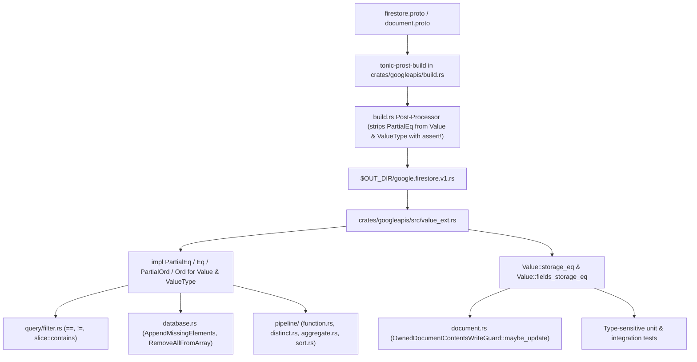

# Unifying Firestore `Value` `PartialEq` with `Ord` Semantics

*   **Author:** Paco van der Linden
*   **Status:** Draft
*   **Date:** 2026-11-10

--------------------------------------------------------------------------------

## Overview

In the Firestore emulator, [`googleapis::google::firestore::v1::Value`](file:///Users/paco/code/rust/firestore-emulator/crates/googleapis/src/value_ext.rs#L13-L208) is the central data representation for document fields, query filters, cursors, field transforms, and pipeline expressions. Today, `Value` inherits a structural `#[derive(PartialEq)]` implementation from `prost-build` while implementing `Eq`, `PartialOrd`, and `Ord` manually in [`crates/googleapis/src/value_ext.rs`](file:///Users/paco/code/rust/firestore-emulator/crates/googleapis/src/value_ext.rs#L210-L288) according to Firestore's cross-type comparison rules.

This design removes `prost-build`'s derived `PartialEq` from `Value` (and `value::ValueType`) in [`crates/googleapis/build.rs`](file:///Users/paco/code/rust/firestore-emulator/crates/googleapis/build.rs) and implements `PartialEq` in [`crates/googleapis/src/value_ext.rs`](file:///Users/paco/code/rust/firestore-emulator/crates/googleapis/src/value_ext.rs) so that `a == b` holds if and only if `a.cmp(b) == Ordering::Equal`. For the single database persistence path that requires exact wire-representation identity—[`OwnedDocumentContentsWriteGuard::maybe_update`](file:///Users/paco/code/rust/firestore-emulator/crates/emulator-database/src/database/document.rs#L250-L277), where changing an integer `1` to a double `1.0` must produce a new document version—`Value` provides an explicit, recursive storage-identity comparison method (`Value::storage_eq`).

## The Problem

Firestore defines value equality and ordering across numeric representations (`IntegerValue(42)` equals `DoubleValue(42.0)`, `-0.0` equals `+0.0`, and `NaN` equals `NaN` for ordering and set membership). In [`crates/googleapis/src/value_ext.rs`](file:///Users/paco/code/rust/firestore-emulator/crates/googleapis/src/value_ext.rs#L210-L288), `Value` implements `Ord`, `PartialOrd`, and `Eq` using Firestore's ordering rules, but keeps `prost-build`'s derived `PartialEq`, which compares Rust enum variants structurally:

1.  **Violation of Rust's `Eq` and `Ord` Trait Contract:** Rust's standard library requires that for any type implementing `Eq` and `Ord`, `a == b` must be equivalent to `a.cmp(&b) == Ordering::Equal`, and `a == a` must hold for all values (reflexivity). Under `prost`'s derived `PartialEq`, `Value::integer(1) == Value::double(1.0)` is `false` while `Value::integer(1).cmp(&Value::double(1.0))` is `Ordering::Equal`, and `Value::double(f64::NAN) == Value::double(f64::NAN)` is `false`. Standard library types and algorithms (`BTreeSet`, `BTreeMap`, `slice::contains`, `Vec::retain`) rely on this contract for deterministic behavior.
2.  **Error-Prone Workarounds Across Query, Transform, and Pipeline Code:** Because `==`, `!=`, and `slice::contains` on `Value` use `prost`'s structural `PartialEq`, developers must remember to bypass standard Rust operators:
    *   [`FieldFilter::eval`](file:///Users/paco/code/rust/firestore-emulator/crates/emulator-database/src/database/query/filter.rs#L178-L180) works around `PartialEq` for `FieldOperator::Equal` using `value <= &self.value && value >= &self.value` with `#[allow(clippy::double_comparisons)]`, while `FieldOperator::NotEqual`, `FieldOperator::ArrayContains`, and `FieldOperator::In` on lines 182–186 use `!=` and `.contains()` and fail to match `IntegerValue` against `DoubleValue`.
    *   [`apply_transform`](file:///Users/paco/code/rust/firestore-emulator/crates/emulator-database/src/database.rs#L583-L598) uses `array.contains(&el)` for `AppendMissingElements` and `elements.values.contains(v)` for `RemoveAllFromArray`, failing to deduplicate or remove equivalent integer/double values.
    *   [`pipeline::function::evaluate`](file:///Users/paco/code/rust/firestore-emulator/crates/emulator-database/src/database/pipeline/function.rs#L218-L219) uses `a == b` and `a != b` for `"equal"` and `"not_equal"`, disagreeing with `"less_than_or_equal"` and `"greater_than_or_equal"` in the same match block.
    *   Introducing a helper method such as `Value::is_firestore_equal` (as attempted in branch `feat-array-contains-any`) leaves `==` and `.contains()` compiling with the wrong behavior whenever a contributor forgets the helper.
3.  **Distinguishing Domain Equality from Storage Identity:** While query evaluation, array transforms, and pipeline operations require Firestore semantic equality (`1 == 1.0`), document persistence in [`OwnedDocumentContentsWriteGuard::maybe_update`](file:///Users/paco/code/rust/firestore-emulator/crates/emulator-database/src/database/document.rs#L264) checks whether an incoming write modifies the stored document fields (`if last.fields == fields`). Overwriting `IntegerValue(1)` with `DoubleValue(1.0)` (or `-0.0` with `+0.0`) changes the stored field representation and must create a new [`StoredDocumentVersion`](file:///Users/paco/code/rust/firestore-emulator/crates/emulator-database/src/database/document.rs#L361-L402).

The proposed solution makes Firestore semantic equality the default `PartialEq` on `Value` (aligned with `Ord::cmp`) so standard Rust operators and slice methods behave according to Firestore rules everywhere by default, while introducing an explicit, recursive `Value::storage_eq` method for persistence change detection and wire-representation test assertions.

## Goals

*   **Unify `PartialEq` and `Ord` on `Value`:** Strip `prost-build`'s derived `PartialEq` from `Value` and `value::ValueType` in [`crates/googleapis/build.rs`](file:///Users/paco/code/rust/firestore-emulator/crates/googleapis/build.rs) (guarded by a build-time assertion) and implement `PartialEq` in [`crates/googleapis/src/value_ext.rs`](file:///Users/paco/code/rust/firestore-emulator/crates/googleapis/src/value_ext.rs) so `a == b` is equivalent to `a.cmp(b) == Ordering::Equal`.
*   **Guarantee Total, Non-Panicking Comparison:** Handle `Value { value_type: None }` (`Value::default()`) in `Ord::cmp` and `PartialEq::eq` without panicking, and compare `FieldReferenceValue`, `FunctionValue`, and `PipelineValue` deterministically without emitting `tracing::warn!` logs.
*   **Preserve Transitivity Across All Numeric & Coordinate Values:** Incorporate exact `i64`-vs-`f64` comparisons (including integers beyond $2^{53}$), `-0.0 == +0.0` normalization (in both `DoubleValue` and `LatLng`), and reflexive `NaN == NaN` ordering.
*   **Avoid Heap Allocations on Map & Array Equality:** Fast-path `ArrayValue` (`a.values == b.values`) and `MapValue` (`a.fields == b.fields`) in `PartialEq::eq` so map equality runs in $O(K)$ without sorting keys into temporary heap allocations.
*   **Provide Recursive Storage-Identity Comparison (`Value::storage_eq`):** Expose a public, recursive `Value::storage_eq` method (and a companion helper for `HashMap<String, Value>`) that compares `DoubleValue` via `f64::to_bits()`, compares `ReferenceValue` strings literally, and recurses through nested containers for use in [`OwnedDocumentContentsWriteGuard::maybe_update`](file:///Users/paco/code/rust/firestore-emulator/crates/emulator-database/src/database/document.rs#L264) and representation-sensitive tests.
*   **Use Standard Rust Equality Operators Across `emulator-database`:** Replace `#[allow(clippy::double_comparisons)]` in [`FieldFilter::eval`](file:///Users/paco/code/rust/firestore-emulator/crates/emulator-database/src/database/query/filter.rs#L178-L180) with `value == &self.value` and eliminate the need for custom `is_firestore_equal` helper loops in favor of standard `==`, `!=`, and `slice::contains`.

## Non-Goals

*   **Implementing `std::hash::Hash` for `Value`:** Ordered collections (`BTreeSet` and `BTreeMap`) are already used for pipeline `distinct` and `aggregate` stages; canonical hashing across `i64`/`f64` and `HashMap` is out of scope.
*   **Introducing a Separate Internal `Value` AST in `emulator-database`:** `googleapis::google::firestore::v1::Value` remains the shared value representation across crates to avoid recursive tree conversions at gRPC and HTTP boundaries.
*   **Changing Inequality Filter Type-Compatibility Rules:** The `is_compatible_with` guard for `<`, `<=`, `>`, and `>=` in [`FieldFilter::eval`](file:///Users/paco/code/rust/firestore-emulator/crates/emulator-database/src/database/query/filter.rs#L169-L171) remains unchanged.

## Open Questions

*   None. All open design questions were resolved during the brainstorm phase.

## Critical User Journeys (CUJs)

### CUJ 1: Cross-Type Numeric Equality in Queries, Array Transforms, and Pipelines

*   **Given**: A stored Firestore document with field `count: IntegerValue(42)` and field `tags: ArrayValue([IntegerValue(10), DoubleValue(f64::NAN)])`.
*   **When**: A client executes a query filter (`Equal`, `NotEqual`, `In`, `ArrayContains`, or `ArrayContainsAny`), a pipeline expression (`equal` or `not_equal`), or an array field transform (`AppendMissingElements` / `RemoveAllFromArray`) using `DoubleValue(42.0)` or `DoubleValue(10.0)` or `DoubleValue(f64::NAN)`.
*   **Then**: Standard Rust `==`, `!=`, and `slice::contains` on `Value` treat `IntegerValue(42)` and `DoubleValue(42.0)` as equal, treat `IntegerValue(10)` and `DoubleValue(10.0)` as equal, treat `DoubleValue(f64::NAN)` and `DoubleValue(f64::NAN)` as equal, and distinguish `IntegerValue(i64::MAX)` from `DoubleValue(i64::MAX as f64)` without precision loss.

### CUJ 2: Representation-Preserving Document Updates in `maybe_update`

*   **Given**: An existing document stored in `emulator-database` with `{ "score": IntegerValue(1), "nested": MapValue({ "items": ArrayValue([IntegerValue(5)]) }) }`.
*   **When**: A client writes an update changing `"score"` to `DoubleValue(1.0)` or changing `"nested.items"` to `ArrayValue([DoubleValue(5.0)])`, or re-writes the exact same document containing a `DoubleValue(f64::NAN)` field.
*   **Then**: [`OwnedDocumentContentsWriteGuard::maybe_update`](file:///Users/paco/code/rust/firestore-emulator/crates/emulator-database/src/database/document.rs#L250-L277) evaluates `Value::fields_storage_eq(&last.fields, &fields)`: it detects the `IntegerValue` to `DoubleValue` change (both at the top level and nested inside arrays/maps) and creates a new [`StoredDocumentVersion`](file:///Users/paco/code/rust/firestore-emulator/crates/emulator-database/src/database/document.rs#L361-L402), while treating an unchanged `DoubleValue(f64::NAN)` with identical bits as a no-op that does not create a spurious version.

### CUJ 3: Total, Non-Panicking Comparison on Default or Unset Protobuf `Value`s

*   **Given**: A `Value::default()` (`Value { value_type: None }`) constructed in unit tests or decoded from an empty protobuf `Value` submessage before request validation.
*   **When**: Code compares the `Value` (or a parent `Document`, `Write`, `Cursor`, or `StructuredQuery`) using `==`, `!=`, `<`, `<=`, `>`, `>=`, or `Ord::cmp`.
*   **Then**: The comparison completes deterministically without panicking (`Value::default() == Value::default()` evaluates to `true`, and `Value { value_type: None }` orders before all populated `ValueType` variants).

## Technical Plan (Architecture)

The architecture separates **Firestore domain comparison** (the default `PartialEq`, `Eq`, `PartialOrd`, and `Ord` traits on `Value`) from **storage-representation identity** (`Value::storage_eq` and `Value::fields_storage_eq`).

### 1. Build-Time Suppression of Derived `PartialEq` (`crates/googleapis/build.rs`)

`prost-build` emits `#[derive(Clone, PartialEq, ::prost::Message)]` on every message and `#[derive(Clone, PartialEq, ::prost::Oneof)]` on every `oneof` without a configuration flag to disable `PartialEq`. However, [`crates/googleapis/build.rs`](file:///Users/paco/code/rust/firestore-emulator/crates/googleapis/build.rs#L32-L34) already attaches unique serde attributes to `Value` and `value::ValueType`:

*   `pub struct Value` is preceded by `#[serde(transparent)]`.
*   `pub enum ValueType` (in `pub mod value`) is preceded by `#[serde(untagged)]`.

Immediately after `.compile_protos(...)` in [`crates/googleapis/build.rs`](file:///Users/paco/code/rust/firestore-emulator/crates/googleapis/build.rs#L43-L47), the build script reads `$OUT_DIR/google.firestore.v1.rs` and strips `PartialEq, ` from those two anchored declarations:

1.  Verify with `assert_eq!` that the exact anchored declaration for `pub struct Value` and the exact anchored declaration for `pub enum ValueType` each appear once in `google.firestore.v1.rs`. If a future `prost-build` upgrade alters attribute ordering or formatting, `cargo build` fails immediately in `build.rs` with an explicit diagnostic message.
2.  Replace `#[derive(Clone, PartialEq, ::prost::Message)]` on `pub struct Value` with `#[derive(Clone, ::prost::Message)]`, and replace `#[derive(Clone, PartialEq, ::prost::Oneof)]` on `pub enum ValueType` with `#[derive(Clone, ::prost::Oneof)]`.
3.  All surrounding `prost` messages (`Document`, `ArrayValue`, `MapValue`, `Function`, `Pipeline`, `Cursor`, `StructuredQuery`, `Write`) keep their generated `#[derive(Clone, PartialEq, ::prost::Message)]` attributes, which now delegate field comparisons to the manual `PartialEq` implementation on `Value`.

### 2. Total Ordering and Fast-Path `PartialEq` (`crates/googleapis/src/value_ext.rs`)

In [`crates/googleapis/src/value_ext.rs`](file:///Users/paco/code/rust/firestore-emulator/crates/googleapis/src/value_ext.rs):

1.  **Total Handling of `Value { value_type: None }`:**
    *   `Value::value_type_order(&self) -> usize` matches on `self.value_type.as_ref()` (via a shared `value_type_rank(vt: Option<&ValueType>) -> usize` helper) instead of calling the panicking `self.value_type()` accessor.
    *   `None` is assigned rank `0` (below `NullValue` at rank `1`). In `Ord::cmp`, `(None, None)` returns `cmp::Ordering::Equal`, and mismatched ranks continue to be resolved by comparing ranks.
2.  **Transitive Numeric and Coordinate Ordering:**
    *   `DoubleValue(a)` vs `DoubleValue(b)` uses `cmp_f64(*a, *b)`, which matches on `(a.is_nan(), b.is_nan())`: `(true, true) => Ordering::Equal`, `(true, false) => Ordering::Less`, `(false, true) => Ordering::Greater`, and for `(false, false)` normalizes `-0.0` and `+0.0` to `0.0` before delegating to `f64::total_cmp`.
    *   `IntegerValue(i)` vs `DoubleValue(d)` (and vice versa) uses `cmp_i64_f64(i, d)`, which compares 64-bit integers against non-`NaN` `f64` values without precision loss above $2^{53}$ by checking the exact power-of-two bounds `i64::MIN as f64` ($-2^{63}$) and `9_223_372_036_854_775_808.0_f64` ($+2^{63}$) before comparing `i` with `d.floor() as i64` and checking `d == d.floor()`.
    *   `LatLng::cmp` (`GeoPointValue`) uses `cmp_f64` on `latitude` and `longitude` so `-0.0` and `+0.0` coordinates compare `Ordering::Equal` and single-`NaN` coordinates preserve strict total ordering.
3.  **Deterministic Comparison of Expression Variants:**
    *   `FieldReferenceValue(a)` vs `FieldReferenceValue(b)` compares `a.cmp(b)`.
    *   `Function`, `Pipeline`, and `pipeline::Stage` implement `Eq`, `PartialOrd`, and `Ord` in `value_ext.rs` (sorting `options` by key via `.iter().sorted()`, matching `MapValue`), so `FunctionValue(a)` vs `FunctionValue(b)` and `PipelineValue(a)` vs `PipelineValue(b)` compare `a.cmp(b)` deterministically without emitting `tracing::warn!` logs.
4.  **`PartialEq` Implementation on `ValueType` and `Value`:**
    *   A shared helper `fn cmp_value_type(a: &ValueType, b: &ValueType) -> cmp::Ordering` encapsulates the variant rank and value ordering for `ValueType`.
    *   `ValueType::eq(&self, other: &Self) -> bool` (`impl PartialEq for ValueType` and `impl Eq for ValueType`) is defined to be equivalent to `cmp_value_type(self, other).is_eq()`, with allocation-free fast paths for container and byte/string variants:
        *   When both values are `MapValue`s: `a.fields == b.fields` (`HashMap::eq` checks `len()` in $O(1)$ and performs $O(K)$ lookups without heap-allocating or sorting key vectors).
        *   When both values are `ArrayValue`s: `a.values == b.values` (`Vec::eq` checks `len()` in $O(1)$ before comparing elements via `Value::eq`).
        *   When both values are `StringValue`s or `BytesValue`s: `a == b` ($O(1)$ length check before byte comparison).
        *   All other combinations delegate to `cmp_value_type(self, other).is_eq()`.
    *   `Value::eq(&self, other: &Self) -> bool` delegates to `ValueType::eq` via `match (&self.value_type, &other.value_type) { (None, None) => true, (Some(a), Some(b)) => a == b, _ => false }`, and `<Value as Ord>::cmp` delegates populated variants to `cmp_value_type`.

### 3. Recursive Storage-Identity Comparison (`Value::storage_eq` & `Value::fields_storage_eq`)

To detect representation changes during document writes (where changing `IntegerValue(1)` to `DoubleValue(1.0)` or `-0.0` to `+0.0` must create a new document version, while re-writing an identical `NaN` must not), `Value` provides two public methods in [`crates/googleapis/src/value_ext.rs`](file:///Users/paco/code/rust/firestore-emulator/crates/googleapis/src/value_ext.rs):

*   `pub fn storage_eq(&self, other: &Self) -> bool`:
    *   Performs an exhaustive match over `(self.value_type.as_ref(), other.value_type.as_ref())` without delegating to `PartialEq` on `Value`, `ValueType`, `ArrayValue`, or `MapValue`:
        *   `DoubleValue(a)` vs `DoubleValue(b)`: `a.to_bits() == b.to_bits()`.
        *   `IntegerValue(a)` vs `DoubleValue(b)`: always `false`.
        *   `ReferenceValue(a)` vs `ReferenceValue(b)`: raw string equality `a == b` (without [`REFERENCE_NAME_MIN_ID`](file:///Users/paco/code/rust/firestore-emulator/crates/googleapis/src/value_ext.rs#L247) normalization, which in `Ord::cmp` maps the sentinel path segment `"__id-9223372036854775808__"` to `""`).
        *   `GeoPointValue(a)` vs `GeoPointValue(b)`: `a.latitude.to_bits() == b.latitude.to_bits() && a.longitude.to_bits() == b.longitude.to_bits()`.
        *   `ArrayValue(a)` vs `ArrayValue(b)`: `a.values.len() == b.values.len()` and element-wise `storage_eq`.
        *   `MapValue(a)` vs `MapValue(b)`: `Self::fields_storage_eq(&a.fields, &b.fields)`.
        *   `FunctionValue(a)` vs `FunctionValue(b)` and `PipelineValue(a)` vs `PipelineValue(b)`: recursive `storage_eq` across `name`, `args`, `options`, and `stages`.
        *   All other same-variant primitives (`NullValue`, `BooleanValue`, `TimestampValue`, `StringValue`, `BytesValue`, `FieldReferenceValue`) use exact equality; mismatched variants return `false`.
*   `pub fn fields_storage_eq(a: &HashMap<String, Self>, b: &HashMap<String, Self>) -> bool`:
    *   Returns `a.len() == b.len() && a.iter().all(|(k, v)| b.get(k).is_some_and(|ov| v.storage_eq(ov)))`.

### 4. Database Call-Site Updates (`crates/emulator-database`)

*   **Document Version Detection ([`crates/emulator-database/src/database/document.rs`](file:///Users/paco/code/rust/firestore-emulator/crates/emulator-database/src/database/document.rs#L258-L267)):**
    *   In `OwnedDocumentContentsWriteGuard::maybe_update`, replace `if last.fields == fields` with `if Value::fields_storage_eq(&last.fields, &fields)` and move the `trace!("fields are equal to previous version")` log statement inside the `if` body.
*   **Query Filter Evaluation ([`crates/emulator-database/src/database/query/filter.rs`](file:///Users/paco/code/rust/firestore-emulator/crates/emulator-database/src/database/query/filter.rs#L172-L190)):**
    *   Replace `#[allow(clippy::double_comparisons)] Equal => value <= &self.value && value >= &self.value` with `Equal => value == &self.value`.
    *   `NotEqual` (`value != &self.value`), `ArrayContains` (`arr.contains(&self.value)`), and `In` (`arr.contains(value)`) remain idiomatic Rust expressions and now evaluate using Firestore equality.
*   **Field Transforms & Pipeline Functions ([`crates/emulator-database/src/database.rs`](file:///Users/paco/code/rust/firestore-emulator/crates/emulator-database/src/database.rs#L578-L605), [`crates/emulator-database/src/database/pipeline/function.rs`](file:///Users/paco/code/rust/firestore-emulator/crates/emulator-database/src/database/pipeline/function.rs#L210-L227)):**
    *   `AppendMissingElements` (`!array.contains(&el)`), `RemoveAllFromArray` (`!elements.values.contains(v)`), and pipeline `"equal"` / `"not_equal"` (`a == b`, `a != b`) require no helper methods and operate using the unified `PartialEq`.

## Alternatives Considered

### Alternative A: Dedicated `Value::is_firestore_equal` Helper Method

*   **Pros**: Requires no post-processing in [`crates/googleapis/build.rs`](file:///Users/paco/code/rust/firestore-emulator/crates/googleapis/build.rs); leaves `prost`'s derived `PartialEq` in place for [`OwnedDocumentContentsWriteGuard::maybe_update`](file:///Users/paco/code/rust/firestore-emulator/crates/emulator-database/src/database/document.rs#L264).
*   **Cons**: Every query filter, array transform, and pipeline expression must remember to avoid `==`, `!=`, and `slice::contains` and instead write manual `.iter().any(|x| x.is_firestore_equal(...))` loops. Leaves `Value`'s `Eq` and `Ord` implementations in violation of Rust's `std::cmp::Ord` trait contract.
*   **Reason for Rejection**: Error-prone because developers can easily forget which equality method to call (as already happened in [`crates/emulator-database/src/database/pipeline/function.rs`](file:///Users/paco/code/rust/firestore-emulator/crates/emulator-database/src/database/pipeline/function.rs#L218-L219)), and leaves `BTreeSet`, `BTreeMap`, and `slice::contains` inconsistent with `Ord`.

### Alternative B: Newtype Wrapper `FirestoreValue(Value)` (with `ref-cast` or `bytemuck`)

*   **Pros**: Isolates Firestore `PartialEq` and `Ord` on a wrapper type; crates such as `ref-cast` or `bytemuck::TransparentWrapper` allow casting `&Value` to `&FirestoreValue` and `&[Value]` to `&[FirestoreValue]` without violating `unsafe_code = "forbid"` in workspace code.
*   **Cons**: As long as `Value` retains `prost`'s derived `PartialEq`, writing `a == b` or `arr.contains(&x)` on `Value` or `&[Value]` still compiles with the wrong semantics. Conversely, stripping `PartialEq` from `Value` without providing a replacement `impl PartialEq for Value` breaks `#[derive(PartialEq)]` on all surrounding `prost`-generated messages (`Document`, `ArrayValue`, `MapValue`, `Cursor`, `StructuredQuery`, `Write`).
*   **Reason for Rejection**: Replaces the risk of forgetting `.is_firestore_equal()` with the identical risk of forgetting `FirestoreValue::ref_cast()` without compiler enforcement, while adding wrapper noise and external crate dependencies.

### Alternative C: Separate Internal `emulator_database::Value` Domain Enum

*   **Pros**: Decouples internal database storage and query evaluation from `prost`-generated wire types (`googleapis::google::firestore::v1::Value`).
*   **Cons**: Requires recursively converting and allocating every `Document` and `Value` tree at the gRPC (`emulator-grpc`) and HTTP (`emulator-http`) boundaries on every read, write, and query response, and duplicates value constructors and accessors across crates.
*   **Reason for Rejection**: Introduces unnecessary heap allocations and boilerplate across the workspace for a discrepancy confined to `PartialEq`.

### Alternative D: AST Parsing (`syn` + `prettyplease`) in `crates/googleapis/build.rs`

*   **Pros**: Modifies `$OUT_DIR/google.firestore.v1.rs` via a parsed syntax tree independent of whitespace or attribute formatting.
*   **Cons**: Adds extra build dependencies (`syn`, `quote`, `prettyplease`) and full-file parsing/formatting time to `crates/googleapis/build.rs`.
*   **Reason for Rejection**: [`crates/googleapis/build.rs`](file:///Users/paco/code/rust/firestore-emulator/crates/googleapis/build.rs#L32-L34) already attaches unique serde attributes (`#[serde(transparent)]` on `pub struct Value` and `#[serde(untagged)]` on `pub enum ValueType`) that anchor a dependency-free string replacement guarded by `assert_eq!`.

### Alternative E: Implementing `Value::storage_eq` via `self.value_type == other.value_type` or `prost::Message::encode_to_vec`

*   **Pros**: Minimal code in `crates/googleapis/src/value_ext.rs`.
*   **Cons**: `ValueType`'s derived `PartialEq` delegates `ArrayValue` and `MapValue` comparisons back to `Value::eq` (Firestore equality), which would cause nested updates from `{"a": [1]}` to `{"a": [1.0]}` to be ignored in `maybe_update`, and uses IEEE 754 `f64::eq` (`NaN != NaN`, `-0.0 == +0.0`). `prost::Message::encode_to_vec` is non-deterministic for `MapValue` because `HashMap<String, Value>` iteration order is randomized.
*   **Reason for Rejection**: Fails correctness requirements for nested containers, `NaN` idempotency, and map key ordering.

--------------------------------------------------------------------------------

## Non-Functional Requirements

*   **Performance & Latency:** `PartialEq::eq` on `MapValue` uses `a.fields == b.fields` ($O(1)$ length check followed by $O(K)$ hash lookups with zero heap allocations) rather than `Ord::cmp`'s $O(K \log K)$ key-sorting allocation. `ArrayValue`, `StringValue`, and `BytesValue` equality also short-circuit in $O(1)$ when lengths differ.
*   **Crash Resilience (`panic = "abort"`):** Because `[profile.release]` in [`Cargo.toml`](file:///Users/paco/code/rust/firestore-emulator/Cargo.toml#L96) sets `panic = "abort"`, `PartialEq::eq`, `Ord::cmp`, and `Value::storage_eq` are total over all representable `Value` states, including `Value { value_type: None }` (`Value::default()`).
*   **Build-Time Safety:** The post-processing step in [`crates/googleapis/build.rs`](file:///Users/paco/code/rust/firestore-emulator/crates/googleapis/build.rs) asserts exact match counts when stripping `PartialEq` from `Value` and `ValueType`, failing the build immediately with an explicit message if a future `prost-build` upgrade changes the generated attribute layout.

--------------------------------------------------------------------------------

## Detailed Implementation Plan

### Target Files to Create/Modify

#### 1. [`crates/googleapis/build.rs`](file:///Users/paco/code/rust/firestore-emulator/crates/googleapis/build.rs) (Modify)

*   **Type / Scope**: Build Configuration (`googleapis` crate)
*   **Proposed Changes**:
    *   After `.compile_protos(...)`, read the generated file at `PathBuf::from(std::env::var("OUT_DIR").unwrap()).join("google.firestore.v1.rs")` using `std::fs::read_to_string`.
    *   Define the exact anchored target and replacement strings for `pub struct Value` (at top-level 0-space indentation) and `pub enum ValueType` (nested inside `pub mod value` at 4-space indentation):
        *   `Value` target: `"#[serde(transparent)]\n#[derive(Clone, PartialEq, ::prost::Message)]\npub struct Value"` -> replacement: `"#[serde(transparent)]\n#[derive(Clone, ::prost::Message)]\npub struct Value"`
        *   `ValueType` target: `"    #[serde(untagged)]\n    #[derive(Clone, PartialEq, ::prost::Oneof)]\n    pub enum ValueType"` -> replacement: `"    #[serde(untagged)]\n    #[derive(Clone, ::prost::Oneof)]\n    pub enum ValueType"`
    *   Verify with `assert_eq!(contents.matches(target).count(), 1, ...)` that each anchored target string appears exactly once in `google.firestore.v1.rs` so any future `prost-build` formatting change fails compilation with an explicit diagnostic message in `build.rs`.
    *   Replace both targets using `.replace(...)` and write the updated contents back to `$OUT_DIR/google.firestore.v1.rs` using `std::fs::write`.
*   **Rationale**: Suppresses `prost-build`'s derived structural `PartialEq` on `Value` and `value::ValueType` without introducing new build-time crate dependencies, allowing custom `PartialEq` implementations in `crates/googleapis/src/value_ext.rs`.

#### 2. [`crates/googleapis/Cargo.toml`](file:///Users/paco/code/rust/firestore-emulator/crates/googleapis/Cargo.toml) (Modify)

*   **Type / Scope**: Crate Manifest (`googleapis` crate)
*   **Proposed Changes**:
    *   Remove `tracing = { workspace = true }` from `[dependencies]` (line 18), as [`crates/googleapis/src/value_ext.rs`](file:///Users/paco/code/rust/firestore-emulator/crates/googleapis/src/value_ext.rs#L5) was the only file in `googleapis` referencing `tracing` and `[lints.rust]` enforces `unused_crate_dependencies = "warn"`.
*   **Rationale**: Keeps `cargo clippy --workspace --all-targets -- -D warnings` clean after removing the `tracing::warn!` stubs in `value_ext.rs`.

#### 3. [`crates/googleapis/src/value_ext.rs`](file:///Users/paco/code/rust/firestore-emulator/crates/googleapis/src/value_ext.rs) (Modify)

*   **Type / Scope**: Rust Library Module & Unit Tests (`googleapis` crate)
*   **Proposed Changes**:
    *   **Total Handling of `None` in `value_type_order` and `Ord::cmp`:** Extract `fn value_type_rank(vt: Option<&ValueType>) -> usize` and change `Value::value_type_order(&self) -> usize` and `<Value as Ord>::cmp` to match on `self.value_type.as_ref()` instead of calling `self.value_type()`. Assign `None` rank `0` and return `cmp::Ordering::Equal` when both operands are `None`.
    *   **Exact Numeric & Float Helpers (`cmp_f64` and `cmp_i64_f64`):**
        *   Add `fn cmp_f64(a: f64, b: f64) -> cmp::Ordering` that matches on `(a.is_nan(), b.is_nan())`: `(true, true) => cmp::Ordering::Equal`, `(true, false) => cmp::Ordering::Less`, `(false, true) => cmp::Ordering::Greater`, and for `(false, false)` normalizes `-0.0` and `+0.0` to `0.0` (`let a = if a == 0.0 { 0.0 } else { a }; let b = if b == 0.0 { 0.0 } else { b }; a.total_cmp(&b)`).
        *   Add `fn cmp_i64_f64(i: i64, d: f64) -> cmp::Ordering` that compares a 64-bit integer against a non-`NaN` `f64` without precision loss above $2^{53}$ using the exact power-of-two bounds `-2^63` (`i64::MIN as f64`) and `+2^63` (`9_223_372_036_854_775_808.0_f64`), comparing `i` with `d.floor() as i64` and checking `d == d.floor()`.
    *   **Complete `Ord::cmp` for Expression Variants & `LatLng`:**
        *   Import `Pipeline` and `pipeline::Stage` from `crate::google::firestore::v1` and implement `Eq`, `PartialOrd`, and `Ord` for `Function`, `Pipeline`, and `pipeline::Stage` (comparing `name`, `args`, and `.options.iter().sorted()`, and `stages` for `Pipeline`), removing `use tracing::warn;` and the `tracing::warn!` macro calls.
        *   In `cmp_value_type(a: &ValueType, b: &ValueType) -> cmp::Ordering`, compare `(FieldReferenceValue(a), FieldReferenceValue(b))`, `(FunctionValue(a), FunctionValue(b))`, and `(PipelineValue(a), PipelineValue(b))` via `a.cmp(b)`.
        *   In `<LatLng as Ord>::cmp`, replace `self.latitude.total_cmp(&other.latitude)` and `self.longitude.total_cmp(&other.longitude)` with `cmp_f64` so `-0.0` and `+0.0` coordinates compare `Ordering::Equal` and single-`NaN` coordinates preserve transitivity.
    *   **Manual `PartialEq` on `value::ValueType` and `Value`:**
        *   Implement `PartialEq` and `Eq` on `value::ValueType`: fast-path same-variant `MapValue` (`a.fields == b.fields`), `ArrayValue` (`a.values == b.values`), `StringValue` (`a == b`), and `BytesValue` (`a == b`), and delegate all other cases to `cmp_value_type(self, other).is_eq()`.
        *   Implement `PartialEq` for `Value` by delegating to `ValueType::eq`: `match (&self.value_type, &other.value_type) { (None, None) => true, (Some(a), Some(b)) => a == b, _ => false }`, and have `<Value as Ord>::cmp` delegate populated variants to `cmp_value_type`.
    *   **Recursive Storage-Identity API (`Value::storage_eq` & `Value::fields_storage_eq`):**
        *   Add `pub fn storage_eq(&self, other: &Self) -> bool` on `Value` that exhaustively matches `(self.value_type.as_ref(), other.value_type.as_ref())` without delegating to `PartialEq` on `Value`, `ValueType`, `ArrayValue`, or `MapValue`:
            *   Compare `DoubleValue(a)` and `DoubleValue(b)` via `a.to_bits() == b.to_bits()`.
            *   Compare `GeoPointValue(a)` and `GeoPointValue(b)` via `a.latitude.to_bits() == b.latitude.to_bits() && a.longitude.to_bits() == b.longitude.to_bits()`.
            *   Compare `ReferenceValue(a)` and `ReferenceValue(b)` via raw string equality `a == b`.
            *   Compare `ArrayValue`, `MapValue`, `FunctionValue`, and `PipelineValue` recursively using `storage_eq` and `fields_storage_eq`.
            *   Return `false` whenever enum variants differ (including `IntegerValue(1)` vs `DoubleValue(1.0)`).
        *   Add `pub fn fields_storage_eq(a: &HashMap<String, Self>, b: &HashMap<String, Self>) -> bool` on `Value` checking `a.len() == b.len() && a.iter().all(|(k, v)| b.get(k).is_some_and(|ov| v.storage_eq(ov)))`.
    *   **Unit Tests in `mod tests`:**
        *   Add unit tests verifying `PartialEq` and `Ord` agreement across `IntegerValue` and `DoubleValue` (including `0`, `-0.0`, `+0.0`, `NaN`, `-NaN`, `i64::MIN`, `i64::MAX - 1`, `i64::MAX`, and `2^63` as `f64`), `Value::default()` (`None`), `LatLng` with `-0.0`/`+0.0`/`NaN`, `FieldReferenceValue`, `FunctionValue`, `PipelineValue`, `ArrayValue` (`slice::contains`), and `MapValue`.
        *   Add unit tests verifying `Value::storage_eq` and `Value::fields_storage_eq` across top-level and nested `ArrayValue`/`MapValue` structures (`IntegerValue(1)` vs `DoubleValue(1.0)`, `-0.0` vs `+0.0`, `NaN` vs `NaN`, and raw `ReferenceValue` strings).
*   **Rationale**: Restores Rust's `Eq`/`Ord` coherence contract on `Value` and provides an explicit, recursive storage-identity check for persistence and representation-level tests.

#### 4. [`crates/emulator-database/src/database/document.rs`](file:///Users/paco/code/rust/firestore-emulator/crates/emulator-database/src/database/document.rs) (Modify)

*   **Type / Scope**: Document Storage & Version Management (`emulator-database` crate)
*   **Proposed Changes**:
    *   In [`OwnedDocumentContentsWriteGuard::maybe_update`](file:///Users/paco/code/rust/firestore-emulator/crates/emulator-database/src/database/document.rs#L258-L267), replace `if last.fields == fields` with `if Value::fields_storage_eq(&last.fields, &fields)` and move `trace!("fields are equal to previous version");` inside the `if` block so the trace is only emitted when the fields actually match.
    *   Add unit tests verifying that updating a field from `Value::integer(1)` to `Value::double(1.0)` (both at top level and nested inside a map or array) creates a new `StoredDocumentVersion`, whereas re-writing an identical field map (including one with `Value::double(f64::NAN)`) returns `Ok((last.update_time, None))`.
*   **Rationale**: Prevents `maybe_update` from dropping writes that change a field's stored representation between `IntegerValue` and `DoubleValue` or between `-0.0` and `+0.0`, and fixes the premature `trace!` log.

#### 5. [`crates/emulator-database/src/database/query/filter.rs`](file:///Users/paco/code/rust/firestore-emulator/crates/emulator-database/src/database/query/filter.rs) (Modify)

*   **Type / Scope**: Query Filter Evaluation (`emulator-database` crate)
*   **Proposed Changes**:
    *   In [`FieldFilter::eval`](file:///Users/paco/code/rust/firestore-emulator/crates/emulator-database/src/database/query/filter.rs#L178-L180), remove the comment `// Workaround for incompatible PartialEq implementation` and `#[allow(clippy::double_comparisons)]`, and replace `Equal => value <= &self.value && value >= &self.value` with `Equal => value == &self.value`.
*   **Rationale**: Eliminates the double-comparison workaround now that `Value::eq` is consistent with `Value::cmp`.

### Verification Plan

*   **Compilation/Build**: `cargo build --workspace --all-targets`
*   **Unit Tests**: `cargo test --workspace` (specifically verifying `crates/googleapis` `value_ext::tests` and `crates/emulator-database` unit and integration tests)
*   **Static Analysis & Linting**: `cargo clippy --workspace --all-targets -- -D warnings`

--------------------------------------------------------------------------------

<!-- Provenance: Indicates initial structural drafting and review via EGM. -->

*Drafted and reviewed with EGM*
