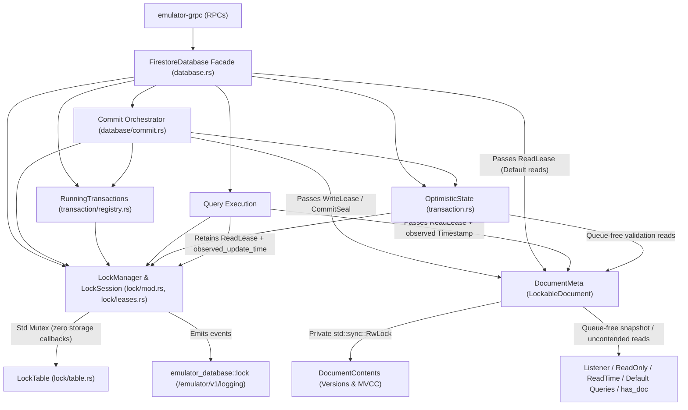

# Wound-Wait Transaction Locking & Internal Lock Module

*   **Author:** Paco
*   **Status:** Draft (Post-Round-2 Revision)
*   **Date:** 2026-11-19

--------------------------------------------------------------------------------

## Overview

This design replaces [`crates/fifo-rwlock`](../../crates/fifo-rwlock/src/lib.rs) with a zero-`unsafe` **Wound-Wait** concurrency subsystem inside `emulator-database` (`crates/emulator-database/src/database/lock/`: `mod.rs`, `table.rs`, `leases.rs`, `tests.rs`), alongside separated transaction-slot management (`database/transaction/registry.rs`) and commit orchestration (`database/commit.rs`), stacked on [PR #208](https://github.com/skunkteam/rust-firestore-emulator/pull/208) (`repository_bug_audit_quality`) with structured `emulator_database::lock` tracing consumable via `/emulator/v1/logging`. It aligns the emulator with Google Cloud Firestore's age-ordered pessimistic transaction behavior, makes [`deadlock`](../../test-suite/tests/3-pessimistic-transaction.test.ts#L642-L728) deterministic across both document-ID sort orders, ungates the skipped query-lock test in [`test-suite/tests/3-pessimistic-transaction.test.ts`](../../test-suite/tests/3-pessimistic-transaction.test.ts#L911-L977), and gates `DocumentContents` access behind runtime-checked lock capabilities; interactive HTTP/SSE and Web UI contention visualization are deferred to issue [#263](https://github.com/skunkteam/rust-firestore-emulator/issues/263).

Work lands in two bisectable commits on top of [PR #208](https://github.com/skunkteam/rust-firestore-emulator/pull/208): Commit 1 adds Cloud validation probes in [`test-suite/tests/3-pessimistic-transaction.test.ts`](../../test-suite/tests/3-pessimistic-transaction.test.ts) and verifies them against live Google Cloud Firestore (`cd test-suite && npm test`), and Commit 2 implements `database/lock/`, `database/transaction/registry.rs`, and `database/commit.rs` while deleting `crates/fifo-rwlock`.

## The Problem

[PR #208](https://github.com/skunkteam/rust-firestore-emulator/pull/208) fixes batch AB-BA commit deadlocks by sorting write targets in `BTreeSet<DocumentRef>`, stages mutations synchronously before applying versions, consumes transactions up front in `commit()`, and serializes Enterprise optimistic commits with `optimistic_commit_lock`. Four concurrency and safety gaps remain:

1.  **Timing-Dependent `deadlock` Risk Under Sorted Commit Locking:** In [`FirestoreDatabase::commit`](../../crates/emulator-database/src/database.rs#L627-L657), write locks are acquired in sorted `BTreeSet<DocumentRef>` order, while transactions acquire shared `FifoRwLock` read locks dynamically in caller order. In [`deadlock`](../../test-suite/tests/3-pessimistic-transaction.test.ts#L642-L728), random 20-character Firestore auto-IDs from `refs()` (`ref1`, `ref2`) are read in opposite orders by Transaction A (`ref1` then `ref2`) and Transaction B (`ref2` then `ref1`), then committed on both documents using asymmetric `Timeouts::FAST` deadlines (`2s` write < `5s` read) and asserted with `toBeOneOf`. When `ref1 < ref2`, Transaction A hits B's read lock on `ref2` at `2s`, freeing A's lock on `ref1` so B commits first; when `ref2 < ref1`, timing-dependent overlapping stalls across retries can race without deterministic age-ordered preemption.
2.  **Idle Query-Lock Holder Preemption (`notImplementedInRust`):** Cycle detection on in-process wait queues cannot pass [`conditional write based on query (contested doc is read first in the secondary transaction)`](../../test-suite/tests/3-pessimistic-transaction.test.ts#L911-L977), currently gated by `notImplementedInRust` (`never[] | undefined` in [`test-suite/tests/utils/firestore.ts`](../../test-suite/tests/utils/firestore.ts#L15), re-exported via `test-suite/tests/utils/index.ts`). There, older `txn 2` reads `docRef2`, younger `txn 1` locks `docRef2` via a query and pauses on an external JavaScript `ConcurrentTest` synchronization barrier (`test.when('txn 2: completed')`), and `txn 2` commits an update to `docRef2`. Because `txn 1` holds zero wait edges inside the emulator, no cycle exists and cycle detection stalls until timeout; `txn 2` must preempt `txn 1`'s read lock immediately based on transaction age.
3.  **`UnsafeCell` Aliasing vs. Remote Preemption and Torn Commit Apply:** [`crates/fifo-rwlock`](../../crates/fifo-rwlock/src/lib.rs#L1-L42) implements strict FIFO scheduling with queue-preserving `upgrade()` and `'static` owned guards across `.await` points (`PessimisticState::guards` in [`transaction.rs`](../../crates/emulator-database/src/database/transaction.rs#L141-L144)), relying on an exemption from `[workspace.lints.rust] unsafe_code = "forbid"` in [`crates/fifo-rwlock/Cargo.toml`](../../crates/fifo-rwlock/Cargo.toml#L15-L17). Moving to workspace-wide `unsafe_code = "forbid"` with `std::sync::RwLock<T>` precludes long-lived `Deref` guards across `.await` or remote revocation by another transaction. At the same time, [`FirestoreDatabase::commit`](../../crates/emulator-database/src/database.rs#L653-L692) acquires commit write locks across `.await` in the commit lock phase before staging and applying versions in the commit apply phase; without an explicit commit seal (`Active -> Committing`), an older concurrent transaction could wound a committing transaction between two target documents and tear multi-document atomicity.
4.  **Wounded Lifecycle Races Across Up-Front `remove()`, `retry_transaction`, and `Rollback`:** [`FirestoreDatabase::commit`](../../crates/emulator-database/src/database.rs#L622-L624) deletes transactions from [`RunningTransactions`](../../crates/emulator-database/src/database/transaction.rs#L27-L102) at the start of `commit()`. Under remote wounding, deleting a wounded entry immediately causes follow-up RPCs (`GetDocument`, `RunQuery`, `Commit`) to return `InvalidArgument` ([`RunningTransactions::get`](../../crates/emulator-database/src/database/transaction.rs#L40-L44)) instead of `Aborted`, breaking `@google-cloud/firestore` retry loops. Conversely, retaining a wounded tombstone with identical wire `TransactionId` bytes creates ambiguity with fire-and-forget SDK `Rollback` calls: [`start_read_write_with_id`](../../crates/emulator-database/src/database/transaction.rs#L75-L95) returns `FailedPrecondition` on occupied entries, an un-versioned [`rollback`](../../crates/emulator-database/src/database.rs#L818-L821) arriving late from `attempt_1` carries bytes identical to `attempt_2`, and existing test [`transactions_mvcc.rs`](../../crates/emulator-tests/src/suites/transactions_mvcc.rs#L59-L86) asserts `retried.id() == saved_id.as_slice()` after explicit rollback. Up-front removal in `commit` also discards transaction age priority if commit lock acquisition aborts unless lineage priority is preserved.

## Goals & Non-Goals

### Goals

*   **Zero-`unsafe` Workspace & `fifo-rwlock` Removal:** Replace `crates/fifo-rwlock` and `just miri` (its Miri aliasing test recipe) with internal `crates/emulator-database/src/database/lock/` (`mod.rs`, `table.rs`, `leases.rs`, `tests.rs`), leaving zero crates exempt from `unsafe_code = "forbid"` ([`Cargo.toml`](../../Cargo.toml#L69-L70); [`crates/googleapis/Cargo.toml`](../../crates/googleapis/Cargo.toml#L34-L42) already sets `unsafe_code = "forbid"` locally).
*   **Capability-Gated `DocumentContents`:** Require a lock capability (`ReadLease`, `WriteLease`, or `CommitSeal`) to read or mutate live `DocumentContents`, paired with queue-free historical/snapshot physical accessors and runtime checks on active un-wounded session state and document identity.
*   **Cloud-Aligned Wound-Wait Contention:** Implement age-ordered Wound-Wait locking so [`conditional write based on query (contested doc is read first in the secondary transaction)`](../../test-suite/tests/3-pessimistic-transaction.test.ts#L911-L977) passes with `notImplementedInRust` removed and [`deadlock`](../../test-suite/tests/3-pessimistic-transaction.test.ts#L642-L728) passes deterministically across both `ref1 < ref2` and `ref2 < ref1`.
*   **Commit 1 Live Cloud Validation Gate:** Run permanent SDK and raw GAPIC conformance tests (`cd test-suite && npm test`) against live Google Cloud Firestore in Commit 1 and record observed semantics before writing Commit 2.
*   **Snapshot Isolation & Queue-Free Optimistic Validation:** Keep [`Listener`](../../crates/emulator-database/src/listener.rs#L110-L145), `ReadOnlyTransaction`, `ReadTime`, non-transactional queries, and collection existence checks queue-free and non-woundable, and inspect unheld Enterprise optimistic validation documents without entering lock wait queues to eliminate validation-phase lock waits and `WriteBatch` AB-BA deadlocks (keeping `optimistic_commit_lock` serializing target write-lock acquisition through apply per [`transactions_mvcc.rs`](../../crates/emulator-tests/src/suites/transactions_mvcc.rs#L598-L641)).
*   **Structured Contention Tracing:** Emit structured `emulator_database::lock` tracing events carrying transaction ID, session/lineage sequence, wounder provenance, document path, wait duration, and typed `AbortReason` for capture via [`/emulator/v1/logging`](../../crates/emulator-http/src/routes/logging.rs#L30-L76).

### Non-Goals

*   Adding on-disk persistence or crash recovery (the emulator remains strictly in-memory).
*   Publishing or maintaining a separate standalone lock crate outside `emulator-database`.
*   Implementing `/emulator/v1/contention` HTTP/SSE endpoints, a contention ring buffer, or a Web UI `Contention` tab (deferred to issue [#263](https://github.com/skunkteam/rust-firestore-emulator/issues/263)).
*   Adding a permanent lock-throughput benchmark suite or pre-building multi-shard lock partitioning.
*   Adding idle `Active` transaction expiration or background GC sweep timers (tracked separately in issue [#257](https://github.com/skunkteam/rust-firestore-emulator/issues/257)).
*   Changing Enterprise Edition optimistic MVCC semantics beyond queue-free validation reads, or extending `emulator-grpc` with non-standard endpoints outside Cloud Firestore parity.

## Open Questions

*   **Question 1 (Commit 1 Cloud Probe — Queue Preemption Scope — *Resolved: Granted Holders Only*):** Live Cloud Probes C1, C2a, and C2b proved that Cloud Firestore wounds conflicting granted *holders* only (`txnMid` aborted with `Code::Aborted`), does not wound conflicting blind write waiters (`txnYoung`), and orders the wait queue by priority (`seq`, then arrival order) so intermediate reader `t1` bypasses younger queued writer `t2` while younger reader `t2` waits behind older queued writer `t1`.
*   **Question 2 (Commit 1 Cloud Probe — Non-Transactional `WriteBatch` & Missing-Doc Locks — *Resolved: Concurrent Batch Locking + Server Retry + Missing-Doc Locks*):** Live Cloud Probes D1–D4 proved that missing documents lock identically to stored documents (Probe D4), single-document writes wait behind RW txns and succeed after release (Probe D3), and 2-document non-transactional `WriteBatch` requests succeed when colliding with older RW txns (Probe D1, retrying server-side if wounded) and acquire uncontended target write locks concurrently across both `doc1 < doc2` and `doc2 < doc1` orderings so later RW txns block behind the batch and observe its writes (Probe D2).
*   **Question 3 (Commit 1 Cloud Probe — Priority Timestamp, `retry_transaction` Wire Bytes, & Stale `Rollback` — *Resolved: Lazy First-Lock Priority + Rotated Tokens*):** Live Cloud Probes A1–A2 and B1–B2 proved that Cloud Firestore assigns transaction-wide priority lazily on first lock acquisition rather than at `BeginTransaction`, rotates `transaction` wire bytes on `BeginTransaction(retry_transaction)` while inheriting original lineage priority, and treats delayed `Rollback(attempt_1)` after `attempt_2` is active as an idempotent `Ok(())` no-op leaving `attempt_2` intact.

## Critical User Journeys (CUJs)

### CUJ 1: Deterministic Opposite-Order Multi-Document Contention (`deadlock`)

*   **Given:** A Standard Edition (pessimistic) or Enterprise Pessimistic database tested across both `ref1 < ref2` and `ref2 < ref1` document-ID sort orderings, where `ref1` and `ref2` are initially absent documents generated via `refs()` (or fixed 20-character Firestore auto-IDs).
*   **When:** Older Transaction A begins first (`txn A` started), reads `ref1` then `ref2`, younger Transaction B begins after A, reads `ref2` then attempts to read `ref1`, and both attempt to commit writes to `ref1` and `ref2` via `@google-cloud/firestore`'s `runTransaction`.
*   **Then:** Older Transaction A preempts (wounds) Transaction B upon conflict and commits on attempt 1 without waiting for `2s`/`5s` timeouts; Transaction B receives `Code::Aborted` on its next read or commit, retries once, and commits.

### CUJ 2: Preempting an Idle Younger Query-Lock Holder

*   **Given:** A Standard Edition database containing `docRef1` and `docRef2` matching `queryDocsInTest`.
*   **When:** Older `txn 2` reads `docRef2`, younger `txn 1` runs `queryDocsInTest` to conditionally update `docRef1` only while matching documents exist (acquiring a read lock on `docRef2`) and pauses on an external JavaScript barrier, and `txn 2` commits an update to `docRef2` (matching [`3-pessimistic-transaction.test.ts`](../../test-suite/tests/3-pessimistic-transaction.test.ts#L911-L977)).
*   **Then:** `txn 2` preempts `txn 1`'s read lock on `docRef2` immediately and commits `{ testName: 'some other name' }`; `txn 1` receives `Code::Aborted` on commit, retries via the SDK, finds zero matching documents on attempt 2, and leaves `docRef1` unmodified.

## Technical Plan (Architecture)

The architecture replaces [`crates/fifo-rwlock`](../../crates/fifo-rwlock/src/lib.rs) with an internal Wound-Wait concurrency subsystem in `crates/emulator-database/src/database/lock/` (`mod.rs`, `table.rs`, `leases.rs`, `tests.rs`: `LockManager`, `LockTable`, `LockSession`, `ReadLease`, `WriteLease`, `CommitSeal`), separates commit orchestration/staging into `database/commit.rs`, and separates slot/tombstone management into `database/transaction/registry.rs`.

**Project Context & Baseline Terms:**

*   **Database Editions & Concurrency Modes:** A `Standard` Edition database uses pessimistic locking (`ConcurrencyMode::Pessimistic`); an `Enterprise` Edition database uses optimistic MVCC validation by default (`ConcurrencyMode::Optimistic`) unless `concurrency_mode` is configured to pessimistic (allowing pipeline queries and runtime edition switching via `/v1/projects/.../databases/...`).
*   **`Timeouts` Configuration:** [`Timeouts`](../../crates/emulator-database/src/database/timeouts.rs#L4-L29) configures read/write lock deadlines per `FirestoreProject` (`FAST`: `5s` read / `2s` write is the default when `long_contention_timeout: false` in `FirestoreConfig::default()`; `CLOUD`: `16s` read / `15s` write requires `--long-contention-timeout`).
*   **`ReadConsistency::Default`:** Non-transactional reads without an explicit timestamp or transaction ID (`get_doc`, `BatchGetDocuments`, `Query::once`). Point reads enter the lock queue (subject to `Timeouts.read` behind writers, per [`contention_timeouts.rs`](../../crates/emulator-tests/src/suites/contention_timeouts.rs#L223-L267)), whereas non-transactional queries evaluate a point-in-time snapshot (`ReadTime`) without lock queues.
*   **Dynamic Tracing (`/emulator/v1/logging`):** [`logging.rs`](../../crates/emulator-http/src/routes/logging.rs#L30-L76) allows tests and operators to dynamically attach `EnvFilter`-syntax target-prefix filters ([`metadata_filter.rs`](../../crates/emulator-tracing/src/metadata_filter.rs#L100-L106)) such as `emulator_database::lock=debug` and drain recorded logs over HTTP.
*   **Codebase Domain Primitives:** `RootRef` identifies a database (`projects/{p}/databases/{d}`); `DatabaseEvent` broadcasts committed document updates to active `Listener` streams; `NewTxnGuard` in `emulator-grpc` rolls back inline `NewTransaction` streams on initialization failure; `StoredDocumentVersion` is a concrete document payload inside `DocumentVersion` (stored vs. deleted MVCC entry); `get_read_time` resolves effective read timestamps for `Default`, `ReadTime`, and `Transaction` queries; and `OptimisticState` pins a read timestamp on first read, records read paths in `observed_docs` and query snapshots in `executed_queries`, validates both queue-free during commit, and maps dropped database `Weak::upgrade()` failures to `DatabaseDropped`.

### 1. Commit 1 Empirical Cloud Validation Gate

Changes stack on [PR #208](https://github.com/skunkteam/rust-firestore-emulator/pull/208) in two commits: Commit 1 adds permanent Cloud validation probes to [`3-pessimistic-transaction.test.ts`](../../test-suite/tests/3-pessimistic-transaction.test.ts) using `ConcurrentTest` and raw GAPIC helpers (`callRawUnaryRpc` / `callRawStreamRpc` in [`test-suite/tests/utils/README.md`](../../test-suite/tests/utils/README.md#L17)) and runs `cd test-suite && npm test` against live Cloud Firestore (`firestore-test-406503`), while Commit 2 implements the engine and lifts pre-Commit-2 `notImplementedInRust ||` guards (see `Detailed Implementation Plan` Stages 1–2 for the full file boundary).

Commit 1 pinned four empirical questions against live Google Cloud Firestore across both `standardEdition` and `enterpriseEditionPessimistic` (observing identical semantics on both editions):

*   **Probe A (Priority Assignment Time — Probes A1 & A2):** `probe A1` started `txn_early` (idle) before `txn_late`, had `txn_late` read `docA` first, then had `txn_early` read and commit `docA` while `txn_late` stayed open; `probe A2` had `txn_early` read an unrelated `docSeed` first before `txn_late` read `docA`.
    *   *Observed Live Cloud Result:* In `probe A1`, `txn_early` blocked and aborted (`earlySettledWhileLateOpen: false`, `earlyOk: false`, `earlyCode: 10`, `lateOk: true`); in `probe A2`, `txn_early` immediately preempted `txn_late` on `docA` (`earlySettledWhileLateOpen: true`, `earlyOk: true`, `lateOk: false`, `lateCode: 10`).
    *   *Commit 2 Locked Rule:* Assign transaction-wide priority lazily on first lock acquisition (`LockPriority::Lazy`), keeping `seq = 0` unassigned at `BeginTransaction` and allocating a monotonic sequence (`< u64::MAX`) on first `LockTable` lock request (inherited via `LockPriority::Assigned(seq)` across retries once assigned).
*   **Probe B (`retry_transaction` Wire Bytes, Lineage Priority & Delayed `Rollback` — Probes B1 & B2):** Tested `beginTransaction({ readWrite: { retryTransaction } })` after an abort against intermediate `txn_mid` (with priority pinned via first-lock reads) and sent a delayed `rollback(attempt_1)` while `attempt_2` was active.
    *   *Observed Live Cloud Result:* `probe B1` observed `sameTokenBytes: false` (Cloud rotates `transaction` wire bytes on retry) while inheriting original lineage priority so `target2` wounded `txn_mid` (`target2SettledWhileMidOpen: true`, `target2Ok: true`, `midCode: 10`); `probe B2` observed `delayedRollbackOk: true` and `attempt2CommitOk: true` (delayed `rollback(attempt_1)` is an idempotent no-op that leaves `attempt_2` intact).
    *   *Commit 2 Locked Rule:* Encode rotated 16-byte `(lineage_id: u64, attempt_gen: u64)` wire `TransactionId` tokens; key `RunningTransactions` by `lineage_id` storing `current_attempt` and `root_seq: Option<u64>`; increment `attempt_gen` on `start_read_write_with_id` returning the rotated `TransactionId`; return idempotent `Ok(())` on delayed `Rollback(stale_attempt)` (`id.attempt_gen < slot.current_attempt`); and update [`transactions_mvcc.rs#L84`](../../crates/emulator-tests/src/suites/transactions_mvcc.rs#L84) to assert rotated bytes (`expect_ne!`).
*   **Probe C (Conflicting Waiter Preemption Scope — Probes C1, C2a & C2b):** `probe C1` placed younger `txn_young` in a blind-write wait queue behind `txn_mid` (holding Read on `docA`) and had older `txn_old` commit a blind write; `probe C2a` and `probe C2b` tested intermediate-age and younger readers behind queued write waiters.
    *   *Observed Live Cloud Result:* `probe C1` confirmed `txn_old` wounded granted holder `txn_mid` (`midCode: 10`) without wounding conflicting blind-write waiter `txn_young` (`youngOk: true`, `oldCommitTime < youngCommitTime`); `probe C2a` confirmed intermediate reader `t1` bypassed younger write waiter `t2` (`t1BypassedT2WhileT0Open: true`, `t1ReadValue: 'initial'`, `t2Ok: true`); `probe C2b` confirmed younger reader `t2` waited behind older write waiter `t1` (`t2BlockedWhileT0Open: true`, `t2ReadValue: 'from t1'`).
    *   *Commit 2 Locked Rule:* Wound conflicting granted `woundable` `Active` holders only, and order wait queues by `(seq, arrival_order)`.
*   **Probe D (Non-Transactional `WriteBatch`, Younger-Txn Collisions & Missing-Doc Locks — Probes D1–D4):** Tested 2-document non-transactional `Commit` across both `doc1 < doc2` and `doc2 < doc1` colliding with an older RW txn holding `doc1` (`probe D1`) and entering before a younger RW txn reads `doc2` (`probe D2`), plus single-doc non-tx writes (`probe D3`) and concurrent read/write locks on a missing document (`probe D4`).
    *   *Observed Live Cloud Result:* `probe D1` passed in both orders (`txnOlderOk: true`, `batchOk: true`, `txnOlderCommitTime < batchCommitTime`); `probe D2` observed in **both** `ref1 < ref2` and `ref2 < ref1` that `txn_younger`'s read on `doc2` blocked behind the queued `WriteBatch` (`youngerReadDoc2WhileBlockerOpen: false`) and `WriteBatch` committed first (`batchSettledWhileYoungerOpen: true`, `youngerReadSawFromBatch: true`, `batchCommitTime < youngerCommitTime`); `probe D3` confirmed single-doc non-tx writes wait behind RW txns and commit after (`txnCommitTime < singleCommitTime`); `probe D4` confirmed missing documents acquire pessimistic read locks identically to existing documents (`txnBBlockedWhileTxnAOpen: true`, `txnBCode: 10`).
    *   *Commit 2 Locked Rule:* Lock missing document paths in `LockTable` identically to stored documents; keep single-doc non-tx writes (`target_docs.len() == 1` and `write_with_version`) in `LockPriority::NonTransactional` (`u64::MAX`, `can_wound = false`, `woundable = false`); run multi-doc non-tx `commit(writes, None)` (`target_docs.len() > 1`) with `LockPriority::NextSeq` (inherited across retries), `can_wound = true`, `woundable = true`, acquiring all target write locks concurrently in one `LockTable` critical section (`acquire_writes_all`) and retrying server-side on `AbortReason::Wounded` within total `Timeouts.write` deadline (failing immediately on `WriteTimeout`, `DatabaseCleared`, `DatabaseDropped`, or deterministic errors).

#### Commit 1 Gate Outcomes (Mandatory Pre-Commit-2 Checkpoint)

| Probe | Question Pinned | Observed Live Cloud Result (Standard & Enterprise Pessimistic) | Commit 2 Locked Rule |
| --- | --- | --- | --- |
| Probe A | Priority at `BeginTransaction` vs. first lock | `A1`: idle `txn_early` blocked & aborted (`earlySettledWhileLateOpen: false`, `earlyCode: 10`, `lateOk: true`). `A2`: `txn_early` reading `docSeed` first wounded `txn_late` on `docA` (`earlySettledWhileLateOpen: true`, `earlyOk: true`, `lateCode: 10`). | Lazy transaction-wide priority (`LockPriority::Lazy`), unassigned (`0`) at `BeginTransaction` and allocated monotonically on first lock acquisition (inherited on retry). |
| Probe B | `retry_transaction` byte equality vs. rotation & delayed `Rollback(attempt_1)` | `B1`: `sameTokenBytes: false` (token rotated) with inherited lineage priority (`target2Ok: true`, `midCode: 10`). `B2`: delayed `rollback(attempt_1)` returned `Ok(())` and left `attempt_2` intact (`attempt2CommitOk: true`). | Rotated 16-byte `(lineage_id, attempt_gen)` `TransactionId` tokens; `lineage_id`-keyed `RunningTxnMap` with `current_attempt` & `root_seq: Option<u64>`; idempotent `Ok(())` on stale-gen `Rollback`; update `transactions_mvcc.rs#L84` to `expect_ne!`. |
| Probe C | Wound granted holders only vs. holders + conflicting waiters | `C1`: `txn_old` wounded holder `txn_mid` (`midCode: 10`) without wounding blind-write waiter `txn_young` (`youngOk: true`, `oldCommitTime < youngCommitTime`). `C2a`: `t1` bypassed queued writer `t2` (`t1BypassedT2WhileT0Open: true`, `t2Ok: true`). `C2b`: `t2` waited behind `t1` (`t2ReadValue: 'from t1'`). | Wound conflicting granted `woundable` `Active` holders only; order wait queues strictly by `(seq, arrival_order)`. |
| Probe D | `WriteBatch` vs. older/younger RW txns & missing-doc read locks | `D1`: both ID orders `txnOlderOk: true`, `batchOk: true` (`txnOlderCommitTime < batchCommitTime`). `D2`: both ID orders `youngerReadDoc2WhileBlockerOpen: false`, `batchSettledWhileYoungerOpen: true`, `youngerReadSawFromBatch: true`. `D3`: single-doc waits behind RW txn (`txnCommitTime < singleCommitTime`). `D4`: missing-doc read locked (`txnBCode: 10`). | Missing-doc reads locked identically to stored docs; single-doc (`<= 1`) non-tx writes use `NonTransactional` (`u64::MAX`, `can_wound = false`, `woundable = false`); multi-doc (`> 1`) non-tx `WriteBatch` uses `NextSeq` (inherited on retry), `can_wound = true`, `woundable = true`, concurrent `acquire_writes_all`, and server-side retry on `Wounded` bounded by `Timeouts.write`. |

### 2. Zero-`unsafe` Lock Capability Gating & Atomic Commit Apply

Removing [`crates/fifo-rwlock`](../../crates/fifo-rwlock/src/lib.rs) removes the sole crate exempt from `unsafe_code = "forbid"` across the workspace. To eliminate `'static` `UnsafeCell` guards across `.await` points and enable immediate remote preemption, logical lock leases are decoupled from physical `std::sync::RwLock` borrows under a strict lock hierarchy (`RunningTransactions -> LockTable`; `LockableDocument` acquired independently with zero mutual nesting because `LockTable` takes no storage callbacks and `LockableDocument` checks lock-free `AtomicU8` session state without re-entering `LockTable`):

*   **Logical Capabilities vs. Physical Storage Lock:** `DocumentMeta` replaces its FIFO lock with a private synchronous `RwLock` wrapper (`LockableDocument`) that recovers cleanly from lock poisoning without panicking or failing subsequent callers. Live `DocumentContents` access requires presenting a `ReadLease`, `WriteLease`, or `CommitSeal` capability whose runtime validity (document identity and active un-wounded session state) is checked via lock-free atomic session state inside the synchronous storage borrow—so physical reads never re-enter `LockTable`.
*   **Keyed by `DocumentRef` + Queue-Free MVCC Reads:** Lock coordination keys entries by `DocumentRef` rather than `DocumentMeta`, allowing both `Default` and pessimistic missing-document reads to acquire `ReadLease` on `DocumentRef` and then inspect storage via non-inserting lookup without allocating empty `Collection` or `DocumentMeta` objects on absent paths. Queue-free snapshot and uncontended physical reads serve `ReadTime`, `ReadOnlyTransaction`, `OptimisticState` reads and unheld validation checks, non-transactional queries, `Collection::has_doc`, `get_document_ids`, `delete_prefix`, and [`Listener`](../../crates/emulator-database/src/listener.rs#L110-L145) snapshots without entering lock wait queues.
*   **Atomic Commit Seal & Monotonic MVCC Apply:** Multi-document commits acquire `WriteLease`s across sorted `DocumentRef` targets, run queue-free optimistic validation if applicable, and consume all target `WriteLease`s to seal the session (`Active -> Committing`), simultaneously closing the session to late retained reads and releasing any un-upgraded retained read holds inside `LockTable` without dropping lease handles under the lock-table mutex. Single-document non-transactional writes run under a non-woundable lock session (`woundable = false`) and seal immediately once granted, closing any multi-thread wound window without a duplicate write API. During the synchronous commit apply phase, physical write locks are acquired in sorted `DocumentRef` order, a single commit timestamp `commit_time >= acquire_time` is stamped across all target versions, and updates + broadcast notifications finish before physical locks or `CommitSeal` release—preventing concurrent implicit-timestamp `ReadOnly` snapshots or `Listener` watermarks from observing torn or out-of-order multi-document state.

### 3. Wound-Wait Queue Scheduling, Consistency Isolation & Optimistic Validation

Every lock-acquiring session carries a lazy or assigned per-database priority `seq: AtomicU64` (`0` = unassigned lazy transaction priority until first lock request; `< u64::MAX` once assigned; `u64::MAX` = `NonTransactional`), a `can_wound: bool` capability, and a `woundable: bool` flag (`abort_all` on `DatabaseCleared` aborts every session regardless of `woundable`):

| Caller / Consistency Path | Queue Priority (`seq`) | `can_wound` | Woundable? | Physical Access Method |
| --- | --- | --- | --- | --- |
| Pessimistic `ReadWriteTransaction` | `LockPriority::Lazy` (assigned on first lock, inherited on retry) | `true` | Yes while `Active`; No once `Committing` | `ReadLease` / `CommitSeal` |
| Optimistic `ReadWriteTransaction` (lock-phase target writes) | `LockPriority::Lazy` (assigned on first lock, inherited on retry) | `true` | Yes during lock-phase write acquisition | `WriteLease` + `CommitSeal` (validation bypasses queues) |
| Multi-doc non-tx `commit(writes, None)` (`target_docs.len() > 1`) | `LockPriority::NextSeq` (inherited across server-side `Wounded` retries) | `true` | Yes while acquiring target locks (`Timeouts.write` total deadline) | Concurrent `acquire_writes_all` + `CommitSeal` |
| Single-doc non-tx `commit(writes, None)` (`target_docs.len() == 1`) & `write_with_version` | `u64::MAX` (`NonTransactional`, arrival tie-break) | `false` | `false` | `WriteLease` + `CommitSeal` |
| `ReadConsistency::Default` point reads (`get_doc` / `BatchGetDocuments`) | `u64::MAX` (`NonTransactional`, arrival tie-break) | `false` | `false` (released on drop after clone; `Timeouts.read`) | Transient `ReadLease` + non-inserting lookup |
| `ReadTime`, `ReadOnlyTransaction`, `OptimisticState::read_doc`, unheld validation docs, non-tx `Query::once`, `Collection::has_doc`, `get_document_ids`, `delete_prefix` scans, [`Listener`](../../crates/emulator-database/src/listener.rs#L110-L145) | Bypassed | `false` | Never | Queue-free MVCC / uncontended physical read |

Placing **all** `can_wound = false` single-document non-transactional operations (`Default` point reads, single-doc `commit(writes, None)`, and `write_with_version` via `put`/`update`/`delete`) in the shared `(u64::MAX, arrival_order)` lowest priority tier guarantees that in [`contention_timeouts.rs#L110-L157`](../../crates/emulator-tests/src/suites/contention_timeouts.rs#L110-L157), single-doc write `w1`, point read `r2`, and write `w3` queued behind a transaction read holder wake strictly in `["w1", "r2", "w3"]` order, while active transactions (`seq < u64::MAX`) take precedence over single-doc non-transactional work. Multi-document non-transactional `WriteBatch` commits (`target_docs.len() > 1`) receive `LockPriority::NextSeq`, `can_wound = true`, and `woundable = true`, acquire all target write locks concurrently in one `LockTable` critical section (`acquire_writes_all`), and retry server-side when wounded within a total `Timeouts.write` deadline, matching Probes D1 and D2. Setting `woundable = false` on `Default` point reads also ensures they cannot be remotely wounded after wakeup and before reading storage, while still enforcing `Timeouts.read` ([`contention_timeouts.rs#L223-L267`](../../crates/emulator-tests/src/suites/contention_timeouts.rs#L223-L267)). Routing `Collection::has_doc`, non-transactional queries, `get_document_ids`, and `delete_prefix` scans through queue-free physical reads avoids holding `Collection::documents`'s `RwLock` across blocking wait queues.

For Enterprise optimistic transactions, [`FirestoreDatabase::commit`](../../crates/emulator-database/src/database.rs#L642-L665) preserves [`transactions_mvcc.rs#L598-L641`](../../crates/emulator-tests/src/suites/transactions_mvcc.rs#L598-L641) by holding `optimistic_commit_lock` while acquiring `WriteLease`s across target documents, then running optimistic validation (`ValidationReadOnly`) completely queue-free: held targets read under `WriteLease`, while unheld `observed_docs` and `once_for_validation` queries read uncontended storage directly. Because validation never enters lock wait queues, queue-free `ValidationReadOnly` eliminates validation-phase lock waits and AB-BA deadlocks against `WriteBatch`.

When requester `R` seeks `Read`, `Write`, or `UpgradeWrite` on document `D`:

1.  **Re-Entrant Fast Path & Age-Ordered Wounding:** If session `R` already holds a compatible lease on `D`, grant immediately (incrementing per-document read hold count; duplicate `WriteLease` requests return an internal error). Otherwise, if `R.can_wound`, scan `D`'s granted holders for any conflicting `woundable` active holder `H != R` with `H.seq > R.seq` (skipping `Committing` holders). Wounded holders `H` have all held leases across all documents stripped, all of `H`'s parked waiters across all documents cancelled immediately with `AbortReason::Wounded`, eligible waiters on other affected documents woken first, `R` evaluated/inserted on `D`, and then eligible waiters on `D` woken. Conflicting `Committing` holders are not wounded; `R` queues until commit apply finishes.
2.  **Immediate Grant, Observation Capture & Caller-Side Upgrade Check:** Excluding `R`'s own read hold on `UpgradeWrite`, `LockTable` grants immediately when no conflicting holders remain on `D` and no higher-priority conflicting waiter precedes `R`. Pessimistic reads (`PessimisticState::read_doc` and `Query::once_with_strategy`) read storage under `ReadLease` (`meta.read_with`) and pass the observed `Option<Timestamp>` into `session.retain_read(lease, observed_update_time)?` (storing `ReadObservation::Observed(Option<Timestamp>)` inside `LockTable`, distinct from `ReadObservation::NeverRead` for blind writes). On `UpgradeWrite`, `LockTable` performs zero storage callbacks; `acquire_or_upgrade_write(&self, doc_ref)` returns `(WriteLease, ReadObservation)` to the commit orchestrator (`database/commit.rs`), which verifies `last_updated()` while holding the exclusive `WriteLease` via `self.peek_doc_meta(&doc_ref).await?` and `meta.read_with_write_lease(&lease, |c| c.last_updated())?`, returning `AbortReason::UpgradeContention` on mismatch ([`contention_timeouts.rs#L76-L108`](../../crates/emulator-tests/src/suites/contention_timeouts.rs#L76-L108))—handling concurrent creation of previously missing documents and reporting `AbortReason::Wounded` if wounded before the check.
3.  **Priority Queue, Timeouts & Post-Wakeup Verification:** If blocked, `UpgradeWrite` releases `R`'s full read hold count on `D` before parking in `D`'s `(R.seq, arrival_order)` waiter queue. Waiters race `oneshot::Receiver` against `Timeouts.read` / `Timeouts.write`, logging a `1s` slow-wait warning ([`contention_timeouts.rs#L161-L197`](../../crates/emulator-tests/src/suites/contention_timeouts.rs#L161-L197)); on RW timeout, the session is marked aborted and its held locks are released. After `rx.await` returns `Ok(())`, requester `R` re-verifies grant validity (`wait_id` + active status) inside `LockTable` before constructing a lease, and cancelled/timed-out wait futures revoke both ungranted waiters and unconsumed promotions while waking subsequent waiters.

Retained read state (`session.retain_read(lease, observed_update_time)?`) is stored exclusively inside `LockTable` rather than storing lease handles inside `LockSession` (preventing reference cycles and re-entrant mutex deadlocks), and `LockSession` deregisters its session entry via explicit `close()` on rollback (`database/transaction/registry.rs`) and `Drop` on transaction teardown. Removing `PessimisticState`'s transaction-wide `tokio::sync::Mutex` (issue [#255](https://github.com/skunkteam/rust-firestore-emulator/issues/255)) allows [`Query::once_with_strategy`](../../crates/emulator-database/src/database/query.rs#L563-L653) to acquire preliminary read leases per scanned document, retain matching result leases—and, in Enterprise Edition `findNearest` vector nearest-neighbor queries, all scanned collection document leases prior to pre-filter evaluation ([`query.rs#L576-L609`](../../crates/emulator-database/src/database/query.rs#L576-L609)) so concurrent mutations to filtered-out candidates still abort conflicting writers—while dropping unmatched leases cleanly. `BatchGetDocuments` and `ExecutePipeline` route through `get_doc` and `Query::once` (paired with `NewTxnGuard`) and therefore share the same lease and active-slot rules.

### 4. Transaction Lifecycle, Wounded Tombstones & Retry Lineage

[`RunningTransactions`](../../crates/emulator-database/src/database/transaction.rs#L27-L102) (extracted into `database/transaction/registry.rs`) replaces its async `tokio::sync::RwLock` with a synchronous `std::sync::Mutex` (never held across `.await`) and verifies `db.is_cleared()` (`AbortReason::DatabaseCleared` without inserting a `Closed` or retry tombstone) alongside session liveness at every RPC entry point (`get_active`, `take_for_commit`, `rollback`, `start_read_write_with_id`—covering `BatchGetDocuments`, `ExecutePipeline`, zero-write commits, empty queries, `get_read_time`, and `ReadOnlyTransaction::read_doc`).

Per Probe B1/B2's rotated-token Cloud behavior, `TransactionId` encodes a 16-byte `(lineage_id: u64, attempt_gen: u64)` tuple (`attempt_gen >= 1`), and `RunningTxnMap` is keyed by `lineage_id` storing `{ current_attempt: u64, slot: TxnSlot }` paired with **two isolated bounded `4,096`-entry generation-tagged eviction rings** per database (zero background sweep timers): one `4,096`-entry ring strictly for un-retried `Wounded` and `AbortedLineage` retry tombstones, and a separate `4,096`-entry ring for `Closed` slots, so 4,096 routine commits or rollbacks never evict un-retried `Wounded`/`AbortedLineage` tombstones (stale generation entries in each ring are compacted before evicting live slots). Only `DatabaseCleared` and `DatabaseDropped` delete slots immediately without writing `Closed` or retry tombstones.

Each issued `TransactionId` transitions through a 5-state `TxnSlot`:

*   **`Active(Arc<Transaction>)`:** Live attempt (`ReadWrite` owning a `LockSession` with `LockPriority::Lazy` or inherited `Assigned(seq)`; `ReadOnly` holding no `LockSession`). Any lookup or lifecycle transition seeing an underlying `Wounded` `LockSession` promotes the slot to `Wounded { root_seq: session.root_seq(), reason }` synchronously, while `db.is_cleared()` fails closed with `AbortReason::DatabaseCleared` (deleting the slot without writing a `Closed` or retry tombstone). In `start_read_write_with_id`: slots with `read_only == true` (`Active(ReadOnly)` or `Closed { read_only: true, .. }`) return `Err(InvalidArgument("Cannot retry a read-only transaction"))` (never `FailedPrecondition`); `Active(ReadWrite)` and `Committing` slots return `FailedPrecondition`; stale generations (`id.attempt_gen < entry.current_attempt`) return `FailedPrecondition`; `Wounded` and `AbortedLineage` transition into a fresh `Active` attempt with `current_attempt += 1` inheriting `Assigned(seq)` (or `Lazy` if `root_seq` is `None`); `Closed { read_only: false, .. }` (`AbortedOrRolledBack` or `Committed`) and valid unused/evicted `Entry::Vacant` IDs passing [`TransactionId::check`](../../crates/emulator-database/src/database/transaction.rs#L525-L530) start a fresh `Active` attempt with `current_attempt += 1` and fresh `LockPriority::Lazy`, returning the rotated `TransactionId`.
*   **`Committing { session: Arc<LockSession>, root_seq: Option<u64> }`:** Strictly `ReadWrite`-only. `take_for_commit(id, has_writes)` inspects `has_writes: bool`: on `Active(ReadOnly)` with `has_writes == true`, it verifies `!db.is_cleared()`, transitions the slot directly to `Closed { outcome: AbortedOrRolledBack, read_only: true }`, and returns `Err(InvalidArgument("Cannot modify entities in a read-only transaction"))` (subsequent `GetDocument` -> `InvalidArgument`, `Rollback(ro)` -> `Ok(())`); on `Active(ReadOnly)` with `has_writes == false`, it verifies `!db.is_cleared()`, transitions the slot directly to `Closed { outcome: Committed, read_only: true }` without entering `Committing`, and returns `Ok(CommitTake::ReadOnly(ro))` (subsequent `Rollback(ro)` -> `10 ABORTED`, `retryTransaction(ro)` -> `3 INVALID_ARGUMENT`). On `Active(ReadWrite)`, `take_for_commit` returns an RAII `CommitSlotGuard` so overlapping `Commit` calls during the commit lock phase fail deterministically with `InvalidArgument` ([`transactions_mvcc.rs#L459-L488`](../../crates/emulator-tests/src/suites/transactions_mvcc.rs#L459-L488)) and concurrent `BeginTransaction(retry_transaction: id)` cannot restart (`FailedPrecondition`), while overlapping `Rollback(id)` leaves the in-flight commit completely untouched and returns `Ok(())`. `CommitSlotGuard::finish_committed(self)` transitions the slot to `Closed { outcome: Committed, read_only: false }`; `CommitSlotGuard::abort_commit(self, abort_reason: Option<AbortReason>)` reads `root_seq = session.root_seq()`, routes `Some(AbortReason::Wounded { .. })` to `TxnSlot::Wounded`, contention `AbortReason`s (`UpgradeContention`, `OptimisticWriteSkew`, `WriteTimeout`, `ReadTimeout`) to `TxnSlot::AbortedLineage { root_seq }`, `Some(AbortReason::DatabaseCleared | AbortReason::DatabaseDropped)` to immediate slot deletion without writing a `Closed` or retry tombstone, and `None` (deterministic errors: `AlreadyExists`, `NotFound`, `FailedPrecondition`) to `session.close()` + `Closed { outcome: AbortedOrRolledBack, read_only: false }`; `CommitSlotGuard::drop` closes the session (`session.close()`), checks `db.is_cleared()`, and deletes the slot on cleared/dropped databases or transitions to `Closed { outcome: AbortedOrRolledBack, read_only: false }` so early returns or cancelled commit futures never leak slots or locks.
*   **`Wounded { root_seq: Option<u64>, reason }`:** Entered strictly on remote wound (`AbortReason::Wounded { .. }`). Subsequent `GetDocument`, `RunQuery`, `ExecutePipeline`, `BatchGetDocuments`, or `Commit` on `id` return `GenericDatabaseError::Aborted(reason)` for SDK retries; `BeginTransaction(retry_transaction: id)` supersedes it into a fresh `Active` attempt inheriting `root_seq`.
*   **`AbortedLineage { root_seq: Option<u64> }`:** Entered strictly on commit-time contention `Aborted` failures (`UpgradeContention`, `OptimisticWriteSkew`, `WriteTimeout`, `ReadTimeout`). `GetDocument`, `RunQuery`, and `Commit` on the latest generation return `InvalidArgument` (preserving [`transactions_mvcc.rs#L433-L457`](../../crates/emulator-tests/src/suites/transactions_mvcc.rs#L433-L457)), while `BeginTransaction(retry_transaction: id)` supersedes it into a fresh `Active` attempt inheriting `root_seq`.
*   **`Closed { outcome: ClosedOutcome, read_only: bool }` (`ClosedOutcome::{Committed, AbortedOrRolledBack}`):** Retains terminal outcome metadata in its own `4,096`-entry ring for Cloud-compliant `Rollback` and `retry_transaction` behavior while closing locks and releasing `Arc<Transaction>` state. `GetDocument`, `RunQuery`, `ExecutePipeline`, `BatchGetDocuments`, and `Commit` return `InvalidArgument`.
*   **Cloud-Verified `Rollback(id)` Contract:** `rollback(id)` checks `db.is_cleared()` (`AbortReason::DatabaseCleared`) and `id.check()?`. Stale generations (`id.attempt_gen < entry.current_attempt`) return idempotent `Ok(())` immediately without mutating `current_attempt` or slot state—even when `current_attempt` is already `Committed` or `Active` (matching Probe B2 and live Cloud). Malformed, empty, unknown/unissued (`Entry::Vacant`), cross-database, or future-generation (`id.attempt_gen > entry.current_attempt`) IDs return `Err(InvalidArgument)`. For current generation (`id.attempt_gen == entry.current_attempt`): `Active(txn)` promotes to `Wounded { root_seq, reason }` and returns `Ok(())` if `ReadWrite` was already wounded, or closes `ReadWrite` `LockSession` (`session.close()`), transitions to `Closed { outcome: AbortedOrRolledBack, read_only }`, and returns `Ok(())`; `Committing { .. }` leaves the in-flight commit untouched (neither cancelling nor mutating) and returns `Ok(())`; `Wounded { .. }` and `AbortedLineage { .. }` return idempotent `Ok(())` **without removing the slot or `root_seq`** (because `@google-cloud/firestore`'s `catch(err)` dispatches fire-and-forget `Rollback(attempt_1)` right before `BeginTransaction(retry_transaction: attempt_1)`); `Closed { outcome: AbortedOrRolledBack, .. }` returns idempotent `Ok(())`; and `Closed { outcome: Committed, .. }` (including empty RW and empty RO commits) returns `Err(GenericDatabaseError::aborted("The referenced transaction has expired or is no longer valid."))` (`10 ABORTED`) while preserving the `Committed` slot so repeated rollbacks continue returning `ABORTED`.

### 5. Structured Tracing (`emulator_database::lock`), Typed `AbortReason` & `CommitError`

Introduce crate-internal `AbortReason` and `CommitError` enums in [`error.rs`](../../crates/emulator-database/src/error.rs): `AbortReason` (`Wounded { wounder_txn_id, wounder_seq }`, `UpgradeContention`, `ReadTimeout`, `WriteTimeout`, `OptimisticWriteSkew`, `DatabaseCleared`, `DatabaseDropped`) converts to `GenericDatabaseError::Aborted(String)` without changing gRPC `Code::Aborted` mapping, while `pub(crate) enum CommitError { Aborted(AbortReason), Other(GenericDatabaseError) }` converts to `GenericDatabaseError` at the public `commit()` boundary and preserves typed `AbortReason` losslessly through `read_with_write_lease`, `check_concurrency_violations`, `apply_sealed_commit`, and `commit_read_write` into `CommitSlotGuard::abort_commit`. Because [`metadata_filter.rs`](../../crates/emulator-tracing/src/metadata_filter.rs#L100-L106) filters out `emulator_grpc` `DEBUG` spans when `emulator_database::lock=debug` is enabled via `/emulator/v1/logging`, lock events record transaction ID, session/lineage sequence, `wounder_txn_id`/`wounder_seq`, document path, wait duration, and reason directly under target `"emulator_database::lock"`.

## Alternatives Considered

### Alternative A: Separate Domain-Agnostic Lock Crate (`crates/<lock-crate>`)

*   **Pros:** Compiles lock primitives in a standalone workspace crate decoupled from Firestore protobufs and `DocumentContents`.
*   **Cons:** [`crates/fifo-rwlock`](../../crates/fifo-rwlock/src/lib.rs) has a single consumer (`DocumentMeta`). Keeping a separate crate forces two-phase `Queue <-> Session` mutex coordination, generic key/token wrappers, and cross-crate error/tracing boilerplate with zero external reuse.
*   **Reason for Rejection:** Keeping `database/lock/` inside `emulator-database` avoids cross-crate wrapper indirection for a single consumer and keeps cross-document wounding, `LockableDocument`, and typed `AbortReason` reporting cohesive in one subsystem.

### Alternative B: Full Transaction Concurrency Engine Crate

*   **Pros:** Co-locates `RunningTransactions`, `PessimisticState`, `OptimisticState`, and lock queues outside `emulator-database`.
*   **Cons:** Moving transaction state out of `emulator-database` introduces circular dependencies or heavy trait indirection over `DocumentMeta`, `Query::once_with_strategy`, `StoredDocumentVersion`, `Timestamp`, and `GenericDatabaseError` for a single consumer.
*   **Reason for Rejection:** Adds cross-crate trait indirection across storage, query, and MVCC internals without simplifying invariants or enabling reuse.

### Alternative C: Keep `crates/fifo-rwlock` With Wait-For Cycle Detection

*   **Pros:** Smaller diff on top of `crates/fifo-rwlock` that breaks in-process wait cycles without replacing `'static` read/write guards.
*   **Cons:** Cannot pass [`3-pessimistic-transaction.test.ts`](../../test-suite/tests/3-pessimistic-transaction.test.ts#L911-L977), where younger `txn 1` holds a read lock while paused on an external JavaScript barrier with zero in-process wait edges (no cycle exists to detect, stalling older `txn 2` until timeout). Also aborts the cycle-closing requester rather than Cloud Firestore's age-ordered victim and preserves `UnsafeCell` aliasing guards.
*   **Reason for Rejection:** Fails Cloud Firestore query-lock preemption on idle lock holders, aborts the wrong victim, and retains `unsafe` `UnsafeCell` guards.

### Alternative D: Wait-Die Instead of Wound-Wait

*   **Pros:** Non-preemptive; younger requesters abort immediately on conflict without revoking granted read leases from another transaction.
*   **Cons:** Aborts younger requesters even when an older transaction holds a read lock without blocking, breaking conformance tests in [`3-pessimistic-transaction.test.ts`](../../test-suite/tests/3-pessimistic-transaction.test.ts#L252-L413) and [`lines 573-640`](../../test-suite/tests/3-pessimistic-transaction.test.ts#L573-L640) where younger transactions must wait on reads behind older holders (and retry only when upgrading/writing conflicts) rather than aborting immediately on initial reads.
*   **Reason for Rejection:** Violates Google Cloud Firestore pessimistic waiting behavior verified by the conformance suite.

### Alternative E: Reverting PR #208's `BTreeSet<DocumentRef>` Commit Sorting Alone

*   **Pros:** Minimal change in [`FirestoreDatabase::commit`](../../crates/emulator-database/src/database.rs#L627-L657) restoring caller-ordered write lock acquisition.
*   **Cons:** Re-introduces AB-BA write deadlocks across concurrent multi-document non-transactional commits (`deadlock` itself commits `(ref1, ref2)` in identical caller order) and leaves symmetric upgrade deadlocks and [`3-pessimistic-transaction.test.ts`](../../test-suite/tests/3-pessimistic-transaction.test.ts#L911-L977) broken.
*   **Reason for Rejection:** Regresses [PR #208](https://github.com/skunkteam/rust-firestore-emulator/pull/208)'s batch deadlock fix without providing age-ordered preemption.

### Alternative F: Per-Document Lock Queues on `DocumentMeta`

*   **Pros:** Eliminates any single per-database `Mutex<LockTable>` bottleneck on disjoint CRUD or large pessimistic scans by embedding `DocLockState` directly inside `LockableDocument` paired with an `AtomicU8` session state (`Active | Committing | Wounded`).
*   **Cons:** Requires two-lock coordination across `LockSession.tracked_docs` and individual `DocLockState` mutexes (plus acquire-time re-check against concurrent remote wounds) whenever cross-document lease revocation or cleanup runs.
*   **Reason for Rejection:** Kept behind `LockManager`'s private boundary; a single per-database `std::sync::Mutex<LockTable>` keeps cross-document wounding and `CommitSeal` transitions atomic in one critical section while queue-free MVCC and uncontended physical reads keep snapshots and validation off `LockTable`.

## Risks & Limits

*   **Missing-Document `DocumentMeta` Allocation Limited to Writes:** Non-inserting lookup under `ReadLease` (`acquire_read` + `peek_doc_meta`) eliminates permanent `Collection` and `DocumentMeta` growth on both queue-free reads and `Default` / pessimistic reads of non-existent paths (transient `LockTable` wait state is cleaned up when the session closes). Only writes on new document paths allocate `Collection` / `DocumentMeta` entries.
*   **Bounded Dual `4,096`-Entry Rings & Idle `Active` Sessions:** Isolating un-retried `Wounded`/`AbortedLineage` retry tombstones (`4,096`-entry ring) from `Closed` (`Committed` / `AbortedOrRolledBack`) terminal slots (`4,096`-entry ring) ensures 4,096 routine commits or rollbacks never evict un-retried retry tombstones, while capping total closed/tombstone metadata per database (`8,192` slots max; only `DatabaseCleared` and `DatabaseDropped` delete slots immediately without writing `Closed` or retry tombstones). Once evicted past `4,096`, an abandoned client receives `InvalidArgument` instead of `Aborted`. Abandoned `Active` `BeginTransaction` calls without `Commit`/`Rollback` remain `Active` without background sweep timers to preserve `start_paused = true` test determinism (tracked separately in issue [#257](https://github.com/skunkteam/rust-firestore-emulator/issues/257)).
*   **Commit 1 Cloud-Parity Gate (Completed):** Live Cloud Firestore verification (`cd test-suite && npm test`) completed in Stage 1 and locked the Commit 2 rules in the Commit 1 Gate Outcomes table above (lazy first-lock priority, rotated 16-byte `(lineage_id, attempt_gen)` retry tokens, granted-holder-only wounding + `(seq, arrival_order)` wait queues, and concurrent `WriteBatch` lock acquisition with server-side retry).

## Non-Functional Requirements

*   **Bounded Auxiliary Metadata:** `RunningTransactions` deletes slots immediately only on `DatabaseCleared`/`DatabaseDropped` and isolates `Wounded`/`AbortedLineage` retry tombstones (`4,096`-entry ring) from `Closed` (`Committed` / `AbortedOrRolledBack`) terminal entries (`4,096`-entry ring) with zero background sweep timers; per-document locking uses synchronous `RwLock` storage without extra dynamic per-lock background allocation.
*   **Virtual-Time Determinism (`start_paused = true`):** `LockManager` and `RunningTransactions` spawn zero background sweep timers or wall-clock tasks, preserving deterministic execution in `#[tokio::test(start_paused = true)]` tests.
*   **Feature-Matrix Compatibility:** Passes both default `ui` and headless `--no-default-features` workspace builds.

--------------------------------------------------------------------------------

## Detailed Implementation Plan

### Stage 1: Commit 1 — Empirical Cloud Validation Gate (Ready to Implement)

#### 1. `./test-suite/tests/3-pessimistic-transaction.test.ts` (`Modify` — Commit 1)

*   **Proposed Changes:**
    *   Parameterize `deadlock` across both `ref1 < ref2` and `ref2 < ref1` 20-character Firestore auto-ID orderings (removing dependence on random `refs()` ordering while keeping `toBeOneOf([txn A, txn B])` during Commit 1; prefix `deadlock (ref2 < ref1)` with `notImplementedInRust ||` on the pre-Commit-2 Rust binary).
    *   Add permanent `ConcurrentTest` + `Promise.withResolvers` + `callRawUnaryRpc` / `callRawStreamRpc` ([`test-suite/tests/utils/common.ts`](../../test-suite/tests/utils/common.ts)) tests across `standardEdition` and `enterpriseEditionPessimistic` verifying Probes A–D against live Google Cloud Firestore (`cd test-suite && npm test`):
        1.  **Probe A (`probe A1` & `probe A2`):** Idle `beginTransaction` priority vs. lazy first-lock assignment across documents (`docSeed`).
        2.  **Probe B (`probe B1` & `probe B2`):** `beginTransaction({ readWrite: { retryTransaction } })` rotated token wire bytes, inherited original-lineage priority over intermediate `txn_mid`, and idempotent delayed `rollback(attempt_1)` leaving `attempt_2` intact.
        3.  **Probe C (`probe C1`, `probe C2a` & `probe C2b`):** Conflicting waiter wounding vs. priority queuing (wound granted holders only, intermediate reader bypassing younger write waiter, younger reader waiting behind older write waiter).
        4.  **Probe D (`probe D1` x2, `probe D2` x2, `probe D3` & `probe D4`):** Non-transactional 2-document `WriteBatch` (`doc1 < doc2` and `doc2 < doc1`) colliding with an *older* RW transaction holding `doc1` (`probe D1`) and entering before a *younger* RW transaction reads `doc2` (`probe D2`), single-document non-tx write waiting behind an RW txn (`probe D3`), and pessimistic read/write locking on missing document paths (`probe D4`).
    *   Prefix the probes failing on the pre-Commit-2 Rust binary (`probe A1`, `probe A2`, `probe B1`, `probe B2`, `probe C1`, `probe C2a`, `probe D1` x2, `probe D2 (ref1 < ref2)`, `probe D3`, plus `deadlock (ref2 < ref1)`) with `notImplementedInRust ||` (leaving `probe C2b`, `probe D2 (ref2 < ref1)`, and `probe D4` active in Commit 1).
    *   **Commit 1 Exit Gate:** Executed `cd test-suite && npm test`, recorded all four Cloud results in the Commit 1 Gate Outcomes table above, and updated affected Commit 2 rules before editing Stage 2 files.

---

### Stage 2: Commit 2 — Internal Wound-Wait Engine & `crates/fifo-rwlock` Removal (Gated on Commit 1 Outcomes)

#### 2. `./Cargo.toml` (`Modify` — Commit 2)

*   **Proposed Changes:** Remove `fifo-rwlock = { path = "crates/fifo-rwlock" }` from `[workspace.dependencies]` (`line 40`), leaving zero crates in the workspace exempt from `unsafe_code = "forbid"` ([`Cargo.toml`](../../Cargo.toml#L69-L70); [`crates/googleapis/Cargo.toml`](../../crates/googleapis/Cargo.toml#L34-L42) declares `unsafe_code = "forbid"` locally).

#### 3. `./Cargo.lock` (`Modify` — Commit 2)

*   **Proposed Changes:** Remove the `fifo-rwlock` workspace package entry via Cargo metadata refresh without adding external crates.io dependencies.

#### 4. `./justfile` (`Modify` — Commit 2)

*   **Proposed Changes:** Remove the `miri` recipe and its usage comment (`lines 11, 75-81`).

#### 5. Delete `crates/fifo-rwlock` (`Delete` — Commit 2)

*   **Proposed Changes:** Delete all 9 files of the replaced FIFO lock crate after migrating its sole consumer (`emulator-database`):
    *   `./crates/fifo-rwlock/Cargo.toml` (`Delete`)
    *   `./crates/fifo-rwlock/README.md` (`Delete`)
    *   `./crates/fifo-rwlock/src/README.md` (`Delete`)
    *   `./crates/fifo-rwlock/src/lib.rs` (`Delete`)
    *   `./crates/fifo-rwlock/src/queue.rs` (`Delete`)
    *   `./crates/fifo-rwlock/src/read_guard.rs` (`Delete`)
    *   `./crates/fifo-rwlock/src/owned_read_guard.rs` (`Delete`)
    *   `./crates/fifo-rwlock/src/owned_write_guard.rs` (`Delete`)
    *   `./crates/fifo-rwlock/src/tests.rs` (`Delete`)

#### 6. `./crates/emulator-database/Cargo.toml` (`Modify` — Commit 2)

*   **Proposed Changes:** Remove `fifo-rwlock = { workspace = true }` (`line 7`) and `futures = { workspace = true }` (`line 8`, used solely by removed `document.rs:lock_timeout`, preventing `unused_crate_dependencies = "warn"` failures under `just lint`), and update `tokio` under `[dependencies]` (`line 14`) from `features = ["macros"]` to `features = ["macros", "sync", "time"]`, declaring `tokio::sync` and `tokio::time` explicitly.

#### 7. `./crates/emulator-database/src/error.rs` (`Modify` — Commit 2)

*   **Proposed Changes:**
    *   Add crate-internal `#[derive(Clone, Copy, Debug, PartialEq, Eq)] pub(crate) enum AbortReason`:
        *   `Wounded { wounder_txn_id: Option<TransactionId>, wounder_seq: u64 }`
        *   `UpgradeContention`
        *   `ReadTimeout`
        *   `WriteTimeout`
        *   `OptimisticWriteSkew`
        *   `DatabaseCleared`
        *   `DatabaseDropped`
    *   Implement `Display` and `From<AbortReason> for GenericDatabaseError` (mapping to `GenericDatabaseError::Aborted(...)`), keeping gRPC `Code::Aborted` wire mapping unchanged.
    *   Add crate-internal `#[derive(Debug)] pub(crate) enum CommitError { Aborted(AbortReason), Other(GenericDatabaseError) }` with `From<AbortReason> for CommitError`, `From<GenericDatabaseError> for CommitError`, and `From<CommitError> for GenericDatabaseError`, preserving typed `AbortReason` losslessly through commit helpers without changing `GenericDatabaseError::Aborted(String)`.

#### 8. `./crates/emulator-database/src/database/timeouts.rs` (`Modify` — Commit 2)

*   **Proposed Changes:** Add `#[derive(Clone, Copy, Debug)]` on `pub(crate) struct Timeouts` (`lines 3-10`) so `LockManager::new` can accept `project.timeouts` by value cleanly without violating `[workspace.lints.rust] missing_copy_implementations = "warn"`.

#### 9. `./crates/emulator-database/src/database/lock/table.rs` (`Create` — Commit 2)

*   **Proposed Changes:** Implement the pure synchronous Wound-Wait state machine (`pub(super) struct LockTable`, zero async/Tokio wait logic and zero storage callbacks):
    *   Track `DocLockState` per `DocumentRef` (`readers`, `writer`, and priority waiter queue ordered by `(seq, arrival_order)`) and `SessionRecord` per `session_id` (tracking lazy/assigned priority `seq`, active held/retained leases, and parked waiter entries across documents).
    *   Support lazy first-lock priority allocation (`seq == 0` unassigned on `LockPriority::Lazy` creation, allocating the next monotonic database sequence `< u64::MAX` on the session's first lock request in `LockTable`, updating `LockSession::seq: AtomicU64`, and returning `Option<u64>` from `session.root_seq()`).
    *   Define `#[derive(Clone, Copy, Debug, PartialEq, Eq)] pub(crate) enum ReadObservation { NeverRead, Observed(Option<Timestamp>) }`, stored per `(DocumentRef, session_id)` read hold inside `LockTable` rather than on `LockSession`:
        *   `retain_read` marks the `(DocumentRef, session_id)` read hold retained inside `LockTable`, rejects post-seal calls, and preserves the session's first recorded `ReadObservation::Observed(observed_update_time)` for that document (so repeat point reads or scans within one pessimistic transaction keep the original read observation).
        *   `upgrade_write` checks whether `session_id` already holds `Read` (`hold_count >= 1`) on `D`: if conflicting holders/higher-priority waiters exist, releases `session_id`'s full `hold_count` on `D` before parking; upon exclusive grant, removes the retained read entry and returns the prior `ReadObservation` (`NeverRead` for blind writes; `Observed(Option<Timestamp>)` for prior retained reads).
    *   Implement re-entrant `Read` fast paths (incrementing hold count; duplicate exclusive `Write` on `(doc, session_id)` returns an internal error).
    *   Implement `try_acquire_or_queue_writes(session_id, docs: &BTreeSet<DocumentRef>)` for concurrent multi-doc `WriteBatch` lock acquisition in a single `LockTable` critical section (granting uncontended targets immediately while parking blocked targets in `(seq, arrival_order)` waiter queues, and aborting/cleaning up cleanly if wounded while waiting on any subset of targets).
    *   Implement age-ordered cross-document wounding: any conflicting request (`Read`, `Write`, or `UpgradeWrite`) with `can_wound == true` wounds every conflicting younger active `woundable` holder (`H != R && H.seq > R.seq && H.woundable`, excluding `Committing`), marks `H` `Wounded`, strips all of `H`'s held/retained leases across all documents, cancels and removes *all* of `H`'s parked waiter entries across all awaited documents (sending `Err(AbortReason::Wounded { ... })` immediately on each `oneshot::Sender`), wakes newly eligible waiters on other affected documents (`!= D`) first, evaluates/inserts `R` on `D`, and then wakes eligible waiters on `D`.
    *   Implement `seal_for_commit` (atomically transitions `Active -> Committing`, rejects late `retain_read`, releases all un-upgraded retained read holds inside `LockTable`, and wakes eligible waiters without dropping `ReadLease` guards under `LockTable`), `close_session` (removes holds, cancels waiters, and deregisters `session_id`), `abort_all` (aborts every session regardless of `woundable`, stripping holds, cancelling parked waiters, and setting a sticky `cleared: bool` flag when `reason` is `AbortReason::DatabaseCleared`), `check_wait_grant`, `revoke_waiter`, and `wake_waiters`.

#### 10. `./crates/emulator-database/src/database/lock/leases.rs` (`Create` — Commit 2)

*   **Proposed Changes:** Define non-`Clone` RAII capability tokens (`#[derive(Debug)]`) and the waiter cancellation guard:
    *   `ReadLease`: RAII refcounted hold on `(DocumentRef, session_id)` inside `LockTable` with `doc_ref(&self) -> &DocumentRef`, `check_active(&self) -> Result<(), AbortReason>`, `is_wounded(&self) -> bool`, `pub(super) fn disarm(self)` (for `retain_read`), and `Drop` decrementing the session's hold count on `(DocumentRef, session_id)` when armed.
    *   `WriteLease`: exclusive hold with `doc_ref(&self) -> &DocumentRef`, `acquire_time(&self) -> Timestamp`, `check_active(&self) -> Result<(), AbortReason>`, `is_wounded(&self) -> bool`, releasing on `Drop` if dropped unsealed.
    *   `CommitSeal`: owns `writes: BTreeMap<DocumentRef, WriteLease>` with `len(&self) -> usize`, `get(&self, doc: &DocumentRef) -> Option<&WriteLease>`, and `Drop` releasing `WriteLease`s and deregistering the session entry after commit apply finishes.
    *   `WaiterGuard`: RAII guard across `.await` (including multi-waiter batch cleanup `Vec<WaiterGuard>` for `acquire_writes_all`) whose `Drop` removes ungranted waiter entries and revokes already-promoted-but-unconsumed grants (decrementing a promoted `Read` hold count by `1`), waking newly eligible waiters.

#### 11. `./crates/emulator-database/src/database/lock/mod.rs` (`Create` — Commit 2)

*   **Proposed Changes:** Expose the database-scoped Wound-Wait subsystem facade (`mod leases; mod table; #[cfg(test)] mod tests;`, re-exporting `pub(crate) use leases::{CommitSeal, ReadLease, WriteLease};` and `pub(crate) use table::ReadObservation;`):
    *   `pub(crate) enum LockPriority`:
        *   `Lazy` (`seq = 0` until first lock request in `LockTable`, then allocates next monotonic sequence `< u64::MAX`)
        *   `Assigned(u64)` (uses existing inherited `root_seq`)
        *   `NextSeq` (eagerly allocates next monotonic sequence `< u64::MAX`, e.g. for multi-doc non-tx `WriteBatch` commits)
        *   `NonTransactional` (uses `u64::MAX`, ordered after `NextSeq`/`Assigned`/`Lazy` strictly by FIFO `arrival_order`)
    *   `LockManager`: holds private `std::sync::Mutex<LockTable>`, `next_session_id: AtomicU64`, `next_seq: AtomicU64`, `timeouts: Timeouts`, and `database: RootRef`, with `new(database: RootRef, timeouts: Timeouts) -> Self`, `new_session(&self, txn_id: Option<TransactionId>, priority: LockPriority, can_wound: bool, woundable: bool) -> Arc<LockSession>`, and `abort_all(&self, reason: AbortReason)`.
    *   `LockSession`: holds immutable metadata (`session_id: u64`, `txn_id: Option<TransactionId>`, `can_wound: bool`, `woundable: bool`) plus lock-free `seq: AtomicU64` (`0` when unassigned `Lazy`), `AtomicU8` session state (`Active | Committing | Wounded | Cleared`), and stored `Option<AbortReason>` separate from `LockTable` so `check_active()` and `is_wounded()` never take `Mutex<LockTable>` inside `LockableDocument` borrows:
        *   **Synchronous methods:** `session_id(&self) -> u64`, `root_seq(&self) -> Option<u64>`, `check_active(&self) -> Result<(), AbortReason>`, `is_wounded(&self) -> bool`, `retain_read(&self, lease: ReadLease, observed_update_time: Option<Timestamp>) -> Result<(), AbortReason>` (checks `lease.check_active()?`, disarms `lease`, and records the retained hold + `observed_update_time` in `LockTable` without storing `ReadLease` on `LockSession` or dropping guards under `LockTable`), `close(&self)` (calls `LockTable::close_session`), and `seal_for_commit(&self, writes: BTreeMap<DocumentRef, WriteLease>) -> Result<CommitSeal, AbortReason>`. `impl Drop for LockSession` invokes `close()` to deregister `session_id` on every non-`CommitSeal` exit (`Default` reads, un-retried `Wounded` sessions, failed non-transactional commits, dropped TXNs).
        *   **Async wait/timeout drivers:** `acquire_read(&self, doc_ref: &DocumentRef) -> Result<ReadLease, AbortReason>`, `acquire_write(&self, doc_ref: &DocumentRef) -> Result<WriteLease, AbortReason>`, `acquire_writes_all(&self, docs: &BTreeSet<DocumentRef>, deadline: Instant) -> Result<BTreeMap<DocumentRef, WriteLease>, AbortReason>` (concurrently acquires/queues all target documents in one `LockTable` critical section and awaits remaining `WaiterGuard`s bounded by `deadline`), and `acquire_or_upgrade_write(&self, doc_ref: &DocumentRef) -> Result<(WriteLease, ReadObservation), AbortReason>` (using `self.woundable = false` + `seal_for_commit` for non-woundable single-doc writes). Each blocked waiter wraps `oneshot::Receiver` in `WaiterGuard`, races against `Timeouts.read` / `Timeouts.write` (or shared `deadline` for `acquire_writes_all`) and a `1s` `sleep` warning (`tracing::warn!(target: "emulator_database::lock", ...)`), transitions timed-out RW sessions to aborted and releases holds (`ReadTimeout` / `WriteTimeout`), re-verifies grant validity (`(wait_id, session_id)`) in `LockTable` after `rx.await` returns `Ok(())`, and emits `tracing::debug!` / `tracing::warn!` events under target `"emulator_database::lock"` (`txn_id`, `session_id`, `root_seq`, `wounder_txn_id`, `wounder_seq`, `doc_name`, `wait_ms`, `reason`).

#### 12. `./crates/emulator-database/src/database/lock/tests.rs` (`Create` — Commit 2)

*   **Proposed Changes:** Add pure synchronous `LockTable` unit tests and `#[tokio::test(start_paused = true)]` async driver tests covering lazy first-lock priority vs. eager `NextSeq`/`Assigned(seq)`, `Read`/`Write`/`UpgradeWrite` age-ordered wounding, multi-doc parked-waiter wound cancellation, `acquire_writes_all` concurrent multi-doc acquisition + wounding + cleanup, `Committing` immunity against remote preemption, `ReadObservation` capture/upgrade transitions (`Observed(None)` missing-doc reads vs. `NeverRead` blind writes), `ReadTimeout`/`WriteTimeout` + `1s` slow-wait warnings, `WaiterGuard::drop` promotion revocation and writer wakeup, post-`rx.await` promotion-vs-wound races, same-session re-entrant read holds + multi-hold upgrades, `ReadWrite` timeout session cleanup, and sticky `DatabaseCleared`.

#### 13. `./crates/emulator-database/src/database/document.rs` (`Modify` — Commit 2)

*   **Proposed Changes:**
    *   Replace `Arc<FifoRwLock<DocumentContents>>` with private `LockableDocument(std::sync::RwLock<DocumentContents>)` (recovering via `PoisonError::into_inner` so a `PoisonError` does not fail or panic subsequent callers).
    *   Remove now-unused `project: &'static FirestoreProject` from `DocumentMeta` (`DocumentMeta::new(name: DocumentRef)`), plus `OwnedDocumentContentsReadGuard`, `OwnedDocumentContentsWriteGuard`, `DocumentContentsReadGuard`, `Deref` impls, and `lock_timeout`.
    *   Add synchronous `pub(crate)` methods on `DocumentMeta`:
        *   `read_with<R>(&self, lease: &ReadLease, f: impl FnOnce(&DocumentContents) -> R) -> Result<R>` (checks `lease.doc_ref() == &self.name` and `lease.check_active()?` inside `std::sync::RwLock::read()`).
        *   `read_with_write_lease<R>(&self, lease: &WriteLease, f: impl FnOnce(&DocumentContents) -> R) -> std::result::Result<R, CommitError>` (checks `lease.doc_ref() == &self.name` and maps `lease.check_active()?` to `CommitError::Aborted` inside `std::sync::RwLock::read()`).
        *   `read_mvcc_at(&self, read_time: Timestamp) -> Option<Arc<StoredDocumentVersion>>` (queue-free snapshot lookup cloning `version_at_time(read_time)`).
        *   `read_latest_uncontended<R>(&self, f: impl FnOnce(&DocumentContents) -> R) -> R` (queue-free physical read for `Collection::has_doc`, `get_document_ids`, `delete_prefix` existence checks, and `ValidationReadOnly` unheld checks).
        *   `apply_sealed_commit<R>(seal: CommitSeal, docs: BTreeMap<DocumentRef, Arc<DocumentMeta>>, apply: impl FnOnce(Timestamp, &mut BTreeMap<DocumentRef, &mut DocumentContents>) -> std::result::Result<R, CommitError>) -> std::result::Result<R, CommitError>`: verifies `seal.len() == docs.len()`, locks physical `std::sync::RwLock::write()` guards on all `docs` in `BTreeMap` order, stamps `let commit_time = Timestamp::now()` inside that critical section, verifies every key in `docs` has a matching `WriteLease` in `seal` with `commit_time >= lease.acquire_time()` (returning `CommitError::Other(GenericDatabaseError::internal(...))` on clock inversion), executes `apply` synchronously, and drops physical write guards before releasing `CommitSeal`.
    *   Remove the now-redundant `acquire_time: Timestamp` parameter from `stage_stored_version` and `DocumentContents::maybe_add_version` (`apply_sealed_commit` enforces `commit_time >= acquire_time` once before `apply`), add synchronous `#[cfg(test)] maybe_update` on `DocumentContents`, and migrate `lines 460-556` tests to `DocumentContents::maybe_update` and `LockManager` / `DocumentMeta`.

#### 14. `./crates/emulator-database/src/database/collection.rs` (`Modify` — Commit 2)

*   **Proposed Changes:**
    *   Remove now-unused `project: &'static FirestoreProject` field (`Collection::new(name: CollectionRef)` and `Collection::get_doc` calling `DocumentMeta::new(name.clone())`).
    *   Add `pub(crate) async fn peek_doc(&self, name: &DocumentRef) -> Option<Arc<DocumentMeta>>` (acquiring `self.documents.read().await` briefly without inserting absent docs).
    *   Update `Collection::has_doc(&self) -> Result<bool>` (`lines 48-55`) to keep its `Result<bool>` signature and iterate `self.documents.read().await.values()` calling synchronous `doc.read_latest_uncontended(|c| c.exists())` with zero `.await` inside the loop and zero `Vec` allocation.

#### 15. `./crates/emulator-database/src/database/transaction/registry.rs` (`Create` — Commit 2)

*   **Proposed Changes:**
    *   Extract `RunningTransactions`, `TransactionId`, and slot/tombstone unit tests out of [`transaction.rs`](../../crates/emulator-database/src/database/transaction.rs#L27-L102) into `database/transaction/registry.rs`, replacing `tokio::sync::RwLock<HashMap<TransactionId, Arc<Transaction>>>` with a shared `Arc<std::sync::Mutex<RunningTxnMap>>` (`RunningTransactions::new(database: Weak<FirestoreDatabase>, locks: Arc<LockManager>)`, making all `RunningTransactions` methods synchronous `fn` without `.await`).
    *   Update `TransactionId` to encode a 16-byte `(lineage_id: u64, attempt_gen: u64)` wire token (`attempt_gen >= 1`, little-endian/native bytes; `TryFrom<Vec<u8>>` validates length and non-zero fields; `Display` renders `<lineage_id>:<attempt_gen>` or `<lineage_id>`). Key `RunningTxnMap` by `lineage_id: u64` storing `{ current_attempt: u64, slot: TxnSlot }` where `TxnSlot` is a 5-state machine with `pub(crate) enum ClosedOutcome { Committed, AbortedOrRolledBack }`:
        *   `Active(Arc<Transaction>)` (containing both `Transaction::ReadWrite` with a `LockSession` and `Transaction::ReadOnly` without one)
        *   `Committing { session: Arc<LockSession>, root_seq: Option<u64> }` (strictly `ReadWrite`-only)
        *   `Wounded { root_seq: Option<u64>, reason: AbortReason }` (strictly remote wound)
        *   `AbortedLineage { root_seq: Option<u64> }` (strictly commit-time contention `Aborted` retry lineage)
        *   `Closed { outcome: ClosedOutcome, read_only: bool }` (retains terminal `Committed` vs. `AbortedOrRolledBack` metadata and `read_only` flag while closing locks and releasing `Arc<Transaction>`).
    *   Maintain two isolated insertion-ordered `VecDeque<(u64, u64)>` rings (`(lineage_id, slot_gen)` with monotonic `slot_gen: u64`): one `4,096`-entry ring strictly for `Wounded` and `AbortedLineage` retry tombstones, and a separate `4,096`-entry ring for `Closed` slots (skipping/compacting stale generation entries before evicting matching latest-generation entries), so 4,096 normal commits/rollbacks never evict un-retried `Wounded`/`AbortedLineage` tombstones. Delete slots immediately without writing `Closed`/retry tombstones only on `DatabaseCleared` and `DatabaseDropped`.
    *   Add synchronous `get_active(id)` and `take_for_commit(id, has_writes: bool) -> Result<CommitTake>` (`CommitTake::ReadWrite((Arc<ReadWriteTransaction>, CommitSlotGuard))` or `CommitTake::ReadOnly(Arc<ReadOnlyTransaction>)`): on `Active(ReadOnly)` with `has_writes == true`, verify `!db.is_cleared()`, transition directly to `Closed { outcome: ClosedOutcome::AbortedOrRolledBack, read_only: true }`, and return `Err(GenericDatabaseError::invalid_argument("Cannot modify entities in a read-only transaction"))`; on `Active(ReadOnly)` with `has_writes == false`, verify `!db.is_cleared()`, transition directly to `Closed { outcome: ClosedOutcome::Committed, read_only: true }` without entering `Committing`, and return `Ok(CommitTake::ReadOnly(ro))`; on `Active(ReadWrite)`, transition to `Committing` under RAII `CommitSlotGuard` holding the `RunningTxnMap` mutex handle, `id`, `session`, and armed state. Reject stale generation calls (`id.attempt_gen < entry.current_attempt`) with `InvalidArgument` on `get_active` and `take_for_commit`, and `FailedPrecondition` on `start_read_write_with_id`. Add `CommitSlotGuard::finish_committed(self)` (transitions `Committing` to `Closed { outcome: ClosedOutcome::Committed, read_only: false }`), `CommitSlotGuard::abort_commit(self, abort_reason: Option<AbortReason>)` (reads `root_seq = session.root_seq()`, routes `Some(AbortReason::Wounded { .. })` -> `Wounded`, contention `AbortReason`s `UpgradeContention | OptimisticWriteSkew | WriteTimeout | ReadTimeout` -> `AbortedLineage { root_seq }`, `Some(AbortReason::DatabaseCleared | AbortReason::DatabaseDropped)` -> immediate slot deletion without writing `Closed`/retry tombstone, and `None` deterministic errors (`AlreadyExists`, `NotFound`, `FailedPrecondition`) -> `session.close()` + `Closed { outcome: ClosedOutcome::AbortedOrRolledBack, read_only: false }`), and `impl Drop for CommitSlotGuard` (calls `session.close()`, checks `db.is_cleared()`, and deletes the slot if cleared/dropped or transitions any un-disarmed `Committing` slot to `Closed { outcome: ClosedOutcome::AbortedOrRolledBack, read_only: false }`). Check `db.is_cleared()` (`AbortReason::DatabaseCleared` deleting any active/existing slot without inserting a `Closed`/retry tombstone) and `Active` -> `session.check_active()` -> `Wounded` promotion consistently across `get_active`, `take_for_commit`, `rollback`, and `start_read_write_with_id`.
    *   Update `start_read_write_with_id(id, optimistic) -> Result<TransactionId>` to check `db.is_cleared()` and `id.check()?`, return `Err(GenericDatabaseError::invalid_argument("Cannot retry a read-only transaction"))` (NOT `FailedPrecondition`) whenever the slot has `read_only == true` (`Active(ReadOnly)` or `Closed { read_only: true, .. }`), reject `Active(ReadWrite)`, `Committing`, and stale-generation (`id.attempt_gen < entry.current_attempt`) slots with `FailedPrecondition`, transition `Wounded` or `AbortedLineage` into a fresh `Active` attempt with `current_attempt += 1` inheriting `Assigned(seq)` (or `Lazy` if `root_seq` is `None`), and transition `Closed { read_only: false, .. }` (`AbortedOrRolledBack` or `Committed`) or `Entry::Vacant` IDs into a fresh `Active` attempt with `LockPriority::Lazy` and `current_attempt = prev + 1` (or `id.attempt_gen + 1` on `Vacant`), returning the rotated `TransactionId`.
    *   Update `rollback(id)` to check `db.is_cleared()` (`AbortReason::DatabaseCleared`) and `id.check()?`: return idempotent `Ok(())` on stale generations (`id.attempt_gen < entry.current_attempt`) without touching `current_attempt` or slot state (even if `current_attempt` is `Committed` or `Active`); return `InvalidArgument` on unknown/unissued (`Entry::Vacant`) or `id.attempt_gen > entry.current_attempt`; on current generation: for `Active(txn)` promote to `Wounded` + `Ok(())` if `ReadWrite` was already wounded, else call `session.close()` (if `ReadWrite`), transition to `Closed { outcome: ClosedOutcome::AbortedOrRolledBack, read_only }`, and return `Ok(())`; for `Committing { .. }` leave the in-flight commit completely untouched and return `Ok(())`; for `Wounded { .. }` and `AbortedLineage { .. }` return idempotent `Ok(())` **without removing `root_seq` or the tombstone slot**; for `Closed { outcome: ClosedOutcome::AbortedOrRolledBack, .. }` return idempotent `Ok(())`; and for `Closed { outcome: ClosedOutcome::Committed, .. }` return `Err(GenericDatabaseError::aborted("The referenced transaction has expired or is no longer valid."))` while preserving the `Committed` slot.
    *   Migrate unit test `start_read_only_validates_and_pins_read_time` ([`transaction.rs#L547-L583`](../../crates/emulator-database/src/database/transaction.rs#L547-L583)) to synchronous `RunningTransactions::new(Weak::new(), Arc::new(LockManager::new(...)))`, sync `start_read_only`, and sync `get_active`, and add unit tests covering 16-byte rotated `TransactionId` retries, stale-gen delayed `Rollback(attempt_1)` idempotency against `Active` and `Committed` `attempt_2`, `Rollback` preserving `Wounded`/`AbortedLineage` `root_seq` and leaving `Committing` commits untouched, `Closed::{Committed, AbortedOrRolledBack}` rollback/retry transitions, `ReadOnly` `take_for_commit(id, true/false)` and `InvalidArgument` retry rejection, `CommitSlotGuard` drop cleanup (checking `db.is_cleared()`), `DatabaseCleared` immediate slot removal without `Closed`/retry tombstones, and isolated `4,096`-entry retry-tombstone vs. `Closed` ring eviction.

#### 16. `./crates/emulator-database/src/database/transaction.rs` (`Modify` — Commit 2)

*   **Proposed Changes:**
    *   Declare `mod registry;` and re-export `pub(crate) use registry::{CommitSlotGuard, CommitTake, RunningTransactions, TransactionId};` so external imports remain clean without path churn.
    *   Remove `RunningTransactions` / `TransactionId` items moved to `registry.rs`, `PessimisticState::guards` (`line 143`), `query_support`, `PessimisticTransactionQuerySupport`, `ReadWriteTransaction::get_write_guard` / `prepare_commit` (`lines 400-415`), `OptimisticState::get_write_guard` (`lines 250-261`), and the transaction-wide `tokio::sync::Mutex`.
    *   Store `session: Arc<LockSession>` (`LockPriority::Lazy` or `Assigned(seq)`, `can_wound = true`, `woundable = true`) on `PessimisticState` and delegate `PessimisticState::read_doc` to `session.acquire_read(name).await?` -> `db.peek_doc_meta(name).await?`, reading `(c.current_version().cloned(), c.last_updated())` via `meta.read_with(&lease, ...)` (or `lease.check_active()?; (None, None)` when absent), retaining via `self.session.retain_read(lease, observed_update_time)?`, and acquiring write leases via `self.session.acquire_or_upgrade_write(name).await`. Update stale doc comments at `lines 147-153, 227-233, 367-373`. Verify whether `#[allow(dead_code)]` on `ReadWriteTransaction::id` (`line 350`) remains needed after tracing updates.
    *   Update `ReadOnlyTransaction::read_doc` (`lines 467-476`) to check `db.is_cleared()` (returning `AbortReason::DatabaseCleared`) before `db.peek_doc_meta(name)` + `meta.read_mvcc_at(self.read_time)`, removing `#[allow(dead_code)]` on `ReadOnlyTransaction::id` and recording `txn_id = %self.id` in `ReadOnlyTransaction::read_doc` tracing.
    *   Update `OptimisticState` (`lines 219-322`) to hold `session: Arc<LockSession>` (`LockPriority::Lazy` or `Assigned(seq)`, `can_wound = true`, `woundable = true`), use `db.peek_doc_meta(name)` + `meta.read_mvcc_at(*self.read_time)` in `read_doc`, acquire commit target `WriteLease`s via `session.acquire_write(name)`, and update `check_concurrency_violations` to accept `&BTreeMap<DocumentRef, WriteLease>` and return `std::result::Result<(), CommitError>`: inspect held commit targets via `db.peek_doc_meta(name)` + `meta.read_with_write_lease(lease, |c| c.last_updated())?` (`None` -> `None`), inspect unheld `observed_docs` queue-free via `db.peek_doc_meta` + `meta.read_latest_uncontended` (mapping `Weak::upgrade()` failures to `CommitError::Aborted(AbortReason::DatabaseDropped)`), return `CommitError::Aborted(AbortReason::OptimisticWriteSkew)` on concurrent modification, and check `self.session.check_active()?` (propagating `CommitError::Aborted(AbortReason::Wounded { .. })`) before mapping `once_for_validation` failures to `CommitError::Aborted(AbortReason::OptimisticWriteSkew)`.

#### 17. `./crates/emulator-database/src/database/query.rs` (`Modify` — Commit 2)

*   **Proposed Changes:**
    *   Update `Query::once` (`line 547`) from `db.transactions.get(transaction_id).await?` to synchronous `db.transactions.get_active(transaction_id)?`.
    *   Refactor `LockStrategy` (`lines 975-1105`) and `LockStrategyDocument` (`lines 1101-1105`, replacing `guard` with `lease: Option<(ReadLease, Option<Timestamp>)>`):
        *   `PessimisticTransaction(&'a Arc<LockSession>)`: `read()` acquires preliminary non-`Clone` `ReadLease` via `session.acquire_read(&meta.name).await?` and reads `(c.current_version().cloned(), c.last_updated())` via `meta.read_with(&lease, ...)`; update `retain_pessimistic_guards` (`line 1034`, accepting `impl Iterator<Item = (ReadLease, Option<Timestamp>)>`) -> `Result<()>` and `confirm_all` (`line 1045`) -> `Result<Vec<QueryMatch>>` so every `session.retain_read(lease, observed_update_time)?` error propagates via `?` at all call sites in `Query::once_with_strategy`. In the Enterprise `findNearest` path (`lines 573-613`), move `doc.lease.take()` into `scanned_leases` before `matches_prefilters` when `self.enterprise_edition` (retaining all scanned docs without cloning `ReadLease`, while `confirm_all` handles already-moved `lease: None`); unmatched preliminary `ReadLease`s drop cleanly.
        *   `OptimisticTransaction`, `ReadTime`, and non-transactional `ReadConsistency::Default` (`Query::once` at `line 542` already captures `Timestamp::now()` once into `LockStrategy::ReadTime(rt)`): read snapshot versions via `meta.read_mvcc_at(rt)` without entering `LockTable` queues.
        *   `ValidationReadOnly(&'a BTreeMap<DocumentRef, WriteLease>)`: reads already write-locked targets via `meta.read_with_write_lease(lease, |c| c.current_version().cloned()).map_err(GenericDatabaseError::from)?` and reads unheld collection documents queue-free via `meta.read_latest_uncontended`.

#### 18. `./crates/emulator-database/src/database/query/tests.rs` (`Modify` — Commit 2)

*   **Proposed Changes:** Refactor `is_locked` (`lines 93-95`) into a closure factory `fn is_locked(db: &FirestoreDatabase) -> impl Fn(&Arc<DocumentMeta>) -> bool + '_` polling a real non-wounding `db.locks.new_session(None, LockPriority::NonTransactional, false, false).acquire_write(&meta.name)` attempt directly (`spawn(...).poll_until_idle().is_pending()`), and update call sites at `lines 160-161, 203-204` to `predicate(is_locked(&database))`.

#### 19. `./crates/emulator-database/src/database/commit.rs` (`Create` — Commit 2)

*   **Proposed Changes:**
    *   Move commit orchestration and synchronous staging out of `database.rs` (`impl FirestoreDatabase`, `StagedDocument<'a> { name: DocumentRef, doc: &'a mut DocumentContents, pending: Option<DocumentVersion> }` without redundant `acquire_time`, and shared `apply_sealed_commit_writes`, moved from [`database.rs#L378-L406`](../../crates/emulator-database/src/database.rs#L378-L406), [`lines 617-702`](../../crates/emulator-database/src/database.rs#L617-L702), and [`lines 940-998`](../../crates/emulator-database/src/database.rs#L940-L998)):
    *   `apply_sealed_commit_writes -> std::result::Result<..., CommitError>`: delegates to `DocumentMeta::apply_sealed_commit` checking `self.is_cleared()` (`CommitError::Aborted(AbortReason::DatabaseCleared)`), stamping commit time, staging/applying versions, emitting `DatabaseEvent` synchronously when `!updates.is_empty()` before physical write locks/`CommitSeal` release, and returning post-apply `Option<Arc<StoredDocumentVersion>>` for `write_with_version` (including no-op updates).
    *   `write_with_version` (inherited by `create_doc`, `update_doc`, `delete_doc`, and `batch_write` at [`database.rs#L463`](../../crates/emulator-database/src/database.rs#L463)): allocates `locks.new_session(None, LockPriority::NonTransactional, false, false)`, acquires `lease = session.acquire_write(&name).await?`, seals via `session.seal_for_commit(...)`, runs `apply_sealed_commit_writes`, and maps `CommitError` via `GenericDatabaseError::from`.
    *   Unified `pub async fn commit(self: &Arc<Self>, writes: Vec<Write>, transaction: Option<TransactionId>) -> Result<(Timestamp, Vec<WriteResult>)>`:
        *   When `transaction` is `None`, delegates to `commit_non_transactional` (never creating slots in `RunningTransactions`): verifies `!self.is_cleared()` (`AbortReason::DatabaseCleared`), validates writes once (`get_doc_name_from_write`, `ensure_owns_doc`, `validation::validate_write`) and collects sorted `BTreeSet<DocumentRef>` targets. If `target_docs.len() <= 1`, allocates `locks.new_session(None, LockPriority::NonTransactional, false, false)` (`woundable = false`), acquires `WriteLease` if non-empty, seals via `session.seal_for_commit(write_leases)?`, and runs `apply_sealed_commit_writes`. If `target_docs.len() > 1` (multi-doc `WriteBatch`, per Probes D1 & D2), computes `deadline = Instant::now() + self.project.timeouts.write` and runs a server-side retry loop starting with `LockPriority::NextSeq` (preserving `Assigned(seq)` across retries once allocated), `can_wound = true`, `woundable = true`: acquires all target write locks concurrently via `session.acquire_writes_all(&target_docs, deadline).await`, seals via `session.seal_for_commit(write_leases)?`, and runs `apply_sealed_commit_writes`; on `AbortReason::Wounded`, closes the wounded session, checks `!self.is_cleared()` and `Instant::now() < deadline`, yields once (`tokio::task::yield_now().await`), and retries (returning `WriteTimeout`, `DatabaseCleared`, `DatabaseDropped`, or deterministic errors immediately without retrying).
        *   When `transaction` is `Some(transaction_id)`, validates all `writes` **before** calling `self.transactions.take_for_commit(transaction_id, !writes.is_empty())?` (`get_doc_name_from_write`, `ensure_owns_doc`, `validation::validate_write`—ensuring [`database/validation.rs`](../../crates/emulator-database/src/database/validation.rs) validates `SetToServerValue` enum values rejecting `ServerValue::Unspecified` / unknown codes, and validates `Precondition::UpdateTime` bounds `seconds >= 0`, `nanos in 0..1_000_000_000`) so request-validation errors leave both `ReadWrite` and `ReadOnly` transactions `Active`. Then calls `self.transactions.take_for_commit(transaction_id, !writes.is_empty())?`: `CommitTake::ReadOnly(_)` is transitioned directly to `Closed { outcome: Committed, read_only: true }` on empty writes (`has_writes == false`, while `has_writes == true` transitions to `Closed { outcome: AbortedOrRolledBack, read_only: true }` and rejects with `InvalidArgument`), while `CommitTake::ReadWrite((rw, commit_guard))` delegates to `commit_read_write -> std::result::Result<(Timestamp, Vec<WriteResult>), CommitError>`: retains `optimistic_commit_lock` around target `WriteLease` acquisition (`session.acquire_or_upgrade_write(&doc_ref).await?` for pessimistic / `session.acquire_write(&doc_ref).await?` for optimistic). For pessimistic upgrades returning `ReadObservation::Observed(expected_update_time)`, checks `self.peek_doc_meta(&doc_ref).await?` + `meta.read_with_write_lease(&lease, |c| c.last_updated())?` while holding the exclusive `WriteLease` (`None` when doc is still absent; returns `CommitError::Aborted(AbortReason::UpgradeContention)` if `actual != expected_update_time` and `CommitError::Aborted(AbortReason::Wounded { .. })` if wounded before the check). Runs `check_concurrency_violations(&write_leases).await?` if optimistic, seals via `seal_for_commit(write_leases)?`, and runs `apply_sealed_commit_writes`. At the `commit` boundary, maps `Ok(res)` -> `commit_guard.finish_committed()` (`Closed { Committed, read_only: false }`) + `Ok(res)`, `Err(CommitError::Aborted(r))` -> `commit_guard.abort_commit(Some(r))` + `Err(r.into())`, and `Err(CommitError::Other(e))` -> `commit_guard.abort_commit(None)` (`session.close()` + `Closed { AbortedOrRolledBack, read_only: false }`) + `Err(e)` (with `CommitSlotGuard::drop` calling `session.close()` and transitioning to `Closed { AbortedOrRolledBack, read_only: false }` when `!db.is_cleared()` on cancellation or early `?` exit).

#### 20. `./crates/emulator-database/src/database.rs` (`Modify` — Commit 2)

*   **Proposed Changes:**
    *   Remove unused `OwnedDocumentContentsWriteGuard` import (`line 30`) and the commit/staging blocks moved to `database/commit.rs` (`lines 378-406, 617-702, 940-998`), declare `mod commit; pub(crate) mod lock;`, add `pub(crate) locks: Arc<LockManager>` to `FirestoreDatabase`, instantiate `LockManager::new(name.clone(), project.timeouts)` cleanly outside/alongside `Arc::new_cyclic`'s `Weak<FirestoreDatabase>`, and pass `Arc::clone(&locks)` to `RunningTransactions::new(weak_db, locks)`.
    *   Update `get_collection` (`line 161`) for `Collection::new(collection_name.clone())` and add `pub(crate) async fn peek_doc_meta(&self, name: &DocumentRef) -> Result<Option<Arc<DocumentMeta>>>`.
    *   Update `get_doc` (`lines 130-150`): `Default` uses `locks.new_session(None, LockPriority::NonTransactional, false, false)` + `session.acquire_read(name)` + `peek_doc_meta(name)` + `read_with`/`lease.check_active()?` (dropped immediately after cloning); `ReadTime` (`lines 137-145`) uses `peek_doc_meta` + `read_mvcc_at`; `Transaction` (`line 148`) uses sync `self.transactions.get_active(id)`. Update `get_read_time` (`line 783`) to sync `self.transactions.get_active(id)`.
    *   Update `get_document_ids` (`lines 207-226`) and `delete_prefix` (`lines 503-515`, switching `get_doc_meta` at `line 504` to `peek_doc_meta`) to check existence via queue-free `meta.read_latest_uncontended(|c| c.exists())`.
    *   Migrate `FirestoreDatabase::new_txn` (`lines 790-816`) to synchronous `self.transactions.*` calls (returning the rotated `TransactionId` from `start_read_write_with_id`) and `FirestoreDatabase::rollback` (`lines 818-821`) to synchronous `self.transactions.rollback(transaction)?`.
    *   In `mark_cleared` (`lines 94-102`), call `self.locks.abort_all(AbortReason::DatabaseCleared)` so blocked waiters fail immediately with `Code::Aborted`.
    *   Update unit test callers `db1.commit(w1, t1_id)` and `db2.commit(w2, t2_id)` at `lines 1198, 1204` to `Some(t1_id)` and `Some(t2_id)`.

#### 21. `./crates/emulator-grpc/src/lib.rs` (`Modify` — Commit 2)

*   **Proposed Changes:** In `commit` (`lines 423-452`), remove synthetic `NewTxnGuard` / `database.new_txn` allocation when `transaction.is_empty()` and route `if transaction.is_empty() { None } else { Some(transaction.try_into()?) }` directly to `database.commit(writes, txn_id)`. Update test caller `db.commit(..., blocker_txn)` (`line 1243`) to `Some(blocker_txn)`.

#### 22. `./crates/emulator-tests/src/suites/contention_timeouts.rs` (`Modify` — Commit 2)

*   **Proposed Changes:** Add `#[tokio::test(start_paused = true)]` integration tests verifying `0ms` Wound-Wait preemption (including `Read` wounding younger `Write`, idle query-lock preemption, and parked-waiter wound cancellation), `ReadTime`/`ReadOnlyTransaction`/`Listener` immunity from wounding, commit apply phase `CommitSeal` MVCC atomicity under concurrent `db.new_txn` `Mode::ReadOnly` (`read_time: None`) snapshots, `database.commit(writes, None)` using `woundable = false` when `target_docs.len() == 1` vs. multi-document `WriteBatch` concurrent locking (`acquire_writes_all`) + server-side retry on `Wounded` within `Timeouts.write` while failing immediately on `WriteTimeout`/`DatabaseCleared`, `clear_database` aborting active idle `ReadOnly`/`ReadWrite` transactions and waking blocked waiters immediately, and `emulator_database::lock=debug` log capture via `/emulator/v1/logging`.

#### 23. `./crates/emulator-tests/src/suites/transactions_mvcc.rs` (`Modify` — Commit 2)

*   **Proposed Changes:**
    *   **Preserve `master`-fixed assertions:** Do **not** revert `master`'s fixes in `pessimistic_commit_cleanup_releases_locks_and_serializes_concurrent_commit_or_rollback` and `rollback_idempotency_validation_preservation_and_read_only_commit_lifecycle` back to old PR #208 `Code::InvalidArgument` expectations; adapt them only for 16-byte rotated tokens (`expect_ne!(retried.id(), saved_id.as_slice())` on retry, updated `failed_id` / `TransactionId` display formatting in any logging assertions, and keeping the 8-byte invalid-length check while adding a 16-byte all-zero invalid token check), and keep all tests in [`test-suite/tests/10-rust-oracle-edge-cases.test.ts`](../../test-suite/tests/10-rust-oracle-edge-cases.test.ts) green without `notImplementedInRust`.
    *   Add black-box wire tests verifying `Code::Aborted` on follow-up `GetDocument`/`RunQuery`/`Commit` after remote wound, `root_seq` inheritance across `BeginTransaction(retry_transaction: id)` alongside Probe-B-aligned 16-byte rotated wire tokens and delayed `Rollback(attempt_1)` idempotent `Ok(())` no-op preserving active `attempt_2` (including when `attempt_2` is `Active` or `Committed`), `BeginTransaction(retry_transaction: id)` while `Committing` (`FailedPrecondition`), `Rollback` on `Wounded` / `AbortedLineage` (`Ok(())` preserving `root_seq` for retry), `Rollback` on `Committing` (`Ok(())` leaving commit untouched), `Rollback` on `Closed { outcome: AbortedOrRolledBack, .. }` (`Ok(())`) vs. `Closed { outcome: Committed, .. }` (`Code::Aborted` repeatedly), `GetDocument`/`RunQuery`/`Commit` on contended `AbortedLineage` and `Closed` slots (`InvalidArgument`), pre-`take_for_commit` validation errors leaving `ReadWrite` and `ReadOnly` `Active`, `ReadOnly` `take_for_commit(id, true/false)` and `InvalidArgument` on `retryTransaction(ro)`, cancellation cleanup via `CommitSlotGuard::drop`, immediate slot removal on `clear_database` without retaining `Closed` or retryable tombstones, and `BeginTransaction(retry_transaction: id)` on `Closed { read_only: false, .. }` and evicted `Vacant` IDs while keeping existing `lines 433-488` lock-cleanup and concurrent commit/rollback tests passing.

#### 24. `./crates/emulator-tests/src/harness/contention.rs` (`Modify` — Commit 2)

*   **Proposed Changes:** Update the doc comment on `advance_and_poll` (`line 37`) referencing `document.rs`'s `1s` slow-lock warning to reference `database/lock/mod.rs`.

#### 25. `./test-suite/tests/3-pessimistic-transaction.test.ts` (`Modify` — Commit 2)

*   **Proposed Changes:** Lift `notImplementedInRust` from [`conditional write based on query (contested doc is read first in the secondary transaction)`](../../test-suite/tests/3-pessimistic-transaction.test.ts#L911-L977), the Commit 1 probes (`probe A1`..`probe D3`), and `deadlock (ref2 < ref1)`; tighten `deadlock` (`lines 714-725`) to assert deterministic `txn B` retry under both `ref1 < ref2` and `ref2 < ref1` (preserving existing `runTransaction` structure since Probe A confirmed lazy first-lock priority and `txn A` already reads `ref1` before `txn B` reads `ref2`).

#### 26. `./README.md` (`Modify` — Commit 2)

*   **Proposed Changes:** Remove `crates/fifo-rwlock` and `just miri` references, update `Global Invariants` (`lines 120-121`: replace `OwnedDocumentContentsWriteGuard::maybe_add_version` and FIFO lock ordering references with `DocumentContents::maybe_add_version` / `apply_sealed_commit` and Wound-Wait locking), fix stale `just clippy` (`line 138`) to `just lint`, and document `database/lock/`, `database/commit.rs`, and `database/transaction/registry.rs`.

#### 27. `./AGENTS.md` (`Modify` — Commit 2)

*   **Proposed Changes:** Remove `crates/fifo-rwlock` from the crate list.

#### 28. `./crates/README.md` (`Modify` — Commit 2)

*   **Proposed Changes:** Remove the `fifo-rwlock` crate entry (`line 12`) and replace `"FIFO reader-writer concurrency primitives"` in the Overview summary (`line 4`).

#### 29. `./crates/emulator-database/src/README.md` (`Modify` — Commit 2)

*   **Proposed Changes:** Document `AbortReason` and `CommitError` in `error.rs`, the `database/lock/` submodule, `database/commit.rs` (including pre-`take_for_commit` write validation), `database/transaction/registry.rs` (`TxnSlot` with `Closed { outcome, read_only }`, `take_for_commit(id, has_writes)`, and the Cloud-compliant `Rollback`/`ReadOnly` lifecycle contract), and `peek_doc_meta` on `FirestoreDatabase`, and update the `FirestoreDatabase::commit` invariant (`line 18`) for `take_for_commit` / `WriteLease` / `CommitSeal`.

#### 30. `./crates/emulator-database/src/database/README.md` (`Modify` — Commit 2)

*   **Proposed Changes:** Replace stale `FIFO`, `fifo_rwlock::FifoRwLock`, `OwnedDocumentContents*Guard`, `lock_timeout`, `retain_pessimistic_guards`, and `TransactionId::check` references (`lines 4, 11, 20, 33, 34, 41, 44, 46`), and document `lock/`, `commit.rs`, `transaction/` (`mod.rs` + `registry.rs`), `LockableDocument`, `TxnSlot` (`Closed { outcome, read_only }`, dual `4,096`-entry rings, `take_for_commit(id, has_writes)`, and the `Rollback`/`ReadOnly` lifecycle contract), `Collection::peek_doc`, and queue-free validation/snapshot reads.

#### 31. `./crates/emulator-database/src/database/lock/README.md` (`Create` — Commit 2)

*   **Proposed Changes:** Create module documentation following [`database/query/README.md`](../../crates/emulator-database/src/database/query/README.md) and [`database/pipeline/README.md`](../../crates/emulator-database/src/database/pipeline/README.md), documenting `mod.rs`, `table.rs`, `leases.rs`, and `tests.rs` boundaries, `LockTable` Wound-Wait invariants, `ReadObservation`, capability tokens (`ReadLease`, `WriteLease`, `CommitSeal`), `WaiterGuard`, and zero-storage-callback decoupling.

#### 32. `./crates/emulator-database/src/database/transaction/README.md` (`Create` — Commit 2)

*   **Proposed Changes:** Create module documentation describing `registry.rs` (`RunningTransactions`, 5-state `TxnSlot` including `Closed { outcome, read_only }` with `ClosedOutcome::{Committed, AbortedOrRolledBack}`, dual isolated `4,096`-entry rings, `CommitTake`, `take_for_commit(id, has_writes)`, RAII `CommitSlotGuard`, Cloud-compliant `Rollback`/`ReadOnly` lifecycle contract, and `db.is_cleared()` fail-closed contract deleting slots only on `DatabaseCleared`/`DatabaseDropped`) alongside `transaction.rs` concurrency modes (`PessimisticState`, `OptimisticState`, `ReadOnlyTransaction`).

#### 33. `./crates/emulator-grpc/src/README.md` (`Modify` — Commit 2)

*   **Proposed Changes:** Update `Invariants` (`lines 18, 20`) so single-shot `FirestoreEmulator::commit` (`transaction.is_empty()`) documents direct routing to `database.commit(writes, None)` instead of synthetic `ReadWrite` transaction allocation + `NewTxnGuard`.

#### 34. `./test-suite/tests/README.md` (`Modify` — Commit 2)

*   **Proposed Changes:** Document Commit 1 Probes A–D and the removed `notImplementedInRust` guard on `3-pessimistic-transaction.test.ts`.

---

### Verification Plan

*   **Ground-Truth Cloud Verification (Commit 1 Gate):** `cd test-suite && npm test` (runs Jest against live Google Cloud Firestore `firestore-test-406503` with `FIRESTORE_EMULATOR_HOST` unset; must pass and pin Probes A–D in the Commit 1 Gate Outcomes table before writing Commit 2).
*   **Compilation / Build:** `cargo build` (default `ui` feature) and `cargo build --no-default-features` (headless CI binary).
*   **Unit, Doctest & Black-Box Rust Tests:** `just test`, `cargo nextest run --workspace --exclude emulator-tests --no-default-features --profile ci`, and `cargo test --workspace`.
*   **Static Analysis, Formatting & UI Type-Checking:** `cargo +nightly fmt --all --check` (read-only format verification; `just fmt` formats in place), `just lint` (`cargo clippy --workspace --all-targets --all-features -- -D warnings` + `just ui-check`), and `cd test-suite && npm run lint` (`eslint tests && prettier -c tests`).
*   **Coverage & Mutation Inspection:** `just cov` (inspect coverage summary for `>= 90%` line coverage across `crates/emulator-database/src/database/lock/{mod.rs,table.rs,leases.rs}`, plus `database/commit.rs` and `database/transaction/registry.rs`), `just mutants emulator-database src/database/lock/table.rs`, `just mutants emulator-database src/database/lock/mod.rs`, and `just mutants emulator-database src/database/lock/leases.rs`.
*   **E2E / Conformance:** `just sdk-test`, `just` (full workspace + UI + conformance gate), and `cd test-suite && npm run test:java-emulator` for comparison against Google's Firebase emulator.

--------------------------------------------------------------------------------

<!-- Provenance: Indicates initial structural drafting via EGM. -->

*Drafted with EGM*
